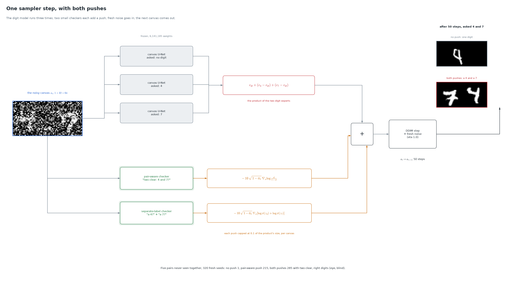
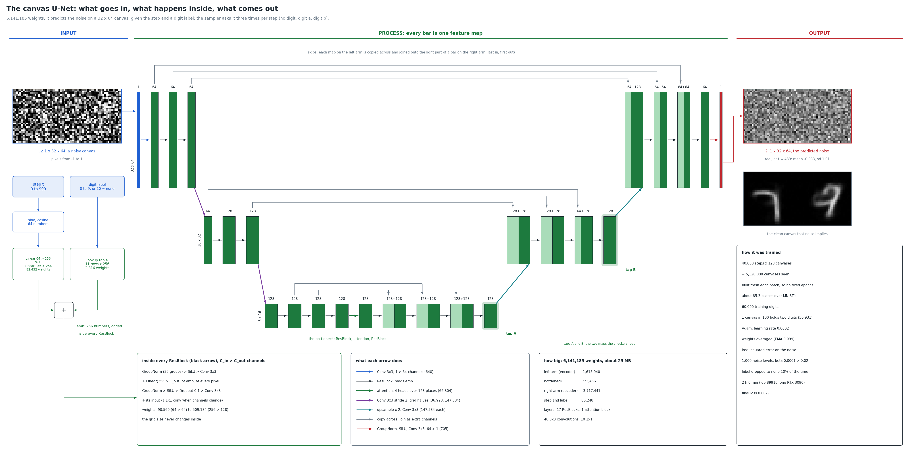
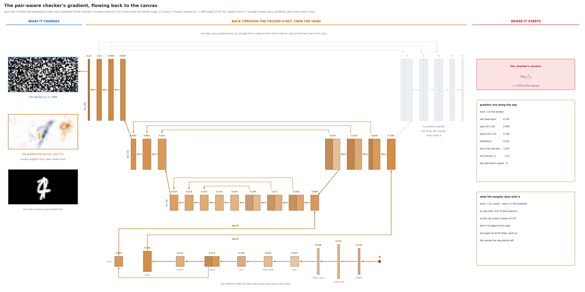
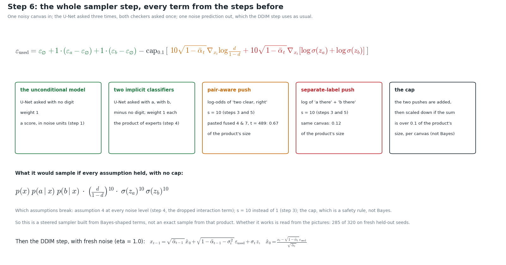
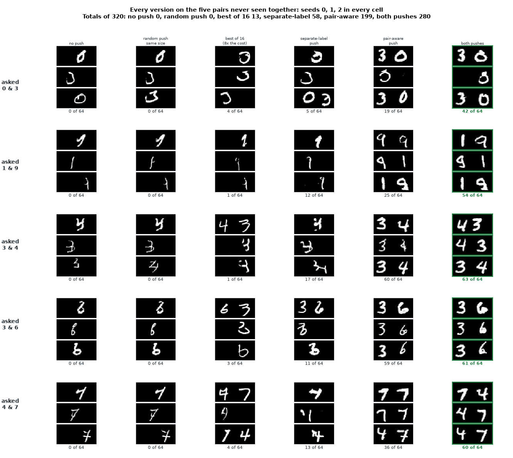

# Classifier guidance on MNIST digits, explained

**Start here.** Open [the derivation](4-the-derivation.md) to see why the push has the form it has, [the sampler step](1-the-sampler-step.md) to see one step drawn, and [the grids](5-qualitative-grids.md) to see what it draws.

Everything here explains step 7b ([plan 24](../../../plans/24-mnist-digits-on-a-canvas.md)): one canvas U-Net that has seen every digit, with a pair-aware and a separate-label checker pushing the product of two digit experts. The evidence behind it (judge gate, plain product, five versions, the sweeps) is in [the step 7b results](../../results/how-good-must-the-checker-be-on-mnist/README.md).

| Page | The question it answers | First figure |
|---|---|---|
| [1. The sampler step](1-the-sampler-step.md) | what happens to one canvas in one step |  |
| [2. The networks](2-the-networks.md) | how big is each network, what goes in and out, how was it trained |  |
| [3. The gradient](3-the-gradient.md) | how a checker's answer flows back to the canvas |  |
| [4. The derivation](4-the-derivation.md) | why every term of the equation is there, from the assumptions up |  |
| [5. Qualitative grids](5-qualitative-grids.md) | what each version draws on each pair |  |

## Where the figures are made

The scripts and numbers files that draw these figures stay beside the evidence they read: `network-view/`, `results-figures/`, `architecture/`, `gradient-flow/` and `grids/` in the step 7b results folder, and `derivation/` in [the older scene folder](../classifier-guidance-on-poe/README.md). Re-running one writes its figure back beside its script; the copies here are the ones the pages use.

## The toys behind the "Words on this page" sections

Each page's names are taken apart on small ordinary toys (soup tasters, a four-pixel strip, a shopkeeper's price cap). [`toys/triad_toys.py`](toys/triad_toys.py) computes every hand answer, asserts it, and writes `toys/toy_numbers.json` and the two moving pictures; a change to a toy fails the file. Where a name is already taught by [journey 13](../../../../../../goal-setting/learning/deep-learning/diffusion-models/13-classifier-guidance-by-hand/textbook/00-index.md) the page links to its chapter instead.
