# The deep dives: each part of the overview, opened

These figures open the parts of [the overview](../overview/ov0-the-sentence-score-push.png) one at a time, in the overview's own order from left to right, with real sizes from CLIP ViT-L/14's public config. CLIP's own insides are already drawn on [the CLIP ladder](../../../../../../../goal-setting/learning/papers/deep-learning/diffusion-models/compositional-diffusion-models/scorers/clip-read-through-a-small-network.md), so each of its figures is linked at the point it helps and only what NoisyCLIP adds is drawn here.

**Reading the colours.** Lilac is text, green is image, pale blue is a matching pair, orange is the push and grey is frozen or fixed. The overview draws text in blue, so its blue and these figures' lilac mean the same thing. The linked CLIP figures keep their own key, where orange marks the shared space and the loss.

**No result on this project's pictures exists yet.** These figures show how the method is wired. Whether it reads or steers any of the five properties is what steps W2 and W3 will measure.

<a href="../overview/ov0-the-sentence-score-push.png">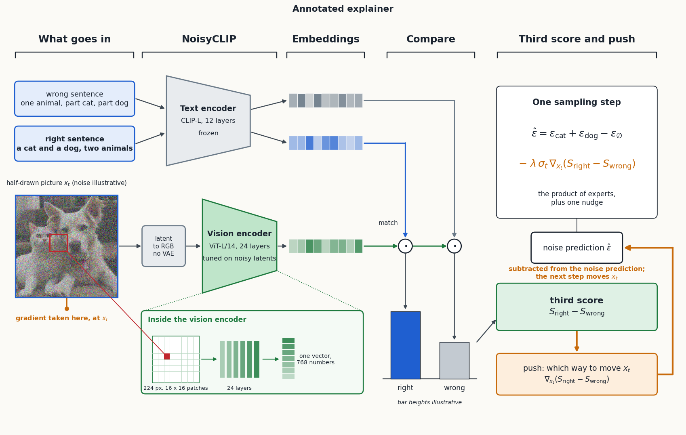</a>

## What goes in: the two sentences and the text encoder

The text encoder is CLIP-L's frozen text tower. These figures ask whether it can tell the two sentences of a checker apart at all, before any image is read.

**Average both word orders, and keep what survives**

<a href="nc11-the-text-only-word-check.png">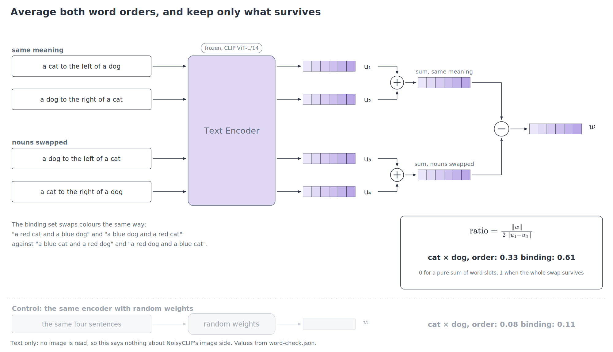</a>

If a sentence vector were a sum of one vector per word slot, the two sums would be equal and $w$ would be zero. The ratio $\lVert w \rVert / (2\lVert u_1 - u_3 \rVert)$ runs from 0 for a pure sum of word slots to 1 when the whole swap survives. For cat and dog it is 0.33 for order and 0.61 for colour binding, against 0.08 and 0.11 for the same encoder with random weights ([the word check's numbers](../../../../../artifacts/notes/progress/noise-text-critic/02-can-it-read/word-check/word-check.json)).

**What survives for six noun pairs**

<a href="nc12-what-survives-for-six-noun-pairs.png">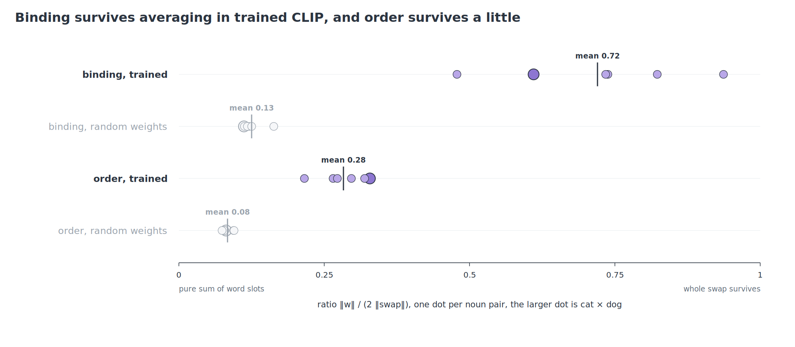</a>

The x axis is the ratio and each dot is one of six noun pairs. Binding averages 0.72 (0.48 to 0.94) in trained CLIP against 0.13 with random weights. Order averages 0.28 (0.22 to 0.33) against 0.08. Swapping the nouns moves a sentence 0.19 to 0.34, against 0.63 to 0.87 for changing one noun.

**What this can and cannot say.** It uses no image, so it bounds what any reader with this text encoder can do and says nothing about NoisyCLIP's image side. The summary and its caveats are in [the W2 review's word check section](../../../../../artifacts/notes/progress/noise-text-critic/02-can-it-read/review.md#text-only-word-check). [A toy sum of word slots](../2-miniature/README.md#9-work-the-word-check-on-a-toy) shows why only an interaction term can survive the averaging.

## What goes in: the half-drawn picture

**Which noise levels it practised on**

<a href="nc7-trained-noise-levels-and-pushed-steps.png">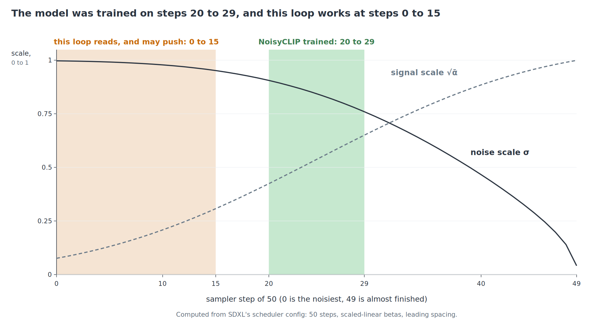</a>

The x axis is the sampler step of 50 and the y axis is the scale from 0 to 1, computed from SDXL's scheduler config. The paper trains on latents 20 to 29 (p. 6), and this loop reads steps 0 to 15, which the model did not train on. W3 pushes only on the steps in that range that W2 can read.

## NoisyCLIP: the map from latent to colour, with no VAE

**Four latent channels become three colours**

<a href="nc3-four-latent-channels-to-rgb.png">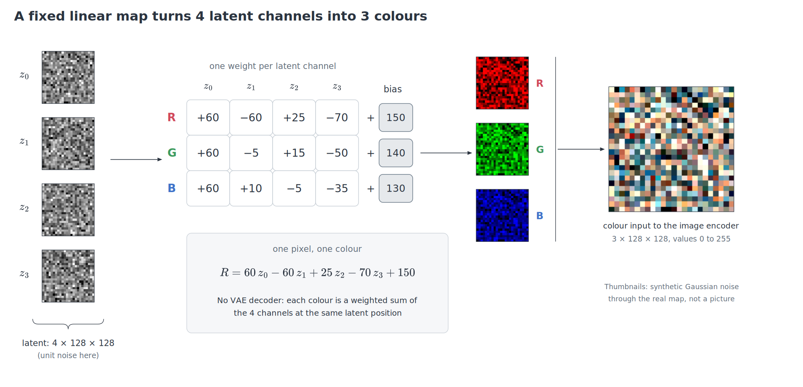</a>

Each colour is a fixed weighted sum of the four channels, with no VAE decoder. The tiles are synthetic Gaussian noise pushed through the real weights.

**The clamp stops the gradient**

<a href="nc4-clamping-kills-the-gradient.png">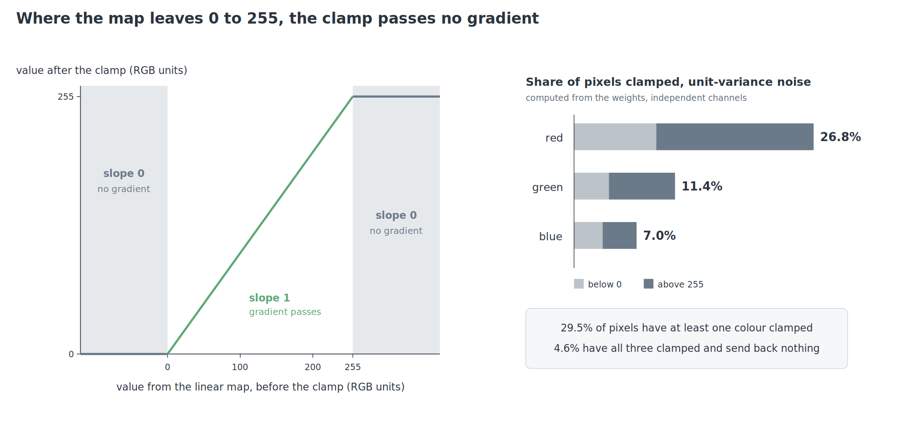</a>

The left plot has the map's value on x and the clamped value on y, both in RGB units. The right plot shows the share of pixels clamped on unit-variance noise, computed from the weights with independent channels: 26.8% of red, 11.4% of green and 7.0% of blue.

## NoisyCLIP: the vision encoder and its inset

**What is tuned and what is frozen**

<a href="nc5-what-is-tuned-and-what-is-frozen.png">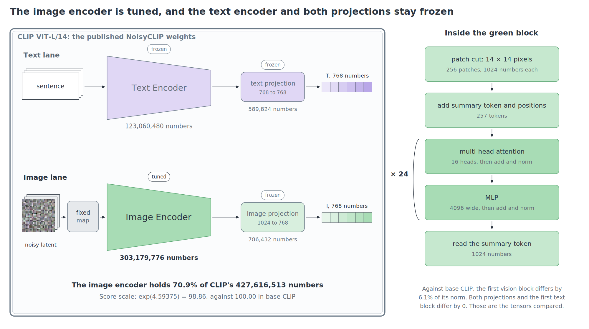</a>

The published weights change the image encoder. Both projection heads and the first text layer equal base CLIP exactly, and the first vision layer differs by 6.1% of its norm ([the checkpoint comparison](../../../../../artifacts/notes/progress/noise-text-critic/01-reading/tools/checkpoint-compare.txt)). Only those tensors were compared. The released `--only_vision` flag would leave the image projection trainable, while the published weights show it unchanged.

**Linked from the CLIP ladder.** [The picture's path](../../../../../../../goal-setting/learning/deep-learning/generative-models/02-stable-diffusion-and-clip/artifacts/figures/clip/network-view/cv6-the-pictures-path.png) walks the patch cut and tokens, and [one query asking the keys](../../../../../../../goal-setting/learning/deep-learning/generative-models/02-stable-diffusion-and-clip/artifacts/figures/clip/network-view/cv3b-one-query-asks-the-keys.png) opens attention.

**Training pulls each latent toward its caption**

<a href="nc6-training-on-noisy-latents.png">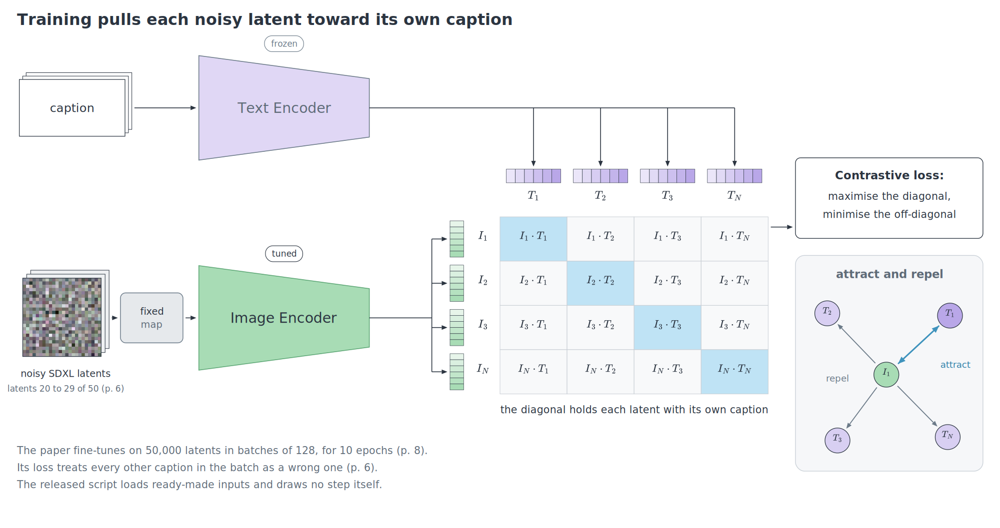</a>

The matrix cells are labelled by their product and hold no values. [The CLIP ladder's four pictures against four captions](../../../../../../../goal-setting/learning/deep-learning/generative-models/02-stable-diffusion-and-clip/artifacts/figures/clip/network-view/cv7-four-pictures-against-four-captions.png) and [its two softmaxes](../../../../../../../goal-setting/learning/deep-learning/generative-models/02-stable-diffusion-and-clip/artifacts/figures/clip/network-view/cv7b-the-two-softmaxes-and-the-loss.png) show the same loss with real scores.

**The same two encoders do three jobs**

<a href="nc1-one-model-three-uses.png">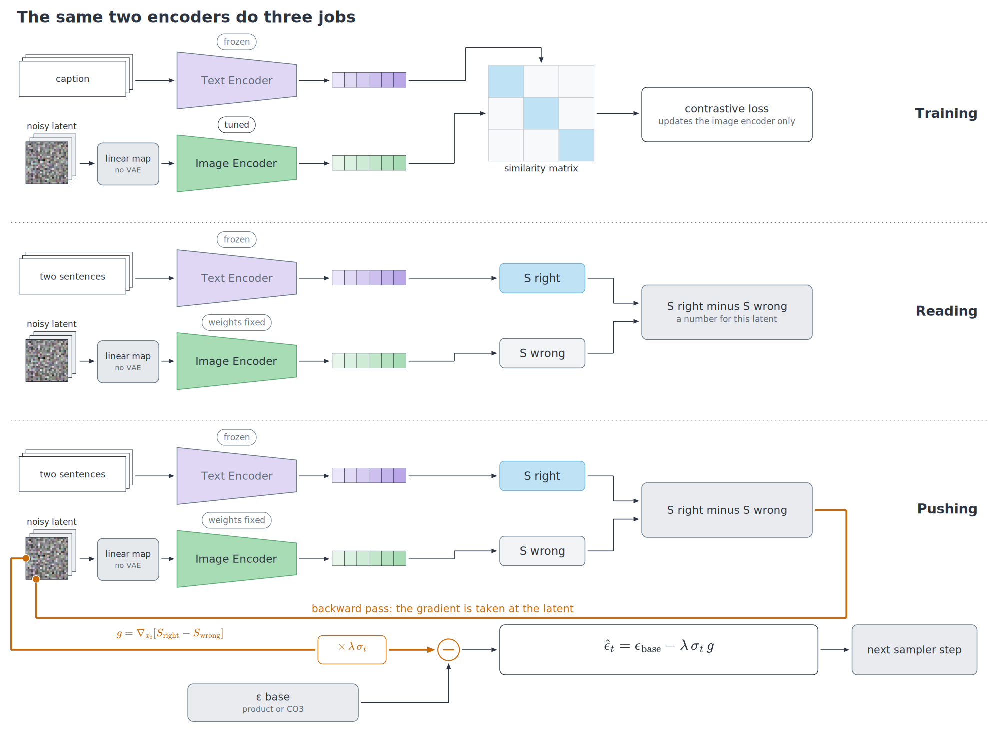</a>

The model is trained once on a contrastive loss, then read and pushed with its weights held. Open this first when you lose track of which job a later figure belongs to.

## Compare: the two scores

**Right minus wrong**

<a href="nc8-right-minus-wrong.png">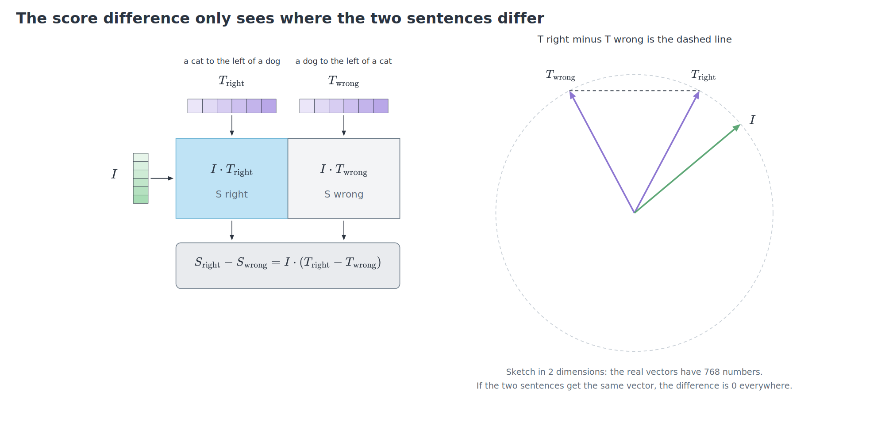</a>

The two sentences use the same words in a different order. The score difference depends only on the gap between their two vectors, so a text encoder that gave them the same vector would give the push nothing to follow. The circle is a two-dimensional sketch of 768-number vectors.

## Third score and push

**The gradient walks back to the latent**

<a href="nc9-the-gradient-back-to-the-latent.png">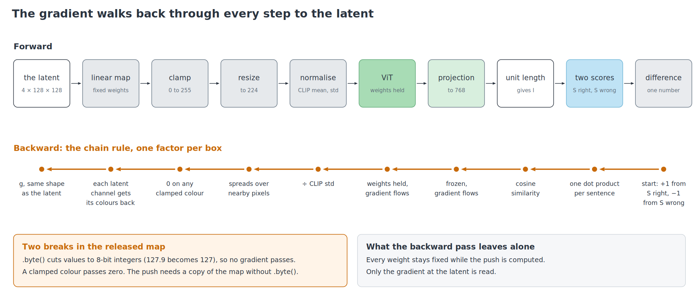</a>

The released map blocks the gradient twice, at any clamped colour and at `.byte()`. The push needs a copy of the map without `.byte()`.

**How the push joins CO3**

<a href="nc10-how-the-push-joins-co3.png">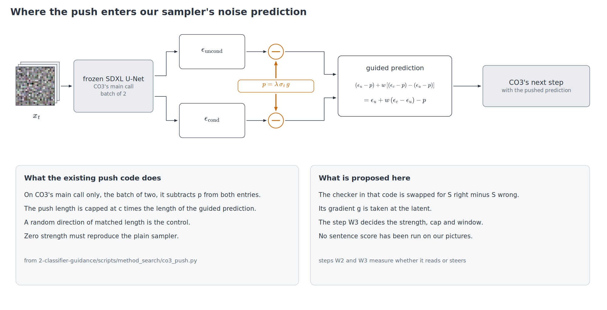</a>

Our existing [push code](../../../../scripts/method_search/co3_push.py) subtracts the push from both entries of CO3's main prediction, which lowers the guided prediction by exactly the push.

**How this reads against the overview.** The overview marks where the gradient is taken, at $x_t$, and ends the push at the noise prediction. These deep dives draw the same two places with every size.

## All of it at once, with every size

**The read and push path, with every size**

<a href="nc2-the-whole-read-and-push-path.png">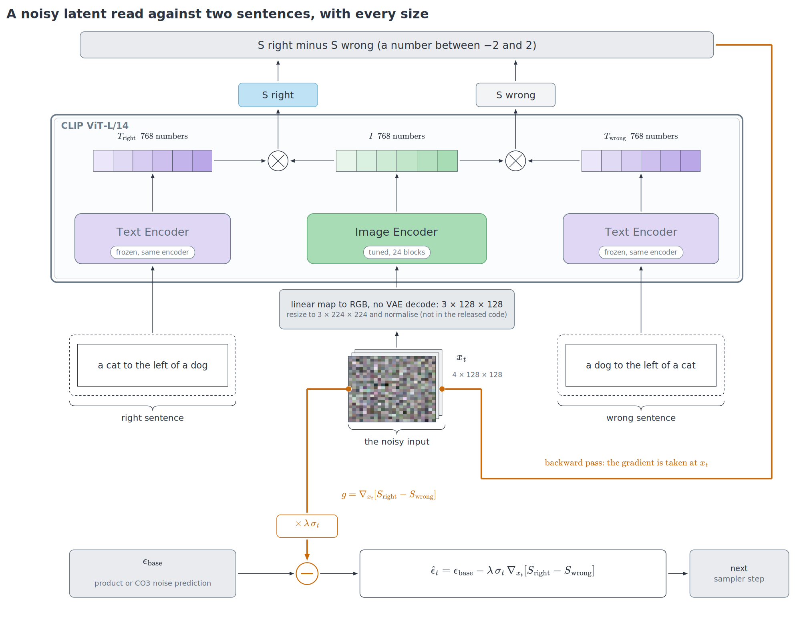</a>

The orange lane ends at $x_t$ because that is where the gradient is read. The result then joins $\epsilon_{\text{base}}$, so nothing is added to the latent directly.

**Linked from the CLIP ladder.** [The whole of CLIP](../../../../../../../goal-setting/learning/deep-learning/generative-models/02-stable-diffusion-and-clip/artifacts/figures/clip/network-view/cv1-the-whole-of-clip.png) shows the two towers on ViT-B/32, and [the module tree](https://claude.ai/artifact/4mePVaMV9NuxENRkJphieQ) opens every layer.

How these were made, and the family checklist

**How they were made.** `make_network_view.py` draws each figure from `../numbers/numbers.json` and refuses to write one where a line crosses a box or a label overlaps another. The noise thumbnails are synthetic. No SDXL image, no NoisyCLIP weight and no GPU were used.

| Family | Must show | Where |
|---|---|---|
| contrastive matrix | real scores, the temperature, each diagonal cross-entropy, the mean of two directions | layout in figure 6, real values in the linked CLIP figures cv7 and cv7b |
| transformer | blocks with attention, MLP, residual add and norm | figure 5's opened encoder, and the linked cv3 |
| attention | queries, keys, values, one weight row | linked cv3b |
| embedding, tokenizer | ids, a row's numbers, a word that splits | linked cv2 and cv2b |
| pooling | which token is read out | figure 5 reads the summary token, and the linked cv5b compares poolings |
| latent space | the sizes, diffusion on the latent | figures 2 and 3 |
| noise schedule | the signal curve with the steps marked | figure 7 |
| guidance as a vector sum | the base prediction plus the scaled push | figures 2 and 10, and illustration 4 |

