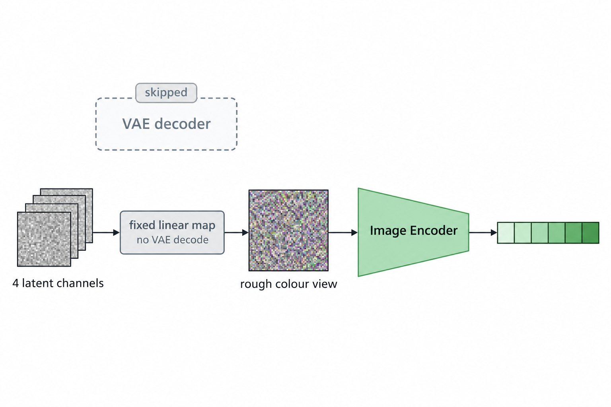
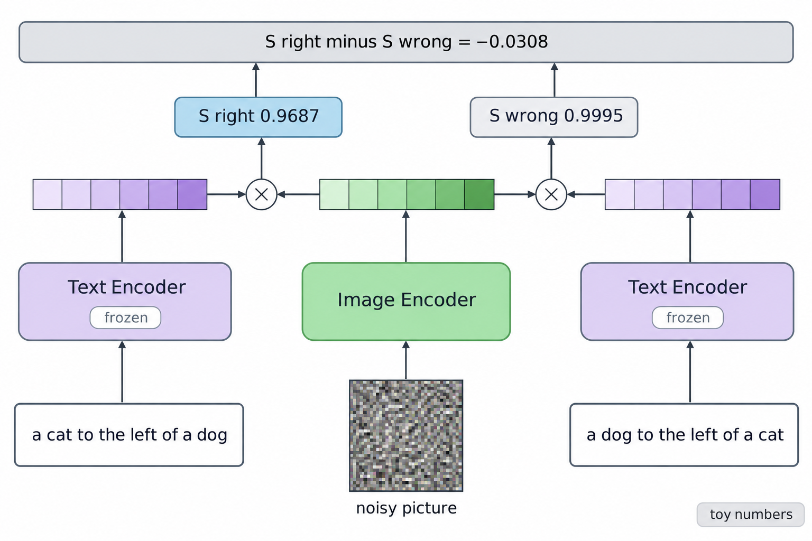
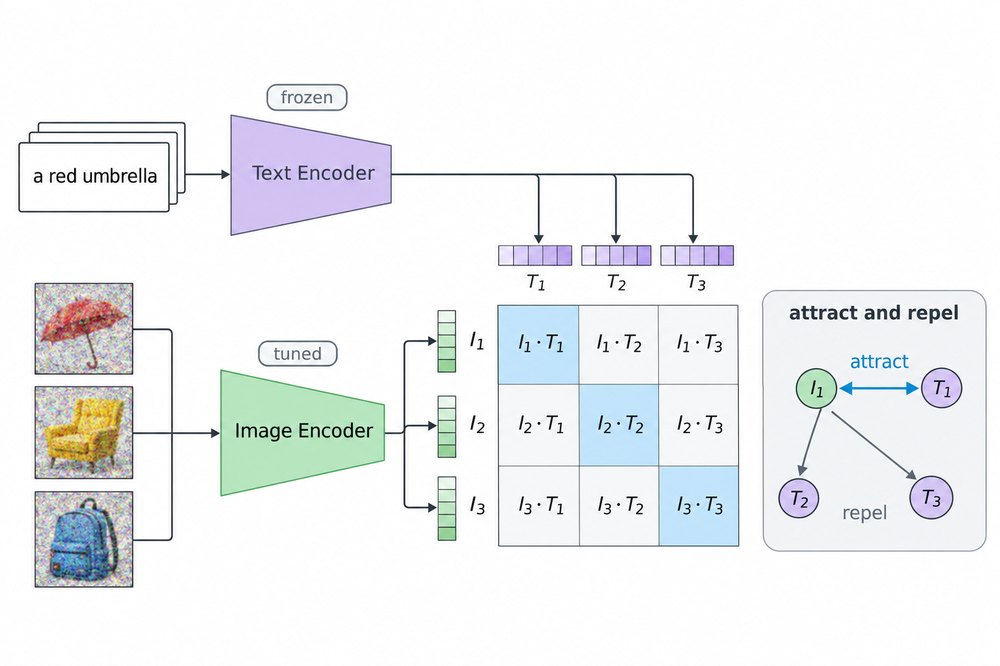
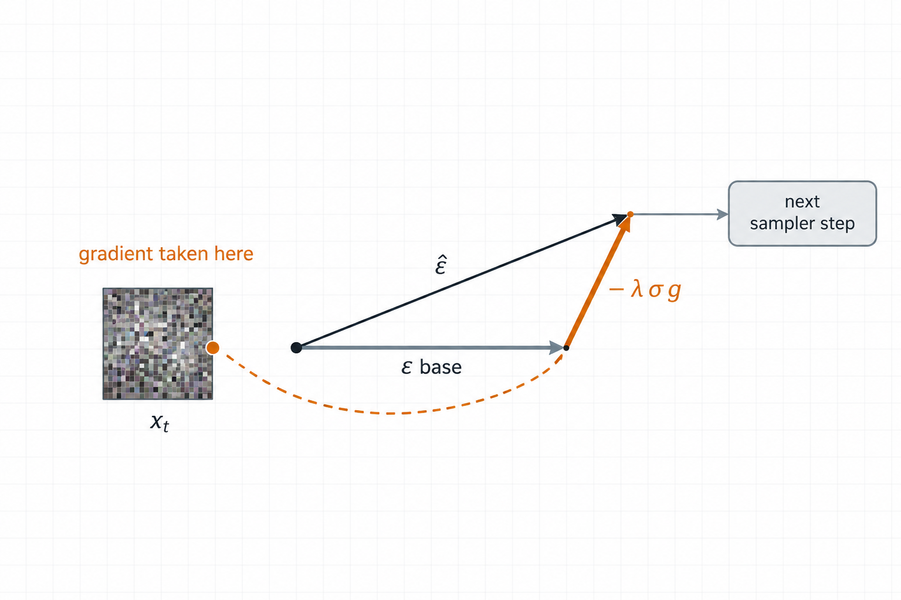
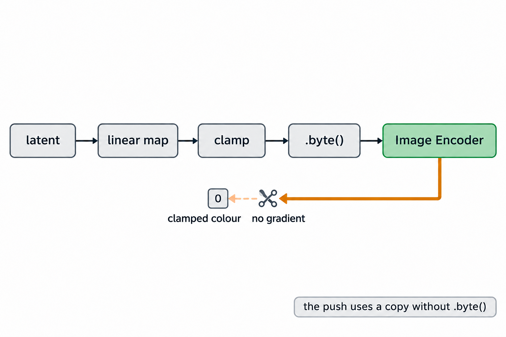
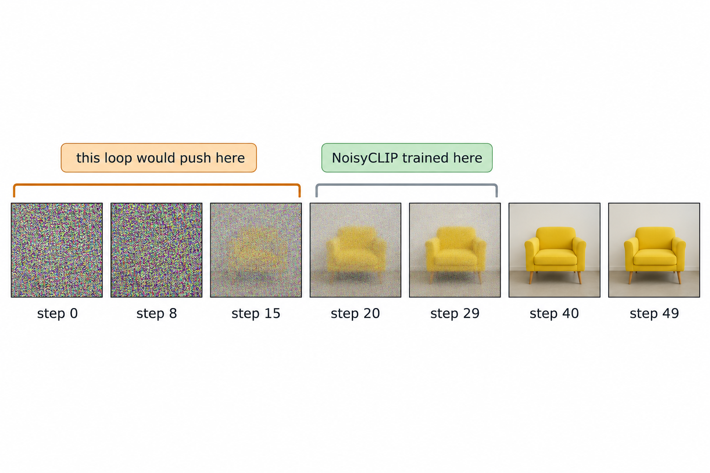

# The six illustrations

These pictures tell the idea before the sizes and the maths. Every tile in them is an image model's teaching drawing, so none is an SDXL sample and none shows a result. Their prompts and faithfulness notes are in [the illustrated map](diagram-prompts.md).

**1. A cheap colour view of the latent**

A half-drawn latent is not a picture, so a fixed sum of its four channels makes a rough colour view with no decoder.

**2. One picture against two sentences**

The checker asks the same noisy picture about two sentences with the same words in a different order, and keeps the difference. The numbers are the miniature's.

**3. Training on half-drawn pictures**

Only the image side learns. Each half-drawn picture is pulled toward its own caption and away from the others.

**4. The push bends the noise prediction**

The gradient is taken at the latent, and what changes is the noise prediction the sampler is about to use.

**5. Two places the signal is cut**

The released map blocks the gradient at the conversion to bytes and at any clamped colour.

**6. Trained later than this loop would push**

NoisyCLIP practised on the middle of the sampling run, and this loop would use it earlier, on noisier latents.
