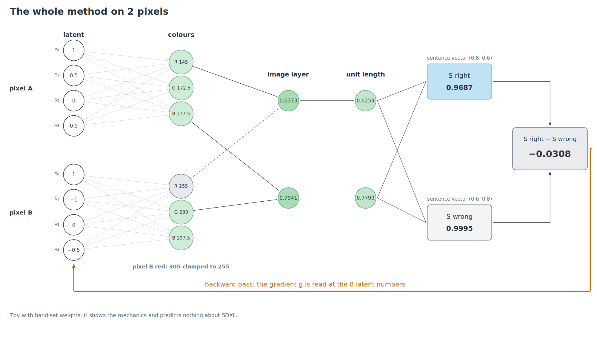
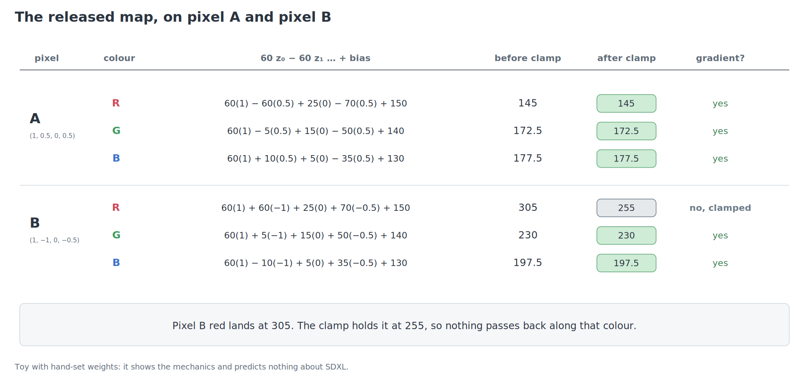
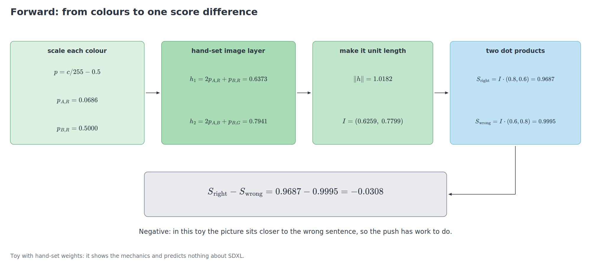
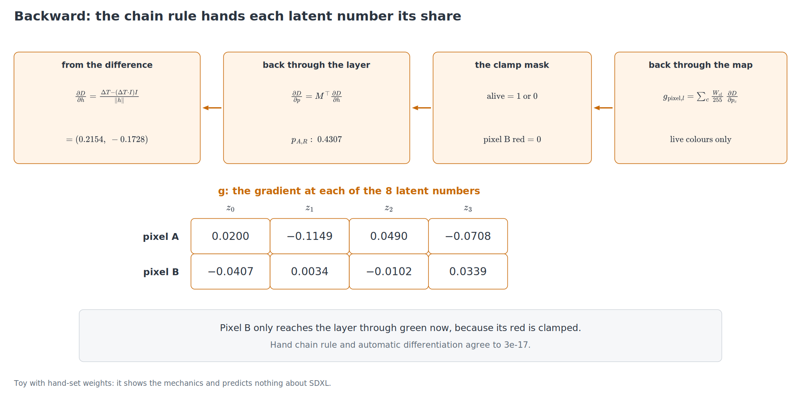
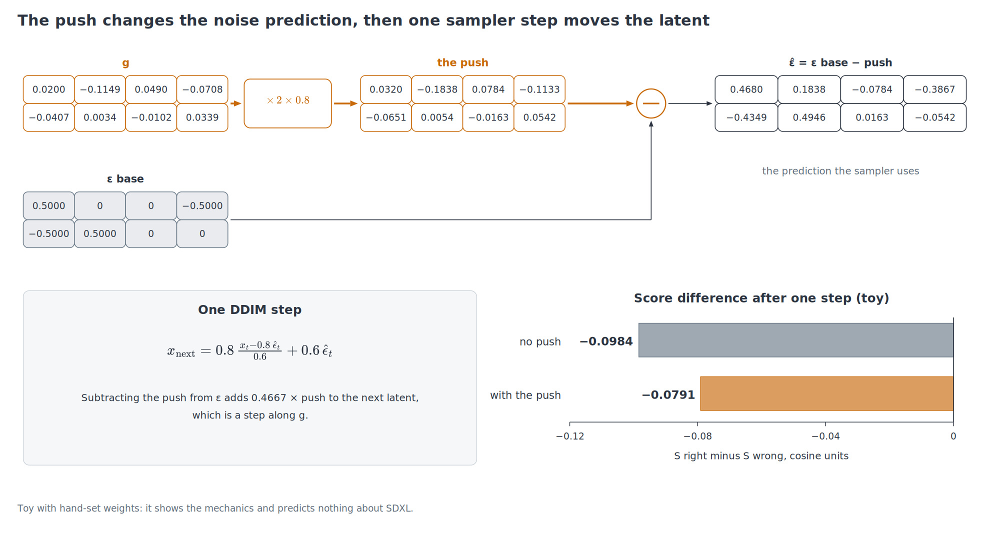
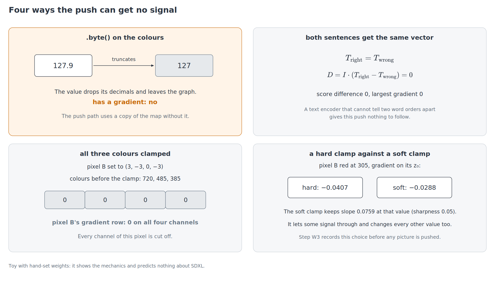
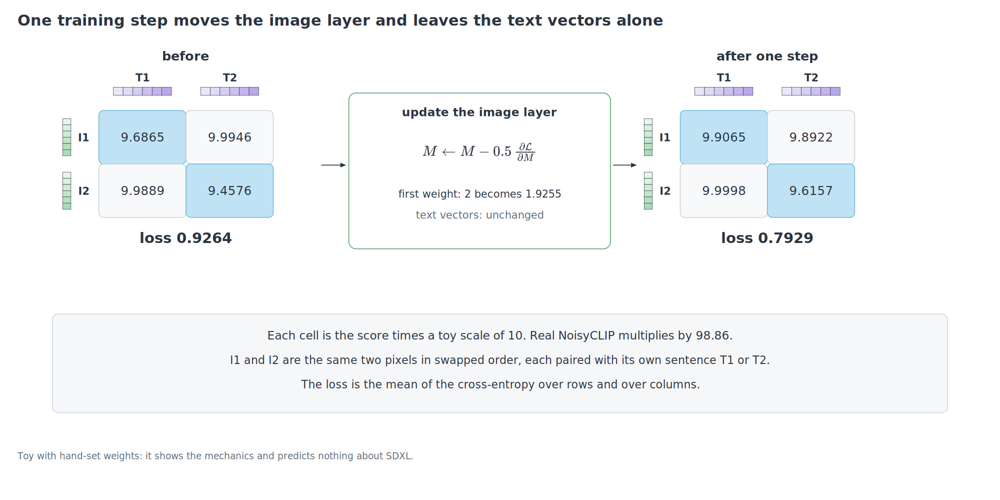

# The miniature: the whole method on 2 pixels

This is the sentence-score push small enough to do on paper. The latent has 8 numbers, the linear map is NoisyCLIP's real one, and every other weight is set by hand so each step can be checked.

**This toy predicts nothing about SDXL.** Its image layer was never trained on data, so a number here shows what a part computes and says nothing about whether NoisyCLIP reads or steers a real picture. Every value comes from [the answer key](miniature_answer_key.json), written by [the script](miniature.py).

## Words this uses

**Pixel A, pixel B.** The two positions of the toy latent, each with 4 channels.

**Clamped.** A colour outside 0 to 255 that the map holds at the edge, so it passes no gradient.

**Image layer.** A hand-set $2 \times 6$ table $M$ that stands in for the whole 24-block ViT.

## 1. See the whole thing

<a href="mm0-the-whole-miniature.png"></a>

Trace one path with your finger: the top latent number, into red, into the first hidden number, into the two scores. The picture's job is to show that each number on the later pages sits on one of these circles.

## 2. Work the linear map

<a href="mm1-from-latent-to-colours.png"></a>

Write out pixel A's red: $60(1) - 60(0.5) + 25(0) - 70(0.5) + 150 = 145$. That is the first green circle in the colour column.

**How it fails.** Pixel B's red comes to 305, so the clamp holds it at 255 and that colour stops carrying a gradient. **How you know it worked.** Your six values match the "before clamp" column.

## 3. Work forward to the score difference

<a href="mm2-forward-to-the-two-scores.png"></a>

Scale each colour with $p = c/255 - 0.5$, apply the layer, divide by the length and take the two dot products:

$$
h = (0.6373,\ 0.7941), \qquad I = (0.6259,\ 0.7799), \qquad D = 0.9687 - 0.9995 = -0.0308 .
$$

The toy starts closer to the wrong sentence, so the difference is negative. **How you know it worked.** Your $I$ has length 1 and your $D$ matches.

## 4. Work the gradient back

<a href="mm3-the-gradient-back-to-the-latent.png"></a>

Differentiating a unit vector removes the part along itself, so with $\Delta T = T_{\text{right}} - T_{\text{wrong}}$:

$$
\frac{\partial D}{\partial h} = \frac{\Delta T - (\Delta T \cdot I)\,I}{\lVert h \rVert} = (0.2154,\ -0.1728).
$$

Then multiply by $M^\top$, zero any clamped colour, and multiply by $W/255$ to reach the 8 latent numbers.

**How it fails.** Forgetting the clamp mask gives pixel B a share through red that the real gradient does not have. **How you know it worked.** Your 8 values match the table, which the script checks against automatic differentiation and against finite differences.

## 5. See why this is a classifier's gradient

Treat the two sentences as a two-class classifier with score multiplier $e^{t_s}$. Its log-probability of the right sentence has the gradient

$$
\nabla_{x_t} \log p(\text{right} \mid x_t) = \big(1 - p(\text{right} \mid x_t)\big)\, e^{t_s}\, \nabla_{x_t}\big[S_{\text{right}} - S_{\text{wrong}}\big].
$$

In the toy, with a multiplier of 10, $p(\text{right}) = 0.4236$ and the factor is 5.7643, and the script confirms the identity to rounding error. So the push has classifier guidance's direction, and its fixed $\lambda$ stands in for a factor that would otherwise shrink as the classifier grows confident.

## 6. Join the noise prediction and step

<a href="mm4-the-push-joins-the-noise-prediction.png"></a>

The push is $\lambda\,\sigma_t\,g$ with $\lambda = 2$ and $\sigma_t = 0.8$. Subtract it from $\epsilon_{\text{base}}$, then run one DDIM step with signal scale 0.6 going to 0.8. In this step the coefficient on $\hat\epsilon_t$ is $-0.4667$, so subtracting the push adds $0.4667\,p$ to the next latent.

The bars plot the toy's score difference after that step: $-0.0984$ with no push and $-0.0791$ with it. **What this shows.** The mechanics move the score in the push's direction on a hand-set network, and it is the only thing they show.

## 7. Break it four ways

<a href="mm5-four-ways-the-gradient-dies.png"></a>

**Byte conversion.** 127.9 becomes 127 and the result has no gradient, so the push path must leave it out.

**The same vector for both sentences.** The difference and every gradient are 0.

**All three colours clamped.** Setting pixel B to $(3, -3, 0, -3)$ gives colours 720, 485 and 385, and its whole gradient row is 0.

**Hard clamp against soft clamp.** At pixel B's red, a soft clamp of sharpness 0.05 keeps a slope of 0.0759, so its $z_0$ gradient is $-0.0288$ against $-0.0407$ for the hard clamp. The soft clamp also changes every other value, which is why W3 records the choice before pushing any picture.

## 8. One training step

<a href="mm6-one-training-step.png"></a>

The two latents are the same two pixels in swapped order, each paired with its own sentence. One gradient step of size 0.5 on $M$ takes the loss from 0.9264 to 0.7929. The sentence vectors do not move, because the text side is frozen.

<details>
<summary>How to rerun this, and what is simplified</summary>

```bash
cd /home/molef/PhD/concept-composition/2-classifier-guidance/artifacts/scenes/noisyclip-sentence-score/2-miniature
CUDA_VISIBLE_DEVICES= PYTHONDONTWRITEBYTECODE=1 uv run --no-project --with torch python miniature.py
PYTHONDONTWRITEBYTECODE=1 python3 make_miniature_figures.py
```

The first command stops with an assertion error if the hand chain rule, finite differences or the classifier identity disagree. The second prints `0 crossings` for all seven figures.

**Simplified on purpose.** The resize and CLIP's normalisation are left out, the 24-block ViT is one linear layer, and the score multiplier in training is 10 where real NoisyCLIP uses 98.86.

</details>
