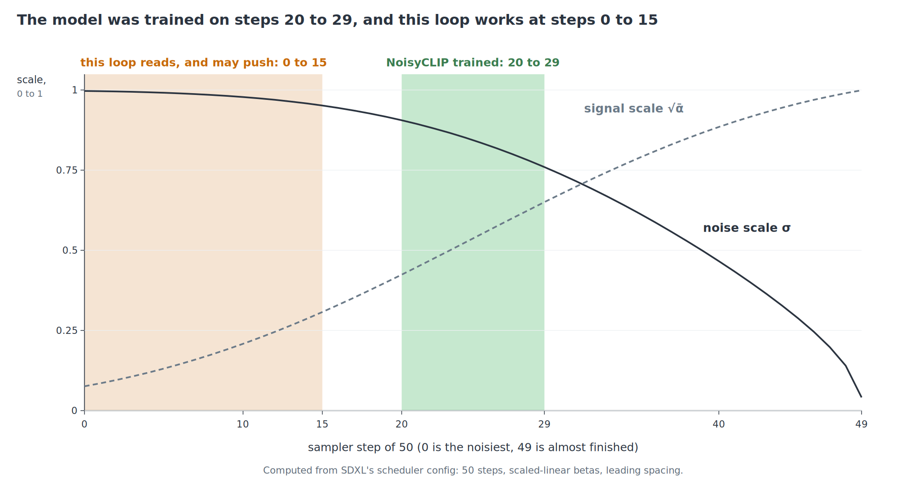
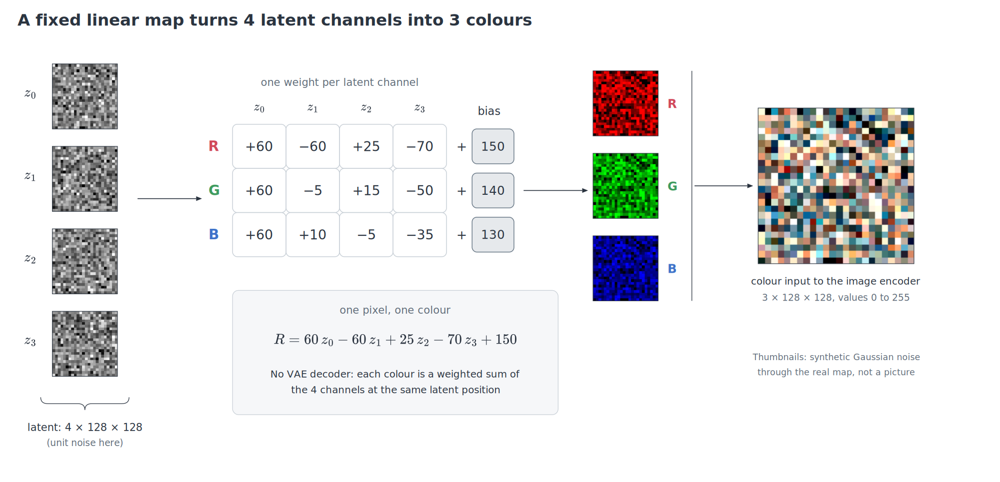
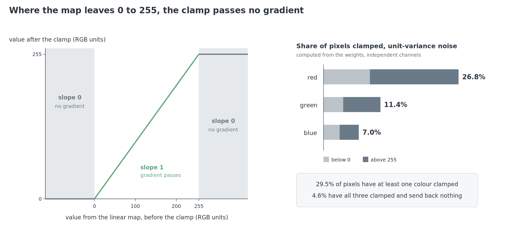
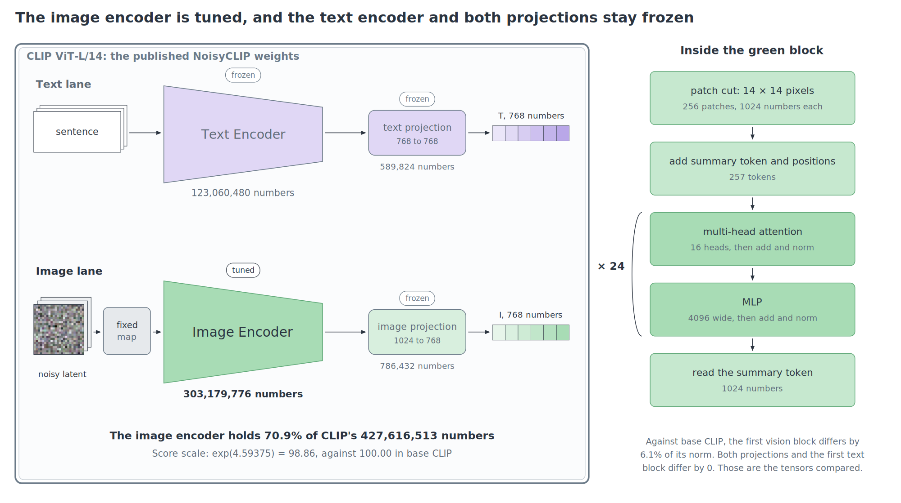
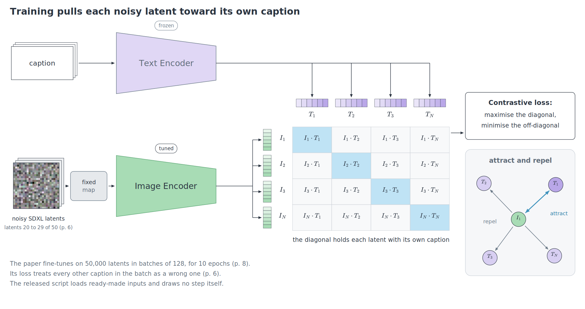
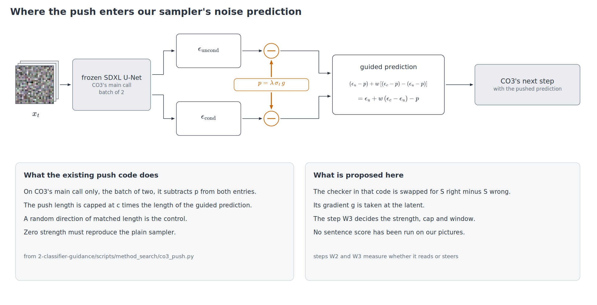

# What each line of NoisyCLIP's released code computes

This walk reads the released code block by block and ties each block to its equation and to its part of the [read and push picture](../0.5-network-view/nc2-the-whole-read-and-push-path.png). It exists so a later session can write the differentiable input path for W2 and W3 without guessing what the authors' path does.

The code is [novasearch/noisyclip](https://github.com/novasearch/noisyclip) at commit `016b91356a43e455542fd018bc16ea3b419779d2`. It was read and never run. Every quoted block is checked against the file by [the quote check](check_quotes.py).

## Table of contents

1. [Catching the half-drawn latents](#1-catching-the-half-drawn-latents)
2. [Four channels become three colours](#2-four-channels-become-three-colours)
3. [The clamp and the byte conversion](#3-the-clamp-and-the-byte-conversion)
4. [Which parameters train](#4-which-parameters-train)
5. [The batch and the loss](#5-the-batch-and-the-loss)
6. [Script defaults against the paper's settings](#6-script-defaults-against-the-papers-settings)
7. [What the release leaves out](#7-what-the-release-leaves-out)
8. [Where a push enters our sampler](#8-where-a-push-enters-our-sampler)

## 1. Catching the half-drawn latents

<a href="../0.5-network-view/nc7-trained-noise-levels-and-pushed-steps.png"></a>

A forward hook on the U-Net saves its first input on every call, so one 50-step image gives 50 saved tensors. This is the "noisy latent" box at the far left of every picture.

<!-- cite: src/generate_latents.py:41-42 -->
`src/generate_latents.py`, lines 41 to 42:

```python
    def hook(self, module, input, output):
        self.temp_latents.append(input[0].detach().cpu())
```

<!-- cite: src/generate_latents.py:75-84 -->
`src/generate_latents.py`, lines 75 to 84:

```python
            unet = self.pipeline.unet
            hook_handle = unet.register_forward_hook(self.hook)

            # Generate image
            image = self.pipeline(prompt, generator=generator, eta=1 if self.ddpm else 0).images[0]

            hook_handle.remove()
            save_image(image, image_path=image_path)
            save_latents(self.temp_latents, latent_path=latent_path)
            self.temp_latents = []
```

**What the saved tensor is.** The pipeline scales the Euler latent before the U-Net sees it, so the hook saves

$$
\frac{z_t}{\sqrt{\sigma_{\text{Euler}}^2 + 1}} = \sqrt{\bar\alpha_t}\,z_0 + \sqrt{1-\bar\alpha_t}\,\varepsilon .
$$

That is the same scale as our DDIM latent $x_t$. The default scheduler in SDXL's [scheduler config](../numbers/sources/sdxl-scheduler-config.json) is `EulerDiscreteScheduler` with leading spacing, so step $k$ of 50 uses timestep $981 - 20k$, as our DDIM steps do.

**How it fails.** A raw Euler latent has a standard deviation near $\sigma_{\text{Euler}}$ (13.12 at step 0 and 3.09 at step 15, from this ladder's [numbers file](../numbers/numbers.json)). Passing it to the linear map without the scaling would saturate almost every pixel. **How you know it worked.** W2's first check compares this path with the authors' on 16 latents and needs a mean cosine of at least 0.99.

## 2. Four channels become three colours

<a href="../0.5-network-view/nc3-four-latent-channels-to-rgb.png"></a>

Each colour is a fixed weighted sum of the four channels at the same position, plus a bias. No VAE decoder runs. This is the grey "linear map" box.

<!-- cite: src/latent_to_image.py:9-17 -->
`src/latent_to_image.py`, lines 9 to 17:

```python
def latents_to_rgb(latents):
    weights = (
        (60, -60, 25, -70),
        (60, -5, 15, -50),
        (60, 10, -5, -35)
    )
    weights_tensor = torch.t(torch.tensor(weights, dtype=latents.dtype).to(latents.device))
    biases_tensor = torch.tensor((150, 140, 130), dtype=latents.dtype).to(latents.device)
    rgb_tensor = torch.einsum("...lxy,lr -> ...rxy", latents, weights_tensor) + biases_tensor.unsqueeze(-1).unsqueeze(-1)
```

$$
\begin{bmatrix}R\\G\\B\end{bmatrix} =
\begin{bmatrix}60&-60&25&-70\\60&-5&15&-50\\60&10&-5&-35\end{bmatrix}
\begin{bmatrix}z_0\\z_1\\z_2\\z_3\end{bmatrix} +
\begin{bmatrix}150\\140\\130\end{bmatrix}
$$

`torch.t` flips the table to 4 by 3 so the `einsum` can sum over the latent channel `l` and leave the colour `r`. [The miniature's table](../2-miniature/mm1-from-latent-to-colours.png) works this sum on two pixels.

## 3. The clamp and the byte conversion

<a href="../0.5-network-view/nc4-clamping-kills-the-gradient.png"></a>

<!-- cite: src/latent_to_image.py:18-20 -->
`src/latent_to_image.py`, lines 18 to 20:

```python
    image_array = rgb_tensor.clamp(0, 255)[0].byte().cpu().numpy()
    image_array = image_array.transpose(1, 2, 0)  # Rearrange dimensions for image
    return Image.fromarray(image_array)
```

Line 18 does three things. `clamp(0, 255)` holds each value inside the byte range, `[0]` takes the first of the two identical classifier-free guidance copies, and `.byte()` converts to 8-bit integers by dropping the decimals, so 127.9 becomes 127.

**How it fails for a push.** `.byte()` has no gradient at all, and a clamped value passes zero. On unit-variance noise the clamp holds 26.8% of red, 11.4% of green and 7.0% of blue values, and 29.5% of pixels have at least one colour clamped ([the numbers file](../numbers/numbers.json), computed from the weights with independent channels). **What the push path changes.** It keeps the sum and the clamp and drops `.byte()`. W3's design records whether the clamp stays hard or becomes soft, before any picture is pushed.

## 4. Which parameters train

<a href="../0.5-network-view/nc5-what-is-tuned-and-what-is-frozen.png"></a>

<!-- cite: src/train_model_classic.py:47-51 -->
`src/train_model_classic.py`, lines 47 to 51:

```python
    elif only_vision:
        for name, param in model.named_parameters():
            param.requires_grad = not ("text" in name)
        if hasattr(model, "logit_scale"):
            model.logit_scale.requires_grad = False
```

<!-- cite: src/train_model_classic.py:71-71 -->
`src/train_model_classic.py`, line 71:

```python
    model.logit_scale.requires_grad = False
```

The test on line 49 is a substring test on the parameter's name. `text_model.*` and `text_projection.*` contain "text" and freeze. `vision_model.*` and `visual_projection.weight` do not, so **this flag would leave the image projection trainable**.

**The published weights show that head unchanged.** Against `openai/clip-vit-large-patch14`, `visual_projection.weight`, `text_projection.weight` and the first text layer's key projection have a largest absolute difference of 0, and the first vision layer's key projection differs by 6.1% of its norm ([the checkpoint comparison](../../../../../artifacts/notes/progress/noise-text-critic/01-reading/tools/checkpoint-compare.txt)). Only those tensors were compared, so the other text layers are stated frozen on the paper's word (p. 6) and were not checked. The command that produced the checkpoint is not released.

`logit_scale` is 4.59375 in the published weights and 4.60517 in base CLIP, which multiplies a score by 98.86 and 100.00.

## 5. The batch and the loss

<a href="../0.5-network-view/nc6-training-on-noisy-latents.png"></a>

<!-- cite: src/train_model_classic.py:14-20 -->
`src/train_model_classic.py`, lines 14 to 20:

```python
def collate_fn_standard_clip(batch):
    return {
        "pixel_values": torch.stack([b["pixel_values"] for b in batch]),
        "input_ids": torch.stack([b["input_ids"] for b in batch]),
        "attention_mask": torch.stack([b["attention_mask"] for b in batch]),
        "return_loss": True
    }
```

<!-- cite: src/train_model_classic.py:265-273 -->
`src/train_model_classic.py`, lines 265 to 273:

```python
    trainer = trainer_class(
        model=model,
        args=training_args,
        train_dataset=dataset_train,
        eval_dataset=dataset_test,
        data_collator=collate_fn,
    )
    print("Starting training...")
    trainer.train()
```

`return_loss: True` makes Hugging Face's `CLIPModel` compute its own contrastive loss, so the script holds no loss code. With $s_{ij}$ the cosine of picture $i$ and caption $j$ and $e^{t}$ the score multiplier:

$$
\mathcal L = \tfrac12\Big[\mathrm{CE}\big(e^{t} s,\ \text{rows}\big) + \mathrm{CE}\big(e^{t} s,\ \text{columns}\big)\Big]
$$

Each picture's right answer is its own caption, and every other caption in the batch is a wrong one. [The CLIP ladder's two softmaxes](../../../../../../../goal-setting/learning/deep-learning/generative-models/02-stable-diffusion-and-clip/artifacts/figures/clip/network-view/cv7b-the-two-softmaxes-and-the-loss.png) draws this loss with real scores.

## 6. Script defaults against the paper's settings

The script's defaults are not the settings the paper reports, and the flags used for the real run are not released.

<!-- cite: src/train_model_classic.py:286-287 -->
`src/train_model_classic.py`, lines 286 to 287:

```python
    argparser.add_argument("--num_epochs", type=int, default=5, help="Number of training epochs")
    argparser.add_argument("--batch_size", type=int, default=64, help="Batch size for training")
```

<!-- cite: src/train_model_classic.py:304-306 -->
`src/train_model_classic.py`, lines 304 to 306:

```python
    argparser.add_argument("--lr", type=float, default=1e-4, help="Learning rate for training")
    argparser.add_argument("--warmup_ratio", type=float, default=0.1, help="Warmup ratio for learning rate scheduler")
    argparser.add_argument("--weight_decay", type=float, default=0.0, help="Weight decay for optimizer")
```

<!-- cite: src/train_model_classic.py:314-315 -->
`src/train_model_classic.py`, lines 314 to 315:

```python
    argparser.add_argument("--base_model", type=str, default="openai/clip-vit-base-patch32",
                           help="Base CLIP model to use for training")
```

| Setting | Script default | Paper, p. 8 |
|---|---|---|
| epochs | 5 | 10 |
| batch size | 64 | 128 |
| learning rate | 1e-4 | 5.7e-5 |
| weight decay | 0.0 | 0.1 |
| base model | `openai/clip-vit-base-patch32` | ViT-L/14 |

## 7. What the release leaves out

**The resize and normalisation.** Training reads ready-made `pixel_values` from a preprocessed dataset, and `AutoProcessor` is imported and never called.

<!-- cite: src/train_model_classic.py:180-181 -->
`src/train_model_classic.py`, lines 180 to 181:

```python
    ds_preprocessed = load_from_disk(preprocessed_dataset_dir)
    dataset_train = ds_preprocessed["train"].with_format("torch")
```

W2's design takes these steps from the base model's [preprocessor config](../numbers/sources/clip-vit-large-patch14-preprocessor.json): bicubic resize from 128 to 224, then CLIP's mean and standard deviation. The published checkpoint ships no processor file, so this is an inferred match that W2's first check tests.

**The choice of noise levels.** The script adds no noise and picks no step. The window of latents 20 to 29 exists in the paper (p. 6) and in a dataset that is not released.

**A line that stops the script.** Line 1 of `train_model_classic.py` is the bare word `python`, which raises a `NameError` if the file is run as released (inferred, since it was not run).

## 8. Where a push enters our sampler

<a href="../0.5-network-view/nc10-how-the-push-joins-co3.png"></a>

This block is our code at `2-classifier-guidance/scripts/method_search/co3_push.py`. It already adds a checker's push to CO3, and a sentence score would replace the checker. No sentence score has been run through it.

<!-- cite: co3_push.py:30-36 -->
`co3_push.py`, lines 30 to 36:

```python
    def forward(self, sample, timestep, *args, **kwargs):
        out = self.inner(sample, timestep, *args, **kwargs)
        if self.pusher is None or sample.shape[0] != 2:
            return out
        eps = out["sample"]
        push = self.pusher(sample[:1], timestep, eps).to(device=eps.device, dtype=eps.dtype)
        return UNet2DConditionOutput(sample=eps - push)
```

<!-- cite: co3_push.py:62-76 -->
`co3_push.py`, lines 62 to 76:

```python
        with torch.enable_grad():
            z = x.detach().float().requires_grad_(True)
            log_p = self.checker.log_prob_both(z, timestep.reshape(1).to(x.device))
            grad = torch.autograd.grad(log_p, z)[0]
        sigma = (1.0 - self.alpha_bar) ** 0.5
        strength = 0.0 if self.mode == "zero" else self.strength
        raw = strength * sigma * grad
        uncond, cond = eps[:1].float(), eps[1:2].float()
        limit = self.cap * (uncond + self.guidance * (cond - uncond)).norm()
        raw_norm = raw.norm()
        fired = bool(raw_norm > limit)
        push = raw * (limit / raw_norm) if fired else raw
        self.applied.append(float(push.norm()))
        self.capped.append(fired)
        return push
```

The gradient is taken at the latent on line 65 and multiplied by the strength and the noise level on line 68, and lines 70 to 73 cap its length. `forward` subtracts the result from both entries of CO3's two-entry prediction, which lowers the guided prediction by exactly the push:

$$
(\epsilon_u - p) + w\big[(\epsilon_c - p) - (\epsilon_u - p)\big] = \epsilon_u + w(\epsilon_c - \epsilon_u) - p .
$$

**What a sentence-score version must supply.** A differentiable `S right minus S wrong` in place of `log_prob_both`, a choice of cosine or scaled logit (the scale multiplies the gradient by 98.86), and a clamp rule. Those choices belong to W3's design.
