# NoisyCLIP as a sentence-score push: a zoom ladder

This ladder explains one candidate for Paper 2's abstract checkers: a noise-aware CLIP reads a half-drawn SDXL latent, scores it against a right and a wrong sentence, and the gradient of the difference pushes the sampler. It climbs from the whole sampler down to a network of 8 latent numbers.

**Read this page from top to bottom.** It holds one overview for each model and training recipe loop 9 uses, in the annotated explainer style, each followed by any deep dives that open its parts. [`noisyclip-ladder.html`](noisyclip-ladder.html) holds the rung pages as one local file, without the overviews.

**What every overview marks.** No run of loop 9 has produced a number on these pages. Noise on a picture and the heights of result bars are illustrative, and every size comes from a public config or a design file. Text is blue in the overviews and lilac in the deep dives.

## 1. NoisyCLIP's sentence-score push

One half-drawn picture enters at the left and is followed to the push. Its noise and the two bars are illustrative. The picture is `data/pilot/seed_42/a_cat__x__a_dog/monolithic.png`, checked at full size against the subject guard.

### The deep dives, in the overview's order

**What goes in: the two sentences and the text encoder.** The text encoder is CLIP-L's frozen text tower. [The word check](0.5-network-view/nc11-the-text-only-word-check.png) asks whether it tells the two word orders apart at all, [six noun pairs](0.5-network-view/nc12-what-survives-for-six-noun-pairs.png) show how much of each swap survives, and [a toy sum of word slots](2-miniature/mm7-a-sum-of-word-slots-cancels.png) with [one interaction term](2-miniature/mm8-one-interaction-term-survives.png) shows why.

<a href="0.5-network-view/nc11-the-text-only-word-check.png">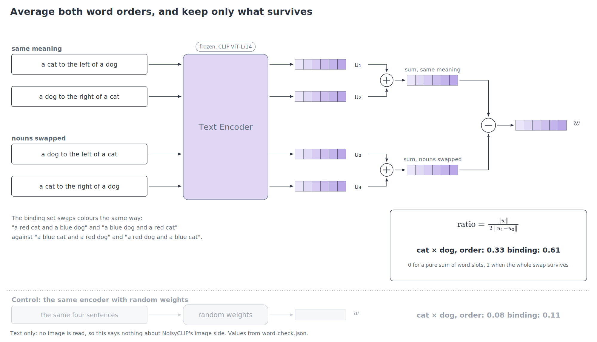</a> <a href="0.5-network-view/nc12-what-survives-for-six-noun-pairs.png">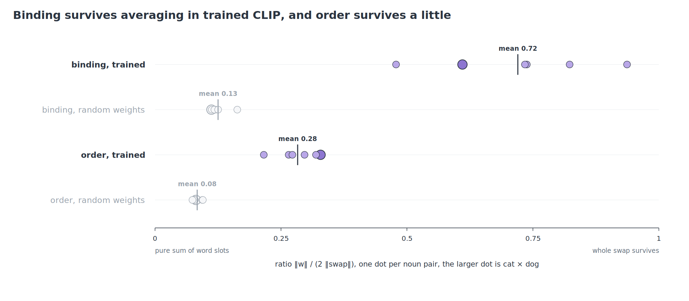</a> <a href="2-miniature/mm8-one-interaction-term-survives.png">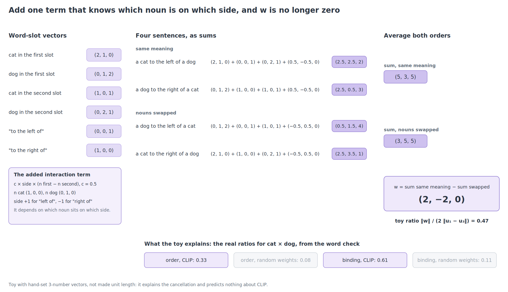</a>

**What goes in: the half-drawn picture.** [The noise levels figure](0.5-network-view/nc7-trained-noise-levels-and-pushed-steps.png) shows that NoisyCLIP trained on steps 20 to 29 and this loop reads steps 0 to 15.

<a href="0.5-network-view/nc7-trained-noise-levels-and-pushed-steps.png">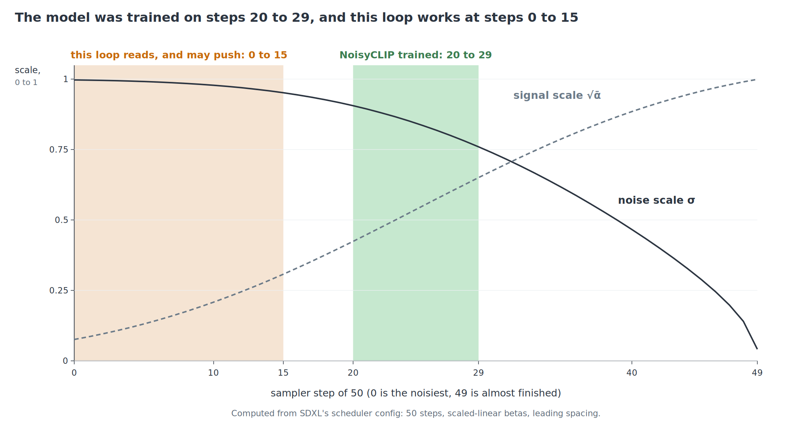</a>

**NoisyCLIP: latent to RGB, no VAE.** [The fixed map](0.5-network-view/nc3-four-latent-channels-to-rgb.png) turns 4 channels into 3 colours, and [the clamp](0.5-network-view/nc4-clamping-kills-the-gradient.png) holds part of them and passes no gradient there.

<a href="0.5-network-view/nc3-four-latent-channels-to-rgb.png">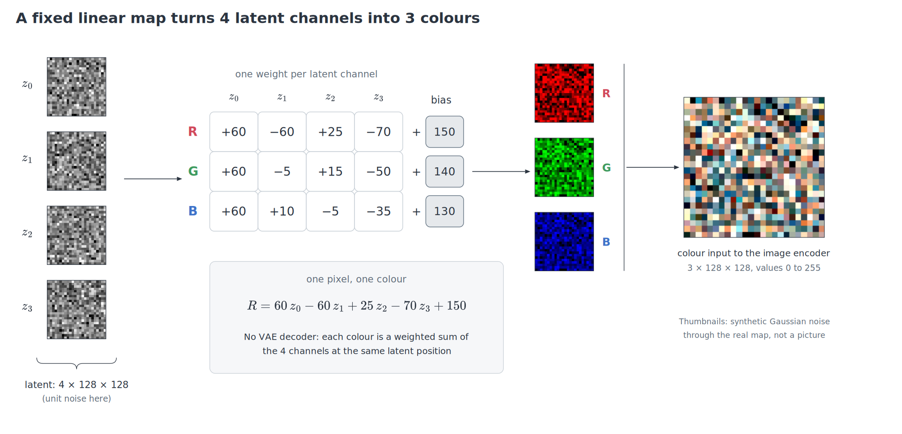</a> <a href="0.5-network-view/nc4-clamping-kills-the-gradient.png">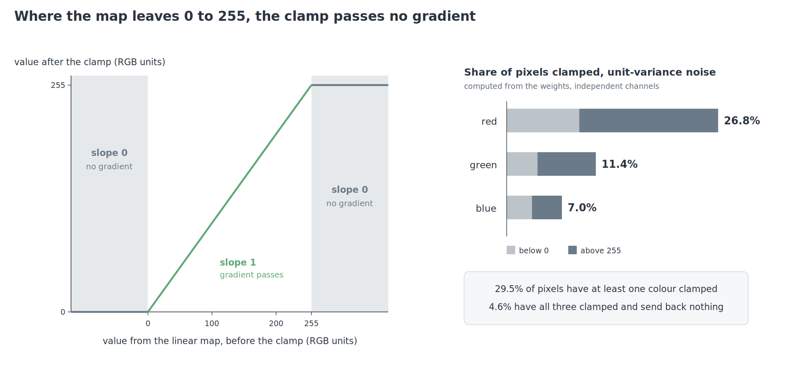</a>

**NoisyCLIP: the vision encoder and its inset.** [What is tuned and what is frozen](0.5-network-view/nc5-what-is-tuned-and-what-is-frozen.png) opens the encoder into its blocks, [training on the similarity matrix](0.5-network-view/nc6-training-on-noisy-latents.png) shows how it learned, and [the three jobs of one model](0.5-network-view/nc1-one-model-three-uses.png) separates training, reading and pushing.

<a href="0.5-network-view/nc5-what-is-tuned-and-what-is-frozen.png">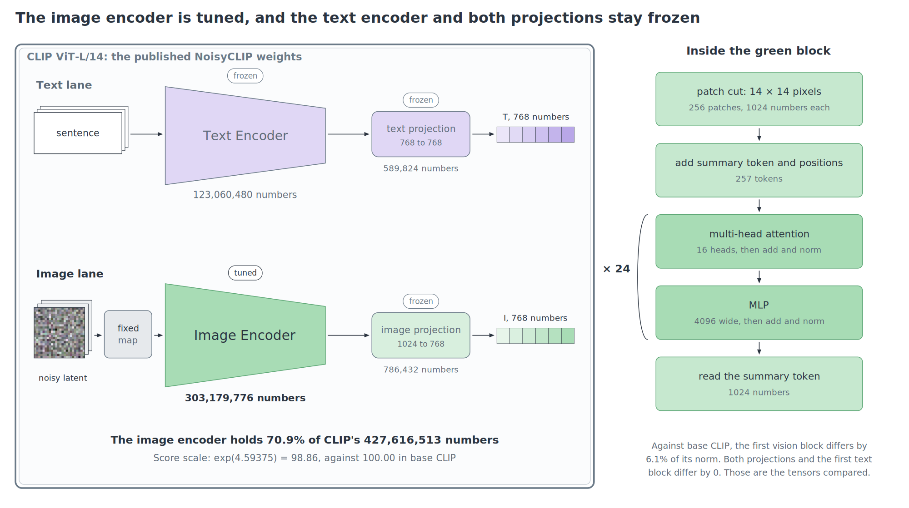</a> <a href="0.5-network-view/nc6-training-on-noisy-latents.png">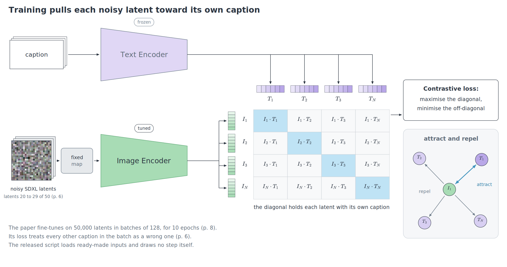</a> <a href="0.5-network-view/nc1-one-model-three-uses.png">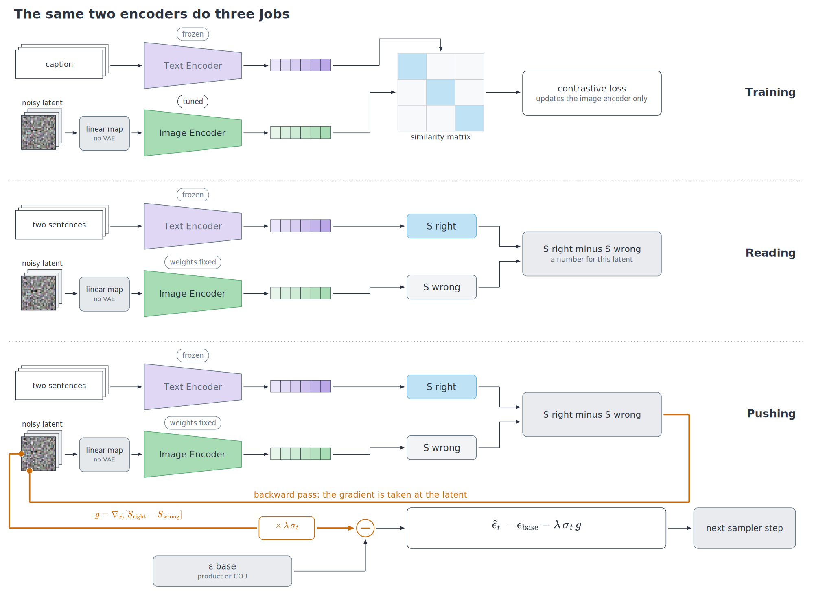</a>

**Compare: the two scores.** [Right minus wrong](0.5-network-view/nc8-right-minus-wrong.png) shows that the score difference depends only on where the two sentence vectors differ.

<a href="0.5-network-view/nc8-right-minus-wrong.png">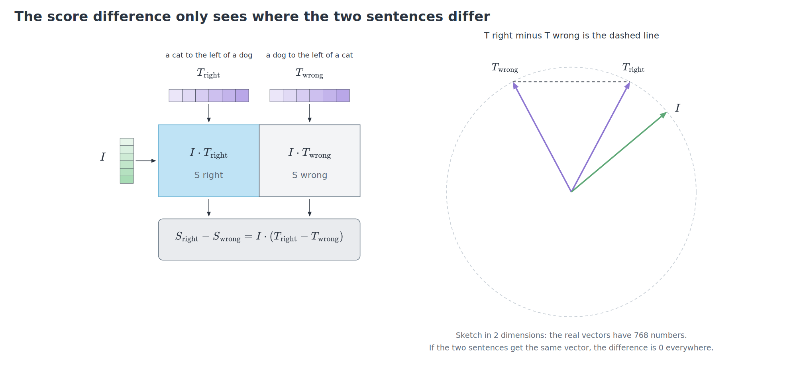</a>

**Third score and push.** [The gradient walks back to the latent](0.5-network-view/nc9-the-gradient-back-to-the-latent.png) through every step, and [the push joins CO3's noise prediction](0.5-network-view/nc10-how-the-push-joins-co3.png) before the next sampler step. The overview draws the push returning to the picture, and these deep dives draw where it actually enters.

<a href="0.5-network-view/nc9-the-gradient-back-to-the-latent.png">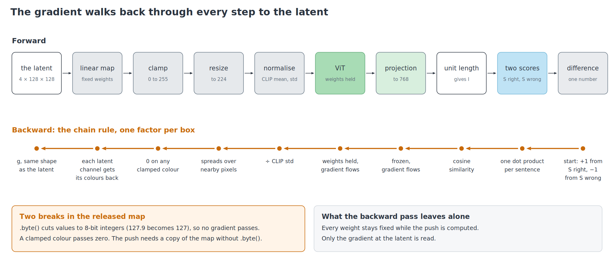</a> <a href="0.5-network-view/nc10-how-the-push-joins-co3.png">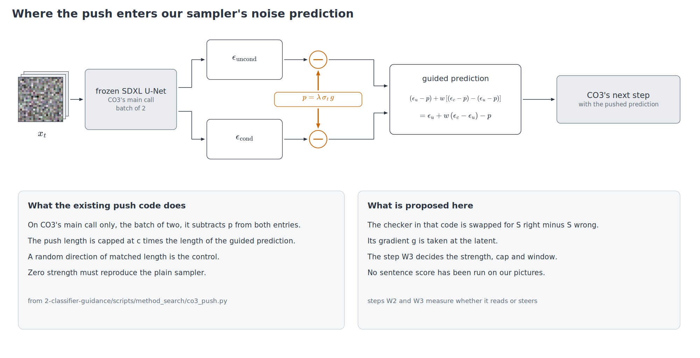</a>

**All of it at once.** [The whole read and push path](0.5-network-view/nc2-the-whole-read-and-push-path.png) repeats the overview with every real size.

## 2. Latent CLIP's push

<a href="overview/ov1-latent-clip-push.png">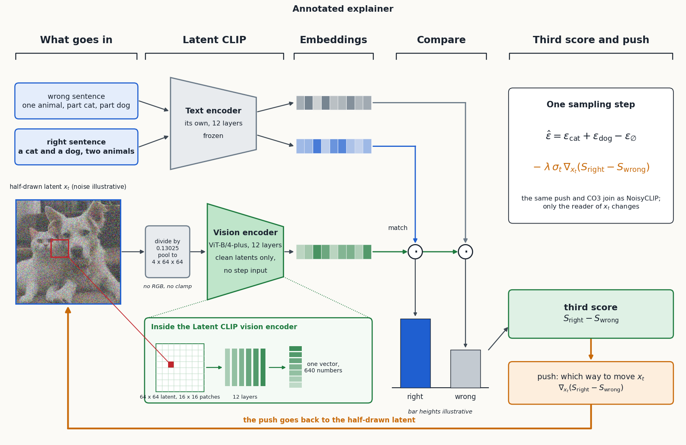</a>

Latent CLIP reads the latent directly: divided by 0.13025 and average-pooled to 4 × 64 × 64, with no RGB map and no clamp. Its vision encoder is ViT-B/4-plus with 12 layers, trained on clean latents only and given no step, and its own text encoder gives 640 numbers. The push and the CO3 join are NoisyCLIP's. The sizes come from [its released config](numbers/sources/latent-vit-b-4-512-plus-config.json), and the method from [the Latent CLIP reading note](../../../../artifacts/notes/progress/noise-text-critic/01-reading/latent-clip.md).

## 3. W2b: a linear probe on frozen vectors

<a href="overview/ov2-the-linear-probe-on-frozen-vectors.png">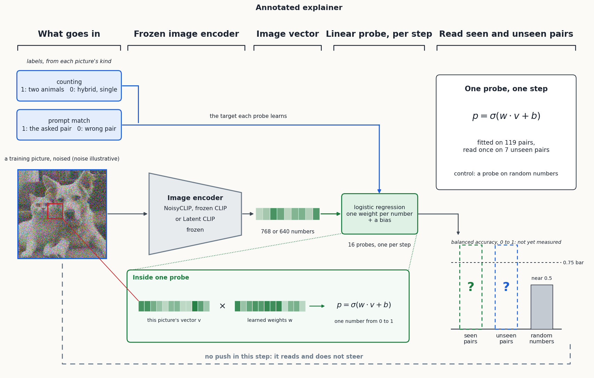</a>

A noised training picture goes through a frozen image encoder (NoisyCLIP, frozen CLIP or Latent CLIP) to one vector, and one logistic regression per step reads counting or prompt match. It fits on 119 pairs and reads 7 unseen pairs once, with a probe on random numbers as the control. The seen and unseen bars are hollow and marked "?", because W2b has not run. This step reads and does not push, so its push lane is dashed grey. The design is [the W2b design](../../../../artifacts/notes/progress/noise-text-critic/02b-linear-probe/design.md). Cat and dog is one of the training pairs, and this file is the pilot render of that pair.

## 4. W4: our own noise-aware encoder on digits

<a href="overview/ov3-our-own-encoder-on-digits.png">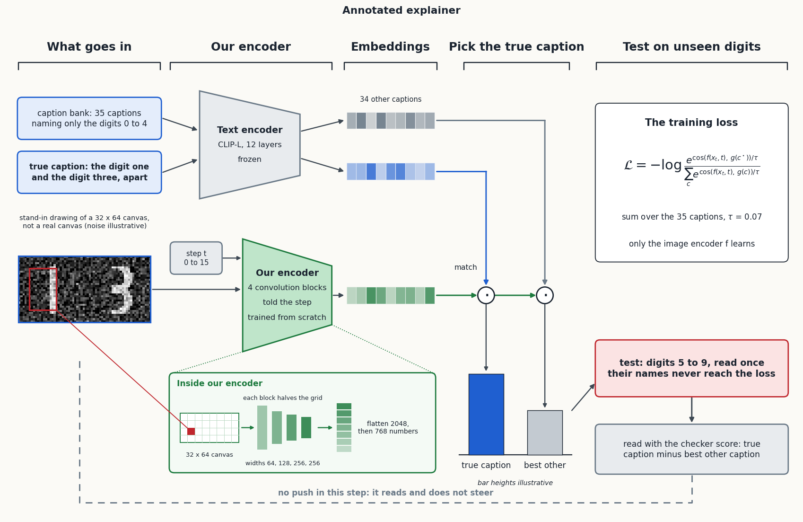</a>

A 32 × 64 canvas of digits 0 to 4 is noised to one of steps 0 to 15 and read by a small encoder of four convolution blocks that is told the step. CLIP's frozen text encoder embeds the 35 captions, and the loss picks the true caption out of the 35. The test reads digits 5 to 9 once, and their names never appear in the loss. The canvas is a drawn stand-in, because no canvas from step V1's dataset is on this laptop, and the sizes come from [the W4 design](../../../../artifacts/notes/progress/noise-text-critic/04-train-our-own/design.md). This step reads and does not push.

## What is established and what is proposed

**NoisyCLIP's results are the paper's own.** It ranks seeds during sampling and reports its numbers on its own benchmarks. It never feeds a gradient to a sampler.

**The push is our proposal.** No result on this project's pictures exists yet. Steps W2 and W3 measure whether it reads or steers any of the five properties.

**The miniature is a toy.** Its weights are set by hand, so it shows what each part computes and predicts nothing about SDXL.

## The rungs

| Level | What it shows | Where |
|---|---|---|
| 0 | the real system | [the classifier guidance system picture](https://claude.ai/artifact/FBbwapTjp1dbEmzpLspRBT) and [CLIP's module tree](https://claude.ai/artifact/4mePVaMV9NuxENRkJphieQ), both linked, with [the three jobs of one model](0.5-network-view/nc1-one-model-three-uses.png) drawn here |
| overviews | the whole method on one real picture, in the annotated explainer style, one per model and recipe | [NoisyCLIP](overview/ov0-the-sentence-score-push.png), [Latent CLIP](overview/ov1-latent-clip-push.png), [W2b](overview/ov2-the-linear-probe-on-frozen-vectors.png), [W4](overview/ov3-our-own-encoder-on-digits.png) |
| 0.5 | the deep dives: each part of the overview opened, in the `clip-contrastive` style | [the twelve figures](0.5-network-view/README.md) |
| 1 | the idea, illustrated | [the six illustrations](1-illustrations/diagram-prompts.md) |
| 2 | the miniature: 8 latent numbers, every term on its part, and a toy of the word check | [the worked miniature](2-miniature/README.md) |
| 3 | the real code, block by block | [the code walk](3-code/walk-noisyclip.md) at commit `016b913` |
| beside | each equation down to fundamentals | [the rebuild companion](rebuild-from-fundamentals.md) |
| close | the method read through the small network | [the closing page](read-through-a-small-network.md) |

## What is in this folder

| File | What it is |
|---|---|
| `noisyclip-ladder.html` | the rung pages as one local file, with their pictures and maths built in, and without the overview |
| `ladder.json` | the ladder's record: each rung's state and files, the colour key and the code commit |
| `NOTATION.md` | the symbols every rung uses, beside the ones the paper prints |
| `overview/ov0` to `ov3`, PNG and SVG | the four overviews, drawn by `annotated_explainer.py` in the zoom-ladder skill (families `sentence-score`, `latent-clip-push`, `linear-probe` and `digit-encoder`) |
| `style-reference.md`, `style-sample-clip-contrastive.png` | the deep dives' drawing style |
| `numbers/make_numbers.py`, `numbers/numbers.json` | every full-scale number, with its source |
| `numbers/check_pages.py` | checks that every decimal on a page appears in a key, a numbers file or the paper |
| `figure_kit.py` | the drawing helpers, which refuse to write a figure where a line crosses a box or label |
| `build_page.cjs` | builds `noisyclip-ladder.html` from the markdown pages |
| `route-zoom-ladder-noisyclip.md` | the steps that rebuild this ladder |
| `reference/` | three third-party layout references, kept out of every page and never committed |

How it was made

The sizes come from the public configs of `openai/clip-vit-large-patch14` and SDXL's scheduler, and the parameter counts come from building that config on PyTorch's meta device, with no weights. The released code was read at commit `016b913` and never run. The checkpoint itself was not downloaded here, and the facts about its weights come from [the checkpoint comparison](../../../../artifacts/notes/progress/noise-text-critic/01-reading/tools/checkpoint-compare.txt). The illustrations were drawn by Codex's image tool from prompts built on the miniature's numbers, so every tile in them is a teaching drawing and none is an SDXL sample.

