# NoisyCLIP read through a small network

This page reads the whole method one idea at a time, using a network of 8 latent numbers you can check by hand. It is the place to start, and every other rung of the ladder is linked from the idea it helps with.

**The question behind it.** Paper 2 needs five abstract scores on a half-drawn picture, such as whether a cat is to the left of a dog. This ladder explains a cheaper candidate: score the half-drawn latent against one right sentence and one wrong sentence, and use the difference as the checker.

**What is established and what is not.** NoisyCLIP's published results rank seeds by this kind of score, and the paper never pushes a sampler with it. No result on this project's pictures exists yet. Whether it reads or steers any of the five properties is what steps W2 and W3 will measure. Numbers marked "toy" come from [the miniature](2-miniature/README.md), whose weights are set by hand and predict nothing about SDXL.

<a href="0.5-network-view/nc2-the-whole-read-and-push-path.png">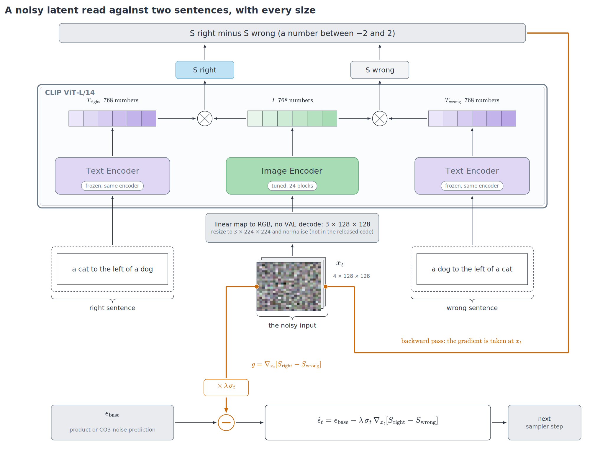</a>

## Table of contents

1. [A half-drawn latent gets a rough colour view](#1-a-half-drawn-latent-gets-a-rough-colour-view)
2. [The clamp and the byte conversion block the signal](#2-the-clamp-and-the-byte-conversion-block-the-signal)
3. [Only the image encoder learned to read noise](#3-only-the-image-encoder-learned-to-read-noise)
4. [It practised on later steps than this loop would push](#4-it-practised-on-later-steps-than-this-loop-would-push)
5. [Two sentences turn a score into a checker](#5-two-sentences-turn-a-score-into-a-checker)
6. [The gradient walks back to the latent](#6-the-gradient-walks-back-to-the-latent)
7. [The push changes the noise prediction](#7-the-push-changes-the-noise-prediction)
8. [What would make it fail](#8-what-would-make-it-fail)
9. [The paper's notation](#9-the-papers-notation)
10. [Where to go next](#10-where-to-go-next)

## 1. A half-drawn latent gets a rough colour view

CLIP reads colour pictures and SDXL's latent has 4 channels, so a fixed table turns the 4 channels into red, green and blue without running the VAE decoder.

<a href="1-illustrations/ni1-a-cheap-colour-view-of-the-latent.png">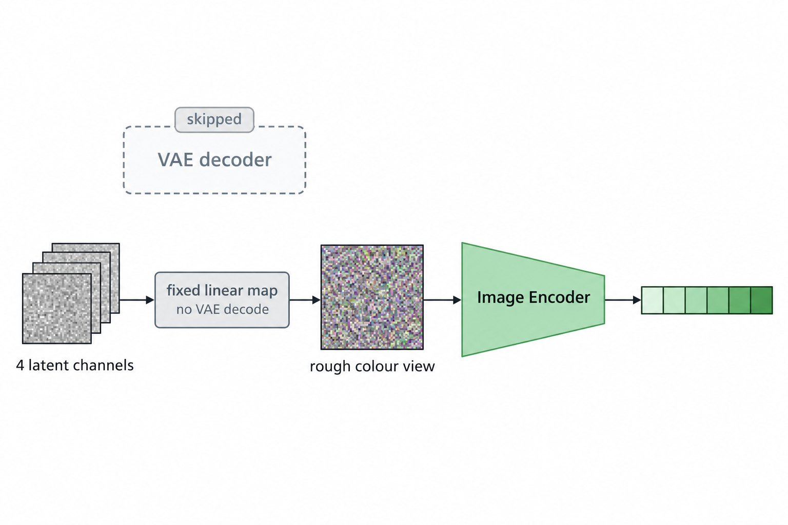</a> <a href="0.5-network-view/nc3-four-latent-channels-to-rgb.png">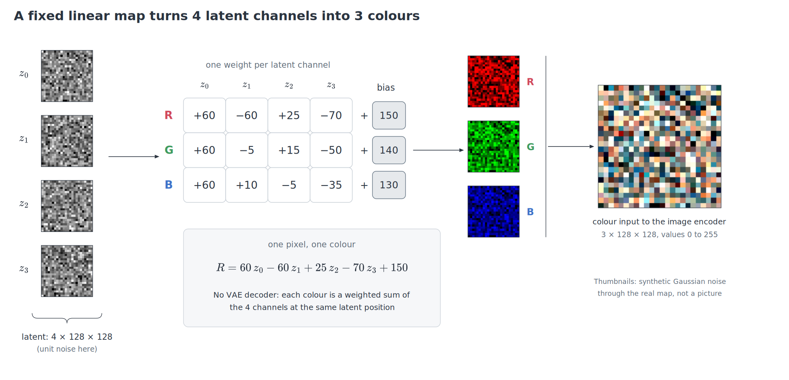</a>

$$
\underbrace{R}_{\text{red}} = \underbrace{60 z_0 - 60 z_1 + 25 z_2 - 70 z_3}_{\text{a fixed weighted sum}} + \underbrace{150}_{\text{bias}}
$$

**On the toy.** Pixel A has channels $(1, 0.5, 0, 0.5)$, so its red is $60 - 30 + 0 - 35 + 150 = 145$. [Work all six colours](2-miniature/README.md#2-work-the-linear-map).

## 2. The clamp and the byte conversion block the signal

The released code holds each colour between 0 and 255 and then converts it to 8-bit integers. A held colour passes no gradient, and the conversion passes none at all.

<a href="1-illustrations/ni5-two-places-the-signal-is-cut.png">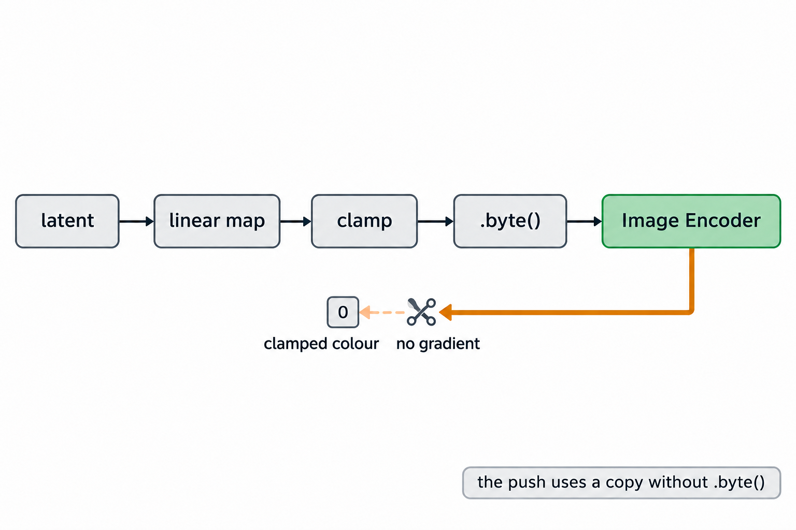</a> <a href="0.5-network-view/nc4-clamping-kills-the-gradient.png">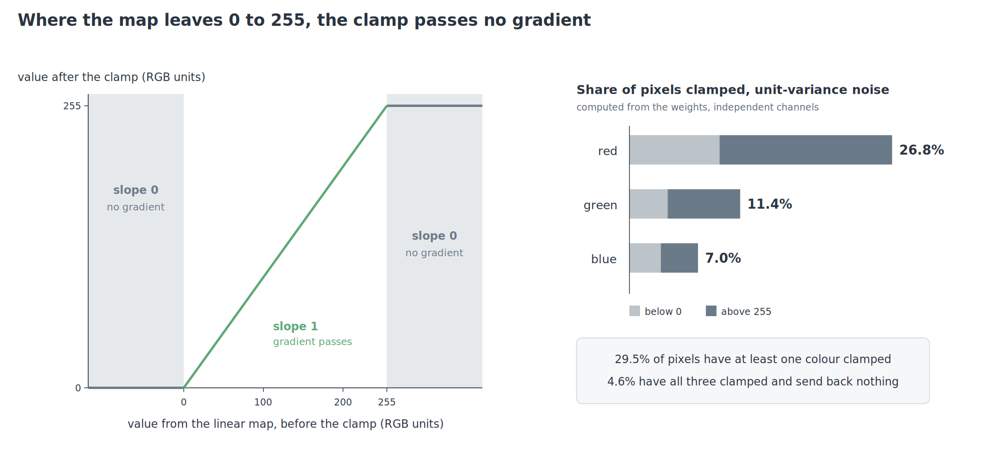</a>

On unit-variance noise the clamp holds 26.8% of red, 11.4% of green and 7.0% of blue values, computed from the weights with independent channels. A half-drawn SDXL latent has structure, so its share has to be measured.

**On the toy.** Pixel B's red is 305, so it is held at 255 and sends nothing back. [See the four ways the signal dies](2-miniature/README.md#7-break-it-four-ways).

## 3. Only the image encoder learned to read noise

NoisyCLIP is CLIP ViT-L/14 with its image encoder fine-tuned on noisy SDXL latents, and its text side left alone so the sentence vectors keep their meaning.

<a href="1-illustrations/ni3-training-on-half-drawn-pictures.png">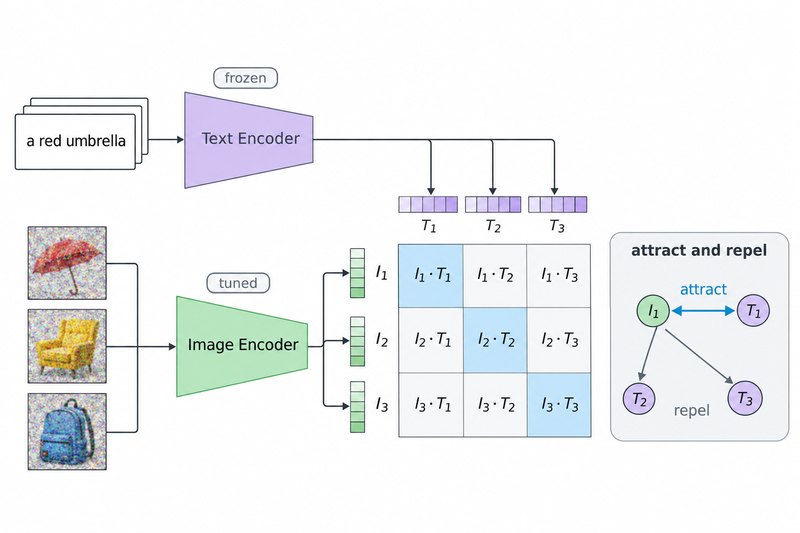</a> <a href="0.5-network-view/nc5-what-is-tuned-and-what-is-frozen.png">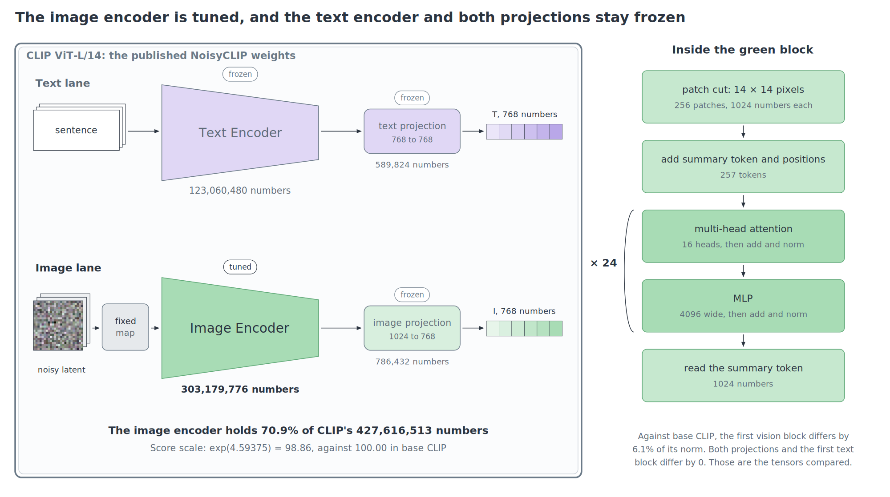</a>

$$
\mathcal L = \tfrac12\Big[\underbrace{\mathrm{CE}(e^{t_s} s,\ \text{rows})}_{\text{each latent picks its caption}} + \underbrace{\mathrm{CE}(e^{t_s} s,\ \text{columns})}_{\text{each caption picks its latent}}\Big]
$$

The published weights match base CLIP exactly on both projection heads and on the first text layer, and differ by 6.1% of its norm on the first vision layer. Only those tensors were compared. The released `--only_vision` flag would leave the image projection trainable, while the published weights show it unchanged.

**On the toy.** One update of the image layer takes the loss from 0.9264 to 0.7929 and leaves the sentence vectors where they were. [Work the training step](2-miniature/README.md#8-one-training-step).

## 4. It practised on later steps than this loop would push

The paper trains on latents 20 to 29 of a 50-step run (p. 6). This loop reads steps 0 to 15, which are noisier and outside that window, and W3 pushes only on the steps in that range that W2 can read.

<a href="1-illustrations/ni6-trained-later-than-we-push.png">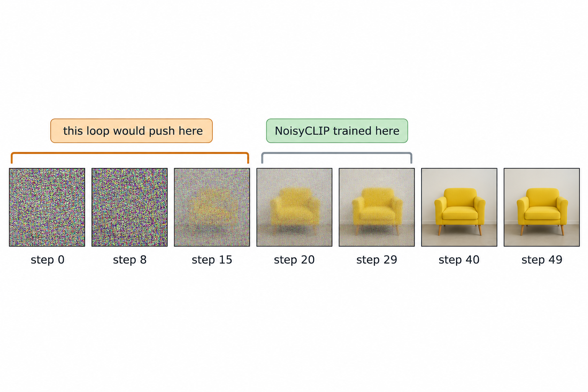</a> <a href="0.5-network-view/nc7-trained-noise-levels-and-pushed-steps.png">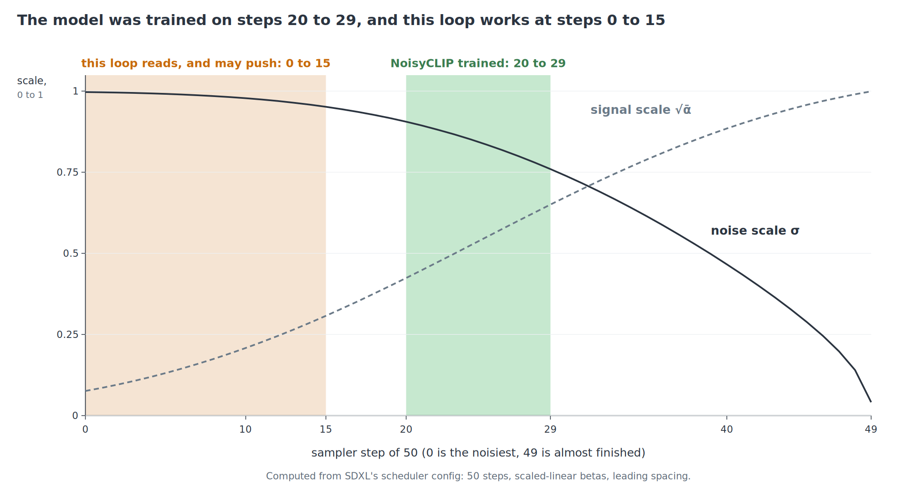</a>

At step 0 the signal scale is 0.076, at step 15 it is 0.3076, and at step 20 it is 0.4241 (computed from SDXL's scheduler config). The paper's own measures at these early latents are on its own captions: it marks separation at latent 10 (p. 10), where the right caption's Recall@1 is about 0.20, which is chance among five captions (Fig. 4, as read in [the reading note](../../../../artifacts/notes/progress/noise-text-critic/01-reading/noisyclip.md)). Its Recall@1, the share of images whose right caption ranks first of 5, is 0.506 over latents 21 to 30 against 0.145 for frozen CLIP (p. 14).

## 5. Two sentences turn a score into a checker

The same picture is scored against a right sentence and a wrong one, and the difference is the checker's output.

<a href="1-illustrations/ni2-one-picture-against-two-sentences.png">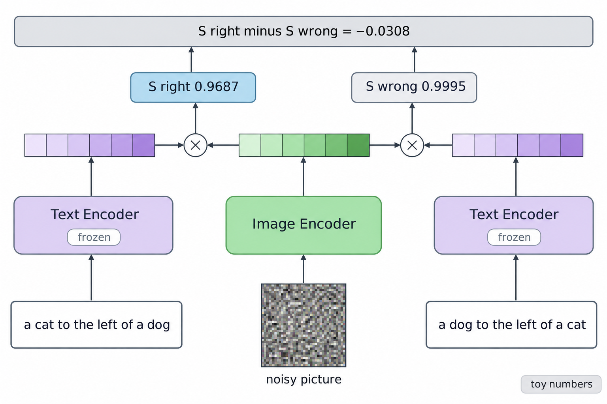</a> <a href="0.5-network-view/nc8-right-minus-wrong.png">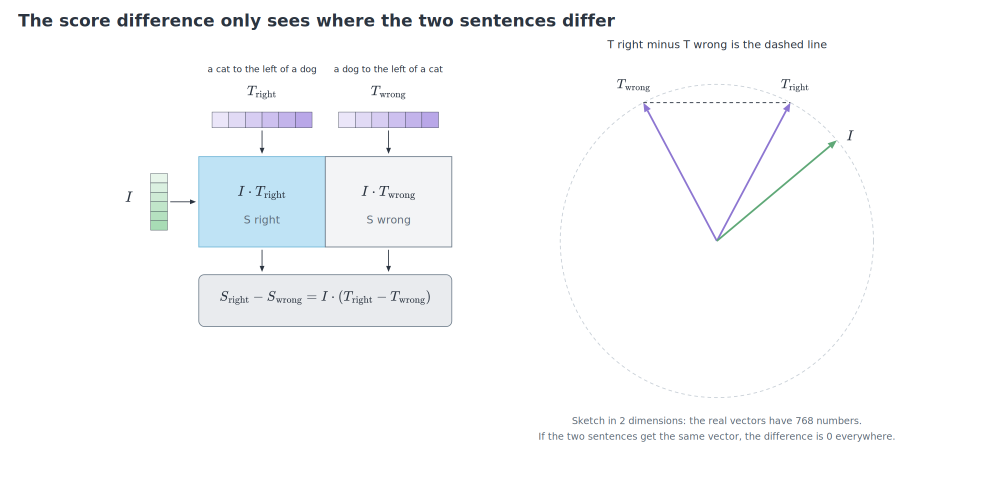</a>

$$
D = \underbrace{I \cdot T_{\text{right}}}_{S_{\text{right}}} - \underbrace{I \cdot T_{\text{wrong}}}_{S_{\text{wrong}}} = I \cdot \underbrace{(T_{\text{right}} - T_{\text{wrong}})}_{\text{where the sentences differ}}
$$

The pair "a cat to the left of a dog" and "a dog to the left of a cat" uses the same words, so this checker depends on the text encoder giving the two orders different vectors.

**On the toy.** $D = 0.9687 - 0.9995 = -0.0308$, so the toy picture starts closer to the wrong sentence.

## 6. The gradient walks back to the latent

The chain rule carries the score difference back through every step, and each of the latent's numbers receives its share.

<a href="0.5-network-view/nc9-the-gradient-back-to-the-latent.png">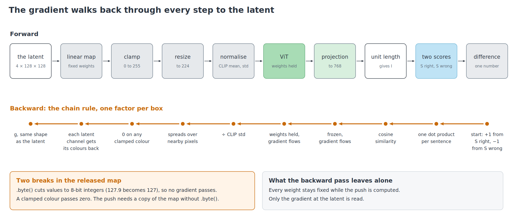</a>

$$
g = \nabla_{x_t}\big[S_{\text{right}} - S_{\text{wrong}}\big]
$$

This $g$ is a classifier's gradient up to size. Treating the two sentences as two classes gives $\nabla \log p(\text{right}) = (1 - p)\,e^{t_s}\,g$, so the push has classifier guidance's direction, and a fixed $\lambda$ replaces a factor that would shrink as the classifier grows confident. [The companion derives this](rebuild-from-fundamentals.md#6-the-score-difference-is-a-two-sentence-classifier).

**On the toy.** The entry of $g$ largest in size is $-0.1149$, on pixel A's channel $z_1$. [Work the backward pass](2-miniature/README.md#4-work-the-gradient-back).

## 7. The push changes the noise prediction

The gradient is taken at the latent, and the correction goes onto the noise prediction the sampler is about to use.

<a href="1-illustrations/ni4-the-push-bends-the-noise-prediction.png">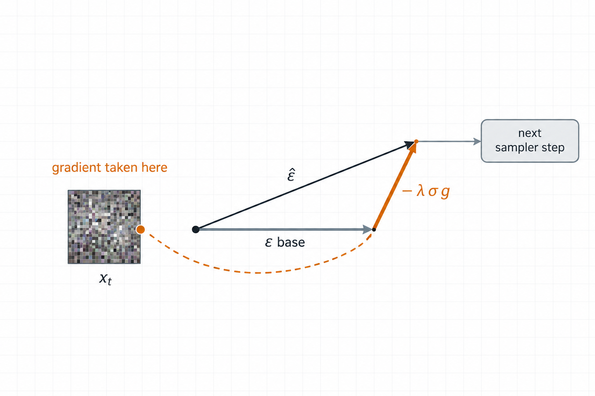</a> <a href="0.5-network-view/nc10-how-the-push-joins-co3.png">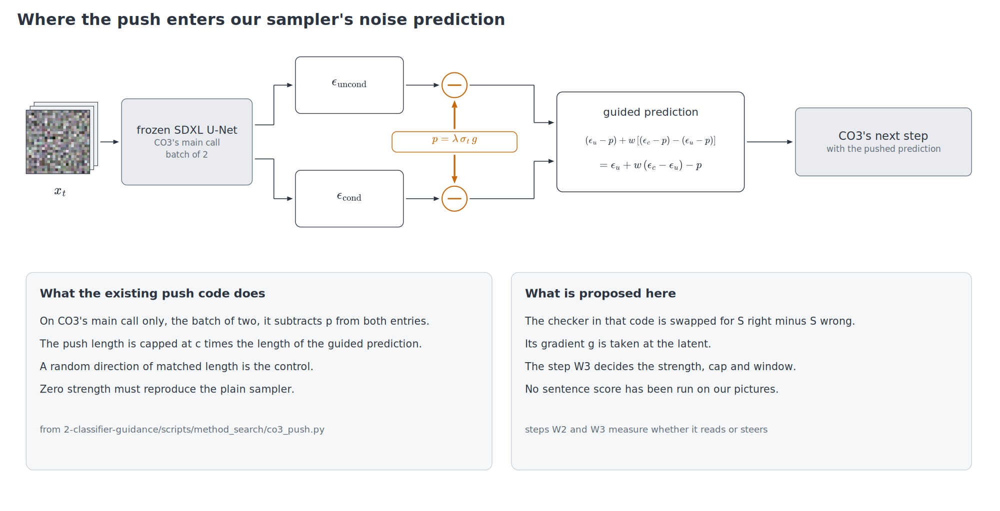</a>

$$
\hat\epsilon_t = \underbrace{\epsilon_{\text{base}}}_{\text{product or CO3}} - \underbrace{\lambda}_{\text{strength}}\,\underbrace{\sigma_t}_{\text{noise level}}\,\underbrace{\nabla_{x_t}\big[S_{\text{right}} - S_{\text{wrong}}\big]}_{g}
$$

**On the toy.** With $\lambda = 2$ and $\sigma_t = 0.8$, one DDIM step ends at a score difference of $-0.0791$ with the push and $-0.0984$ without it. [Work the step](2-miniature/README.md#6-join-the-noise-prediction-and-step). A hand-set network moving in the push's direction says nothing about whether a real picture would.

## 8. What would make it fail

These are the failure routes the wiring allows. Each is a question for W2 or W3, and none has been measured here.

**The text side cannot tell the two sentences apart.** Identical vectors give a zero difference and a zero push.

**The score moves and the picture does not.** A CLIP checker on the decoded image raised its own score and did not move where the animals were ([the checker loop](../../drips/rung2-pair-aware-discriminator/checker-loop.md)), so a score that rises is not evidence on its own.

**The steps are outside the training window.** The model practised on steps 20 to 29 and this loop would use steps 0 to 15.

**The clamp removes part of the direction the push needs.** In the toy, pixel B's red would send back 0.2154 and the clamp sends back 0.

## 9. The paper's notation

The paper writes the latent as $z_t$, the text encoder as $\tau_\theta$, the image encoder as $\nu_\theta$ and the path into RGB as $\Phi$. Its score (p. 5) is

$$
S_{\text{latent}}(z_t, y) = \tau_\theta(y) \cdot \nu_\theta(\Phi(z_t)).
$$

In this ladder's symbols that is $S = T \cdot I$, with $T = \tau_\theta(y)$ and $I = \nu_\theta(\Phi(x_t))$. The paper uses this score to choose which seeds keep running, and its gradient appears nowhere in the paper. The [notation table](NOTATION.md) maps every symbol.

## 10. Where to go next

| You want | Open |
|---|---|
| every size and how the parts join | [the network view](0.5-network-view/README.md) |
| to do it by hand | [the miniature](2-miniature/README.md) |
| the real code, block by block | [the code walk](3-code/walk-noisyclip.md) |
| each equation down to fundamentals | [the rebuild companion](rebuild-from-fundamentals.md) |
| CLIP's own insides | [CLIP read through a small network](../../../../../../goal-setting/learning/papers/deep-learning/diffusion-models/compositional-diffusion-models/scorers/clip-read-through-a-small-network.md) |
| the design of the first measurement | [the W2 design](../../../../artifacts/notes/progress/noise-text-critic/02-can-it-read/design.md) |
