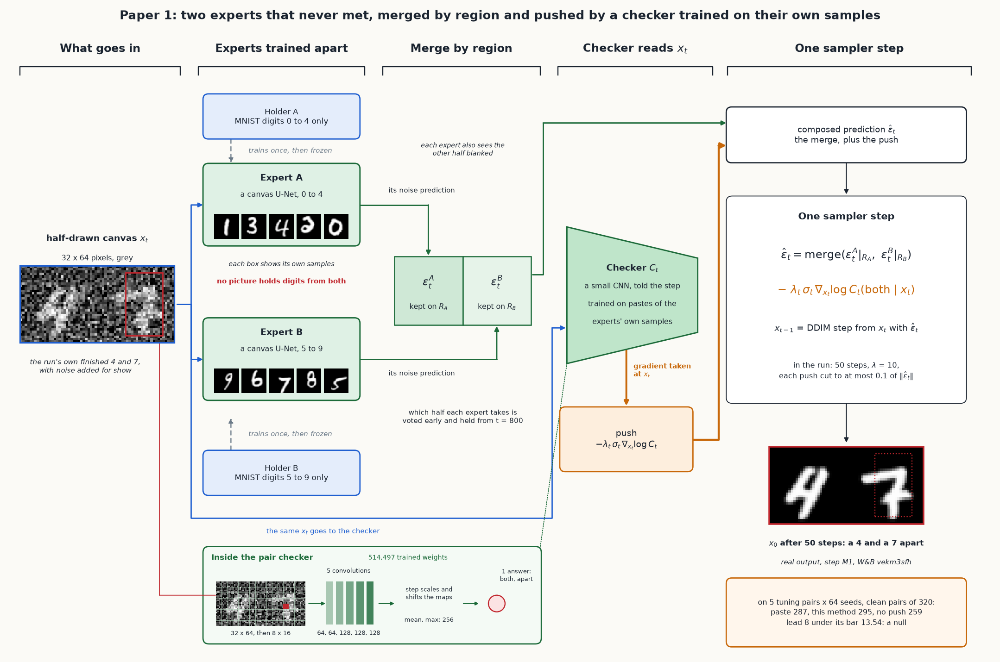

# Level 0: Paper 1's method, one canvas from input to output

**Said plainly.** Two image generators are trained on data that never meet: one sees only the digits 0 to 4, the other only 5 to 9.
At sampling time each one denoises its own half of the canvas, the two halves are joined, and a small checker reads the noisy
canvas and pushes it toward "both digits are there, apart". The checker was trained only on pastes of the two generators' own
samples, so no picture holding both concepts is ever used.

The figure is also saved as [an SVG](figures/level0-paper-1-overview.svg).

## What each bracket is

| Bracket | On this canvas | On two-colour CLEVR, the paper's main test |
|---|---|---|
| What goes in | $x_t$, a 1 x 32 x 64 grey canvas partway along its path from noise ($t = T$) to picture ($t = 0$) | a 64 x 64 colour picture |
| Experts trained apart | two canvas U-Nets, `e04-either` (0 to 4) and `e59-either` (5 to 9), each trained once and never retrained | two EDM2 `edm2-img64-xs` models, one trained only on red scenes, one only on blue, 2,000,896 images seen each |
| Merge by region | each expert's prediction is kept on its own half, with the other half blanked in what it sees ([figure a](01-the-network-view.md#a-the-region-merge)) | no regions: the experts are told what to draw and not where, so the push goes on the plain product ([figure c](01-the-network-view.md#c-where-regions-apply-and-where-they-cannot)) |
| Checker reads $x_t$ | a pair checker and a separate-digit checker, small CNNs told the step, trained on pastes of the experts' own samples | a count checker retrained on mask pastes of the two experts' samples |
| One sampler step | the composed prediction is the merge plus the push, then one DDIM step | the same, with EDM2's 32-step Heun sampler |

Every size in the table is in [the numbers file](data/paper1_numbers.json), key `sizes`, each with the file and line it was read
from. The CLEVR column is the design in [the two-colour design](../../../../artifacts/notes/progress/method-search/05-two-experts-by-colour/design.md);
no two-colour expert has trained yet ([its review](../../../../artifacts/notes/progress/method-search/05-two-experts-by-colour/review.md), line 3).

## Where the picture comes from

The canvas is the "method with the checker push" tile for digits 4 and 7, seed 0, in step M1's sheet of four rows
([the sheet](../../../../artifacts/notes/progress/method-search/01-beat-the-baseline/paper-1-four-rows-first-two-seeds.png),
third row, fifth tile), from W&B run `vekm3sfh`. The input copy is that finished canvas with noise drawn for show; no run saved its
intermediate states. The digits inside each expert box are cut from the same sheet's paste row, which holds each expert's own
samples drawn alone. The red square marks the 7 on the input, in the checker's inset and on the output.

## How it fails and how you know it worked

**It fails** when the second digit comes out faint or broken: the same sheet's "no push" row shows a 4 beside a faint mark at seed 1.
Without the push the method draws 259 clean pairs of 320 on five tuning pairs; with it, 295.

**It worked** when the digit judge reads exactly two blobs, one per half, each the asked digit with confidence at least 0.9. The
catch is that sampling each expert alone and pasting the halves draws 287, and the method's lead of 8 is under its bar of 13.54, so
on digits the comparison is a null ([the paste finding](../../../report/the-method-search/does-composing-two-digit-models-beat-sampling-and-pasting.md)).

Next rung: [level 0.5, the network view](01-the-network-view.md).
