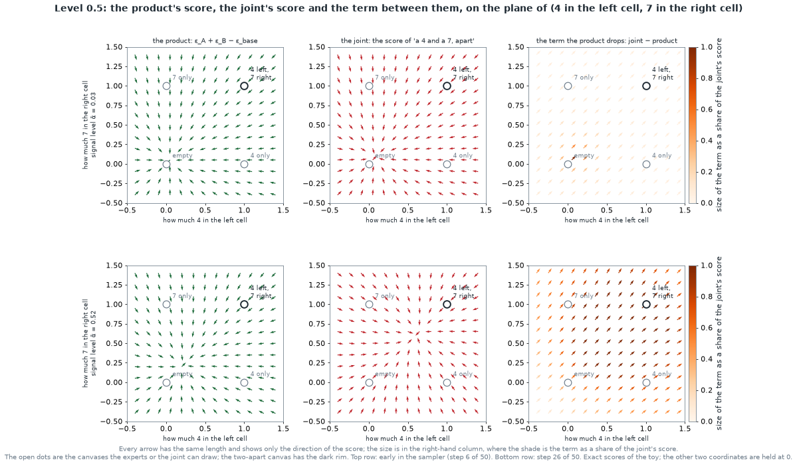
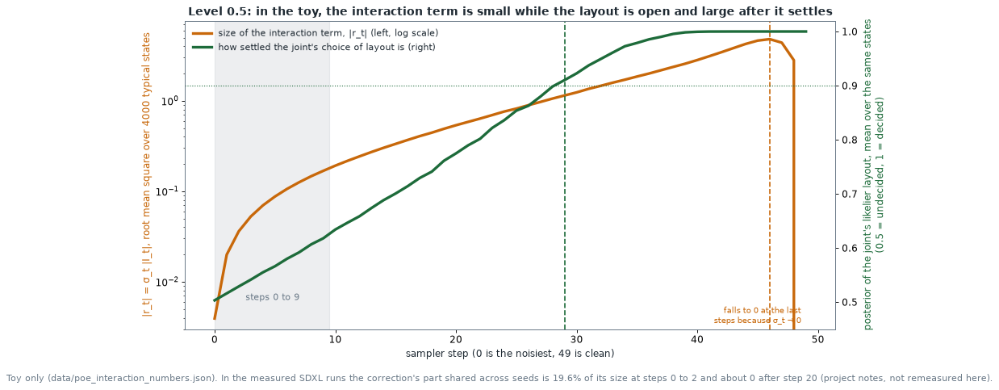
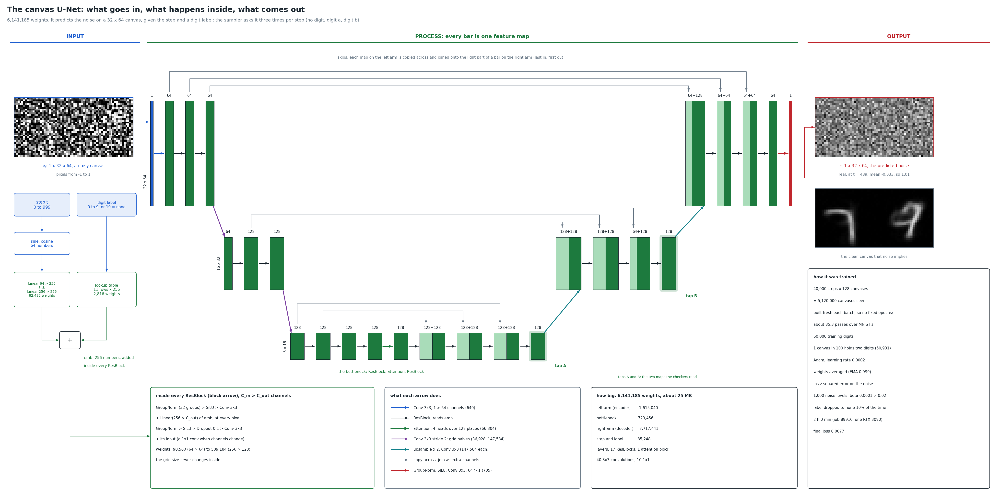
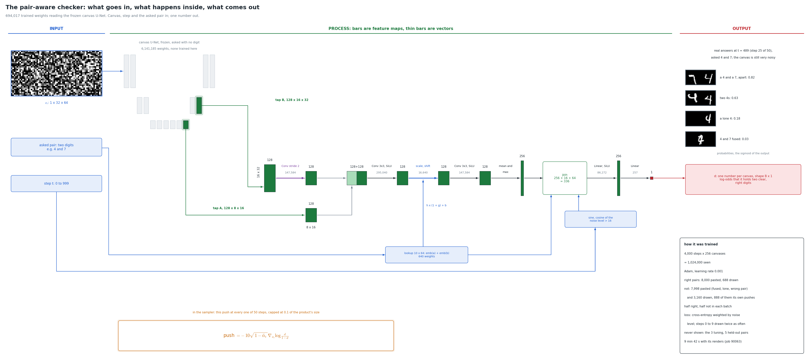
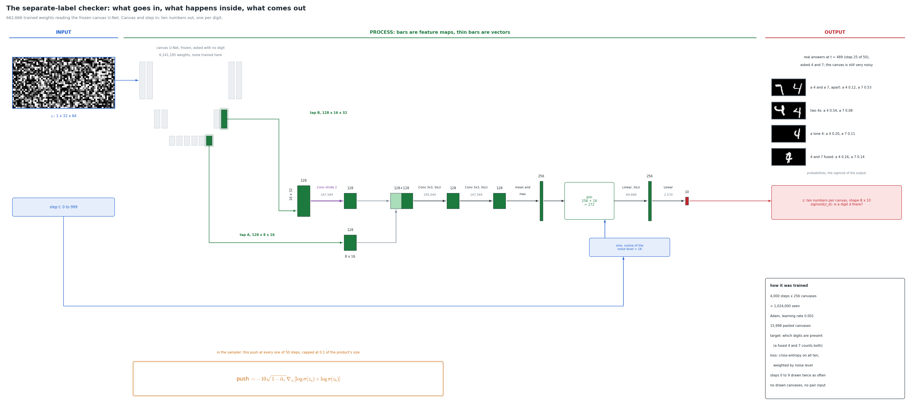
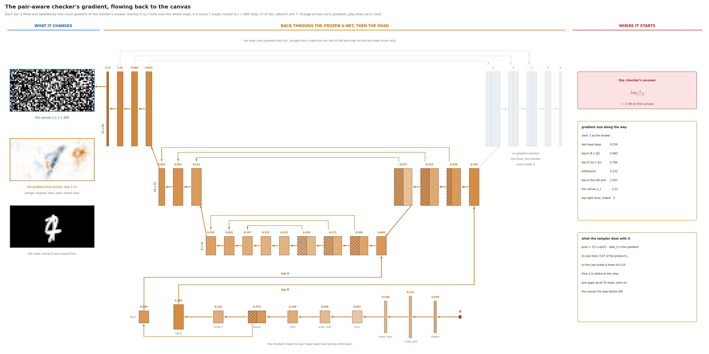
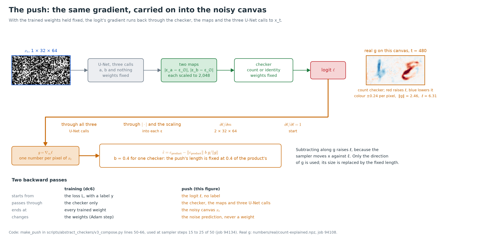
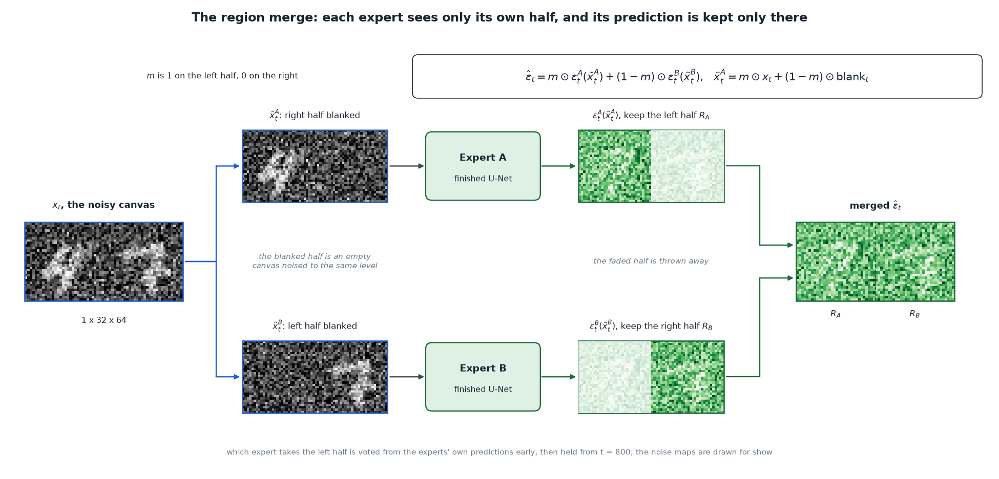
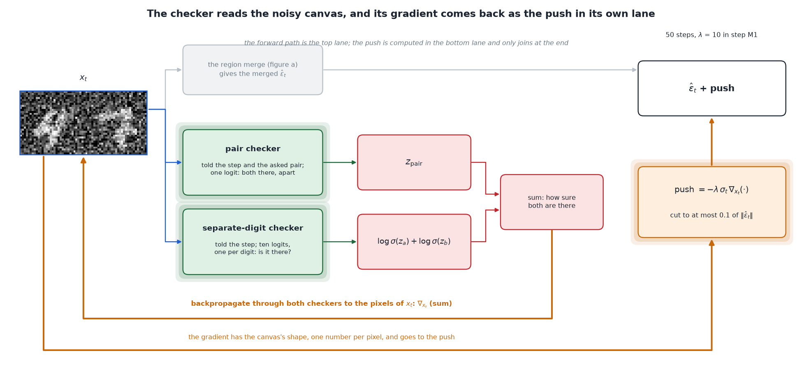
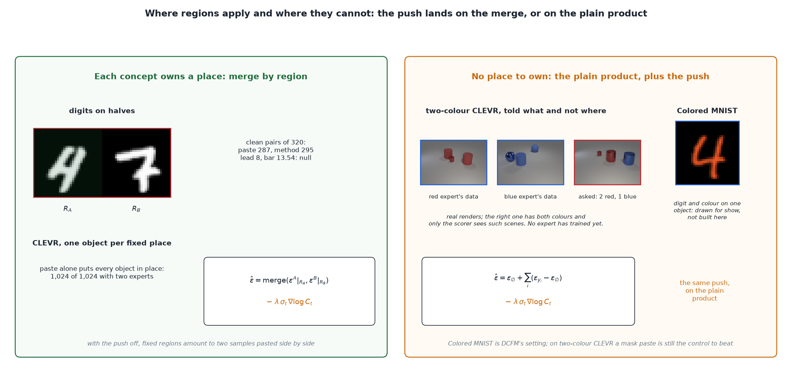

# Level 0.5: the network view

**Said plainly.** Most of what Paper 1 runs is already drawn elsewhere: the product of experts as score fields, the canvas U-Net,
the two checkers and their gradients. This page links those figures in reading order and draws only the three things Paper 1 adds:
the merge by region, the checker's push in its own lane, and the two settings where the push lands on a merge or on a plain product.
Level 0.5 has no numbers on its edges; [the toy page](03-the-toy.md) has them.

## Already drawn elsewhere, linked here

| What it shows | Figure | Where it is explained |
|---|---|---|
| the product's score, the joint's score and the term between them, as arrows on the toy's plane |  | [the PoE ladder's network view](../product-of-experts-interaction-term/01-the-network-view.md#the-three-fields) |
| how large the dropped term is along the sampler step |  | [the term against the step](../product-of-experts-interaction-term/01-the-network-view.md#the-term-against-the-step) |
| the canvas U-Net each digit expert is |  | [the networks page of the digit guidance scene](../mnist-guidance-explained/2-the-networks.md) |
| the pair-aware checker and the separate-label checker |   | the same page; those checkers read the U-Net's inner maps, while Paper 1's checkers read the pixels (`PixelHead` in `pixel_checker.py`), as figure b shows |
| the gradient flowing back from a checker to the canvas |  | [the gradient page](../mnist-guidance-explained/3-the-gradient.md) |
| a checker's push as a gradient into the canvas, on Loop 8's digit-map checkers |  | [the digit-map checkers' network view](../digit-map-checkers/0.5-network-view/README.md) |

## New: what Paper 1 adds

### a. The region merge

**What the picture is.** The noisy canvas $x_t$ on the left is copied twice. Expert A's copy has its right half replaced by an empty
canvas noised to the same level, and expert B's copy has its left half replaced. Each expert predicts noise over the whole canvas,
the half outside its region is thrown away (faded), and the two kept halves are joined into $\hat\epsilon_t$. Which expert takes the
left half is voted from the experts' own predictions early in the run and held from t = 800. The noise maps are drawn for show.

**What it changes.** The plain product asks both experts about every pixel, so each pulls the whole canvas toward its own kind of
digit. The merge asks each expert only about its own half. On the PoE ladder's toy that alone takes two digits apart from 811 of
4,000 draws to 3,859 ([the toy page](03-the-toy.md)).

### b. The checker reads the noisy canvas, and its gradient is the push

**What the picture is.** The top lane is the forward path: $x_t$ to the merge of figure a, faded because it is drawn there. The two
glowing boxes are the checkers. The pair checker is told the step and the asked pair and gives one logit, "both there, apart". The
separate-digit checker is told the step and gives ten logits, one per digit. The run adds the pair logit to $\log\sigma(z_a) + \log\sigma(z_b)$
for the two asked digits. The orange bottom lane is the backward signal: the gradient of that sum with respect to each pixel of
$x_t$, which has the canvas's shape, scaled by $-\lambda\sigma_t$, cut to at most 0.1 of the prediction's length, and added to $\hat\epsilon_t$.

**Where it lives in the code.** `pair_push` and `separate_push` in `pixel_checker.py` (lines 70 and 82), joined by `make_push` in
`two_experts.py` (line 178), and the cut in `per_sample_cap` in `canvas_unet.py` (line 180). [The code page](04-the-code.md) lists each.

### c. Where regions apply and where they cannot

**What the picture is.** Left, the settings where each concept owns a place: digits on halves, and CLEVR with one object per fixed
place. There the push is added to the merge. Right, the settings with no place to own: two-colour CLEVR, where each expert is told
what to draw and not where, and Colored MNIST, where a digit and its colour sit on one object. There the push is added to the plain
product $\epsilon_\varnothing + \sum_i(\epsilon_{y_i} - \epsilon_\varnothing)$. The CLEVR pictures are real renders from step M10's
smoke sheet; the red digit is a digit from step M1's sheet tinted to stand for Colored MNIST, which this project has not built.

**Why the split matters.** Where regions apply, the merge with the push off is two samples pasted side by side, and pasting is
already strong: 287 clean digit pairs of 320 against the method's 295, and 1,024 of 1,024 CLEVR images with every object in place.
Where regions cannot apply, the push is the only thing that can place two concepts, and it is the setting DCFM works in
([the DCFM gap note](../../../../artifacts/notes/progress/gaps/04-exploiting-dcfm.md#lead-1-finished-experts-without-retraining)).

> [!NOTE]
> The brief for this ladder placed CLEVR on the regions side. The two-colour CLEVR design puts its method row on the plain product
> ("red expert at count x, plus blue expert at count y, minus the empty-scene model", plus the count checker's push;
> [the two-colour design](../../../../artifacts/notes/progress/method-search/05-two-experts-by-colour/design.md), lines 27 and 28).
> Only the fixed-place CLEVR of step M7 has regions, and there pasting already wins. Figure c follows the design.

## Checklist from the family table

| Family | What the figure must show | Done |
|---|---|---|
| product of experts | two densities and their overlap, and where a fused sample sits | linked: the PoE ladder's fields and [its miniature](../product-of-experts-interaction-term/02-the-miniature.md); the merge in figure a |
| guidance as a vector sum | prediction arrows added tip to tail, plus a classifier's push | figure b, the push joining $\hat\epsilon_t$; the arrows tip to tail are in the PoE ladder's field figure (green plus orange equals red) |
| readout or CNN checker | the tapped input, the head, its weight count, the push's step and its size | figure b and the overview's inset: the pixels are the input (no frozen network is tapped), 514,497 trained weights in the pair checker and 483,402 in the separate one, counted from the layers; the push is $-\lambda\sigma_t\nabla$, at most 0.1 of $\|\hat\epsilon_t\|$ |

Next rung: [the maths, step by step](02-the-maths-step-by-step.md).
