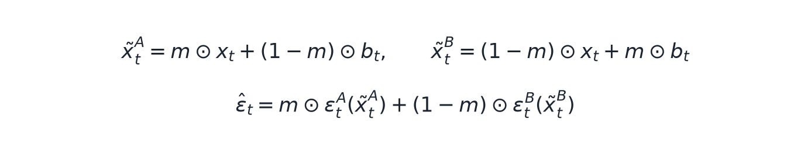
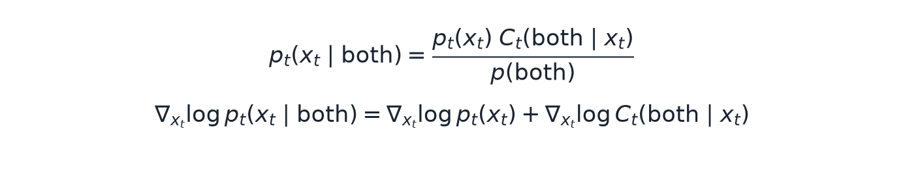

# The maths, step by step

**Said plainly.** Seven steps take Paper 1's formula apart, from "a noise prediction is a scaled score" to one full sampler step with
the push. Each step has its equation in TeX, the same equation rendered as a picture (for viewers that do not render TeX), one line per
symbol saying what moves when it moves, and a worked number from the toy.

**Direction.** Every step runs diffusion's way: $t$ goes from $T$ (pure noise) down to 0 (the picture). DCFM's flow runs the other
way, from noise at 0 to data at 1, so a DCFM page's "later" is this page's "earlier".

**The worked numbers.** All come from one state of the PoE ladder's toy, stored under `worked_state` in
[the numbers file](data/paper1_numbers.json). The toy canvas is four numbers, (4 in left, 7 in left, 4 in right, 7 in right). The
state is the joint's "4 left, 7 right" canvas noised to sampler step 26 of 50, counted from the noisy end, where
$\bar\alpha_t = 0.5517$ and $\sigma_t = 0.6696$:

$$x_t = (0.744,\ 0.201,\ -0.185,\ 0.143)$$

Symbols are in [the notation file](NOTATION.md). The derivations are taken from
[the digit guidance scene's derivation](../mnist-guidance-explained/4-the-derivation.md) and
[the PoE ladder](../product-of-experts-interaction-term/README.md), which work each one more slowly.

## Table of contents

- [1. A noise prediction is a scaled score](#1-a-noise-prediction-is-a-scaled-score)
- [2. The product of experts adds scores](#2-the-product-of-experts-adds-scores)
- [3. The interaction term is what the sum drops](#3-the-interaction-term-is-what-the-sum-drops)
- [4. The region merge keeps each expert on its own half](#4-the-region-merge-keeps-each-expert-on-its-own-half)
- [5. Bayes turns a checker into a score term](#5-bayes-turns-a-checker-into-a-score-term)
- [6. From score to noise: the push](#6-from-score-to-noise-the-push)
- [7. One full sampler step with the push](#7-one-full-sampler-step-with-the-push)
- [What the steps add up to](#what-the-steps-add-up-to)

## 1. A noise prediction is a scaled score

$$x_t = \sqrt{\bar\alpha_t}\,x_0 + \sigma_t\,\epsilon,\qquad \sigma_t = \sqrt{1-\bar\alpha_t}$$

$$\epsilon_\theta(x_t, y) = -\,\sigma_t\,\nabla_{x_t}\log p_t(x_t\mid y)$$

**Direction.** $t$ from $T$ to 0; $\bar\alpha_t$ rises toward 1 as $t$ falls, so $\sigma_t$ falls toward 0.

| Symbol | What moves when it moves |
|---|---|
| $\bar\alpha_t$ | larger keeps more of the clean picture in $x_t$ |
| $\sigma_t$ | larger means more noise, and a larger noise prediction for the same score |
| $\nabla_{x_t}\log p_t(x_t\mid y)$ | the score: which way each pixel should move to make $x_t$ more likely under $y$ |
| $\epsilon_\theta$ | what the network outputs; the minus sign and $\sigma_t$ turn the score into it |

**Worked number.** Expert A's score at $x_t$ is $s_A = (-0.296, -0.443, 0.701, -0.315)$. Multiply by $-\sigma_t = -0.6696$:
$\epsilon_A = (0.198, 0.297, -0.469, 0.211)$, which is what the toy's expert A predicts.

**Where it is derived.** [Step 1 of the digit derivation](../mnist-guidance-explained/4-the-derivation.md#step-1-why-every-guidance-term-carries-sqrt1-baralpha_t):
the noisy pixel is a Gaussian around the shrunk clean value, its score points back to the centre, and the network's best guess of
the noise is that score times $-\sigma_t$.

## 2. The product of experts adds scores

$$p(x\mid y_1, y_2)\ \propto\ \frac{p(x\mid y_1)\;p(x\mid y_2)}{p(x)}$$

$$\nabla\log p(x\mid y_1,y_2) = s_1 + s_2 - s_\varnothing$$

$$\epsilon_{\mathrm{PoE}} = \epsilon_\varnothing + \sum_i\,(\epsilon_{y_i} - \epsilon_\varnothing)$$

**Direction.** The same at every $t$; the product is formed afresh at each step from that step's three predictions.

| Symbol | What moves when it moves |
|---|---|
| $s_1, s_2$ | each expert pulls the whole canvas toward its own kind of picture |
| $s_\varnothing$ | the base is subtracted once, so the part both experts share is counted once |
| $\epsilon_{y_i} - \epsilon_\varnothing$ | how much asking for $y_i$ changes the prediction: an implicit classifier for $y_i$ |

**Worked number.** $\epsilon_\varnothing = (0.550, 0.072, -0.392, 0.006)$ and $\epsilon_B = (1.097, -0.277, -0.272, -0.311)$.
The first entry of the sum is $0.550 + (0.198 - 0.550) + (1.097 - 0.550) = 0.745$, and the whole is
$\epsilon_{\mathrm{PoE}} = (0.745, -0.052, -0.350, -0.107)$.

**Where it is derived.** [Step 4 of the digit derivation](../mnist-guidance-explained/4-the-derivation.md#step-4-the-product-of-experts-is-the-same-algebra),
which also shows that each bracket is a classifier push with strength 1, and [the product of experts method page](../../../../context/methods/01-the-product-of-experts/01-overview.md).

## 3. The interaction term is what the sum drops

$$I_t = \nabla_{x_t}\log p_t(x_t\mid y_1, y_2)\ -\ [\,s_1 + s_2 - s_\varnothing\,]$$

$$r_t = -\,\sigma_t\,I_t = \epsilon_{\mathrm{joint}} - \epsilon_{\mathrm{PoE}}$$

**Direction.** At every $t$. Step 2's product is exact only when this term is 0. Noising the experts and then multiplying them is
not the same as multiplying them and then noising, so $I_t$ is not 0 even when the clean product would be right.

| Symbol | What moves when it moves |
|---|---|
| $\nabla\log p_t(x_t\mid y_1,y_2)$ | the score of a model that had seen both together; Paper 1 never has one |
| $I_t$ | the correction toward canvases holding both; 0 where the sum is already right |
| $r_t$ | the same correction as a noise prediction, the size the project measures |

**Worked number.** The joint's score is $(-0.320, -0.126, 0.725, 1.004)$, so
$I_t = (0.793, -0.204, 0.202, 0.845)$ and $r_t = (-0.531, 0.136, -0.136, -0.566)$. The two largest entries of $I_t$ are 4 in the left
cell and 7 in the right cell: the dropped term pulls toward the canvas this state came from, the one with both digits apart.

**Where it is derived.** [The PoE ladder's closing page](../product-of-experts-interaction-term/README.md) and its
[miniature](../product-of-experts-interaction-term/02-the-miniature.md), where the product draws two apart in 811 of 4,000 and the
product plus $I_t$ at every step in 4,000.

## 4. The region merge keeps each expert on its own half

$$\tilde x^A_t = m\odot x_t + (1-m)\odot b_t,\qquad \tilde x^B_t = (1-m)\odot x_t + m\odot b_t$$

$$\hat\epsilon_t = m\odot\epsilon^A_t(\tilde x^A_t) + (1-m)\odot\epsilon^B_t(\tilde x^B_t)$$

**Direction.** At every $t$; which half is $m$ is voted over the steps with $t \ge 800$ and then held to the end.

| Symbol | What moves when it moves |
|---|---|
| $m$ | 1 on $R_A$, 0 on $R_B$; flipping it swaps which expert draws where |
| $b_t$ | an empty canvas noised to step $t$; it stops an expert from reacting to the other expert's digit |
| $\epsilon^A_t(\tilde x^A_t)$ | expert A's prediction, of which only the $R_A$ half is kept |

**Worked number.** With A on the left cell and B on the right, and the whole canvas visible to both to keep the arithmetic short,
the merge takes $\epsilon_A$'s first two entries and $\epsilon_B$'s last two: $\hat\epsilon_t = (0.198, 0.297, -0.272, -0.311)$. On the
toy, the merge with the other cell hidden draws two apart in 3,859 of 4,000, and with it visible in 3,468.

**Where it is in the code.** The `occlude` branch of `inferred_eps` in `two_experts.py`, read on
[the PoE ladder's code page](../product-of-experts-interaction-term/03-the-code.md).

## 5. Bayes turns a checker into a score term

$$p_t(x_t\mid \mathrm{both}) = \frac{p_t(x_t)\;C_t(\mathrm{both}\mid x_t)}{p(\mathrm{both})}$$

$$\nabla_{x_t}\log p_t(x_t\mid\mathrm{both}) = \nabla_{x_t}\log p_t(x_t) + \nabla_{x_t}\log C_t(\mathrm{both}\mid x_t)$$

**Direction.** At every $t$; $C_t$ reads the noisy $x_t$ and is told $t$, because "both will be there once the noise is gone" is a
different question at each noise level.

| Symbol | What moves when it moves |
|---|---|
| $p_t(x_t)$ | the density the checker's labels were drawn from; Bayes is exact only for this one |
| $C_t(\mathrm{both}\mid x_t)$ | how sure the checker is that both concepts are there, apart |
| $p(\mathrm{both})$ | a fixed number; its gradient is 0, so guidance never needs it |

**The catch.** Bayes is exact when $p_t$ is the density the checker trained on. Paper 1's checker trains on pastes of the experts'
own samples, and the push is added to the merge or the product, which is a different density. On the toy this gap can be measured:
with the checker's own training mixture as the base, the push at $\lambda = 1$ draws two apart in 4,000 of 4,000, as Bayes says.

**Worked number.** The toy's exact checker, trained on pastes of the toy experts' samples (half "both apart", half one digit alone or
both in one cell), gives $C_t = 0.468$ at this state and $\nabla_{x_t}\log C_t = (0.176, -0.180, 0.059, 0.545)$. Its cosine with $I_t$
from step 3 is 0.901: the checker's gradient points close to the term the product drops.

**Where it is derived.** [Step 2 of the digit derivation](../mnist-guidance-explained/4-the-derivation.md#step-2-what-guidance-aims-at-and-why-the-term-is-nabla_x_tlog-pymid-x_t).

## 6. From score to noise: the push

$$\hat\epsilon_t = \epsilon_{\mathrm{base}}(x_t)\ -\ \lambda_t\,\sigma_t\,\nabla_{x_t}\log C_t(\mathrm{both}\mid x_t)$$

$$\epsilon_{\mathrm{base}} = \mathrm{merge}(\epsilon^A_t|_{R_A},\,\epsilon^B_t|_{R_B})\quad\text{or}\quad \epsilon_{\mathrm{PoE}}$$

**Direction.** At every $t$ in the digit run. Step 1's factor $-\sigma_t$ converts step 5's score term into noise units, so the push
shrinks as $t$ nears 0.

| Symbol | What moves when it moves |
|---|---|
| $\lambda_t$ | how hard to push; 1 is Bayes, above 1 keeps fewer and surer pictures |
| $\sigma_t$ | the score-to-noise factor from step 1 |
| $\nabla_{x_t}\log C_t$ | the direction of the push, one number per pixel |
| the minus sign | the sampler subtracts predicted noise, so lowering the prediction moves the canvas uphill for $C_t$ |

**What the run does differently.** The digit run uses $\lambda = 10$ and cuts each canvas's push to at most 0.1 of the prediction's
length. Its pair checker pushes along its raw logit, and only while that logit is inside a clip window; its separate checker pushes
along $\log\sigma(z_a) + \log\sigma(z_b)$ ([`pixel_checker.py`](../../../scripts/mnist/pixel_checker.py), lines 70 to 91;
[why logits](../mnist-guidance-explained/4-the-derivation.md#step-7-the-checkers-outputs-are-logits)).

**Worked number.** With $\lambda = 1$: push $= -0.6696 \times (0.176, -0.180, 0.059, 0.545) = (-0.118, 0.121, -0.039, -0.365)$.
Added to step 4's merge, $\hat\epsilon_t = (0.080, 0.418, -0.312, -0.676)$. On the toy at $\lambda = 1$ the product plus the push
draws two apart in 4,000 of 4,000 and the merge plus the push in 3,955 ([the toy page](03-the-toy.md)).

**Where it is derived.** [Step 3 of the digit derivation](../mnist-guidance-explained/4-the-derivation.md#step-3-from-scores-to-noise-predictions-and-the-dial-s),
which calls the strength $s$.

## 7. One full sampler step with the push

$$\hat x_0 = \frac{x_t - \sigma_t\,\hat\epsilon_t}{\sqrt{\bar\alpha_t}}$$

$$x_{t-1} = \sqrt{\bar\alpha_{t-1}}\,\hat x_0 + \sqrt{1-\bar\alpha_{t-1}-\eta_t^2}\;\hat\epsilon_t + \eta_t\,z$$

**Direction.** One move from $t$ to the next, less noisy, level $t-1$. The digit run repeats it 50 times with $\eta = 1$; the toy uses
the same sampler.

| Symbol | What moves when it moves |
|---|---|
| $\hat\epsilon_t$ | the composed prediction from step 6; the push enters the picture only through it |
| $\hat x_0$ | the guess of the finished picture; the push moves this guess toward "both apart" |
| $\eta_t$ | how much fresh noise $z$ is added; 0 makes the step deterministic |

**Worked number.** $\hat x_0 = (0.744 - 0.6696 \times 0.080)/\sqrt{0.5517} = 0.929$ in the first entry, and
$\hat x_0 = (0.929, -0.106, 0.032, 0.802)$ in full: a 4 in the left cell and a 7 in the right, with almost nothing elsewhere. The next
level has $\bar\alpha_{t-1} = 0.5833$, $\eta_t = 0.2244$ and a factor 0.6053 on $\hat\epsilon_t$, so before fresh noise
$x_{t-1} = (0.758, 0.172, -0.164, 0.203)$, and $0.2244\,z$ is added.

**Where it is drawn.** [Step 6 of the digit derivation](../mnist-guidance-explained/4-the-derivation.md#step-6-the-whole-sampler-step)
and [the real sampler step](../mnist-guidance-explained/1-the-sampler-step.md).

## What the steps add up to

Put together, Paper 1's formula is step 4's merge (or step 2's product, where regions cannot apply) minus step 6's push, used in
step 7's sampler. The push stands in for step 3's dropped term, which Paper 1 can never compute because no model has seen both
concepts. Step 5's catch says how close it can get: exactly at $\lambda = 1$ only on the checker's own training mixture. Elsewhere it
is an approximation whose direction, on the toy, agrees with $I_t$ at a cosine of 0.901 at this state.

Next rung: [level 2, the toy](03-the-toy.md).
