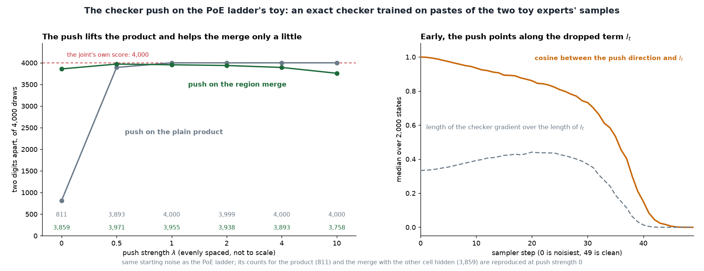

# Level 2: the toy, with the push added

**Said plainly.** The PoE ladder already has the toy Paper 1 needs: two experts that each draw one digit in one of two cells, a
product that rarely draws both apart, and the merge by region. It had no checker. This page adds one, trained on pastes of the two
toy experts' own samples, and measures what its push does on the product and on the merge. Every score in the toy is exact, so no
network is trained and nothing here is measured on the digit U-Nets.

## The toy, linked

[The PoE ladder's miniature](../product-of-experts-interaction-term/02-the-miniature.md) defines the canvas (four numbers: 4 in
left, 7 in left, 4 in right, 7 in right), the two experts, the base and the joint, and [its script](../product-of-experts-interaction-term/scripts/poe_toy.py)
holds the exact scores and the sampler (50 steps, $\eta = 1$, the project's sampler). This ladder imports that script read-only and
uses the same starting noise for all 4,000 draws.

| Way of composing, from the PoE ladder | Two apart, of 4,000 |
|---|---:|
| the product of the two experts | 811 |
| the product plus the interaction term at every step (the joint's own score) | 4,000 |
| each expert on its own cell, whole canvas visible, side held from a coin | 3,468 |
| each expert on its own cell, other cell hidden, side held from a coin | 3,859 |
| the same, side voted over steps 0 to 9 then held (the digit run's recipe) | 3,840 |
| the same, side re-voted at every step | 1,810 |

These are copied from [the PoE ladder's numbers](../product-of-experts-interaction-term/data/poe_interaction_numbers.json), key
`outcomes_of_4000`. This ladder's script recomputes the first and the fourth with the push at 0 and stops if either differs.

## What this page adds: the checker and its push

**The checker.** Paste the toy experts' samples into one canvas and three kinds come out: the 4 and the 7 in different cells,
labelled "both apart", and the 4 and the 7 in the same cell, or one expert's digit alone, labelled "not both apart". Half the training
canvases are positive and half negative. The checker is the exact answer to "is this noisy canvas one of the positives?" at each
noise level, so its gradient $\nabla_{x_t}\log C_t$ has no training error. It uses only what pasting the two experts' samples makes.

**The push.** $\hat\epsilon_t = \epsilon_{\mathrm{base}} - \lambda\,\sigma_t\,\nabla_{x_t}\log C_t$, at every step, with no cap, as
in [step 6 of the maths page](02-the-maths-step-by-step.md#6-from-score-to-noise-the-push).

**What the picture is.** Left: two digits apart, of 4,000 draws, against the push strength $\lambda$ at 0, 0.5, 1, 2, 4 and 10, drawn
evenly spaced and not to scale. Grey is the push on the plain product, green the push on the merge with the other cell hidden; the
counts are printed along the bottom. The dashed red line is the joint's own score, 4,000. Right: along the sampler step (0 noisiest,
49 clean), the median over 2,000 states drawn from the joint's own noised canvases of two things. The orange line is the cosine
between the checker's gradient and the interaction term $I_t$; the grey dashed line is the gradient's length over $I_t$'s length.
All values are in [the numbers file](data/paper1_numbers.json), key `toy_push`.

| $\lambda$ | 0 | 0.5 | 1 | 2 | 4 | 10 |
|---|---:|---:|---:|---:|---:|---:|
| product plus the push | 811 | 3,893 | 4,000 | 3,999 | 4,000 | 4,000 |
| merge (other cell hidden, coin) plus the push | 3,859 | 3,971 | 3,955 | 3,938 | 3,893 | 3,758 |

**Three readings, each on this toy only.**

*On the product the push does the whole job.* From 811 to 4,000 at $\lambda = 1$, the same count the joint's own score reaches. The
toy's checker is exact and its training canvases cover exactly the toy joint's two layouts, which no learned checker on real data gets.

*On the merge the push adds little and then costs.* The merge already draws 3,859. The push lifts it to 3,971 at $\lambda = 0.5$ and
lowers it to 3,758 at $\lambda = 10$. At $\lambda = 1$ the 45 failures of 4,000 are 8 with both digits in one cell, 8 with one
digit, and 29 other. This is the toy's version of the digit run's comparison, where the merge without a push is near pasting and the
push adds a lead smaller than its bar.

*The push points along the dropped term early and fades late.* The cosine with $I_t$ is 1.00 at step 0, 0.93 at step 10 and 0.81 at
step 25, then falls to 0.15 at step 40. Late in the run the checker is sure the canvas is "both apart" and its gradient is near 0, while
$I_t$ is largest there ([the PoE ladder's profile](../product-of-experts-interaction-term/01-the-network-view.md#the-term-against-the-step)).

**Where the push has to act, on this toy.** At $\lambda = 4$ on the product, the push over steps 0 to 9 only draws 814 two apart, over
steps 10 to 49 only it draws 4,000, and at every step 4,000. The toy's push works late, like the toy's interaction term. The digit
run pushes at every step, while the two-colour CLEVR design trains its checker at the early steps' noise levels and pushes only there
([the two-colour design](../../../../artifacts/notes/progress/method-search/05-two-experts-by-colour/design.md), line 28). On this toy
an early-only push does nothing. Whether the same holds for a learned checker on CLEVR is open, because the toy cannot separate what
composition needs from what a learned checker can fit.

**The Bayes check.** With the checker's own training mixture as the base, the push at $\lambda = 1$ draws two apart in 4,000 of 4,000,
as [step 5 of the maths page](02-the-maths-step-by-step.md#5-bayes-turns-a-checker-into-a-score-term) says it must. That confirms
the checker and its gradient are computed right.

## What moves when each part moves

| Part | If it grows | Seen on this toy |
|---|---|---|
| $\lambda$ | the sampler leans harder on the checker | product: 811 to 4,000 by $\lambda = 1$; merge: up to 3,971, then down to 3,758 |
| the merge's hidden cell | each expert reacts less to the other's digit | 3,468 visible against 3,859 hidden, with no push |
| the window the push acts in | late windows matter on this toy | 814 over steps 0 to 9, 4,000 over steps 10 to 49 |

## Try it yourself

| Step | What you should see | What it looks like when it fails |
|---|---|---|
| from this folder, run `~/.claude/venvs/figures/bin/python scripts/make_paper1_numbers.py` | about 5 seconds, then the two lambda rows above, `bayes check 4000`, and a worked state | `cite failed: ...`: a quoted line moved in a source file, so a number on these pages may no longer match its source |
| open `data/paper1_numbers.json`, find `reproduces_poe_ladder` | `product` 811 and `regions_hidden_coin_held` 3859 | an `AssertionError` before the file is written: the starting noise no longer matches the PoE ladder's, so every count here would be on different draws |

Next rung: [level 3, the code](04-the-code.md).
