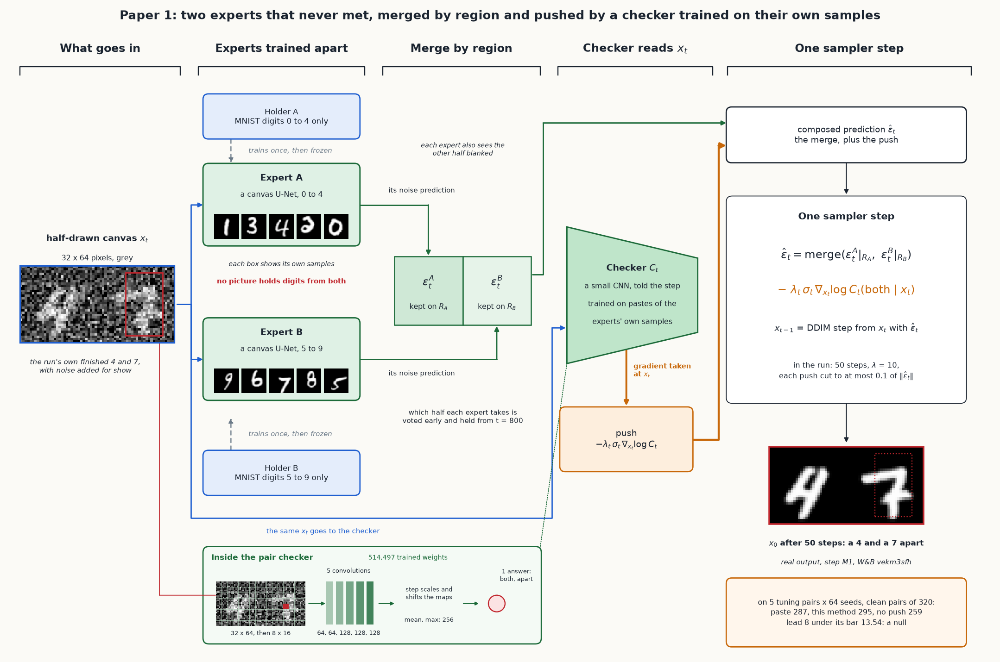

# Paper 1: composing experts that never met

**In one sentence.** Two diffusion models trained on data that never meet are composed while sampling: each denoises its own region,
the two predictions are joined, and a small checker trained only on pastes of their own samples pushes the joined prediction toward
"both concepts are there, apart".

## The method, read through the toy

**What goes wrong without it.** On the PoE ladder's toy, two experts each know one digit and nothing else. Their plain product draws
the two digits apart in 811 of 4,000 draws, because neither expert says anything about a canvas holding both
([the toy page](03-the-toy.md)).

**What the merge does.** Give each expert one cell and hide the other cell from it, and the toy draws two apart in 3,859 of 4,000. The
merge removes the fight between the experts over the same pixels. With the checker off it is close to sampling each expert alone and
pasting the results.

**What the push does.** The checker learns "both apart" from pastes of the experts' samples, and its gradient, scaled by
$-\lambda\sigma_t$, is added to the prediction. On the toy's plain product that push alone takes 811 to 4,000 at $\lambda = 1$. On the
merge it adds at most 112 (3,859 to 3,971) and costs 101 at $\lambda = 10$ (3,758). Early in the run its direction is close to the
interaction term the product drops: a cosine of 0.93 at step 10 of 50.

**The simple equation.** What the sampler follows = each expert on its own half, joined + a push toward "both apart".

**The source's notation, last.**

$$\hat\epsilon_t(x_t) = \mathrm{merge}\big(\epsilon^A_t(x_t|_{R_A}),\ \epsilon^B_t(x_t|_{R_B})\big) - \lambda_t\,\sigma_t\,\nabla_{x_t}\log C_t(\text{both concepts present}\mid x_t)$$

from [the two problem statements](../../../../artifacts/notes/progress/problem-statements.md#paper-1-composing-experts-that-never-met).
Where each concept cannot own a place, the merge is replaced by the plain product $\epsilon_\varnothing + \sum_i(\epsilon_{y_i} - \epsilon_\varnothing)$.

## The rungs

| Rung | State | Page |
|---|---|---|
| 0, the overview | built: one real digit canvas followed from input to output | [the overview](00-the-overview.md) |
| 0.5, the network view | linked (six figures from three scenes) and built (the merge, the push lane, the two settings) | [the network view](01-the-network-view.md) |
| 1, illustrations | skipped by the owner's choice | |
| the maths, step by step | built: seven steps, each in TeX and rendered, each with a worked toy number | [the maths](02-the-maths-step-by-step.md) |
| 2, the toy | linked (the PoE ladder's toy) and extended with the checker push | [the toy](03-the-toy.md) |
| 3, the code | linked: the digit run's functions by line, and four code walks | [the code](04-the-code.md) |
| close | this page | |

Colour key and symbols: [the notation file](NOTATION.md). The record of the rungs: [ladder.json](ladder.json). How the ladder was
run: [the route file](route-zoom-ladder-paper-1.md). Every printed value: [the numbers file](data/paper1_numbers.json), from
[its script](scripts/make_paper1_numbers.py).

## What has been shown, and what has not

| Statement | State | Source |
|---|---|---|
| On digits with fixed halves, the method with its push draws 295 clean pairs of 320 and sample-and-paste draws 287; the lead of 8 is under the bar of 13.54 | null | [the method against paste finding](../../../report/the-method-search/does-composing-two-digit-models-beat-sampling-and-pasting.md) |
| Inside that run the checker push lifts the method by 36 pairs over no push, and a random push of the same size changes nothing | shown, read after the run with no bar of its own | the same finding, section 2 |
| On CLEVR with one object per fixed place, pasting puts every object in place in 1,024 of 1,024 images | shown; counting objects there cannot separate the method from pasting | [the CLEVR paste finding](../../../report/the-method-search/does-sample-and-paste-already-solve-small-clevr.md) |
| With no regions, two digit experts drawing on either side give 0 clean pairs of 320, and both pushes give 4 | shown: the push alone does not compose them on digits | [the two-expert finding](../../../report/classifier-guided-poe/32-mnist-two-experts.md) |
| On one shared canvas with no halves, the best run draws 121 of 320, against a bar of 288 | inconclusive (proposed) | [the two digit models finding](../../../report/classifier-guided-poe/can-two-separately-trained-digit-models-compose-while-sampling.md) |
| 1,200 clean pairs of 1,280 on 20 unseen digit pairs, fixed halves | **on the void list, out of any claim** until the owner decides it | [the problem statement](../../../../artifacts/notes/progress/problem-statements.md#paper-1-composing-experts-that-never-met), line 39 |
| The push on two-colour CLEVR, where the experts are told what and not where | not established: renders under way, no expert trained | [the two-colour review](../../../../artifacts/notes/progress/method-search/05-two-experts-by-colour/review.md), line 3 |
| The push on Colored MNIST, DCFM's setting | not established: nothing built or run | [the DCFM gap note](../../../../artifacts/notes/progress/gaps/04-exploiting-dcfm.md), "What this cannot tell you" |
| Anything on chest X-ray, or in a latent space | not established | [the evaluation plan](../../../../artifacts/notes/progress/targets/paper-1-evaluation-plan.md#chest-x-ray-measures) |
| The toy counts on these pages | shown on the toy only, with exact scores | [the numbers file](data/paper1_numbers.json) |

## Paper 1's push beside a training-time independence penalty

DCFM retrains its experts with an independence penalty carried across data holders ($\lambda_{CI}$), so the fix lives in the weights.
Its guarantee needs a minimum share of combinations seen on some data holder: 0.19 on Colored MNIST, by the gap note's reading of
its Definition 3.1 ([the DCFM gap note](../../../../artifacts/notes/progress/gaps/04-exploiting-dcfm.md#lead-2-below-dcfms-minimum-share-of-seen-combinations)). Paper 1 leaves the experts finished and moves the fix to sampling: one
checker gradient per step, trained on pastes of the experts' own samples, whatever the number of experts. On the toy, the push on a
plain product does what the dropped term does (811 to 4,000), because its direction follows that term early in the run. On real digits
with regions, the push sits on top of a merge that is already close to pasting, and the gain over pasting is a null. The test that
would separate the two approaches, the push on Colored MNIST or on two-colour CLEVR with no regions, has not run.
