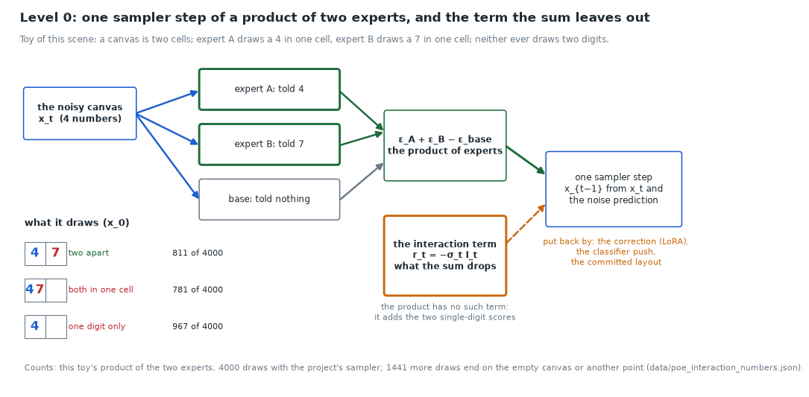

# Level 0: the system a product of experts lives in

**Said plainly.** A product of experts draws a picture by adding the noise predictions of several models that each know one thing, then taking a sampler step. The sum is exact only when the things do not interact. When they do, the sum leaves out a term, and the sampler draws what the sum says: a blend, one thing, or a picture that has neither.

**What each box does in the toy and in the real runs**

| Box | In this scene's toy | In the real runs |
|---|---|---|
| the noisy canvas | four numbers: how much 4 and how much 7 in the left cell, then in the right cell | a 32 × 64 image of noise (digits) or an SDXL latent (animals) |
| expert A, told 4 | a mixture of two narrow bumps: a 4 on the left, a 4 on the right | a U-Net trained on 0 to 4 digits on either side |
| expert B, told 7 | the same with a 7 | a U-Net trained on 5 to 9 digits on either side |
| base, told nothing | the four single-digit canvases, a quarter each | the experts' own no-digit prediction (averaged) |
| the interaction term | exact, computed from the joint's own bumps | never available; it is what the correction (LoRA), the pushes and the layout commit stand in for |

**Taking the names apart**

*Product of experts.* Product, because the densities are multiplied: a canvas is likely only if every expert finds it likely. Experts, because each model knows one thing and knows nothing else. On the toy, a canvas with a 4 and a 7 apart is unlikely to expert A (it never saw a 7) and unlikely to expert B (it never saw a 4), so the product is small there.

*Interaction term.* Interaction, because it is how the two things act on each other when they share a canvas. Term, because it is one piece of a sum: the joint's score equals the two single scores added, minus the base once, plus this piece.

**How this fails and how you know it worked.** It fails when the sampler ends on one digit, on both digits in one cell, or on an empty canvas: the toy's product does this in 3189 of 4000 draws ([the counts](data/poe_interaction_numbers.json)). It worked when the two digits are apart: 811 of 4000 for the product, 4000 of 4000 when the joint's own score is used.

**What already exists in your material (linked, not redrawn)**

| What | Where |
|---|---|
| the digit experiments, step by step, with the networks and the gradient drawn | [the guidance scene for the digit canvas](../mnist-guidance-explained/1-the-sampler-step.md) |
| the product as two classifiers, derived by hand | [classifier guidance by hand, plan 3](/home/molef/goal-setting/learning/deep-learning/diffusion-models/13-classifier-guidance-by-hand/plans/03-the-product-as-two-classifiers.md) |
| the AND operator derived | [plurality and timestep scheduling, plan 1](/home/molef/goal-setting/learning/deep-learning/diffusion-models/10-plurality-and-timestep-scheduling/plans/01-the-and-operator-derived.md) |
| the classifier-guidance ladder for animals | [guidance ladder page](../classifier-guidance-on-poe/guidance-ladder.html) |

Next rung: [level 0.5, the score fields and the time profile](01-the-network-view.md).
