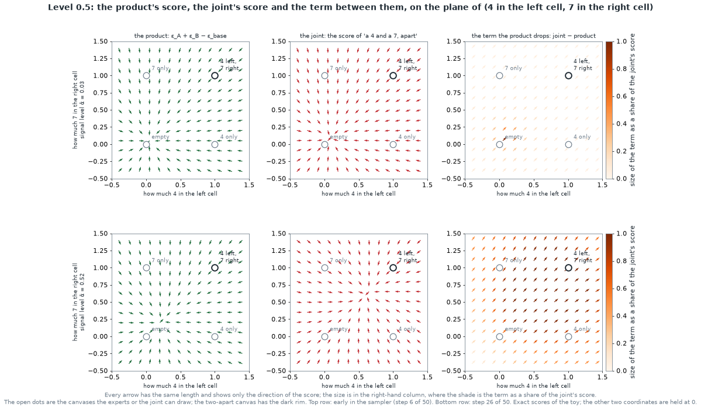
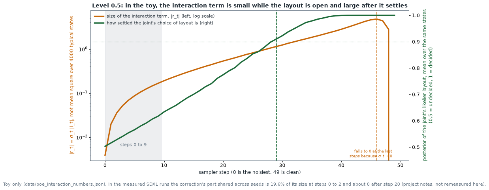

# Level 0.5: the score fields and the time profile

**Said plainly.** In this toy there is no trained network to draw, because every score is exact: each expert is a mixture of narrow bumps and its score at any noise level is a weighted pull toward the bumps. So the network view here shows what a network would be computing, as arrows on the plane that matters. The trained U-Nets of the real digit runs are drawn in [the digit scene's page on the networks](../mnist-guidance-explained/2-the-networks.md).

## The three fields

**What the picture is.** The plane has "how much 4 in the left cell" across and "how much 7 in the right cell" up. The open dots are the canvases the experts or the joint can draw. The one with the dark rim, 4 on the left and 7 on the right, is the canvas we want. Each arrow shows the direction a score pulls a point. Left column: the product, ε_A + ε_B − ε_0, in green. Middle: the joint's own score, in red. Right: the difference, orange, shaded by how large it is next to the joint's score.

**What it shows, with the numbers from [the numbers file](data/poe_interaction_numbers.json).**

| Row | Signal level ᾱ | Median size of the term as a share of the joint's score | Reading |
|---|---|---|---|
| top, step 6 of 50 | 0.03 | 0.07 | Early, the product and the joint point almost the same way. The term is a small correction. |
| bottom, step 26 of 50 | 0.52 | 0.76 | Mid-run, the product pulls toward the single-digit canvases and the joint pulls toward the two-apart canvas. The term is most of the joint's score. |

**Picture to equation.** The right column is I_t, the middle column minus the left, and the identity is: joint score = (s_A + s_B − s_0) + I_t. Where the right column is pale the product is nearly right. Where it is dark, the product is pulling somewhere else.

## The term against the step

**What the picture is.** Sampler step across (0 is the noisiest, 49 is clean). Left axis, on a log scale: |r_t| = σ_t |I_t|, the root mean square over 4000 states drawn from the joint's own noised marginal. Right axis: how settled the joint's choice between its two layouts is, from 0.5 (undecided) to 1.

**What it shows.** In this toy the layout settles to 0.9 at step 29 (signal level 0.65). |r_t| is 0.09 at step 5, 0.19 at step 10, 1.15 at step 29 and peaks at 4.80 at step 46. The share of the total squared |r_t| that lies in steps 0 to 9 is 0.05%.

**What this does and does not say.** The toy has exact scores and bumps one unit apart with width 0.1, so after the layout settles the term is large and cleanly defined. This does not reproduce the early window found in the real runs, where the part of the learned correction that is shared across seeds is 19.6% of its size at steps 0 to 2 and about 0 after step 20 (project notes, not remeasured here). The two are different systems, and the toy neither confirms nor contradicts the real one. What it does show is that where the term acts depends on the geometry of what is being composed, which is what a speciation analysis would predict as well.

## Checklist from the family table

| Family | Must show | Done here |
|---|---|---|
| score field | the score is a direction at every point | yes, every arrow |
| guidance as a vector sum | the sum of arrows, tip to tail | yes: green plus orange equals red, column by column |
| product of experts | the overlap, and where a fused sample sits | partly: the open dots stand in for the overlap; the log densities are in [level 2](02-the-miniature.md) |
| one sampler step | the drift arrow, the noise arrow, the move | no: the real run's step is in [the real-run figure](figures/real-run/one-sampler-step.png) |
| noise schedule | how much signal is kept at each step | in words: ᾱ is 6e-5 at step 0 and 1 at step 49 (cosine schedule) |

Next rung: [level 2, the miniature](02-the-miniature.md).
