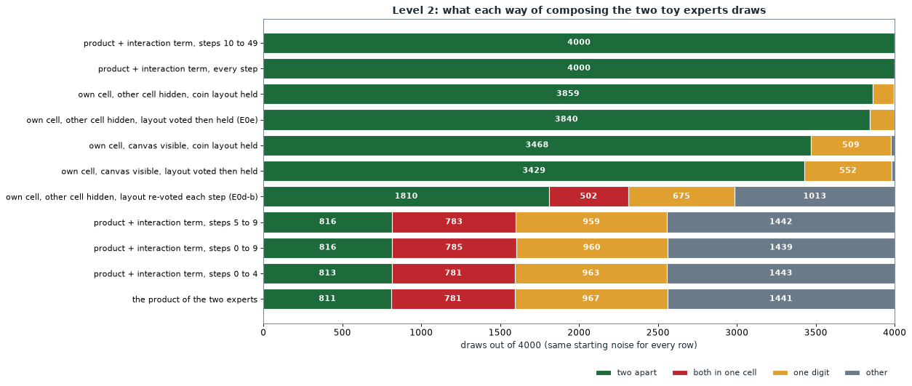
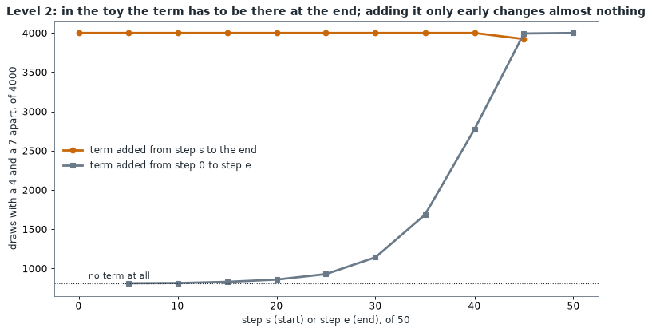

# Level 2: the miniature, an exactly solvable toy

**Said plainly.** Two experts that each draw one digit, composed by the product, on a canvas small enough that every score is exact. The numbers on this page come from [the numbers script](scripts/make_poe_interaction_numbers.py) and are written to [one file](data/poe_interaction_numbers.json). Nothing here is measured on SDXL or on the digit U-Nets.

## The toy

A canvas is two cells, left and right. Each cell holds two numbers: how much 4 and how much 7. So x = (4 in L, 7 in L, 4 in R, 7 in R), four numbers. A digit drawn is 1 in its place and 0 elsewhere, with Gaussian blur of width 0.1.

| Density | What it can draw | Weights |
|---|---|---|
| expert A, told 4 | a 4 in the left cell, or a 4 in the right cell | ½, ½ |
| expert B, told 7 | a 7 in the left cell, or a 7 in the right cell | ½, ½ |
| base, told nothing | those four single-digit canvases | ¼ each |
| the joint, told 4 and 7 | a 4 in one cell and a 7 in the other | ½, ½ |

Neither expert ever draws two digits, which is the situation of the two digit experts in plan 32 and plan 33.

## What the product puts its mass on

Natural log of each density at the cleanest level, up to one shared constant. The product column is log p_A + log p_B − log p_base.

| Canvas | log p_A | log p_B | log p_base | log product | log joint |
|---|---|---|---|---|---|
| 4 in the left cell only | −0.7 | −100.0 | −1.4 | −99.3 | −50.7 |
| 7 in the right cell only | −100.0 | −0.7 | −1.4 | −99.3 | −50.7 |
| 4 left and 7 right (two apart) | −50.7 | −50.7 | −50.7 | −50.7 | −0.7 |
| 4 and 7 both in the left cell | −50.7 | −50.7 | −50.7 | −50.7 | −100.0 |
| empty | −50.0 | −50.0 | −50.0 | −50.0 | −100.0 |

**What the table says.** The product is not empty. It is decided by the tails of the two experts: its highest log mass is on the empty canvas (−50.0), then a tie between the two-apart canvas and the fused canvas (−50.7), and the single-digit canvases the experts know best sit far below at −99.3. Neither expert says anything about what it has never seen, so the product's mass on a canvas with a 4 and a 7 is whatever the two tails happen to leave. The joint has −0.7 on the two-apart canvas.

## What each way of composing draws

**What the picture is.** One bar per way of composing, 4000 draws each from the same starting noise, split into two digits apart (green), both in one cell (red), one digit only (amber) and anything else (grey). The sampler is the project's (50 steps, eta 1).

| Way of composing | Two apart, of 4000 |
|---|---|
| the product of the two experts | 811 |
| product plus the interaction term at every step (the joint's own score) | 4000 |
| product plus the interaction term, steps 0 to 9 only | 816 |
| product plus the interaction term, steps 10 to 49 only | 4000 |
| each expert keeps its own cell, canvas visible, coin layout held | 3468 |
| the same with the layout voted over steps 0 to 9 then held | 3429 |
| each expert keeps its own cell, other cell hidden, coin layout held | 3859 |
| the same with the layout voted then held (the E0e recipe) | 3840 |
| other cell hidden, layout re-voted at every step (the E0d-b recipe) | 1810 |

**Three readings, each on this toy only.**

*The order of the digit runs is reproduced.* Re-voting at every step is the worst of the region recipes (1810), holding the layout is far better, and hiding the other cell adds about 400 on top. The same ordering was found on the real digit experts, and the real run's missing cell (held layout, canvas visible) is filled here: 3468 and 3429, so on the toy hiding is worth 10 points and holding is worth 50.

*The vote does nothing the coin does not.* Voted and held gives 3840, a coin held gives 3859. The two toy experts have no side preference, so the vote has nothing to find. The real digit experts also train with the digit on either side equally, and the matching control on them is still to run.

*The interaction term has to be there at the end.* Added over steps 0 to 9 only it changes 811 to 816; added over steps 10 to 49 it reaches 4000.

**What the picture is.** Orange: the term added from step s to the end. Grey: added from step 0 to step e. The orange line stays at 4000 until s is 45. The grey line stays near 811 until e is about 30 and reaches 4000 at e = 45.

**What it says and what it does not.** In the toy the joint's score is exact at every noise level, so adding it late is a complete repair. A learned correction is not exact at low noise, and the real runs found their correction acts early. The toy therefore cannot say whether the early window is a property of composition or of how well a learned term can be fitted. That is a question for the fork test on the real runs: take a state at step k, run 16 continuations, and record the fraction that compose.

## What moves when each symbol moves

The identity: joint score = s_A + s_B − s_0 + I_t.

| Symbol | If it grows | Seen in this toy |
|---|---|---|
| s_A | the sum pulls harder toward the 4-bumps | the product's arrows lean to the single-4 canvases |
| s_B | the sum pulls harder toward the 7-bumps | the same toward the single-7 canvases |
| s_0 | the sum subtracts more of the common part | the product relaxes toward the empty canvas |
| I_t | the correction toward the canvas with both | zero where the sum is already right, large after the layout settles |

## Try it yourself

| Step | What you should see | What it looks like when it fails |
|---|---|---|
| `cd` into this scene folder and run `python scripts/make_poe_interaction_numbers.py` with the sdxl-local python | a line per way of composing, with 811 for the product and 4000 for the joint's own score | different counts: the seed or the schedule changed, which would also change every figure here |
| open `data/poe_interaction_numbers.json`, find `two_apart_of_4000_by_window` | a ten-step window table that reaches 4000 only at steps 40 to 49 | a table that is flat: the term was not applied |

Next rung: [level 3, the code](03-the-code.md).
