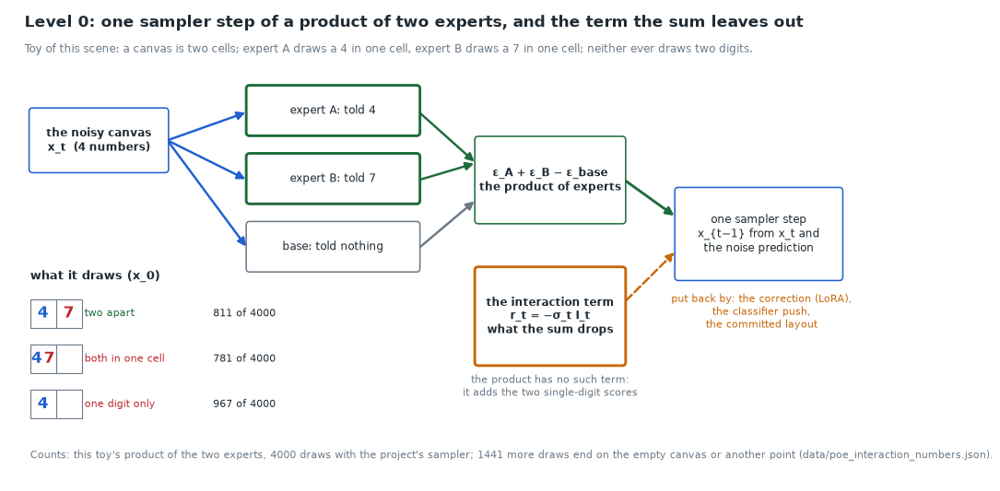
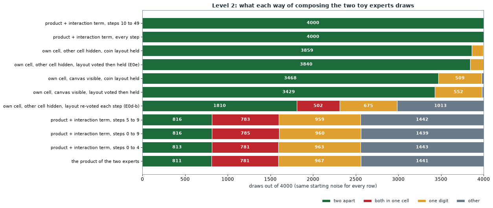

# The product of experts and the interaction term it drops

**In one sentence.** Adding the noise predictions of two experts is exact only when what they draw does not interact; the term it leaves out is the interaction term, and it is what the correction (LoRA), the classifier pushes and the committed layout each stand in for.

<table><tr>
<td> the system</td>
<td> what each way of composing draws</td>
</tr></table>

**The simple equation.** What the joint pulls toward = what expert A pulls toward + what expert B pulls toward − what the base pulls toward + the interaction term. In the toy, the product of the two experts draws a 4 and a 7 apart in 811 of 4000 draws, and the same sum plus the interaction term in 4000 of 4000 ([numbers](data/poe_interaction_numbers.json)).

**The source's notation, last.** ∇ log p_t(x | c₁, c₂) = [s_1 + s_2 − s_∅] + I_t, and r_t = −σ_t I_t is the same term as a noise prediction. The identity is this project's own derivation; Liu et al. assume I_t = 0 (conditional independence), Bradley et al. redefine the goal so that it is not needed, and CoInD trains it toward 0.

## The rungs

| Rung | State | Page |
|---|---|---|
| 0, the system | built | [the system](00-the-system.md) |
| 0.5, the network view | built (no trained network in the toy, so the fields stand in) | [score fields and time profile](01-the-network-view.md) |
| 1, the idea illustrated | skipped: needs Codex-drawn illustrations, not run unattended here; the real-run pictures below stand in | [real-run pictures](figures/real-run/) |
| 2, the miniature | built | [the toy](02-the-miniature.md) |
| 3, the code | built, reading this project's own code in place | [the code](03-the-code.md) |
| beside, the companion | built as pointers into the learning tree | [where each equation is taught](04-where-each-equation-is-taught.md) |
| close | this page | |

The real-run pictures from the digit runs, which show the same ideas on the trained experts: [the four steps of E0e](figures/real-run/e0e-1-where-each-expert-wants-its-digit.png), [the layout flips or holds](figures/real-run/e0e-2-the-layout-flips-or-holds.png), [hide the other half and join](figures/real-run/e0e-3-hide-the-other-half-and-join.png), [one real sampler step](figures/real-run/one-sampler-step.png) and [the ways of composing, three pairs](figures/real-run/qualitative-ways-of-composing.png).

## What the toy found

1. **The product is decided by tails.** Its highest log mass is on the empty canvas (−50.0), then a tie between two apart and both in one cell (−50.7), with the single digits at −99.3. This is the toy's version of the real digit experts' product giving 0 to 11 clean pairs of 320.
2. **The ordering of the real digit runs repeats.** Re-voting the layout at each step 1810, holding it 3840, hiding the other cell adds about 400.
3. **The vote adds nothing to a coin.** 3840 for the vote against 3859 for a coin. The matching control on the real digit experts is still to run.
4. **The interaction term acts late in the toy, not early.** Steps 0 to 9 only: 816. Steps 10 to 49: 4000. The toy has exact scores and cannot tell whether the early window of the real runs is a property of composition or of how well a learned term can be fitted.

## What is measured where

| Statement | Measured on | Source |
|---|---|---|
| the toy's counts and profile | this toy, exact scores | [the numbers file](data/poe_interaction_numbers.json) |
| the real correction's shared part is 19.6% of its size at steps 0 to 2 and about 0 after step 20 | SDXL cat and dog, project runs | project notes, not remeasured here |
| the early-readout push works on steps 0 to 15 | digit and animal runs | project notes, not remeasured here |
| E0e: 310 of 320 on five tuning pairs, 1,200 of 1,280 by the judge on 20 unseen pairs | digit experts | [the plan 33 review file](../../../plans/review/33-experts-that-compose-at-inference.md) |
| where speciation lands for the product of two experts | not measured | open: needs the fork test |

## Next tests named, none run for this scene

The random held layout against the voted one on the real digit experts. The commit-time sweep t₀ in {980, 800, 600, 400, 200}. The fork test: take a state at step k, run 16 continuations, record the fraction that compose. The first two are written up in the walk's idea map; the third compares with the speciation time read from the data covariance.

**Taking "speciation" apart.** Species, a kind that stays apart from the others; the ending, the moment of becoming. In a diffusion run it is the step at which a trajectory stops being able to end in either of two kinds and commits to one. On the toy the nearest thing measured is the step at which the joint's choice of layout reaches 0.9, which is step 29.

Colour key and symbols: [the notation file](NOTATION.md). The record of the rungs: [ladder.json](ladder.json).
