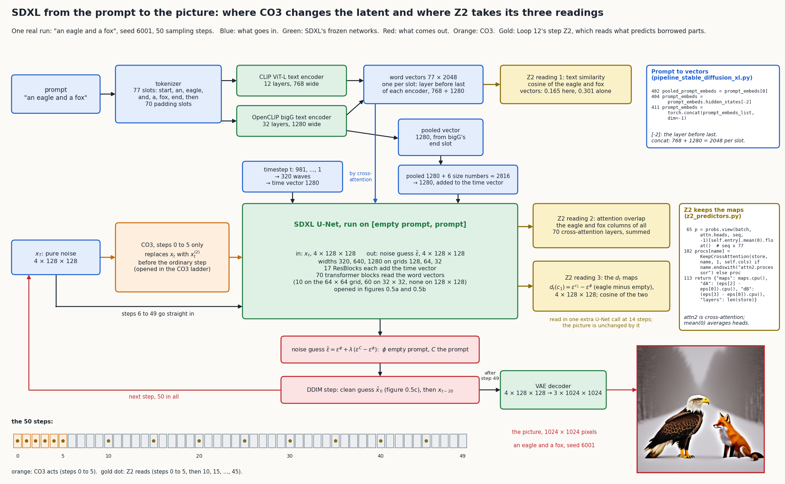
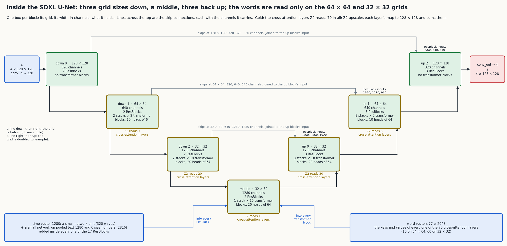
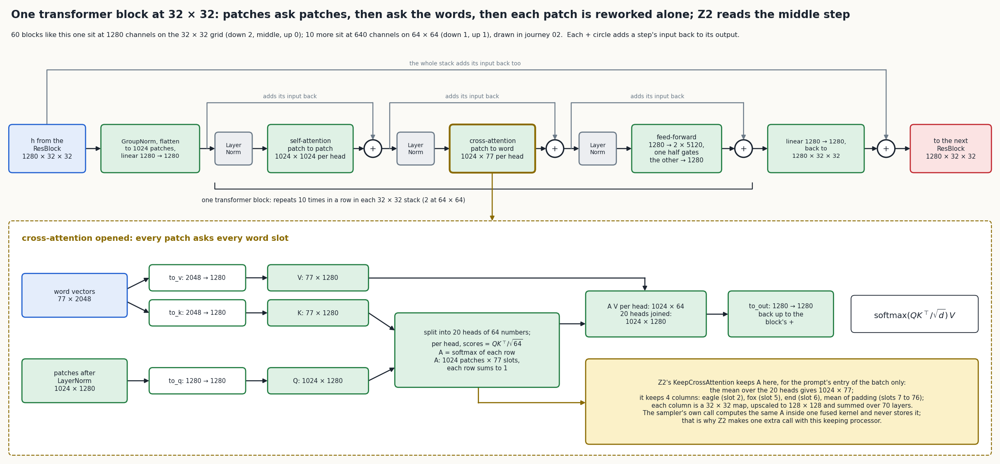
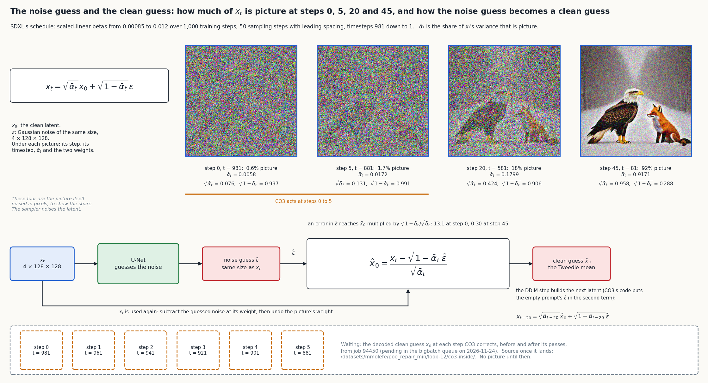
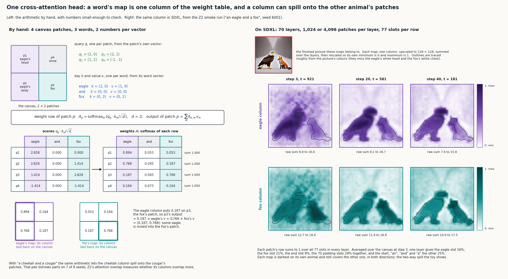

# SDXL from the prompt down to one attention head

This page follows one real SDXL picture, "an eagle and a fox" at seed 6001, from the prompt to the pixels, then opens
the network a level at a time down to one cross-attention head worked by hand. Its purpose is to show where two things
sit inside SDXL: CO3's fix, which changes the latent before SDXL's first six steps, and the three readings Loop 12's
step Z2 takes to find out what predicts borrowed parts. Every size comes from SDXL's own config files through
`sdxl_numbers.json`, and every symbol is in [the notation file](NOTATION.md).

**Words this uses**

**CO3** is the sampler from "Steer Away From Mode Collisions" (Dutta et al., arXiv 2509.25940). Before each of the first
six of 50 steps it rebuilds or edits the latent from the U-Net's predictions for the joint prompt and for each animal
alone. **Z2** is Loop 12's step that measures three things inside SDXL while CO3 renders, to find which one rises with
the number of pictures that **borrow parts** (two separate animals, one carrying a clear part of the other). A **word
slot** is one of the 77 positions a prompt is padded or cut to.

## Level 0: one picture from the prompt to the pixels

The prompt is split into 77 word slots, and two text encoders read it: CLIP ViT-L (12 layers, 768 numbers per slot)
and OpenCLIP bigG (32 layers, 1280 per slot). SDXL keeps the layer before last of each and joins them, so every slot
becomes a word vector of 2,048 numbers; bigG's end slot, projected, becomes one pooled vector of 1,280. Journey 13
draws this path as circles in [a caption becomes word vectors](../../../../../../goal-setting/learning/deep-learning/diffusion-models/13-classifier-guidance-by-hand/artifacts/figures/network-view/nv2-a-caption-becomes-word-vectors.png),
and the timestep's path in [a timestep becomes a time vector](../../../../../../goal-setting/learning/deep-learning/diffusion-models/13-classifier-guidance-by-hand/artifacts/figures/network-view/nv3-a-timestep-becomes-a-time-vector.png).
Z2's first reading is taken here, before any sampling: the cosine between the eagle slot's and the fox slot's word
vectors, 0.165 inside "an eagle and a fox" and 0.301 when each is encoded alone.

The picture starts as pure noise of 4 × 128 × 128 and goes through the U-Net 50 times, from timestep 981 down to 1.
At steps 0 to 5 only, CO3 replaces the latent with its own version before the ordinary step; steps 6 to 49 go straight
in. What CO3 does inside that box is drawn in [the CO3 overview](../co3-sampler/co3-overview.png) and the
[CO3 schedule](../co3-sampler/co3-schedule.png), which say which of the six steps resample and which correct, and read
in full on [the CO3 reading page](../co3-sampler/index.md). Z2's other two readings come from one extra U-Net call at 14
of the 50 steps (0 to 5, then 10, 15, ..., 45), made on the latent the sampler is about to step from and then
discarded: the attention overlap, from the eagle and fox columns of all 70 cross-attention layers, and the $d_t$ maps,
what each animal's prompt adds to the empty prompt's noise guess. Z2's design draws its read steps against the share of
picture in [what Z2 reads and when](../../../../artifacts/notes/progress/leakage/02-what-predicts-borrowing/z2-what-and-when.png)
and states its test in [the borrowing design note](../../../../artifacts/notes/progress/leakage/02-what-predicts-borrowing/design.md).
After step 49 the VAE decoder turns the 4 × 128 × 128 latent into the 1024 × 1024 picture.

## Level 0.5: inside the network

### 0.5a: the U-Net's blocks, and where the words and the time enter

The U-Net works on three grid sizes: 128 × 128 at 320 channels, 64 × 64 at 640 and 32 × 32 at 1,280. The blocks at
128 × 128 hold no transformer blocks, so no word is read there. Down 1 and up 1 hold 10 transformer blocks at 64 × 64,
and down 2, the middle and up 0 hold 60 at 32 × 32, so Z2's attention maps come from 70 layers on two grids. The time
vector (1,280) is added inside every one of the 17 ResBlocks after the pooled text and 6 size numbers (2,816 numbers in
all) have been mapped to 1,280 and added to it; journey 13 draws that join in
[how the inputs join](../../../../../../goal-setting/learning/deep-learning/diffusion-models/13-classifier-guidance-by-hand/artifacts/figures/network-view/nv4-how-the-inputs-join.png).
The same U drawn as bars, with one ResBlock opened, is
[inside the SDXL U-Net](../../../../../../goal-setting/learning/deep-learning/diffusion-models/13-classifier-guidance-by-hand/artifacts/figures/network-view/nv9-inside-the-sdxl-unet.png),
and the word-map checker counts the per-head maps those 70 layers give in
[where the maps come from](../word-map-checker/0.5-network-view/wm1-three-inputs-and-where-the-maps-come-from.png).

### 0.5b: one transformer block, and the step Z2 reads

Each transformer block does three things to the row of patches, each after a LayerNorm and each adding its input back:
self-attention, where every patch asks every other patch (1,024 × 1,024 weights per head at 32 × 32); cross-attention,
where every patch asks the 77 word slots, with keys and values made from the word vectors (1,024 × 77 weights per head);
and a feed-forward step that reworks each patch alone. Z2 keeps the cross-attention weights, averaged over the 20 heads,
for four columns: eagle, fox, end-of-text and the mean of the padding. The 640-channel block at 64 × 64 is drawn in
journey 02's [inside one transformer block](../../../../../../goal-setting/learning/deep-learning/generative-models/02-stable-diffusion-and-clip/artifacts/figures/sd/network-view/sd3-inside-one-transformer-block.png),
and the two kinds of attention side by side with measured weights in
[self-attention against cross-attention](../../../../../../goal-setting/learning/deep-learning/generative-models/02-stable-diffusion-and-clip/artifacts/figures/sd/network-view/sd4-self-attention-against-cross-attention.png).

### 0.5c: the noise guess and the clean guess

The noisy latent is $x_t = \sqrt{\bar\alpha_t}\,x_0 + \sqrt{1-\bar\alpha_t}\,\epsilon$, and $\bar\alpha_t$ is the share
of its variance that is picture: 0.6% at step 0, 1.7% at step 5, 18% at step 20 and 92% at step 45 on SDXL's schedule.
The U-Net guesses $\epsilon$, and the clean guess $\hat x_0 = (x_t - \sqrt{1-\bar\alpha_t}\,\hat\epsilon)/\sqrt{\bar\alpha_t}$
(the Tweedie mean) follows by subtracting the guessed noise and dividing by the picture's weight. An error in
$\hat\epsilon$ reaches $\hat x_0$ multiplied by 13.1 at step 0 and by 0.30 at step 45, which is why the clean guesses
CO3 builds on at steps 0 to 5 are blurry. Journey 02 decodes one step's latent, guess and next latent in
[one sampler step](../../../../../../goal-setting/learning/deep-learning/generative-models/02-stable-diffusion-and-clip/artifacts/figures/sd/network-view/sd6-one-sampler-step.png),
and the product-of-experts scene draws the step that composes two predictions in
[one sampler step of a product of experts](../product-of-experts-interaction-term/figures/level0-one-sampler-step-of-a-product-of-experts.png).

> [!NOTE]
> **Waiting for job 94450.** The decoded clean guess at each step CO3 corrects, before and after its passes, will fill
> the empty row at the bottom of the figure. Job 94450 was pending in the bigbatch queue on 2026-11-24, and its outputs
> land at `/datasets/mmolefe/poe_repair_min/loop-12/co3-inside/`. No picture is shown until then.

## Level 2: one attention head by hand

Four canvas patches, three words and two numbers per vector are enough to see the whole computation. Each patch's query
is scored against each word's key, divided by $\sqrt{d}$, and the softmax turns each patch's row of scores into weights
that sum to 1. A word's attention map is its column of that table laid back on the canvas. In the toy the eagle column
puts 0.187 on the fox's patch, so the fox's patch mixes in 0.187 of the eagle word's value. The right half shows the
same columns on SDXL for the real picture, summed over the 70 layers: each map is darkest on its own animal and still
covers the other, in both directions. With "a cheetah and a cougar", a pair that borrows parts on 7 of 8 seeds, the
same arithmetic lets the cheetah column spill onto the cougar's patches; Z2's overlap measures whether it does. The
word-map checker draws one layer's column becoming a word's stack of maps in
[from one layer to a word's stack](../word-map-checker/0.5-network-view/wm2-from-one-layer-to-a-words-stack.png).

## Level 3: the code

[The code page](code-walk.md) copies the lines that compute each level, with their line numbers, from diffusers 0.29.2
(the version the `co3` environment on mscluster runs), CO3's checkout and Z2's `z2_predictors.py`. It runs in the same
order as this page: the prompt to vectors, the time vector, the U-Net's shape and path, one transformer stack and block,
the clean guess, one attention head, and Z2's `KeepCrossAttention`.

## Where to read further

**Building SDXL from simple maths.** [Diffusion from simple maths to SDXL](../../../../../../goal-setting/learning/deep-learning/diffusion-models/00-from-scratch-to-sdxl/MASTER_PLAN.md)
is the learning journey that builds each part on this page from first principles.

**Rebuilding a small latent diffusion model.** [Rebuilding a minimal latent diffusion model](../../../../../../goal-setting/learning/deep-learning/diffusion-models/latent-diffusion-architecture-rebuilt/MASTER_PLAN.md)
rebuilds the VAE, the U-Net and its attention at small size.

**Where an adapter touches the U-Net.** [The LoRA corridor](../../../../../../goal-setting/learning/deep-learning/diffusion-models/where-the-lora-touches-the-unet-corridor/CORRIDOR.md)
opens the same cross-attention layers to say what adapting each one can change, and
[the prompt-to-prediction corridor](../../../../../../goal-setting/learning/deep-learning/diffusion-models/prompt-to-prediction-corridor/CORRIDOR.md)
traces a prompt through SDXL to every place two predictions could meet.

**The SDXL notebook.** [The SDXL notebook artifact](https://claude.ai/artifact/1GayZthQkRL4FmukdCV9WW) runs the pipeline
step by step.

Where the existing figures and SDXL's config differ

No size printed by the linked figures contradicts the config. Two figures leave something out. The word-map checker's
[where the maps come from](../word-map-checker/0.5-network-view/wm1-three-inputs-and-where-the-maps-come-from.png) joins
only the 1,280 pooled numbers to the time vector and leaves out the 6 size numbers (1,536 of the 2,816 that
`add_embedding` takes); journey 13's nv4 includes them. Journey 02's sd3 leaves out the GroupNorm before the flatten and
says so on its face. CO3's code reads $\bar\alpha$ at $t - 1$ rather than at $t$, which moves the share of picture at
step 0 from 0.579% to 0.584%; both round to the 0.6% printed here.

