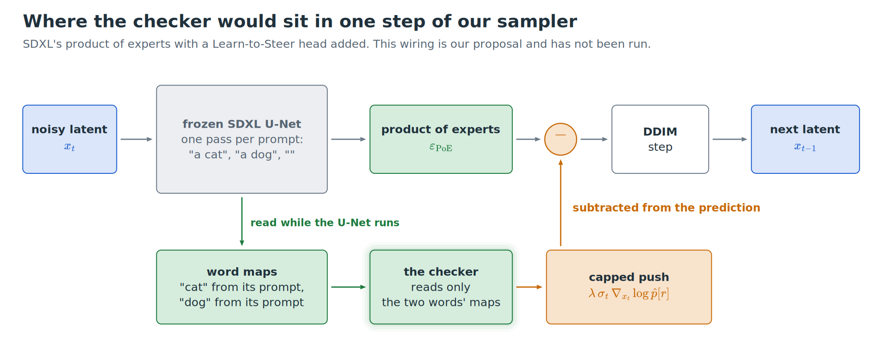
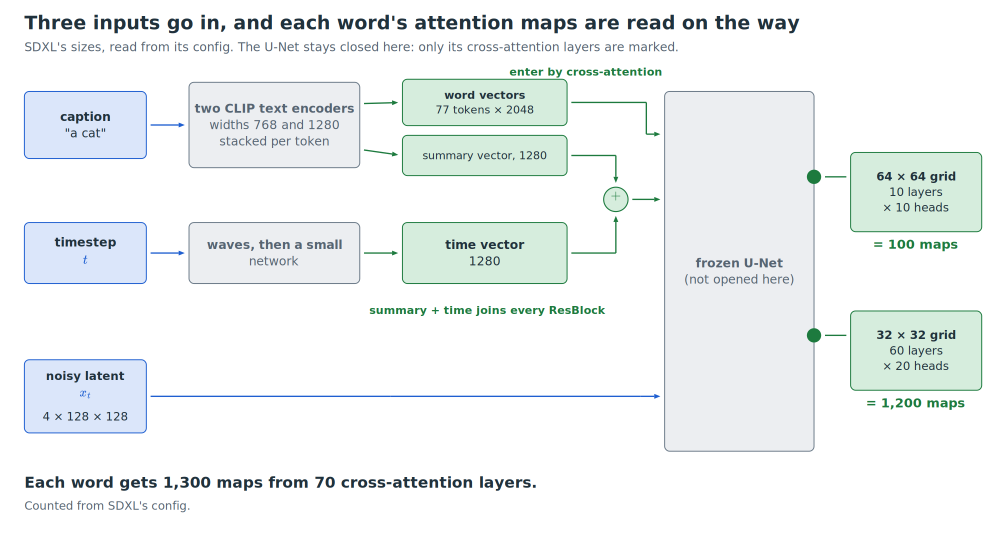
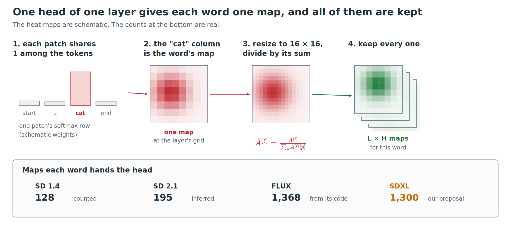
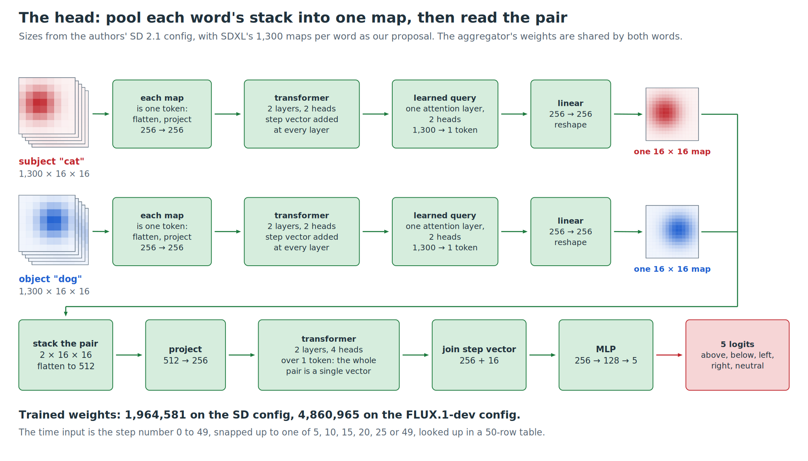
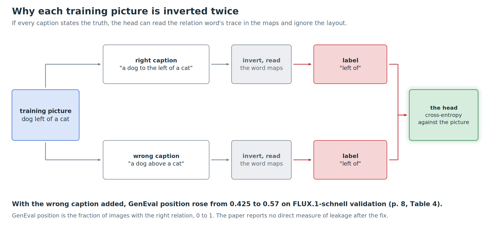
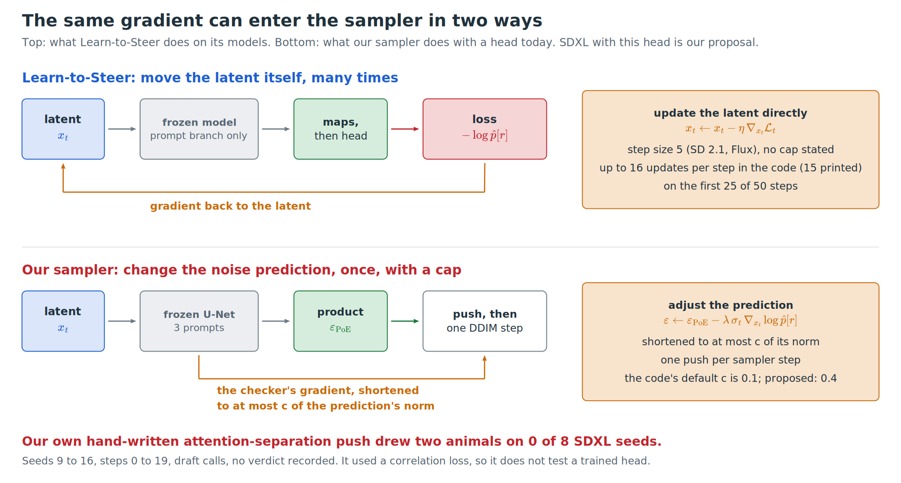
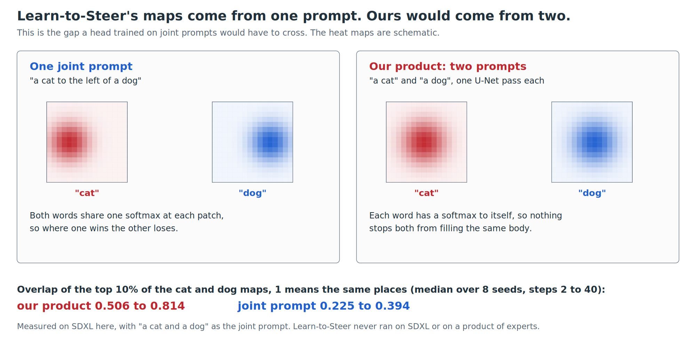

# The word-map checker's network view

These figures open the classifier-push box of our sampler into the network a word-map checker would be. They are level 0.5 of the [word-map checker ladder](../README.md): the real inputs and sizes, with no worked numbers on the edges. The U-Net stays closed, because this view stops at how the inputs join and where the maps are read.

Learn-to-Steer ran on FLUX and on SD 1.4 and 2.1, and never on SDXL. Anything drawn on SDXL here is our proposal. Sizes come from [the ladder's numbers](../numbers/numbers.json), and symbols from [the ladder's notation](../NOTATION.md). Figures marked "journey 13" or "journey 02" already existed and are linked where they make a point. The `wm` figures are new.

## Reading order

1. **Our sampler, and where the checker would sit.**
   
   The checker reads the word maps while the U-Net runs, and its capped push comes off the product's noise prediction before the DDIM step.

2. **The three inputs and where the maps come from.**
   
   SDXL has 10 cross-attention layers of 10 heads at 64 × 64 and 60 layers of 20 heads at 32 × 32, so each word gets 100 + 1,200 = 1,300 maps. The figure draws the summary vector joining the time vector directly. SDXL also folds six size numbers into that join, which [how the inputs join (journey 13)](../../../../../../../goal-setting/learning/deep-learning/diffusion-models/13-classifier-guidance-by-hand/artifacts/figures/network-view/nv4-how-the-inputs-join.png) shows.

3. **One patch asks the words (journey 13).**
   
   The softmax whose weights are the word maps.

4. **Where cat and dog land on a real SDXL run (journey 02).**
   
   Real maps, for comparison with the schematic heat maps below.

5. **From one layer to a word's stack.**
   
   Learn-to-Steer keeps every layer's and head's map, each resized to 16 × 16 and divided by its sum. That is 128 maps on SD 1.4, 195 on SD 2.1 (inferred), 1,368 on FLUX and 1,300 on SDXL (our proposal).

6. **Pooling with a learned query (journey 02).**
   
   The fourth column is what the head's aggregator does to each word's stack of maps.

7. **The head.**
   
   Each word's stack becomes one map, and the pair becomes five logits. The head holds 1,964,581 trained weights on the authors' SD config and 4,860,965 on their FLUX.1-dev config. Its time input is the step number, snapped to one of 5, 10, 15, 20, 25 or 49.

8. **Why each training picture is inverted twice.**
   
   Both inversions carry the relation seen in the picture, so the head cannot succeed by reading the relation word. GenEval position rose from 0.425 to 0.57 on FLUX.1-schnell's validation set (p. 8, Table 4).

9. **The same gradient, two ways in.**
   
   Learn-to-Steer moves the latent itself, up to 16 times per step in its code (the paper prints 15) on the first 25 of 50 steps. Our sampler changes the noise prediction once per step under a cap. Our hand-written attention-separation push drew two animals on 0 of 8 SDXL seeds (seeds 9 to 16, steps 0 to 19, draft calls, no verdict recorded). That push used a correlation loss, so it does not test a trained head.

10. **What changes on a product of experts.**
    
    Learn-to-Steer's head trained on maps from one joint prompt, where the two words compete. Ours would read two prompts, where they do not. On SDXL the top 10% of the two maps overlaps by 0.506 to 0.814 for the product and 0.225 to 0.394 for the joint prompt "a cat and a dog" (median over 8 seeds at each of steps 2 to 40).

## What these figures cannot show

The heat maps in wm2, wm3 and wm6 are schematic. Whether word maps can be read at SDXL's earliest steps is untested here. A word-map detector on SD 2.1 scored 18.0 of 100 at $t = 800$ against 58.4 at $t = 200$ ([the Detector Guidance note](../../../../../artifacts/notes/progress/abstract-checkers/01-reading/detector-guidance.md)), and 10 of our 16 pushed steps sit above $t = 800$. Carrying that SD 2.1 result to SDXL is an inference.

## How they were built

[The figure script](make_network_view.py) reads every size from the numbers file and draws through [the shared figure kit](../figure_kit.py), which refuses to write a figure where a line crosses a box or a label.
