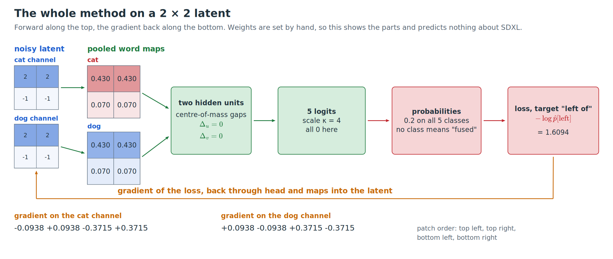
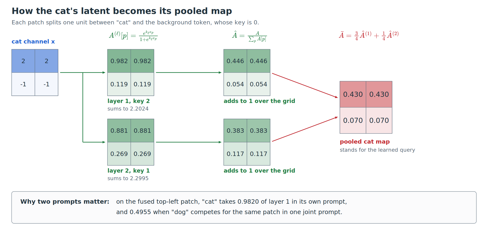
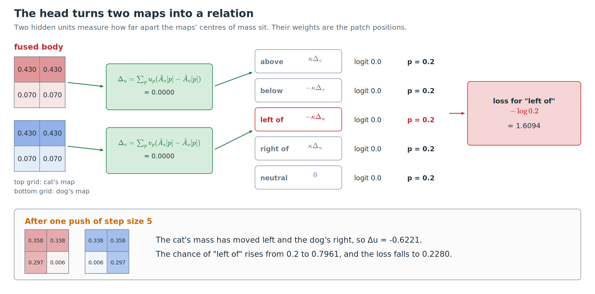
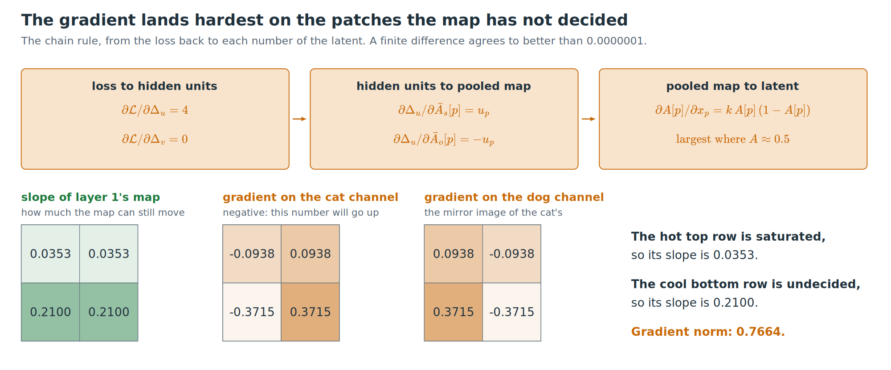
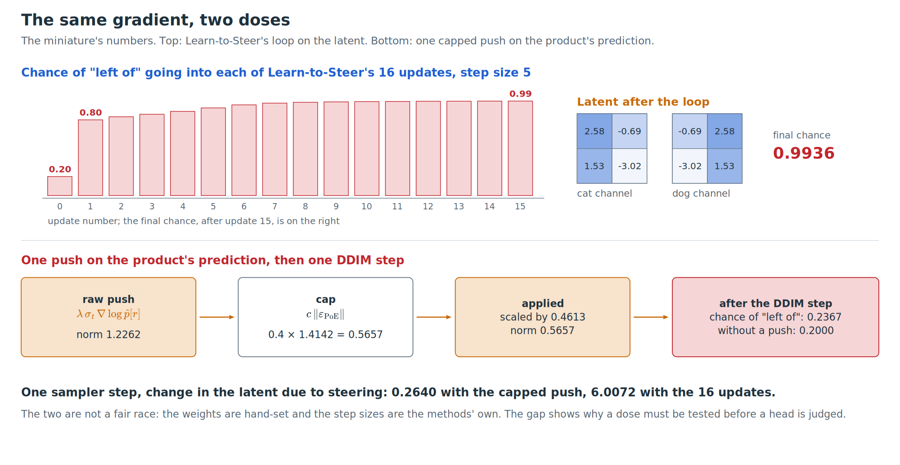
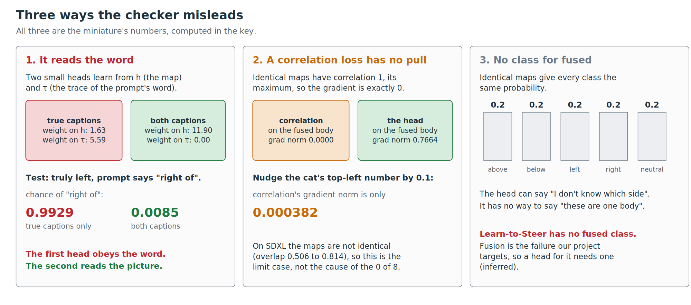

# The word-map checker on a 2 × 2 latent

This page works the whole method by hand on a latent of 8 numbers, so every equation of Learn-to-Steer has a place you can point at. It is level 2 of the [word-map checker ladder](../README.md). The weights are set by hand: the page shows what each part computes and predicts nothing about a trained head on SDXL.

Every value below comes from [the answer key](miniature_answer_key.json), written by [the miniature's script](miniature.py). Symbols follow [the ladder's notation](../NOTATION.md).

<a href="mm0-the-whole-miniature.png"></a>

## Table of contents

- [What each small piece stands for](#what-each-small-piece-stands-for)
- [Stage 1: the latent becomes two word maps](#stage-1-the-latent-becomes-two-word-maps)
- [Stage 2: the head reads a relation](#stage-2-the-head-reads-a-relation)
- [Stage 3: the gradient back to the latent](#stage-3-the-gradient-back-to-the-latent)
- [Stage 4: two ways to apply it](#stage-4-two-ways-to-apply-it)
- [Stage 5: three ways it misleads](#stage-5-three-ways-it-misleads)
- [Rebuild it yourself](#rebuild-it-yourself)

## What each small piece stands for

| Miniature piece | Stands for | Where the real one lives |
|---|---|---|
| 8-number latent, 2 × 2 patches and 2 channels | SDXL's latent, $4 \times 128 \times 128$ | our sampler, `poe_repair/methods/_classifier_guided.py` |
| 2 cross-attention layers, keys 2 and 1 | SDXL's 70 layers, 1,300 maps per word | the U-Net's `attn2` blocks |
| background token with key 0 | every other token in the prompt | the 77-token softmax |
| fixed pooling weights $3/4$, $1/4$ | the learned query | `CrossAttentionExtractor`, `model.py:133-135,176-177` |
| two hidden units $\Delta_u,\ \Delta_v$ | the flatten, project, transformer and MLP layers | `RelationClassifierTransformer`, `model.py:76-88` |
| scale $\kappa = 4$ | the head's trained weights and its step vector | `model.py:82-87` |

**Left out, and why.** The aggregator's transformer layers are left out because a hand-set weight cannot show what they learn. The classifier's transformer is left out because the real one sees a single token, so its attention has only that token to attend to (`model.py:76-80`). The step table is reduced to one value of $\kappa$.

## Stage 1: the latent becomes two word maps

**In one sentence.** Each patch shares one unit of attention between the word and the background token, and the shares over all patches form that word's map.

<a href="mm1-from-latent-to-pooled-map.png"></a>

The latent holds one fused body along the top row. Both channels are the same:

$$
x_{\text{cat}} = x_{\text{dog}} = \begin{bmatrix} 2 & 2 \\ -1 & -1 \end{bmatrix}.
$$

The rows are the grid's rows and the columns its columns. Layer $\ell$ gives the word this share at patch $p$:

$$
\begin{aligned}
A^{(\ell)}[p] &= \frac{e^{k_\ell x_p}}{1 + e^{k_\ell x_p}}, \\[6pt]
A^{(1)}[\text{top}] &= \frac{e^{2 \cdot 2}}{1 + e^{2 \cdot 2}} = 0.9820, \qquad A^{(1)}[\text{bottom}] = \frac{e^{-2}}{1 + e^{-2}} = 0.1192.
\end{aligned}
$$

Each map is then divided by its sum, which is what the authors' `resize_and_concat_attn_maps_from_dict` does (`utils.py:68-69`), and the two are mixed:

| Step | top left | top right | bottom left | bottom right | sum |
|---|---|---|---|---|---|
| $A^{(1)}$, key 2 | 0.9820 | 0.9820 | 0.1192 | 0.1192 | 2.2024 |
| $A^{(2)}$, key 1 | 0.8808 | 0.8808 | 0.2689 | 0.2689 | 2.2995 |
| $\hat A^{(1)} = A^{(1)} / 2.2024$ | 0.4459 | 0.4459 | 0.0541 | 0.0541 | 1 |
| $\hat A^{(2)} = A^{(2)} / 2.2995$ | 0.3830 | 0.3830 | 0.1170 | 0.1170 | 1 |
| $\bar A = \tfrac34 \hat A^{(1)} + \tfrac14 \hat A^{(2)}$ | 0.4302 | 0.4302 | 0.0698 | 0.0698 | 1 |

**Why two prompts matter.** Under the product of experts each word has its own softmax, so "cat" takes 0.9820 of the top-left patch and "dog" also takes 0.9820. Under one joint prompt the two words split the same softmax, and "cat" takes 0.4955. Nothing in the product stops both words filling one body.

## Stage 2: the head reads a relation

**In one sentence.** Two hidden units measure how far the cat's centre of mass sits right of and above the dog's, and five logits turn those gaps into a relation.

<a href="mm2-the-head-reads-a-relation.png"></a>

Each hidden unit's weights are the patch positions, $u = (-1, 1, -1, 1)$ and $v = (1, 1, -1, -1)$ in the order top left, top right, bottom left, bottom right:

$$
\begin{aligned}
\Delta_u &= \sum_p u_p \big(\bar A_s[p] - \bar A_o[p]\big), \qquad \Delta_v = \sum_p v_p \big(\bar A_s[p] - \bar A_o[p]\big), \\[6pt]
\ell_{\text{above}} &= \kappa \Delta_v, \quad \ell_{\text{below}} = -\kappa \Delta_v, \quad \ell_{\text{left}} = -\kappa \Delta_u, \quad \ell_{\text{right}} = \kappa \Delta_u, \quad \ell_{\text{neutral}} = 0, \\[6pt]
\hat p[r] &= \frac{e^{\ell_r}}{\sum_j e^{\ell_j}}, \qquad \mathcal L = -\log \hat p[\text{left of}].
\end{aligned}
$$

On the fused body the two maps are identical, so $\Delta_u = \Delta_v = 0$, every logit is 0, and each of the five classes gets 0.2. The loss is $-\log 0.2 = 1.6094$. A hand-set head like this one is exactly a comparison of centres of mass, the kind of rule hand-written losses use. Learn-to-Steer's point is that a trained head finds its own rule.

## Stage 3: the gradient back to the latent

**In one sentence.** The chain rule carries the loss back through the gaps and the maps, and it lands hardest on patches whose map has not decided yet.

<a href="mm3-the-gradient-back-to-the-latent.png"></a>

$$
\begin{aligned}
\frac{\partial \mathcal L}{\partial \Delta_u} &= \kappa\,\big(1 - \hat p_{\text{left}} + \hat p_{\text{right}}\big) = 4\,(1 - 0.2 + 0.2) = 4
&&\text{the softmax's derivative at a tie,} \\[6pt]
\frac{\partial \Delta_u}{\partial \bar A_s[p]} &= u_p, \qquad \frac{\partial \Delta_u}{\partial \bar A_o[p]} = -u_p
&&\text{the positions are the weights,} \\[6pt]
\frac{\partial A^{(\ell)}[p]}{\partial x_p} &= k_\ell\, A^{(\ell)}[p]\,\big(1 - A^{(\ell)}[p]\big)
&&\text{the softmax's slope.}
\end{aligned}
$$

The last line is why the top row barely moves. In layer 1 its slope is $2 \times 0.9820 \times (1 - 0.9820) \approx 0.0353$, against $0.2100$ on the bottom row. Multiplying through, with the division by each map's sum included, gives:

| Patch | top left | top right | bottom left | bottom right |
|---|---|---|---|---|
| $\partial \mathcal L / \partial x_{\text{cat}}$ | $-0.0938$ | $0.0938$ | $-0.3715$ | $0.3715$ |
| $\partial \mathcal L / \partial x_{\text{dog}}$ | $0.0938$ | $-0.0938$ | $0.3715$ | $-0.3715$ |

The gradient's norm is 0.7664. [The script](miniature.py) checks every entry against a finite difference, and the largest gap is about $10^{-10}$.

## Stage 4: two ways to apply it

**In one sentence.** Learn-to-Steer moves the latent up to 16 times per sampler step, and our sampler changes the noise prediction once, under a cap.

<a href="mm4-sixteen-updates-against-one-capped-push.png"></a>

**Learn-to-Steer's update.** $x_t \leftarrow x_t - \eta\,\nabla_{x_t}\mathcal L_t$ with $\eta = 5$. The first update takes the cat's top-right number from $2$ to $2 - 5 \times 0.0938 \approx 1.5311$ and its bottom-left number from $-1$ to $-1 + 5 \times 0.3715 \approx 0.8577$. The chance of "left of" goes from 0.2 to 0.7961. After all 16 updates it is 0.9936, with the latent:

$$
x_{\text{cat}} = \begin{bmatrix} 2.5829 & -0.6852 \\ 1.5323 & -3.0200 \end{bmatrix}, \qquad
x_{\text{dog}} = \begin{bmatrix} -0.6852 & 2.5829 \\ -3.0200 & 1.5323 \end{bmatrix}.
$$

The fused top row has become a cat down the left column and a dog down the right column.

**Our push on the product.** The miniature uses $\bar\alpha_t = 0.36$ and $\bar\alpha_{t-1} = 0.64$, so $\sigma_t = 0.8$. The product's prediction is $\varepsilon_{\text{PoE}} = \varepsilon_{\text{cat}} + \varepsilon_{\text{dog}} - \varepsilon_\varnothing$, which is $0.5$ on the top row and $-0.5$ on the bottom row of both channels, with norm 1.4142.

$$
\begin{aligned}
\text{raw push} &= \lambda\,\sigma_t\,\nabla_{x_t}\log\hat p[r] = 2 \times 0.8 \times (-\nabla_{x_t}\mathcal L), \quad \text{norm } 1.2262, \\[6pt]
\text{limit} &= c\,\lVert\varepsilon_{\text{PoE}}\rVert = 0.4 \times 1.4142 = 0.5657, \\[6pt]
\text{applied} &= \text{raw push} \times \frac{0.5657}{1.2262} = \text{raw push} \times 0.4613.
\end{aligned}
$$

After subtracting the push and taking one DDIM step, the chance of "left of" is 0.2367. Without the push it stays at 0.2000.

**Reading the two together.** The change in the latent due to steering is 0.2640 for the capped push (pushed step against plain step) and 6.0072 for the 16 updates (end of the loop against the start). The race is not fair, because the weights are hand-set and each method keeps its own step size. It does show why a dose must be tested before a head is called a failure: Learn-to-Steer's dose is far larger than one capped push per step.

## Stage 5: three ways it misleads

<a href="mm5-three-ways-it-breaks.png"></a>

**It can learn the word instead of the picture.** Two small logistic heads see $h$, a weak spatial reading from the map, and $\tau$, the trace of the prompt's relation word. Each trains for 400 full-batch steps at learning rate 1. The head trained on true captions puts weight 5.5886 on $\tau$ and 1.6336 on $h$. The head trained on both the true and the wrong caption puts weight 0 on $\tau$ and 11.9015 on $h$. Shown an image truly on the left whose prompt says "right of", the first says "right of" with probability 0.9929 and the second with probability 0.0085. This is the relation leakage of Learn-to-Steer's p. 4, reduced to two features.

**A correlation loss has no pull on a perfectly fused pair.** Our own attention-separation push minimises the correlation of the two maps. On identical maps the correlation is 1, its maximum, so its gradient is exactly 0, where the head's has norm 0.7664. A nudge of 0.1 on one number gives a correlation gradient of norm only 0.000382. SDXL's maps are not identical (their top 10% overlap by 0.506 to 0.814), so this limit case does not explain why that push drew two animals on 0 of 8 SDXL seeds (seeds 9 to 16, steps 0 to 19, draft calls, no verdict recorded).

**The head has no class for "fused".** Identical maps give 0.2 on all five classes. The head can say it does not know which side each word is on, and it cannot say the two are one body. Learn-to-Steer has no fused class, and fusion is the failure this project targets, so a head for the product would need one (inferred).

## Rebuild it yourself

**Run the key.** From this folder, the key rebuilds with:

```bash
PYTHONDONTWRITEBYTECODE=1 uv run --no-project --with numpy python -I miniature.py
```

You should see the loop's 16 updates ending at a chance of 0.9936 for "left of", and the script stops with an assertion error if the chain rule disagrees with the finite difference.

**Work it on paper.** Write the two $2 \times 2$ channels, compute one map by hand, then redo Stage 3's gradient for the bottom-left patch. Your number should match $-0.3715$ for the cat channel.

**Break it.** Copy [the miniature's script](miniature.py) to a scratch folder first, because it rewrites the key beside it. Change `KEYS` to `[1.0, 1.0]` and run the copy. Both layers then give the same map, so the pooling weights stop mattering. The gradient's norm becomes 0.7754 and the 16 updates end at a chance of 0.9875, which are the values this change printed when it was tried.

**Where to go next.** One rung up is the [network view](../0.5-network-view/README.md), with SDXL's real sizes. One rung down is the [Learn-to-Steer code walk](../3-code/walk-learn-to-steer.md). The idea is read through this small network in [the closing page](../read-through-a-small-network.md).
