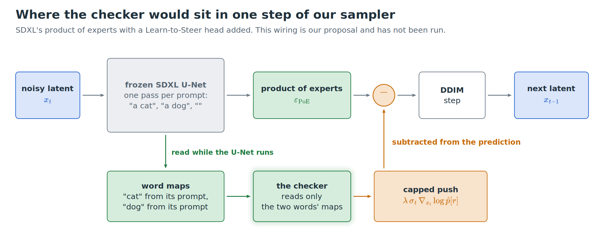

# The word-map spatial checker: a zoom ladder

This ladder teaches the first of Paper 2's five proposed checkers, the one that reads the spatial relation between two subjects from their word attention maps. It climbs from the whole SDXL sampler down to a network of 8 latent numbers with the maths on its nodes. The spatial checker comes first because it is the only one of the five with a trained precedent, Learn-to-Steer ([arXiv 2509.02295v2](https://arxiv.org/abs/2509.02295)).

**Start at [the closing page](read-through-a-small-network.md).** It reads the whole method through the small network, one idea at a time, and links every other rung from the place it helps.

## What is established and what is proposed

**Learn-to-Steer's results are on other models.** It ran on FLUX and on SD 1.4 and 2.1, and never on SDXL. Its 0.60 GenEval position (the fraction of images with the right relation, 0 to 1) on 16 unseen categories is on FLUX.1-dev, and those categories were chosen as words absent from training with no planned split.

**Anything on SDXL is our proposal.** This ladder trained no head and ran no SDXL. The miniature's weights are set by hand, so it shows what each part computes and predicts nothing about performance.

**Our own push on these maps has not worked yet.** A hand-written push that separates the two attention maps drew two animals on 0 of 8 SDXL seeds (seeds 9 to 16, steps 0 to 19, draft calls, no verdict recorded). It used a correlation loss, so it does not test a trained head.

## The rungs

| Level | What it shows | Where |
|---|---|---|
| 0 | the real system: our product-of-experts sampler | [the classifier guidance system picture](https://claude.ai/artifact/FBbwapTjp1dbEmzpLspRBT) (journey 13, linked), with [where the checker would sit](0.5-network-view/wm0-where-the-checker-sits.png) |
| 0.5 | the network view: caption, timestep and latent paths, where word maps are read, and how the head uses them | [the network view](0.5-network-view/README.md) |
| 1 | the idea, illustrated | [the six illustrations](1-illustrations/diagram-prompts.md) |
| 2 | the miniature: 8 latent numbers, every term on its part | [the worked miniature](2-miniature/README.md) |
| 3 | the real code, block by block | [the authors' code](3-code/walk-learn-to-steer.md) at commit `a2ae427`, and [our sampler](3-code/walk-our-sampler.md) |
| beside | each equation down to fundamentals | [the rebuild companion](rebuild-from-fundamentals.md) |
| close | the method read through the small network | [the closing page](read-through-a-small-network.md) |

## What is in this folder

| File | What it is |
|---|---|
| `ladder.json` | the ladder's record: each rung's state and files, the colour key and the code commit |
| `NOTATION.md` | the symbols every rung uses, beside the ones the paper prints |
| `numbers/make_numbers.py`, `numbers/numbers.json` | every full-scale number, each with its source and whether it is counted, printed or inferred |
| `figure_kit.py` | the drawing helpers, which refuse to write a figure where a line crosses a box or label |
| `route-zoom-ladder-word-map-checker.md` | the steps that build this ladder, each with the command that rebuilds it |

**How it was made.** The sizes were counted from SDXL's public config and from a rebuild of the authors' head at their configs. The authors' repository was cloned read-only and read, never imported or run. The illustrations were drawn by Codex's image tool from prompts built on the miniature's numbers, so their photos are teaching drawings and none is an SDXL sample. The bars in the dose illustration land within 3 percentage points of their printed values, and the printed numbers are the values.
