# 📐 The word-map spatial checker, read through a small network

Learn-to-Steer (Yiflach, Atzmon and Chechik, [arXiv 2509.02295v2](https://arxiv.org/pdf/2509.02295v2#page=4)) trains a small classifier to read the spatial relation between two objects from a diffusion model's word attention maps, then uses that classifier's error to steer the latent while the picture is drawn. Paper 2 asks whether a checker of this kind can make one frozen SDXL draw two separate subjects where a product of experts fuses them. This page reads the method on a latent of 8 numbers, one idea at a time, with the paper's notation last.

**What was run and what was not.** Learn-to-Steer ran on FLUX and on SD 1.4 and 2.1, and never on SDXL. Everything shown on SDXL is our proposal. Nothing in this ladder trained a head or ran SDXL, and the small network's weights are set by hand. The photos in the illustrations are an image model's teaching drawings, and none is an SDXL sample.

<a href="2-miniature/mm0-the-whole-miniature.png">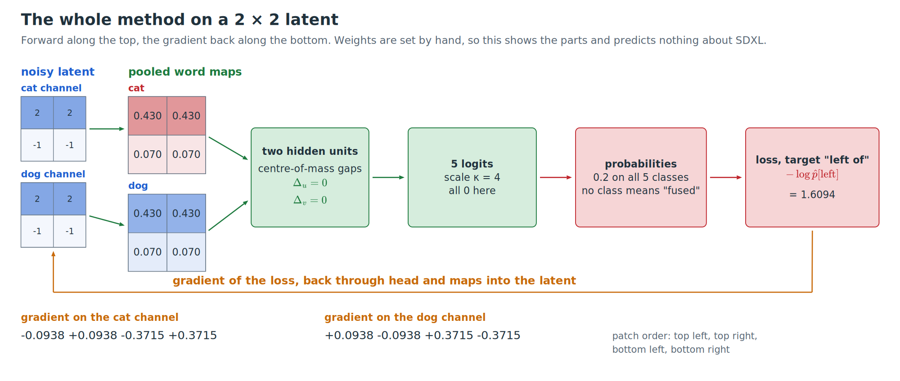</a>

**How to read this.** The input is the 2 × 2 latent on the left. The process runs left to right through maps, hidden units, logits and a loss. The output is the orange gradient arriving back at the latent. Each section below works one part.

## Table of contents

- [The small network, and the colours](#the-small-network-and-the-colours)
- [1. Each word leaves a map of where it landed](#1-each-word-leaves-a-map-of-where-it-landed)
- [2. Keep every map, then let a learned query pool them](#2-keep-every-map-then-let-a-learned-query-pool-them)
- [3. A small head reads the relation from the pair](#3-a-small-head-reads-the-relation-from-the-pair)
- [4. Train against the word, or the head learns the word](#4-train-against-the-word-or-the-head-learns-the-word)
- [5. The head's error becomes a push on the latent](#5-the-heads-error-becomes-a-push-on-the-latent)
- [6. The dose decides how far the push goes](#6-the-dose-decides-how-far-the-push-goes)
- [7. What changes on a product of experts](#7-what-changes-on-a-product-of-experts)
- [The whole method in three sentences and one equation](#the-whole-method-in-three-sentences-and-one-equation)
- [What is still open](#what-is-still-open)
- [Cross-references](#cross-references)

## The small network, and the colours

Navigation: 📋 [TOC](#table-of-contents) | [1. Word maps](#1-each-word-leaves-a-map-of-where-it-landed) ➡️

**The latent.** Four patches (top left, top right, bottom left, bottom right) with two channels each, cat-ness and dog-ness, so 8 numbers. It starts as one fused body: both channels are $2$ on the top row and $-1$ on the bottom row.

**The word maps.** Two cross-attention layers with keys $k_1 = 2$ and $k_2 = 1$. Each patch splits one unit between the word and a background token whose key is 0.

**The head.** Two hidden units that measure the gap between the two maps' centres of mass, then five logits at scale $\kappa = 4$. The target is "a cat to the left of a dog".

**Every number comes from one script.** [The miniature's script](2-miniature/miniature.py) writes [the answer key](2-miniature/miniature_answer_key.json), and the figures read that key. Full-scale sizes come from [the ladder's numbers](numbers/numbers.json). Symbols follow [the ladder's notation](NOTATION.md).

| Colour | Part of the picture |
|---|---|
| blue | inputs: the latent and the prompts |
| green | hidden values: word maps, pooled maps, the head's units |
| red | outputs: logits, probabilities and the loss |
| orange | the backward signal and the push |
| grey | frozen, fixed or broken parts |

## 1. Each word leaves a map of where it landed

Navigation: ⬅️ [The small network](#the-small-network-and-the-colours) | 📋 [TOC](#table-of-contents) | [2. Pooling](#2-keep-every-map-then-let-a-learned-query-pool-them) ➡️

**Said plainly.** While the U-Net draws, each patch of the picture decides how much to listen to each word, and the amount it gives one word, over all patches, is that word's map.

**The pictures.**

<a href="1-illustrations/wi1-where-each-word-landed.png">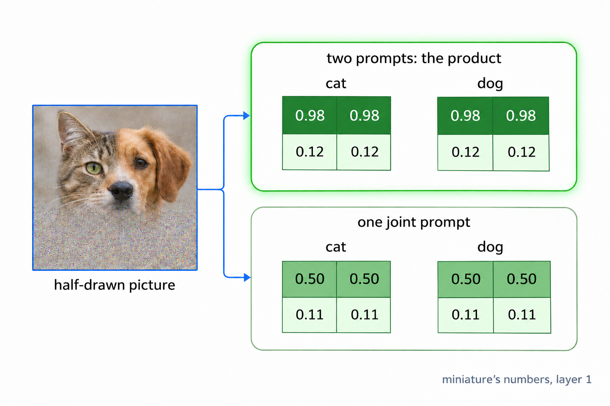</a> <a href="2-miniature/mm1-from-latent-to-pooled-map.png">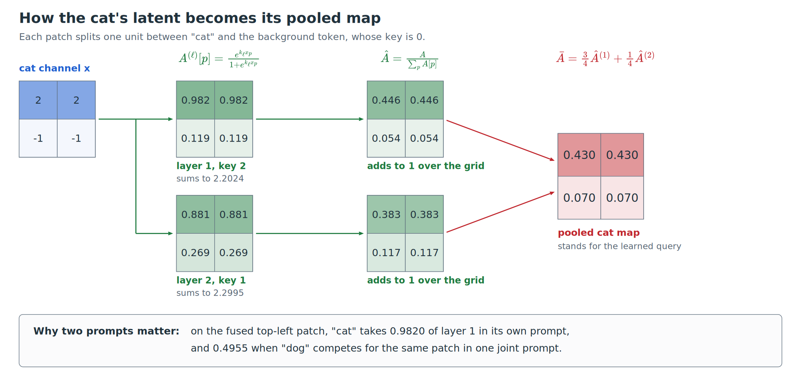</a>

Up a rung: [the three inputs and where the maps are read](0.5-network-view/wm1-three-inputs-and-where-the-maps-come-from.png). Down a rung: [catching each attention map in the code walk](3-code/walk-learn-to-steer.md#1-catching-each-attention-map).

**The equation on the small network.**

$$
\textcolor{#1d7a3e}{\underbrace{A^{(1)}[\text{top left}]}_{\text{cat's share of this patch}}}
= \frac{e^{\,k_1\,\textcolor{#1f5fd0}{x_p}}}{1 + e^{\,k_1\,\textcolor{#1f5fd0}{x_p}}}
= \frac{e^{2 \cdot 2}}{1 + e^{2 \cdot 2}} = 0.9820 .
$$

**What the equation says.** A patch whose cat-ness is large gives nearly all of its attention to "cat". Raise $x_p$ and the share climbs toward 1; lower it and the share falls toward 0.

**The parts.**

| Map | Shape | Stands for | Top row, bottom row |
|---|---|---|---|
| $\textcolor{#1f5fd0}{x_{\text{cat}}}$ | 2 × 2 | one channel of SDXL's $4 \times 128 \times 128$ latent | 2, $-1$ |
| $\textcolor{#1d7a3e}{A^{(1)}}$ | 2 × 2 | one layer-and-head's map | 0.9820, 0.1192 |
| $\textcolor{#1d7a3e}{A^{(2)}}$ | 2 × 2 | another layer-and-head's map | 0.8808, 0.2689 |

🧸 **Toy:** the fused latent above, where both words light the same top row.

🎞️ **Moving picture:** follow the cat channel through [the first miniature figure](2-miniature/mm1-from-latent-to-pooled-map.png): latent, two softmaxes, two renormalised maps, one pooled map.

🔤 **The name:** *cross-attention* is attention (each patch weighs a set of things and takes a weighted mix) across two kinds of data, patches asking words. A *word map* is one word's column of those weights, laid back out on the grid.

🔨 **Build:** [stage 1 of the worked miniature](2-miniature/README.md#stage-1-the-latent-becomes-two-word-maps).

💥 **Break:** under one joint prompt "cat" and "dog" share a softmax, and "cat" takes only 0.4955 of the same patch.

**The paper's own words, last.** "$A_t \in \mathbb R^{h \times w \times N}$, where $h \times w$ is the spatial resolution and $N$ is the number of text tokens" ([p. 3](https://arxiv.org/pdf/2509.02295v2#page=3)). Their $A_t[:, :, i]$ is our $A^{(\ell)}$ for one word and one layer.

## 2. Keep every map, then let a learned query pool them

Navigation: ⬅️ [1. Word maps](#1-each-word-leaves-a-map-of-where-it-landed) | 📋 [TOC](#table-of-contents) | [3. The head](#3-a-small-head-reads-the-relation-from-the-pair) ➡️

**Said plainly.** Instead of averaging the model's many maps into one by hand, the head takes all of them and learns how much to trust each.

**The pictures.**

<a href="0.5-network-view/wm2-from-one-layer-to-a-words-stack.png">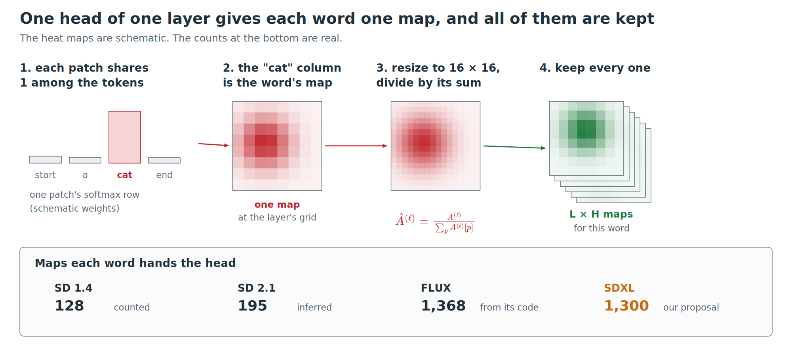</a> <a href="0.5-network-view/wm3-the-head-reads-the-two-stacks.png">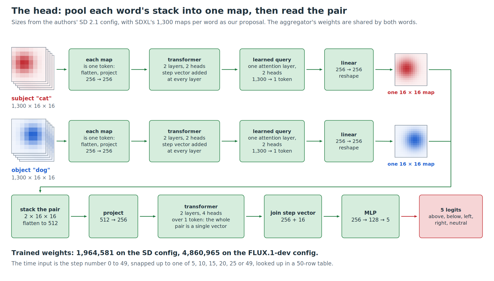</a>

Up a rung: [the head at SDXL's sizes](0.5-network-view/wm3-the-head-reads-the-two-stacks.png). Down a rung: [the aggregator in the code walk](3-code/walk-learn-to-steer.md#5-the-aggregator-many-maps-into-one).

**The equation on the small network.**

$$
\begin{aligned}
\hat A^{(\ell)} &= \frac{A^{(\ell)}}{\sum_p A^{(\ell)}[p]}, \\[6pt]
\textcolor{#1d7a3e}{\bar A} &= \tfrac34\,\hat A^{(1)} + \tfrac14\,\hat A^{(2)}
= \tfrac34 (0.4459) + \tfrac14 (0.3830) = 0.4302 \quad \text{on the top row.}
\end{aligned}
$$

**What the equation says.** Dividing by the sum makes each map a distribution over patches, so only where the word landed counts and how loud it was does not. The mix then decides how much each map contributes. The real head computes that mix from the maps with a learned query, and the small network fixes it at $3/4$ and $1/4$.

**The parts.**

| Model | Maps per word | Source |
|---|---|---|
| SD 1.4 | 128 | counted from its config |
| SD 2.1 | 195 | inferred, its config was not reachable |
| FLUX | 1,368 | the authors' code, 57 layers × 24 heads |
| SDXL | 1,300 | counted from its config, our proposal |

🧸 **Toy:** two maps of one word, weights $3/4$ and $1/4$.

🎞️ **Moving picture:** in [the head's figure](0.5-network-view/wm3-the-head-reads-the-two-stacks.png), watch a stack of 1,300 tokens narrow to one token at the learned query.

🔤 **The name:** to *pool* is to pour many values into one, as into a shared pool. A *learned query* is a trained vector that asks every map "how relevant are you?" and takes a weighted mix of the answers.

🔨 **Build:** change `POOL` in a scratch copy of [the miniature's script](2-miniature/miniature.py) and watch $\bar A$ move.

💥 **Break:** the paper's mean over all maps scored highest on position, 0.78 against 0.70 for keeping them all, and gave dull backgrounds ([p. 13, Table 9](https://arxiv.org/pdf/2509.02295v2#page=13)). Our own 32 × 32 map is closest to that mean (inferred).

**The paper's own words, last.** "A four-layer, four-head transformer then processes this sequence" and "we learn a query vector" ([p. 15](https://arxiv.org/pdf/2509.02295v2#page=15)). The released code differs in one place: the query is one attention layer with 4 heads on FLUX.1-dev and 2 on SD 2.1, where the paper prints a four-layer, single-head transformer.

## 3. A small head reads the relation from the pair

Navigation: ⬅️ [2. Pooling](#2-keep-every-map-then-let-a-learned-query-pool-them) | 📋 [TOC](#table-of-contents) | [4. Leakage](#4-train-against-the-word-or-the-head-learns-the-word) ➡️

**Said plainly.** The head looks only at the two pooled maps and answers whether the first thing is above, below, left of or right of the second.

**The pictures.**

<a href="1-illustrations/wi2-a-small-judge-reads-only-the-two-maps.png">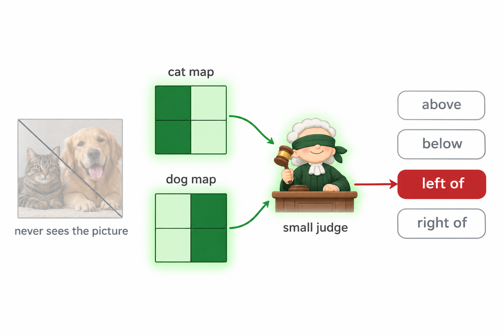</a> <a href="2-miniature/mm2-the-head-reads-a-relation.png">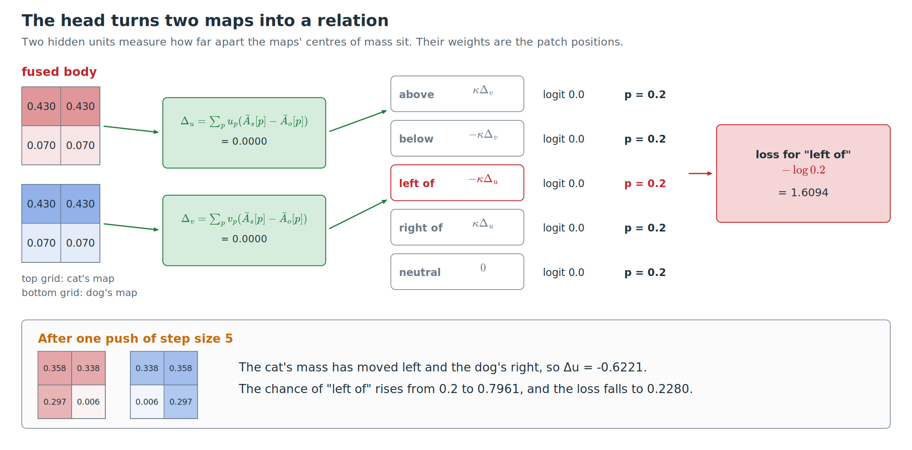</a>

Up a rung: [the head at SDXL's sizes](0.5-network-view/wm3-the-head-reads-the-two-stacks.png). Down a rung: [the classifier in the code walk](3-code/walk-learn-to-steer.md#6-the-classifier-two-maps-and-the-step-into-five-logits).

**The equation on the small network.**

$$
\begin{aligned}
\textcolor{#1d7a3e}{\Delta_u} &= \sum_p u_p \big(\bar A_s[p] - \bar A_o[p]\big) = 0 , \\[6pt]
\textcolor{#c0262d}{\ell_{\text{left}}} &= -\kappa\,\Delta_u = 0 , \qquad
\textcolor{#c0262d}{\hat p[\text{left of}]} = \frac{e^{0}}{5\,e^{0}} = 0.2 , \\[6pt]
\textcolor{#c0262d}{\mathcal L} &= -\log 0.2 = 1.6094 .
\end{aligned}
$$

**What the equation says.** On a fused body the two maps are the same, so their centres of mass coincide and the head has no reason to prefer any relation. Its loss is at its most uncertain value for five classes.

**The parts.**

| Quantity | Value on the fused body | Stands for |
|---|---|---|
| $\Delta_u,\ \Delta_v$ | 0, 0 | the flatten, projection, transformer and MLP layers |
| five logits | all 0 | the MLP's output, 5 relation classes |
| $\hat p$ | 0.2 each | the softmax over relations |

🧸 **Toy:** the fused pair's identical maps.

🎞️ **Moving picture:** in [the head's figure](2-miniature/mm2-the-head-reads-a-relation.png), compare the fused row with the row after one update, where $\Delta_u = -0.6221$.

🔤 **The name:** a *logit* is an unscaled score for a class, one per answer. *Softmax* turns the scores into probabilities that add to 1.

🔨 **Build:** [stage 2 of the worked miniature](2-miniature/README.md#stage-2-the-head-reads-a-relation).

💥 **Break:** the head has no class for "fused". Identical maps give 0.2 on every class, so it can say "I can't tell which side" and cannot say "these are one body".

**The paper's own words, last.** "$\hat p = C(A_s, A_o, t)$, where $\hat p$ is the predicted probability distribution over relation classes" ([p. 4](https://arxiv.org/pdf/2509.02295v2#page=4)). The real classifier flattens the pair to 512 numbers, projects them to 256 and passes them through a transformer as a single token (`model.py:76-80`), so that transformer's attention has only that one token to attend to.

## 4. Train against the word, or the head learns the word

Navigation: ⬅️ [3. The head](#3-a-small-head-reads-the-relation-from-the-pair) | 📋 [TOC](#table-of-contents) | [5. The push](#5-the-heads-error-becomes-a-push-on-the-latent) ➡️

**Said plainly.** If every training caption tells the truth, a head can read the relation word's faint trace in the maps and never look at the layout, so each training picture is also shown with a wrong caption and the true label.

**The pictures.**

<a href="1-illustrations/wi3-it-learned-the-word-instead-of-the-picture.png">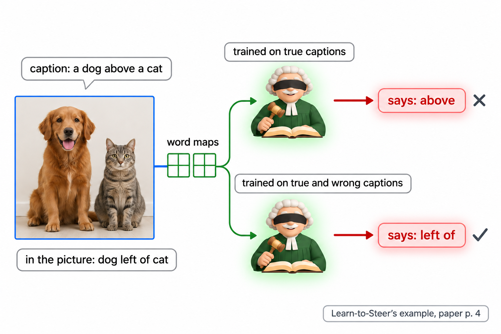</a> <a href="2-miniature/mm5-three-ways-it-breaks.png">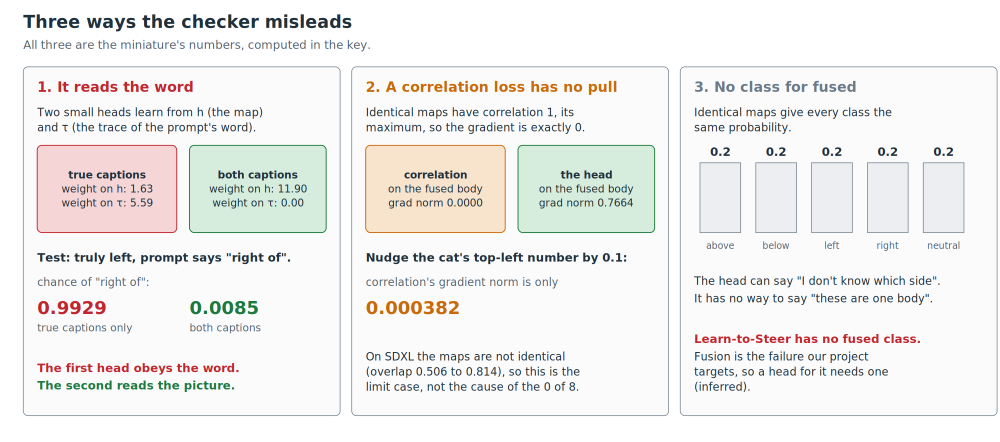</a>

Up a rung: [why each training picture is inverted twice](0.5-network-view/wm4-training-on-the-right-and-wrong-word.png). Down a rung: [the training data in the code walk](3-code/walk-learn-to-steer.md#10-training-data-two-inversions-one-label).

**The equation on the small network.** One logit reads $h$ (the map's spatial reading) and $\tau$ (the trace of the word):

$$
\hat p[\text{right of}] = \frac{1}{1 + e^{-(a\,h + b\,\tau)}} .
$$

| Trained on | $a$ on the map | $b$ on the word | Truly left, prompt says "right of": chance of "right of" |
|---|---|---|---|
| true captions | 1.6336 | 5.5886 | 0.9929 |
| true and wrong captions | 11.9015 | 0 | 0.0085 |

**What the table says.** With true captions alone, the word is the easier signal and the head leans on it. With both captions, the word no longer predicts the label, so its weight goes to 0 and the head has to read the map.

🧸 **Toy:** eight training rows of $(h, \tau, \text{label})$, in [the answer key](2-miniature/miniature_answer_key.json) under `broken_leakage`.

🎞️ **Moving picture:** the left panel of [the broken-runs figure](2-miniature/mm5-three-ways-it-breaks.png).

🔤 **The name:** *leakage* is the answer seeping into the input by a side route. Here the relation word seeps into the maps, because the maps were made while reading a prompt that contained it.

🔨 **Build:** [stage 5 of the worked miniature](2-miniature/README.md#stage-5-three-ways-it-misleads).

💥 **Break:** the paper reports the fix's effect, 0.425 without it and 0.57 with it on FLUX.1-schnell's validation set ([p. 8, Table 4](https://arxiv.org/pdf/2509.02295v2#page=8)). It reports no direct measure of how often the trained head still follows a wrong word.

**The paper's own words, last.** "We perform inversion twice: once with a 'mismatching' prompt that correctly describes the spatial relation [...] and once with a prompt containing a randomly sampled incorrect relation" ([p. 4](https://arxiv.org/pdf/2509.02295v2#page=4)). Calling the correct prompt "mismatching" reads as a wording slip (inferred).

## 5. The head's error becomes a push on the latent

Navigation: ⬅️ [4. Leakage](#4-train-against-the-word-or-the-head-learns-the-word) | 📋 [TOC](#table-of-contents) | [6. The dose](#6-the-dose-decides-how-far-the-push-goes) ➡️

**Said plainly.** Because every step from the latent to the head's answer is differentiable, the head's error can be sent back to say which numbers of the noisy picture to change.

**The pictures.**

<a href="1-illustrations/wi4-the-judges-complaint-pushes-the-noise.png">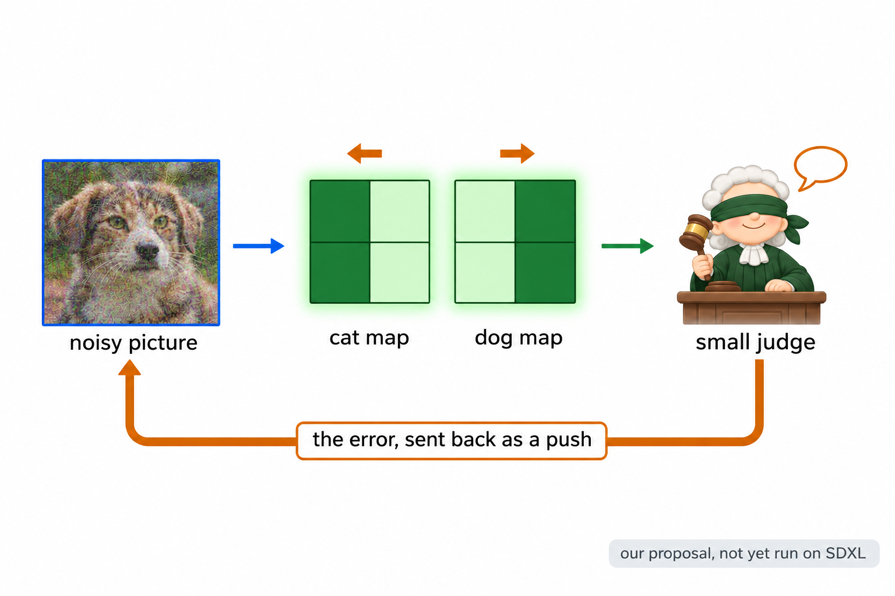</a> <a href="2-miniature/mm3-the-gradient-back-to-the-latent.png">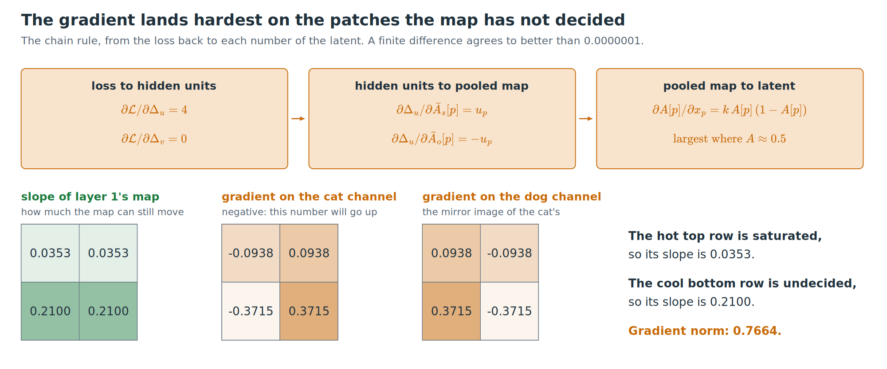</a>

Up a rung: [the two ways the gradient enters](0.5-network-view/wm5-two-ways-to-apply-the-push.png). Down a rung: [the loss in the code walk](3-code/walk-learn-to-steer.md#7-the-loss).

**The equation on the small network.**

$$
\textcolor{#c86a0a}{\frac{\partial \mathcal L}{\partial x_p}}
= \underbrace{\frac{\partial \mathcal L}{\partial \Delta_u}}_{=\,4}
\;\underbrace{\frac{\partial \Delta_u}{\partial \bar A[p]}}_{u_p}
\;\underbrace{\frac{\partial \bar A[p]}{\partial x_p}}_{\text{map's slope}}
\quad\Longrightarrow\quad
\nabla_{x_{\text{cat}}} \mathcal L = (-0.0938,\ 0.0938,\ -0.3715,\ 0.3715) .
$$

The last factor stands for the full derivative of the pooled map, which also carries the division by each map's sum.

**What the equation says.** The gradient is largest on the bottom row, where the map has not decided. In layer 1 the map's slope is 0.0353 on the saturated top row and 0.2100 on the bottom row. Moving against the gradient lifts the cat on the left and the dog on the right.

🧸 **Toy:** the gradient table in [stage 3 of the worked miniature](2-miniature/README.md#stage-3-the-gradient-back-to-the-latent).

🎞️ **Moving picture:** [the gradient figure](2-miniature/mm3-the-gradient-back-to-the-latent.png), read from the loss on the left to the patches on the right.

🔤 **The name:** the *gradient* is the list of how much the loss changes per unit change in each input number. A *push* is a step against it.

🔨 **Build:** the script's `gradient` function in [the miniature's script](2-miniature/miniature.py), checked against a finite difference to about $10^{-10}$.

💥 **Break:** our own hand-written push minimised the correlation of the two maps. On identical maps that correlation is at its maximum, so its gradient is exactly 0, where the head's has norm 0.7664. That push drew two animals on 0 of 8 SDXL seeds (seeds 9 to 16, steps 0 to 19, draft calls, no verdict recorded). SDXL's maps are not identical, so this limit case does not explain the result, and a hand-written loss failing does not test a trained head.

**The paper's own words, last.** "We compute a cross-entropy loss against the desired relation $r$ from the prompt: $\mathcal L_t = -\log \hat p[r]$, and update the latent code with its gradient: $z_t \leftarrow z_t - \alpha \nabla_{z_t}\mathcal L_t$" ([p. 4](https://arxiv.org/pdf/2509.02295v2#page=4)). Their $z_t$ is our $x_t$ and their $\alpha$ is our $\eta$.

## 6. The dose decides how far the push goes

Navigation: ⬅️ [5. The push](#5-the-heads-error-becomes-a-push-on-the-latent) | 📋 [TOC](#table-of-contents) | [7. The product](#7-what-changes-on-a-product-of-experts) ➡️

**Said plainly.** Learn-to-Steer pushes hard and many times per step, and our sampler pushes once under a cap, so a head that fails under our dose has not yet been tested at theirs.

**The pictures.**

<a href="1-illustrations/wi5-one-capped-nudge-against-sixteen-big-steps.png">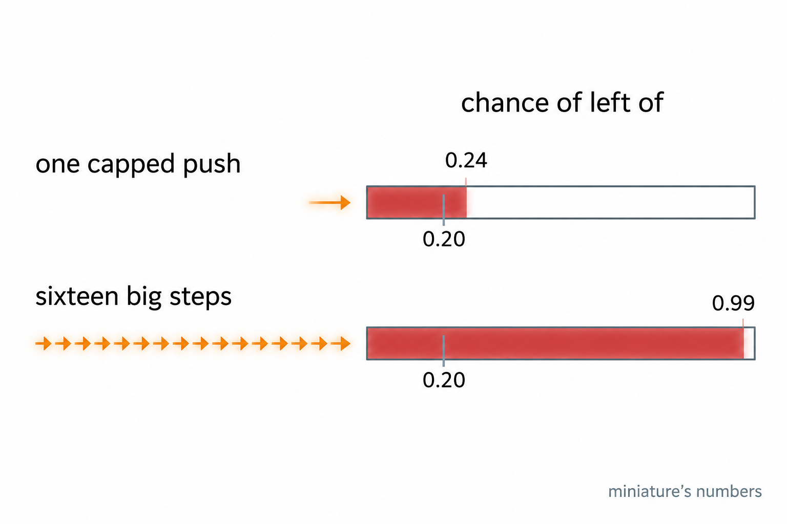</a> <a href="2-miniature/mm4-sixteen-updates-against-one-capped-push.png">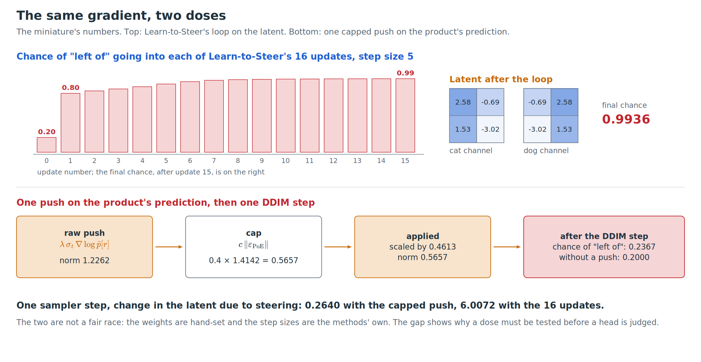</a>

Up a rung: [the two ways the gradient enters](0.5-network-view/wm5-two-ways-to-apply-the-push.png). Down a rung: [the refine loop in the code walk](3-code/walk-learn-to-steer.md#8-the-refine-loop) and [our sampler's push](3-code/walk-our-sampler.md).

**The equation on the small network.**

$$
\begin{aligned}
\text{Learn-to-Steer:}\quad & x_t \leftarrow x_t - 5\,\nabla_{x_t}\mathcal L_t \quad\text{up to 16 times,} && \hat p[\text{left of}]: 0.2 \to 0.9936 , \\[6pt]
\text{our push:}\quad & \varepsilon \leftarrow \varepsilon_{\text{PoE}} - 0.4613 \times 2 \times 0.8\,\nabla_{x_t}\log\hat p[r] \quad\text{once,} && \hat p[\text{left of}]: 0.2 \to 0.2367 .
\end{aligned}
$$

**What the equation says.** The factor 0.4613 is the cap shortening a raw push of norm 1.2262 to $0.4 \times 1.4142 = 0.5657$. Steering changes the latent by 0.2640 under the capped push and by 6.0072 across the 16 updates. These are the miniature's hand-set numbers, so the size of the gap says nothing about SDXL. Its direction is the reason to test the dose first.

🧸 **Toy:** the loop's 16 rows, under `lts_loop` in [the answer key](2-miniature/miniature_answer_key.json).

🎞️ **Moving picture:** the bars of [the dose figure](2-miniature/mm4-sixteen-updates-against-one-capped-push.png), left to right.

🔤 **The name:** a *dose* is how much of a treatment is given. Here it is the step size, the number of updates per step and the number of steps treated.

🔨 **Build:** [stage 4 of the worked miniature](2-miniature/README.md#stage-4-two-ways-to-apply-it).

💥 **Break:** the cost of the full dose is real. SD 2.1 goes from 4.5 s to 90 s per image and FLUX.1-dev from 11 s to 6 minutes ([p. 7](https://arxiv.org/pdf/2509.02295v2#page=7)).

**The paper's own words, last.** "The step size $\alpha$ is 5 for SD2.1 and Flux-based models, and 7.5 for SD1.4 and number of optimization iterations per step are 15" ([p. 16](https://arxiv.org/pdf/2509.02295v2#page=16)). The released loop runs `range(15 + 1)` passes, each able to update, so it can make 16 updates (`pipelines/test_time_optimization.py:175-187`). No cap is stated.

## 7. What changes on a product of experts

Navigation: ⬅️ [6. The dose](#6-the-dose-decides-how-far-the-push-goes) | 📋 [TOC](#table-of-contents) | [The whole method](#the-whole-method-in-three-sentences-and-one-equation) ➡️

**Said plainly.** Learn-to-Steer trained on maps from one prompt naming both objects, and our product would hand the head two maps from two prompts that never compete, so the head would be reading a kind of map it has not seen.

**The pictures.**

<a href="1-illustrations/wi6-the-map-can-move-without-a-second-animal.png">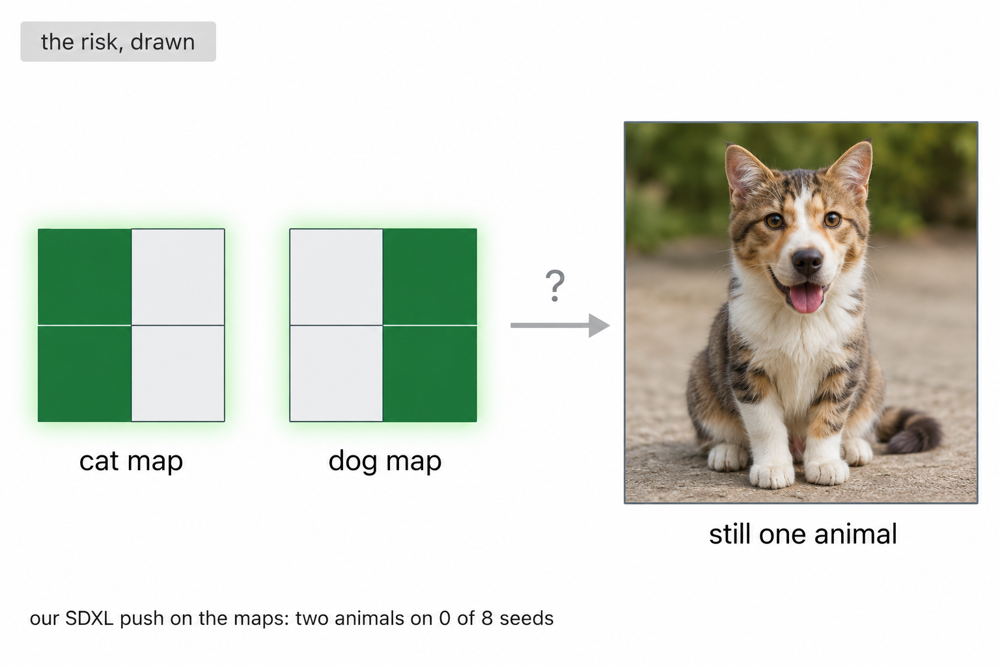</a> <a href="0.5-network-view/wm6-one-joint-prompt-against-two-prompts.png">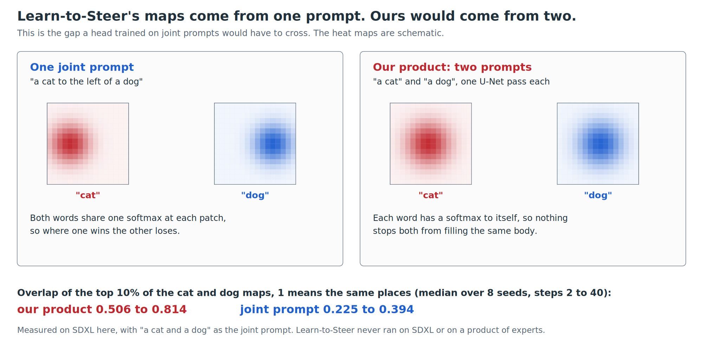</a>

Up a rung: [where the checker would sit in our sampler](0.5-network-view/wm0-where-the-checker-sits.png). Down a rung: [our sampler's code walk](3-code/walk-our-sampler.md).

**The equation on the small network.**

$$
\underbrace{\frac{e^{4}}{1 + e^{4}} = 0.9820}_{\text{``cat'' in its own prompt}}
\qquad\text{against}\qquad
\underbrace{\frac{e^{4}}{1 + e^{4} + e^{4}} = 0.4955}_{\text{``cat'' when ``dog'' is in the same prompt}} .
$$

**What the equation says.** In one prompt the two words divide each patch between them. In two prompts each word can take the whole patch, so both can fill one body. On SDXL the top 10% of the two maps overlaps by 0.506 to 0.814 under the product and by 0.225 to 0.394 under the joint prompt "a cat and a dog" (intersection over union, median over 8 seeds at each of steps 2 to 40).

🧸 **Toy:** the fused patch above.

🎞️ **Moving picture:** compare the two panels of [the prompts figure](0.5-network-view/wm6-one-joint-prompt-against-two-prompts.png).

🔤 **The name:** a *product of experts* multiplies the two prompts' densities, which for noise predictions means adding them: $\varepsilon_{\text{cat}} + \varepsilon_{\text{dog}} - \varepsilon_\varnothing$.

🔨 **Build:** read `run_poe_classifier_guided` through [our sampler's code walk](3-code/walk-our-sampler.md).

💥 **Break:** a head can be satisfied by the maps moving while the picture still holds one animal. Nothing in the miniature rules that out, because its head reads only the maps.

**The paper's own words, last.** The paper does not test a product of experts. Its closest statement is on the failure itself: a prompt can yield "a chimeric hybrid of them both" ([p. 1](https://arxiv.org/pdf/2509.02295v2#page=1)).

## The whole method in three sentences and one equation

Navigation: ⬅️ [7. The product](#7-what-changes-on-a-product-of-experts) | 📋 [TOC](#table-of-contents) | [What is still open](#what-is-still-open) ➡️

A small head is trained to read which side each word landed on from the word attention maps alone, on maps made under both true and wrong captions so it cannot read the relation word. During sampling, the head's error on the relation you asked for is differentiated back through the maps into the noisy latent. Moving the latent against that gradient makes the two words' maps land where the relation says.

$$
x_t \leftarrow x_t - \eta\,\nabla_{x_t}\Big[-\log C\big(A_s(x_t),\, A_o(x_t),\, t\big)[r]\Big]
$$

On the small network, 16 of these updates at $\eta = 5$ move the chance of "left of" from 0.2 to 0.9936, and the fused top row becomes a cat down the left column and a dog down the right.

## What is still open

Navigation: ⬅️ [The whole method](#the-whole-method-in-three-sentences-and-one-equation) | 📋 [TOC](#table-of-contents) | [Cross-references](#cross-references) ➡️

**Whether the maps can be read this early on SDXL.** A word-map detector on SD 2.1 scored 18.0 of 100 at $t = 800$ against 58.4 at $t = 200$ ([the Detector Guidance note](../../../../artifacts/notes/progress/abstract-checkers/01-reading/detector-guidance.md)). Ten of our 16 pushed steps sit above $t = 800$. Carrying the SD 2.1 result to SDXL is an inference.

**Whether a head trained on joint prompts reads a product's maps.** No result covers this. The two-prompt maps in section 7 are a different input from the ones Learn-to-Steer trained on.

**Whether moved maps mean two animals.** Our hand-written attention push drew two animals on 0 of 8 seeds. A trained head at a larger dose has not been tried.

**How far 0.60 on unseen words carries.** Learn-to-Steer's 0.60 GenEval position on 16 unseen categories is on FLUX.1-dev, and those categories were chosen as words absent from training with no planned split ([p. 5, Table 2](https://arxiv.org/pdf/2509.02295v2#page=5) and [p. 14](https://arxiv.org/pdf/2509.02295v2#page=14)).

## Cross-references

Navigation: ⬅️ [What is still open](#what-is-still-open) | 📋 [TOC](#table-of-contents)

- [The ladder's front page](README.md), with every rung and its state.
- [The network view](0.5-network-view/README.md), SDXL's real inputs and sizes.
- [The worked miniature](2-miniature/README.md), every number by hand.
- [The Learn-to-Steer code walk](3-code/walk-learn-to-steer.md) at commit `a2ae427`, and [our sampler's code walk](3-code/walk-our-sampler.md).
- [The rebuild companion](rebuild-from-fundamentals.md), each equation down to fundamentals.
- [The checked note on the paper](../../../../artifacts/notes/progress/abstract-checkers/01-reading/learn-to-steer.md).
- [Readout Guidance read through a small network](../../../../../../goal-setting/learning/papers/deep-learning/diffusion-models/compositional-diffusion-models/guided-sampling/readout-guidance-read-through-a-small-network.md), the sibling ladder's closing page, for a head that reads U-Net features where this one reads word maps.
