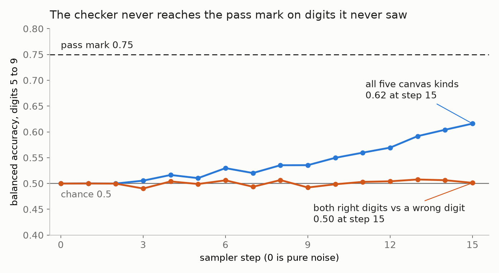
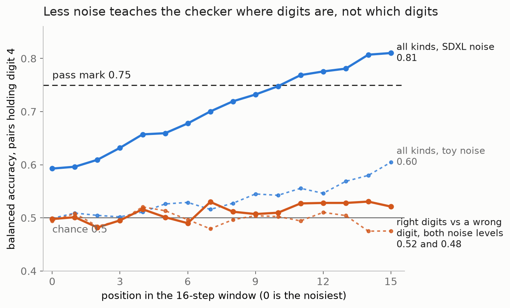

# Does a checker learn plurality on unseen digits?   ✅ support, by the count checker · the first single checker ⚪ null by its written rule · verified 2026-11-24

**The claim**

A small checker that reads only where each asked digit acts on a noisy canvas learns "two digits sitting apart" from digits 0 to
4, and keeps that skill on digits 5 to 9, which it never trained on: balanced accuracy 0.791 on digits 5 to 9 against 0.782 on
digits 0 to 4, a gap of 0.009, where the pass mark is 0.75 and the gap may be at most 0.05. W&B run `tyhrpyov` `verified`
(`v2/count-final/final-count.json`, keys `map`, `verdict` and `wandb_run`, opened 2026-11-24).
No checker here learns *which* digits are present. The first design's single checker, which had to read both where and which, is
null on digits 5 to 9 (W&B run `a562r799`), and a checker trained only on right against wrong digits reads 0.555 on a digit it never saw `verified` (`v2/full/final.json`, keys `verdict` and `wandb_run`, and
`v2/sdxl-split/split.json`, key `identity.map.inner_unseen`).

**What a canvas is.** A canvas is a small black picture 32 pixels tall and 64 wide, with room for one handwritten MNIST digit in
each half. The asked pair is the two digits the canvas is judged against. Every asked pair gets five kinds of canvas: `apart`
(both asked digits, one per half), `overlaid` (both on one spot), `same_half` (both in one half), `single` (one asked digit) and
`wrong` (one asked digit and a different digit, one per half). The [environment finding](is-the-small-environment-repeatable.md)
shows all five.

## Table of contents

- [Words this page uses](#words-this-page-uses)
- [What would have counted](#what-would-have-counted)
- [1. The single checker at the toy's noisiest steps is null](#1-the-single-checker-at-the-toys-noisiest-steps-is-null)
- [2. At SDXL's noise level it learns where the digits are, and still not which](#2-at-sdxls-noise-level-it-learns-where-the-digits-are-and-still-not-which)
- [3. Split in two, the count checker passes and the identity checker misses](#3-split-in-two-the-count-checker-passes-and-the-identity-checker-misses)
- [4. The count checker on digits 5 to 9](#4-the-count-checker-on-digits-5-to-9)
- [Where the sources disagree](#where-the-sources-disagree)
- [What this cannot tell you](#what-this-cannot-tell-you)
- [Concepts this uses](#concepts-this-uses)
- [Where this came from](#where-this-came-from)
- [Still open](#still-open)
- [Cross-references](#cross-references)

## Words this page uses

Navigation: 📋 [TOC](#table-of-contents) | [Next](#what-would-have-counted) ➡️

**Plurality.** Both asked digits present on the canvas, and apart.

**Map reader.** The checker under test. For each asked digit it reads a map of where that digit's label changes the frozen digit
model's noise prediction, scaled to add to 1. It is never told which digits were asked.

**Raw reader.** The comparison checker. It reads [the noisy canvas](../../artifacts/scenes/digit-map-checkers/rebuild-from-fundamentals.md#1-the-noisy-canvas) itself and is told the asked pair.

**Count checker.** A map reader trained to answer "two digits sitting apart?", with `apart` and `wrong` as yes and the other three
kinds as no, so it is not asked which digits they are.

**Identity checker.** A map reader trained only on `apart` (yes) against `wrong` (no), so it must tell the right digits from a
wrong one.

**Noise level.** Sampling starts from pure noise and removes it over 50 steps. A timestep counts down from 999 (all noise) to 0
(clean). The toy's own sampler steps 0 to 15 are timesteps 999 to 693. SDXL's first 16 steps carry as much signal as the toy's
timesteps 712 to 480, which are toy sampler steps 14 to 25.

**Balanced accuracy.** The mean of the share of label-1 canvases and the share of label-0 canvases called correctly, from 0 to
1, where 0.5 is chance. Taught on a toy under [Concepts this uses](#concepts-this-uses).

## What would have counted

Navigation: ⬅️ [Previous](#words-this-page-uses) | 📋 [TOC](#table-of-contents) | [Next](#1-the-single-checker-at-the-toys-noisiest-steps-is-null) ➡️

**Each read had its bar pinned in [the learning design](../../../artifacts/notes/progress/abstract-checkers/05-does-it-learn/design.md) before it ran, and the bar changed between reads by the owner's answers on the progress board.**

| Read | Bar written before it ran | Where it was pinned |
|---|---|---|
| The single checker, digits 5 to 9 | balanced accuracy at least 0.75, within 0.05 of digits 0 to 4, and at least 0.75 on `apart` against `wrong`. Null if the overfit rung passes and any of the three is missed | [the design's result table](../../../artifacts/notes/progress/abstract-checkers/05-does-it-learn/design.md#what-counts-as-a-result), with the third bar added by the owner's answer to board question 55 |
| The same checker at SDXL's noise level, pairs holding digit 4 | the same three bars | [the rehearsal section](../../../artifacts/notes/progress/abstract-checkers/05-does-it-learn/design.md#the-rehearsal-at-sdxls-noise-level-board-question-64), board question 64 |
| Count and identity checkers, pairs holding digit 4 | count: at least 0.75 and within 0.05 of the trained pairs. Identity: at least 0.75 | [the two-checker section](../../../artifacts/notes/progress/abstract-checkers/05-does-it-learn/design.md#two-checkers-at-sdxls-noise-level-board-question-67), board question 67 |
| The count checker, digits 5 to 9 | at least 0.75, and within 0.05 of digits 0 to 4 | [the count read section](../../../artifacts/notes/progress/abstract-checkers/05-does-it-learn/design.md#reading-digits-5-to-9-with-the-count-checker-board-question-69), board question 69 |

Both verdicts are copied from [the learning review](../../../artifacts/notes/progress/abstract-checkers/05-does-it-learn/review.md), line 3.

> [!IMPORTANT]
> The count checker's support is judged on two bars. The `apart` against `wrong` bar cannot apply to it, because it calls both
> kinds yes. The original design's third bar is listed under [Where the sources disagree](#where-the-sources-disagree).

## 1. The single checker at the toy's noisiest steps is null

Navigation: ⬅️ [Previous](#what-would-have-counted) | 📋 [TOC](#table-of-contents) | [Next](#2-at-sdxls-noise-level-it-learns-where-the-digits-are-and-still-not-which) ➡️

**At the toy's sampler steps 0 to 15, the map reader climbs only to 0.62 by step 15 and stays at chance on telling the right
digits from a wrong one.**

| The single map reader on digits 5 to 9, step by step |
|---|
|  Y, balanced accuracy on digits 5 to 9; x, sampler step 0 (pure noise) to 15. Blue, all five canvas kinds, rising from 0.50 to 0.62 at step 15. Orange, `apart` against `wrong`, flat near 0.50 and 0.50 at step 15. Dashed, the pass mark 0.75, which neither line reaches `verified` (read on the picture; matches the review). Each point pools 2,000 canvases at 4 noise draws, from job 93905. |

**The number.** Pooled over steps 0 to 15, from `/datasets/mmolefe/poe_repair_min/loop-8/v2/full/final.json`, keys `map` and `raw`, `verified` (opened 2026-11-24):

| Score, 0.5 is chance | Bar | Map reader | Met | Raw reader |
|---|---|---|---|---|
| Balanced accuracy on digits 5 to 9 | at least 0.75 | 0.540 | no | 0.500 |
| Gap to digits 0 to 4, which scored 0.540 | at most 0.05 | 0.0002 | yes | 0.000 |
| `apart` against `wrong` on digits 5 to 9 | at least 0.75 | 0.501 | no | 0.500 |
| `apart` against `wrong` on digits 0 to 4 | none | 0.504 | | 0.500 |

The verdict is null by the written rule: the overfit rung passed and the frozen setting missed a bar. The small gap shows no
transfer, because the reader is at chance on `apart` against `wrong` for both ranges. The raw reader did not train: its final
loss is 0.6931, the loss of a constant guess, and it answers label 0 on every read, so the maps-against-raw comparison has no
result here `verified` (`v2/full/final.json`, keys `overfit_passed`, `raw.final_loss` and `raw.unseen_test.accuracy_by_kind`).

Before this read, an inner test trained on the pairs among digits 0 to 3 and scored the pairs holding digit 4. The base reader and
three named variations (log totals added, signed differences, 12,000 updates) all missed every bar, at 0.531 to 0.537 overall and
0.495 to 0.500 on `apart` against `wrong` for the pairs holding digit 4 `stated` (job 93702, `v2/full/inner.json`).

## 2. At SDXL's noise level it learns where the digits are, and still not which

Navigation: ⬅️ [Previous](#1-the-single-checker-at-the-toys-noisiest-steps-is-null) | 📋 [TOC](#table-of-contents) | [Next](#3-split-in-two-the-count-checker-passes-and-the-identity-checker-misses) ➡️

**Moved to the 16 timesteps that carry as much signal as SDXL's first 16 steps, the same reader rises to 0.81, and right against
wrong digits stays near 0.5.** The toy's steps 0 to 15 hold 13.7 to 144 times less signal relative to noise than SDXL's, which is
why the owner approved this rehearsal (board question 64). It read the pairs holding digit 4 only; digits 5 to 9 were not read.

| Two noise levels, pairs holding digit 4 |
|---|
|  Y, balanced accuracy on the pairs holding digit 4; x, position in the 16-step window, 0 the noisiest. Solid lines, this run at SDXL's noise; dashed, the base reader at the toy's own early noise. Blue solid, all canvas kinds, rises from 0.59 to 0.81 and crosses the 0.75 pass mark near position 10. Blue dashed ends at 0.60. Orange, right against wrong digit, ends at 0.52 solid and 0.48 dashed `verified` (read on the picture; matches the review). |

**The number.** Pooled over the 16 steps, job 94080, `v2/sdxl-window/rehearse.json`, keys `overfit`, `map`, `raw` and `verdict`,
`verified` (opened 2026-11-24):

| Score, pairs holding digit 4, 0.5 is chance | Bar | Map reader | Raw reader |
|---|---|---|---|
| Overfit check, 16 fixed examples | at least 15 right | 16 | 16 |
| Balanced accuracy, all canvas kinds | at least 0.75 | 0.704 | 0.713 |
| Gap to the trained pairs | at most 0.05 | 0.029 | 0.037 |
| `apart` against `wrong` | at least 0.75 | 0.511 | 0.514 |
| Share of reads called label 1 | between 0.01 and 0.99 | 0.636 | 0.554 |
| Wrong-digit canvases called label 0 | none | 0.18 | 0.26 |

The verdict is a miss by the written rule. The raw reader is told the asked digits and still scores 0.514 on `apart` against
`wrong`, so the maps are not what blocks identity. Wrong-digit canvases are 1 in 8 of the training mix, and the other three
label-0 kinds can be told apart by layout alone `stated`.

Read afterwards as a two-digits-apart counter, the map reader scores 0.766. This reading was not planned before the run, so it
supports no claim `stated`.

## 3. Split in two, the count checker passes and the identity checker misses

Navigation: ⬅️ [Previous](#2-at-sdxls-noise-level-it-learns-where-the-digits-are-and-still-not-which) | 📋 [TOC](#table-of-contents) | [Next](#4-the-count-checker-on-digits-5-to-9) ➡️

**Trained apart on the pairs among digits 0 to 3 at SDXL's noise level, the count checker clears its bar on the pairs holding
digit 4 and the identity checker reads little above chance.**

> 🖼️ **Figure wanted**: balanced accuracy against position in the 16-step window on the pairs holding digit 4, one line for
> the count checker (0.64 to 0.91) and one for the identity checker (0.48 to 0.65), with the 0.75 pass mark. The data is
> `v2/sdxl-split/split.json` under `/datasets/mmolefe/poe_repair_min/loop-8/`, from job 94085.

**The number.** Pooled over the 16 steps `stated`:

| Checker | Reader | Trained pairs | Pairs holding 4, bar 0.75 | Gap | Overfit, of 16 | Verdict |
|---|---|---|---|---|---|---|
| Count (11,504 training canvases, 800 test) | map | 0.781 | 0.774 | 0.007, bar 0.05 | 16 | pass |
| | raw | 0.793 | 0.775 | 0.018 | 16 | |
| Identity (7,004 training canvases, 500 test) | map | 0.603 | 0.555 | 0.048 | 16 | miss |
| | raw | 0.606 | 0.556 | 0.049 | 16 | |

The identity checker says no to 63% of reads. Its training pool holds 6,000 right-digit canvases and 1,004 wrong-digit ones,
drawn half and half, so each wrong-digit canvas is drawn about 510 times. The raw reader scores the same, so the review puts the
limit on the noise level and the training data, and not on the maps `stated`.

## 4. The count checker on digits 5 to 9

Navigation: ⬅️ [Previous](#3-split-in-two-the-count-checker-passes-and-the-identity-checker-misses) | 📋 [TOC](#table-of-contents) | [Next](#where-the-sources-disagree) ➡️

**Retrained on all 10 pairs among digits 0 to 4 and read once on digits 5 to 9, the count checker passes both bars.** The script
refuses to run this stage twice, so digits 5 to 9 were read once.

> 🖼️ **Figure wanted**: the count checker's balanced accuracy against position in the 16-step window on digits 5 to 9 (0.63
> to 0.92) beside digits 0 to 4, with the 0.75 pass mark, and one bar per unseen pair (0.77 to 0.81). The data is in
> `v2/count-final/` under `/datasets/mmolefe/poe_repair_min/loop-8/`, from job 94108.

**The number.** Pooled over the 16 steps, job 94108 on `mscluster79`, commit `0974c41e`, W&B `tyhrpyov` `verified`
(`v2/count-final/final-count.json`, keys `map`, `raw` and `wandb_run`, and the job's log `loop-8/logs/l8-v2-94108.log`, opened
2026-11-24):

| Score over the 16 steps, 0.5 is chance | Bar | Map reader | Raw reader |
|---|---|---|---|
| Digits 0 to 4, `seen_test` | none | 0.782 | 0.787 |
| Digits 5 to 9, `unseen_test` | at least 0.75 | 0.791 | 0.754 |
| Gap | at most 0.05 | 0.009 | 0.033 |
| Overfit check, of 16 | at least 15 | 16 | 16 |

The map reader's score on digits 5 to 9 rises from 0.63 at the noisiest step to 0.92 at the least noisy, and every one of the 10
unseen pairs scores between 0.77 and 0.81. By kind it calls 96% of overlaid canvases correctly and 65% of single-digit canvases, its weakest kind `verified`
(`v2/count-final/final-count.json`, keys `map.unseen_test.per_step`, `by_pair` and `accuracy_by_kind`). This saved checker is the one whose push the [push finding](does-the-count-checkers-push-compose-unseen-digits.md) tests.

## Where the sources disagree

Navigation: ⬅️ [Previous](#4-the-count-checker-on-digits-5-to-9) | 📋 [TOC](#table-of-contents) | [Next](#what-this-cannot-tell-you) ➡️

**Four places where two records say different things. This page reports both and resolves none.**

| What | One source | The other source |
|---|---|---|
| Which bars the step's support needs | [the abstract-checker design](../../../artifacts/notes/progress/abstract-checkers/03-design.md), line 52, [the learning design](../../../artifacts/notes/progress/abstract-checkers/05-does-it-learn/design.md), line 55, and the owner's answer to board question 55 (`board.json`, line 2334): at least 0.75 overall, within 0.05, and at least 0.75 on `apart` against `wrong` for unseen pairs | [the learning design](../../../artifacts/notes/progress/abstract-checkers/05-does-it-learn/design.md), line 129: the count read's support needs only the first two, and the board marks the step done on that read (`board.json`, step `V2` note) |
| Which noise levels the step's proof names | the board's proof for the step (`board.json`, line 767): "balanced accuracy over steps 0 to 15" | [the learning review](../../../artifacts/notes/progress/abstract-checkers/05-does-it-learn/review.md), line 5: the count checker was read at timesteps 712 to 480, "between the toy's sampler steps 14 and 25" |
| The signal share at the end of SDXL's 16-step window | [the learning review](../../../artifacts/notes/progress/abstract-checkers/05-does-it-learn/review.md), line 75: "from 0.0058 to 0.0946" | [the learning design](../../../artifacts/notes/progress/abstract-checkers/05-does-it-learn/design.md), line 69: "from 0.0058 to 0.0949" |
| Where the identity checker's 0.555 was read | [the learning review](../../../artifacts/notes/progress/abstract-checkers/05-does-it-learn/review.md), line 32: 0.555 on the pairs holding digit 4, trained on digits 0 to 3 | [the Loop 8 summary](../../../artifacts/notes/progress/abstract-checkers/09-summary/executive-summary.md), line 12: "0.555 on digits it never saw" in a table about digits 5 to 9. The right-digits checker read on digits 5 to 9 scored 0.556 ([the removal review](../../../artifacts/notes/progress/abstract-checkers/08-remove-one-checker/review.md), line 66) |

## What this cannot tell you

Navigation: ⬅️ [Previous](#where-the-sources-disagree) | 📋 [TOC](#table-of-contents) | [Next](#concepts-this-uses) ➡️

**Whether the checker reads plurality whole.** The count checker answers "two digits apart?" and calls a wrong digit yes. Which
digits are present is left to the digit model's own labels.

**Whether maps carry over better than pixels.** On the one count read, the map reader loses nothing moving to digits 5 to 9 and
the raw reader loses 0.033. The review calls this one read, and no repeat exists.

**Anything about sampled canvases.** These are pasted digits under added noise. Whether the checker's gradient helps on what the
sampler draws is the [push finding](does-the-count-checkers-push-compose-unseen-digits.md).

**Anything direct about SDXL.** Equal signal share in pixels and in SDXL's latents is not equal difficulty (`inferred` in the
review, line 75), and the null in section 1 overlaps SDXL's window on two steps only.

> [!WARNING]
> Sections 1 and 4 differ in two things at once, the noise window and the task (single checker against count checker), so the
> step from 0.540 to 0.791 is a mixed comparison and does not measure either change alone.

## Concepts this uses

Navigation: ⬅️ [Previous](#what-this-cannot-tell-you) | 📋 [TOC](#table-of-contents) | [Next](#where-this-came-from) ➡️

**Balanced accuracy.** A smoke alarm tested in 6 smoky and 2 clear rooms rings in all 8 (invented numbers). It is right on 6 of 8,
0.75, yet the smoky row scores 1.0 and the clear row 0.0, and balanced accuracy is their mean, 0.5. "Balanced" gives each true
class one vote; "accuracy" is the share called right in each row. Run back on this page: a checker that called every canvas yes
would score 1.0 on label 1 and 0.0 on label 0, an average of 0.5, which is why 0.5 is chance in every table here. The
[environment finding](is-the-small-environment-repeatable.md#concepts-this-uses) works one on the project's own counts, and the
[accuracy card](../../../../../Obsidian/Artificial%20Intelligence/Machine%20Learning/Accuracy.md#where-to-learn-this) teaches the plain version.

**A checker that reads maps.** A [classifier](../../../../../Obsidian/Artificial%20Intelligence/Machine%20Learning/Classifier.md#where-to-learn-this)
takes an input and returns a yes-or-no score. Here the input is two maps of 2,048 cells each. Toy, invented numbers: on a 1 by 4
strip, asking for digit 5 changes the model's prediction by 0, 3, 1, 0 and asking for digit 9 by 0, 0, 1, 3. Scaled to add to 1,
the maps are 0, 0.75, 0.25, 0 and 0, 0, 0.25, 0.75. Their peaks sit apart, which says where each digit acts and nothing about
whether a 5 or a 9 sits there. The design names this risk, that maps carry little appearance ([the abstract-checker
design](../../../artifacts/notes/progress/abstract-checkers/03-design.md#what-this-design-cannot-say)). The identity result does
not settle it, because the raw reader, which reads the pixels, misses by the same amount.

**Signal relative to noise.** A noisier step keeps less of the picture. The toy's timestep 999 keeps a signal share of 0.00004 and
SDXL's first step keeps 0.0058, so SDXL starts with far more picture left to read `stated` (review, line 75). The
[walk on stepping in log signal-to-noise](../../../../../goal-setting/learning/deep-learning/diffusion-models/11-pixart-alphas-loop-by-hand/plans/09-stepping-in-log-signal-to-noise.md) teaches the ratio.

## Where this came from

Navigation: ⬅️ [Previous](#concepts-this-uses) | 📋 [TOC](#table-of-contents) | [Next](#still-open) ➡️

**The run numbers were read off the results files under `/datasets/mmolefe/poe_repair_min/loop-8/v2/` on 2026-11-24, and the bars off the learning script.**

| What | Source | Mark |
|---|---|---|
| The verdicts and both W&B runs | [the learning review](../../../artifacts/notes/progress/abstract-checkers/05-does-it-learn/review.md), line 3; keys `verdict` and `wandb_run` in `v2/full/final.json` and `v2/count-final/final-count.json`, opened 2026-11-24 | verified |
| The count read, job 94108 | `v2/count-final/final-count.json`, keys `map`, `raw` and `wandb_run`, opened 2026-11-24 | verified |
| The two checkers, job 94085 | review lines 24 to 37, from `v2/sdxl-split/split.json` | stated |
| The rehearsal, job 94080 | review lines 39 to 56, from `v2/sdxl-window/rehearse.json` | stated |
| The single checker, job 93905, and the inner test, job 93702 | review lines 58 to 103, from `v2/full/final.json` and `v2/full/inner.json` | stated |
| The bars | [the learning design](../../../artifacts/notes/progress/abstract-checkers/05-does-it-learn/design.md), with the values in `2-classifier-guidance/scripts/abstract_checkers/v2_learn.py`, lines 33 to 35, opened 2026-11-24 | verified |
| The bars' changes between reads | the owner's answers to board questions 55, 64, 67 and 69 in [the progress board](../../../artifacts/notes/progress/board.json) | stated |
| What each picture shows | the two pictures above, opened at full size on 2026-11-24 | verified |
| The plan that owned the step | step V2 on the progress board, run under [the Session 8 brief](../../../artifacts/notes/progress/prompts/session-8-test-abstract-checkers.md), from [the abstract-checker design](../../../artifacts/notes/progress/abstract-checkers/03-design.md#step-v2-does-a-checker-learn-plurality-on-unseen-digits) | |
| Regenerate with | `2-classifier-guidance/scripts/abstract_checkers/v2_learn.py`, launched as in [launching and harvesting a run](../../../runbook/running-things-on-the-cluster/launching-and-harvesting-a-run.md) | |
| The cluster and its cards | [the environment overview](../../../environment/overview.md) | |

## Still open

Navigation: ⬅️ [Previous](#where-this-came-from) | 📋 [TOC](#table-of-contents) | [Next](#cross-references) ➡️

- [ ] The two figures wanted in sections 3 and 4.
- [ ] An identity checker that reads which digits are present at these noise levels. None has passed; the Loop 8 summary names a later push window and the full noise-prediction signature as untested routes.
- [ ] The four disagreements under [Where the sources disagree](#where-the-sources-disagree).

## Cross-references

Navigation: ⬅️ [Previous](#still-open) | 📋 [TOC](#table-of-contents)

- The mention of **the learning finding, section 3** in [the context page on the digit-map checkers, one sampler step, section "The names, taken apart"](../../../context/methods/03-the-digit-map-checkers/01-overview.md#the-names-taken-apart).
- The mention of **the learning finding, section 4** in [the context page on the digit-map checkers, the network view, section "Two checkers, two label sets"](../../../context/methods/03-the-digit-map-checkers/02-the-network-view.md#two-checkers-two-label-sets).
- The mention of **the learning finding, section 3** in [the context page on the digit-map checkers, worked on a four-pixel canvas, section "One training step on each checker"](../../../context/methods/03-the-digit-map-checkers/03-the-miniature.md#one-training-step-on-each-checker).
- The mention of **the learning finding, section 2** in [the context page on the digit-map checkers, the code that runs them, section "The schedule and the sixteen timesteps"](../../../context/methods/03-the-digit-map-checkers/04-the-code.md#the-schedule-and-the-sixteen-timesteps).
- The mention of **the digit checker finding** in [the context page on the sentence-score push, training our own encoder on digits, section "Read more"](../../../context/methods/04-the-sentence-score-push/05-training-our-own-encoder.md#read-more).

<!-- built-to: PAGE_LOOK_FORMAT v1 -->
