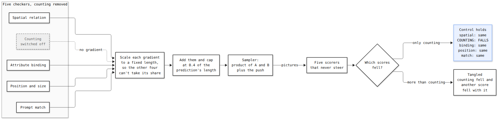

# Does removing one checker remove its property, and only its property?   ⚪ null by the written rule · read 2026-11-24

**The claim**

Three checkers push together on digits 5 to 9: one for two digits apart (count), one for the right digits, and one for left-right
order. Removing the count checker lowers the share of canvases with two digits apart from 38.4% to 10.3%, a fall of 28.1
percentage points, and removing the order checker lowers the share in the asked order from 88.2% to 47.8%, a fall of 40.4 points.
A random push of the same length in its place falls about as far, so each fall comes from losing that checker's direction. No
property meets the whole rule.

**What a canvas is.** A canvas is a small black picture 32 pixels tall and 64 wide, with room for one handwritten digit in each
half. Each canvas asks for two digits in a set order, so it is fully right when it holds both asked digits, clearly, one per
half, with the asked left digit on the left.

## Table of contents

- [Words this page uses](#words-this-page-uses)
- [What would have counted](#what-would-have-counted)
- [1. What is removed and what is scored](#1-what-is-removed-and-what-is-scored)
- [2. The removal table, 960 canvases per row](#2-the-removal-table-960-canvases-per-row)
- [3. Which removal meets the rule](#3-which-removal-meets-the-rule)
- [4. The first run, 320 canvases per row, was inconclusive](#4-the-first-run-320-canvases-per-row-was-inconclusive)
- [5. How well each checker reads, and the push length](#5-how-well-each-checker-reads-and-the-push-length)
- [Where the sources disagree](#where-the-sources-disagree)
- [What this cannot tell you](#what-this-cannot-tell-you)
- [Concepts this uses](#concepts-this-uses)
- [Where this came from](#where-this-came-from)
- [Still open](#still-open)
- [Cross-references](#cross-references)

## Words this page uses

Navigation: 📋 [TOC](#table-of-contents) | [Next](#what-would-have-counted) ➡️

**The three checkers.** Count (two digits sitting apart?), right digits (are they the two asked digits?) and order (is the asked
left digit on the left?). Each is a small classifier that reads two maps of where each asked digit acts on [the noisy canvas](../../artifacts/scenes/digit-map-checkers/rebuild-from-fundamentals.md#1-the-noisy-canvas), at
the noise levels of SDXL's first 16 steps. The count checker is the one from the [learning finding](does-a-checker-learn-plurality-on-unseen-digits.md).

**Push.** Each active checker's gradient, scaled to a fixed share `b` of the size of the product's noise prediction and added to
it, on sampler steps 15 to 25 of 50. No shared cap runs, so removing one checker leaves the others' pushes unchanged.

**The three columns.** Each is scored only on canvases that passed the one before it. Count: share of all canvases with two
separate digits. Right digits: of those, the share the judge calls clean. Order: of those, the share with the asked left digit on
the left. The three multiply to the share fully right.

**Point.** A percentage point: 38.4% to 10.3% is a fall of 28.1 points.

## What would have counted

Navigation: ⬅️ [Previous](#words-this-page-uses) | 📋 [TOC](#table-of-contents) | [Next](#1-what-is-removed-and-what-is-scored) ➡️

**The rule was pinned in [the removal design's run settings](../../../artifacts/notes/progress/abstract-checkers/08-remove-one-checker/design.md#run-settings) and [the abstract-checker design's digit rehearsal](../../../artifacts/notes/progress/abstract-checkers/03-design.md#the-digit-rehearsal) before any row ran, and the rerun kept it unchanged.**

| Result | What it takes |
|---|---|
| Support | All three together beat the plain product on fully right canvases by more than 1.96 standard errors. Each removal lowers its own column by at least 6.25 percentage points and more than 1.96 standard errors, its random-push row falls by the same rule, and no other column moves by both more than 4.2 points and more than 1.96 standard errors |
| Partial | At least one property meets that rule and at least one does not |
| Null | No removal lowers its own column by that margin |
| Inconclusive | The zero-push check fails, a row is void by the 0.6 total-length rule, or a cell the verdict needs holds fewer than 40 canvases |

The margins of 6.25 and 4.2 points are the planned SDXL table's 3 and 2 pictures of 48. Standard errors come from 10,000
bootstrap resamples of the 10 pairs.

Removing count raises the order share by 6.8 points and removing order lowers the right-digits share by 6.9 points, past the
4.2-point limit, and removing the right-digits checker lowers its own share by only 2.6 points `stated`. The owner recorded this
as null by the written rule (board question 75). W&B run `j4anxfgy`
([the removal review](../../../artifacts/notes/progress/abstract-checkers/08-remove-one-checker/review.md), lines 3 and 25 to 29).

> [!IMPORTANT]
> The result fits none of the four rows as worded. Count and order each lower their own column past the margin, which the null
> row's words exclude, and no property meets the whole rule, which partial needs. The code labels it null, and the owner's answer
> to board question 75 records it as "null by the written rule, with the description that removing count or order lowers its
> own property by 28 and 40 points and moves one other by about 7" ([the progress board](../../../artifacts/notes/progress/board.json), line 2550).

## 1. What is removed and what is scored

Navigation: ⬅️ [Previous](#what-would-have-counted) | 📋 [TOC](#table-of-contents) | [Next](#2-the-removal-table-960-canvases-per-row) ➡️

**One checker is switched off, the rest keep their own fixed push length, and scorers that never steer read the pictures.**

| The removal test's design picture |
|---|
|  Left, five checkers with counting greyed out and no gradient. Each remaining gradient is scaled to a fixed length so the others cannot take its share, then added "with no shared cap; a row is void if the total passes 0.6 of the prediction's length". The sampler draws, five scorers that never steer read the pictures, and the outcome is "control holds" if only counting falls, or "tangled" if another score falls with it `verified` (read on the picture). It draws the five-checker SDXL version; the digit run on this page has three checkers, because binding, position and size do not exist on a digit canvas `stated` ([the removal design](../../../artifacts/notes/progress/abstract-checkers/08-remove-one-checker/design.md), line 72). |

**The number.** Eleven rows on the 10 unseen pairs among digits 5 to 9 at seeds 1000 to 1095, 960 canvases per row: the plain
product, all three checkers, each removed (3), each removed with a random push of the same length in its place (3), and each
alone (3) `stated`. Each canvas asks for the lower digit on the left for even seeds and on the right for odd seeds.

## 2. The removal table, 960 canvases per row

Navigation: ⬅️ [Previous](#1-what-is-removed-and-what-is-scored) | 📋 [TOC](#table-of-contents) | [Next](#3-which-removal-meets-the-rule) ➡️

**Taking count or order out drops its own column most, and a random push in its place drops it about as much.**

> 🖼️ **Figure wanted**: one unseen pair at the same 8 seeds under four rows (all three, minus count, minus order, minus right
> digits), each canvas framed by the judge's call, so the reader sees two digits merge when count goes and swap sides when order
> goes. The canvases are from job 94186 under `/datasets/mmolefe/poe_repair_min/loop-8/v5/`; none is on the laptop.

**The number.** Job 94186 on `mscluster81`, commit `b82bf776`, push length 0.215 per checker, from `v5/final3.json` as the
review copies it. Canvas counts are in brackets `stated` (review, lines 9 to 21).

| Row | Count: two digits apart | Right digits, of those | Order, of those | Fully right, of all |
|---|---|---|---|---|
| Plain product | 1.6% (15) | 6.7% (1) | 0.0% (0) | 0.0% |
| All three | 38.4% (369) | 41.2% (152) | 88.2% (134) | 14.0% |
| Minus count | 10.3% (99) | 40.4% (40) | 95.0% (38) | 4.0% |
| Minus count, random in its place | 12.6% (121) | 36.4% (44) | 86.4% (38) | 4.0% |
| Count alone | 29.7% (285) | 28.1% (80) | 52.5% (42) | 4.4% |
| Minus right digits | 36.5% (350) | 38.6% (135) | 91.1% (123) | 12.8% |
| Minus right digits, random in its place | 32.9% (316) | 30.4% (96) | 89.6% (86) | 9.0% |
| Right digits alone | 6.8% (65) | 23.1% (15) | 40.0% (6) | 0.6% |
| Minus order | 40.7% (391) | 34.3% (134) | 47.8% (64) | 6.7% |
| Minus order, random in its place | 38.3% (368) | 35.3% (130) | 42.3% (55) | 5.7% |
| Order alone | 11.0% (106) | 29.2% (31) | 87.1% (27) | 2.8% |

A removal's own column is count for minus count, right digits for minus right digits, and order for minus order. All three together beat the plain product on fully right canvases by 14.0 points, standard
error 2.64. No row was void: the all-three row's total push passed 0.6 of the product's norm on 2.1% of pushed steps, under the 5%
limit `stated` (review, lines 7 and 31).

## 3. Which removal meets the rule

Navigation: ⬅️ [Previous](#2-the-removal-table-960-canvases-per-row) | 📋 [TOC](#table-of-contents) | [Next](#4-the-first-run-320-canvases-per-row-was-inconclusive) ➡️

**None does: count and order pass on their own column and miss on a side column, and right digits misses on its own.**

> 🖼️ **Figure wanted**: one panel per removal (count, right digits, order), each with three bars in percentage points: the fall
> in its own column, the fall when a random push takes its place, and the largest move in another column, each with its 1.96
> standard error whisker, the 6.25-point bar drawn on the first two and the 4.2-point limit on the third, so the reader sees count
> and order clear their own bar and cross the side limit while right digits stays under its bar. The numbers are the verdict table
> in the review, lines 25 to 29, from `v5/final3.json` under `/datasets/mmolefe/poe_repair_min/loop-8/`, job 94186. Render into
> `2-classifier-guidance/artifacts/results/does-removing-one-checker-remove-its-property/`, write its card entry, then embed here.

| Removed | Own column falls by (bar 6.25 points and 1.96 standard errors) | Random in its place falls by | Largest move in another column (limit 4.2 points and 1.96 standard errors) | Meets the whole rule |
|---|---|---|---|---|
| Count | 28.1 points, standard error 2.68 | 25.8, standard error 2.02 | order rises 6.8 points, standard error 2.75 | no |
| Right digits | 2.6 points, standard error 3.65 | 10.8, standard error 3.59 | order rises 3.0 | no |
| Order | 40.4 points, standard error 5.26 | 45.9, standard error 4.57 | right digits falls 6.9 points, standard error 3.46 | no |

The side moves have plain sources in the table above. Without count, fewer canvases reach the order column (38 against 134), and
those few are in order more often (95.0% against 88.2%). Without order, the right-digits share falls from 41.2% to 34.3%. The
right-digits checker, which reads near chance (0.556), controls its own property no more than a random push does `stated`
(review, line 33).

## 4. The first run, 320 canvases per row, was inconclusive

Navigation: ⬅️ [Previous](#3-which-removal-meets-the-rule) | 📋 [TOC](#table-of-contents) | [Next](#5-how-well-each-checker-reads-and-the-push-length) ➡️

**At 320 canvases per row and push length 0.229, the all-three row passed 0.6 of the product's norm on 5.85% of pushed steps, over
the 5% limit, and several cells held under 40 canvases, so the rules void it.** The owner approved the rerun above with three
times the seeds and the bars unchanged (board question 73).

> 🖼️ **Figure wanted**: the first run's share of pushed steps where the all-three row's total push passed 0.6 of the product's
> norm (5.85%) beside the rerun's (2.1%), with the 5% limit drawn, and beside it the canvases left in each removal row's own column
> against the 40-canvas floor, so the reader sees why the first run is void and the rerun is not. Label the panel as a void run
> that carries no claim. The numbers are in the review, lines 39 to 57, from `v5/final.json` (job 94172) and `v5/final3.json`
> (job 94186) under `/datasets/mmolefe/poe_repair_min/loop-8/`. Render into
> `2-classifier-guidance/artifacts/results/does-removing-one-checker-remove-its-property/`, write its card entry, then embed here.

Read without a verdict, as the review does: removing count lowered the count column from 41.6% to 14.1% (random 10.9%), and
removing order lowered the order column from 88.9% to 45.2% (random 53.1%). Removing right digits lowered its column from 40.6%
to 34.2%, and its random replacement left it at 41.4% `stated` (review, lines 39 to 57, job 94172, `v5/final.json`). These carry
no claim.

## 5. How well each checker reads, and the push length

Navigation: ⬅️ [Previous](#4-the-first-run-320-canvases-per-row-was-inconclusive) | 📋 [TOC](#table-of-contents) | [Next](#where-the-sources-disagree) ➡️

**Count and order read well above chance on digits they never saw; right digits reads near chance.**

> 🖼️ **Figure wanted**: balanced accuracy of each of the three checkers on digits 0 to 4 and on digits 5 to 9, as paired bars,
> with the 0.5 chance line and the 0.75 pass mark, so the reader sees right digits sit near chance while count and order do not.
> The right-digits and order numbers are in `v5/train.json` under `/datasets/mmolefe/poe_repair_min/loop-8/`, from job 94153;
> the count checker's are from W&B run `tyhrpyov`. Render into
> `2-classifier-guidance/artifacts/results/does-removing-one-checker-remove-its-property/`, write its card entry, then embed here.

| Checker | Overfit check, of 16 | Digits 0 to 4 | Digits 5 to 9, never trained on | Source |
|---|---|---|---|---|
| Count | 16 | 0.782 | 0.791 | the learning step, W&B `tyhrpyov` |
| Right digits | 16 | 0.601 | 0.556 | `v5/train.json` |
| Order | 16 | 0.798 | 0.711 | `v5/train.json` |

Scores are balanced accuracy over the 16 steps, where 0.5 is chance, from job 94153 `stated` (review, lines 61 to 67).

The push length came from the three gradients' mean pairwise cosine on the seen pairs, 0.009 over 10,560 pairs of gradients, which
gives b = 0.4 / √(3 (1 + 2 × 0.009)) = 0.229 for the first run (job 94154). For the rerun, job 94185 took the largest length on
the design's list whose all-three row passed 0.6 on at most 5% of pushed steps on the seen pairs: 0.215, at 2.2% `stated`
(review, lines 7 and 73).

## Where the sources disagree

Navigation: ⬅️ [Previous](#5-how-well-each-checker-reads-and-the-push-length) | 📋 [TOC](#table-of-contents) | [Next](#what-this-cannot-tell-you) ➡️

**Six places where two records say different things. This page reports both and resolves none.**

| What | One source | The other source |
|---|---|---|
| What null means | [the removal design](../../../artifacts/notes/progress/abstract-checkers/08-remove-one-checker/design.md), line 47, and [the abstract-checker design](../../../artifacts/notes/progress/abstract-checkers/03-design.md), line 239: "No removal lowers its own column by that margin" | the code's label, null, for a run in which count and order each lower their own column past the margin ([the removal review](../../../artifacts/notes/progress/abstract-checkers/08-remove-one-checker/review.md), line 3; board question 75's text, `board.json` line 2543 onward) |
| Whether the label is settled | [the removal review](../../../artifacts/notes/progress/abstract-checkers/08-remove-one-checker/review.md), line 3: "the label is the owner's call" | `board.json`, line 2550: board question 75 answered, option A, null by the written rule |
| Whether every removal moves another column by about 7 points | [the removal review](../../../artifacts/notes/progress/abstract-checkers/08-remove-one-checker/review.md), line 3: "Each removal also moves one other column by about 7 points"; the progress board's step `V5` note (`board.json`, line 809): "one other column moves ~7 points each"; [the Loop 8 summary](../../../artifacts/notes/progress/abstract-checkers/09-summary/executive-summary.md), line 14 | the same review's table, line 28: removing right digits moves order by 3.0 points. The about-7 moves belong to count (6.8) and order (6.9) |
| How many canvases reached the order column in the first run, minus count | `board.json`, line 2522 (board question 73): "only 18 canvases in the order column" | [the removal review](../../../artifacts/notes/progress/abstract-checkers/08-remove-one-checker/review.md), line 55: "18 with the right digits and 16 in the order column"; line 45 gives 40.0% (18) right digits and 88.9% (16) order |
| How the right-digits column is scored | [the removal design](../../../artifacts/notes/progress/abstract-checkers/08-remove-one-checker/design.md), line 18: "of the canvases that pass count, the share the judge calls clean" | [the abstract-checker design](../../../artifacts/notes/progress/abstract-checkers/03-design.md), line 222: "of the canvases that pass count, the share holding both asked digits" |
| Whether the design picture draws a shared cap | the picture itself and its source `remove-one-checker.mmd`, line 13: "Add them, with no shared cap; a row is void if the total passes 0.6", which matches [the abstract-checker design](../../../artifacts/notes/progress/abstract-checkers/03-design.md), line 114 | the drain census row for the picture (`artifacts/notes/progress/drain/01-census.md`, line 199) and [the Loop 8 page](../../../artifacts/notes/progress/score-space/02-the-loops/loop-8-test-abstract-checkers.md), line 68: "Add them and cap at 0.4 of the prediction's length", and line 122, as the census row: "capped at 0.4 of the prediction's length" |

## What this cannot tell you

Navigation: ⬅️ [Previous](#where-the-sources-disagree) | 📋 [TOC](#table-of-contents) | [Next](#concepts-this-uses) ➡️

**Anything about binding, position or size.** Those properties do not exist on a 32 by 64 digit canvas, and order is left or
right only. The five-checker SDXL version waits for the owner's decision after the SDXL test (step V4 on the progress board) passes.

**Whether a weak checker could control its property.** The right-digits checker reads at 0.556, so its row shows what a checker
near chance does, and says nothing about a working identity checker.

> [!WARNING]
> The column after a removal is scored only on canvases that passed the column before it. Removing count leaves 38 canvases in
> the order column against 134 with all three, so the 6.8-point rise in order is measured on a much smaller and different set of
> canvases.

**How exact any one cell is.** Pushed renders are not bit-reproducible across nodes (the [push finding](does-the-count-checkers-push-compose-unseen-digits.md#5-how-the-push-length-was-chosen-and-a-rerun-on-another-node)
measured 43 against 41), so cells carry noise beyond the bootstrap errors.

## Concepts this uses

Navigation: ⬅️ [Previous](#what-this-cannot-tell-you) | 📋 [TOC](#table-of-contents) | [Next](#where-this-came-from) ➡️

**A removal test, or ablation.** Toy, invented numbers: a cake judged on sweetness and rise, baked with sugar and baking powder.
Leave out the sugar and sweetness falls from 8 to 2 while rise stays at 7; leave out the powder and rise falls from 7 to 1 while
sweetness stays at 8. Each ingredient "controls" its own score. Swap the sugar for the same weight of flour, and if sweetness
still falls, the fall came from losing sugar and not from a lighter mix. Run back on this page: removing count drops count from
38.4% to 10.3%, and the same-length random push in its place gives 12.6%, so the fall is the count checker's direction. The rule
also asks the other scores to hold, and here order moves by 6.8 points when count goes.

**Percentage points against percent.** 88.2% to 47.8% is a fall of 40.4 points. The bars on this page are in points.

**Adding pushes whose directions barely overlap.** Two arrows of length 1 at right angles add to length √2, about 1.41; pointing
the same way they add to 2. The three checkers' gradients have a mean cosine of 0.009, almost at right angles, so each was given
length b = 0.229 to bring the total near 0.4. The [cosine similarity card](../../../../../Obsidian/Mathematics/Linear%20Algebra/Cosine%20Similarity.md#where-to-learn-this)
teaches the measure, and the [bootstrap card](../../../../../Obsidian/Mathematics/Statistics/Bootstrap.md#where-to-learn-this) teaches the standard errors.

## Where this came from

Navigation: ⬅️ [Previous](#concepts-this-uses) | 📋 [TOC](#table-of-contents) | [Next](#still-open) ➡️

**Every number is copied from the review; the results files it quotes are on the cluster and were not opened.**

| What | Source | Mark |
|---|---|---|
| The rerun table, the removal verdict table, W&B `j4anxfgy` | [the removal review](../../../artifacts/notes/progress/abstract-checkers/08-remove-one-checker/review.md), lines 3 to 33, from `v5/final3.json` | stated |
| The first run | review lines 35 to 57, from `v5/final.json` | stated |
| The checkers' accuracies and the push length | review lines 59 to 84, from `v5/train.json` and `v5/calibrate.json` | stated |
| The rule | [the removal design](../../../artifacts/notes/progress/abstract-checkers/08-remove-one-checker/design.md), lines 43 to 50, with the bars in `2-classifier-guidance/scripts/abstract_checkers/v5_remove.py` | stated |
| The owner's answers to board questions 56, 73 and 75 | [the progress board](../../../artifacts/notes/progress/board.json), `questions` | stated |
| What the design picture shows | the picture above, opened at full size on 2026-11-24, and its `.mmd` source | verified |
| The plan that owned the step | step V5 on the progress board, run under [the Session 8 brief](../../../artifacts/notes/progress/prompts/session-8-test-abstract-checkers.md), from [the abstract-checker design](../../../artifacts/notes/progress/abstract-checkers/03-design.md#step-v5-remove-one-checker-at-a-time) | |
| Regenerate with | `v5_remove.py`, launched as in [launching and harvesting a run](../../../runbook/running-things-on-the-cluster/launching-and-harvesting-a-run.md) | |
| The cluster and its cards | [the environment overview](../../../environment/overview.md) | |

## Still open

Navigation: ⬅️ [Previous](#where-this-came-from) | 📋 [TOC](#table-of-contents) | [Next](#cross-references) ➡️

- [ ] The exemplar sheet in section 2.
- [ ] The figures in sections 3, 4 and 5.
- [ ] The design's result rows do not cover a run where removals pass on their own column and miss on a side column; the owner chose to keep the coded label (board question 75).
- [ ] The five-checker SDXL removal test, decided once the SDXL test passes.
- [ ] The six disagreements under [Where the sources disagree](#where-the-sources-disagree).

## Cross-references

Navigation: ⬅️ [Previous](#still-open) | 📋 [TOC](#table-of-contents)

- The mention of **the removal finding** in [the context page on the digit-map checkers, one sampler step, section "Why the checker reads maps"](../../../context/methods/03-the-digit-map-checkers/01-overview.md#why-the-checker-reads-maps).

<!-- built-to: PAGE_LOOK_FORMAT v1 -->
