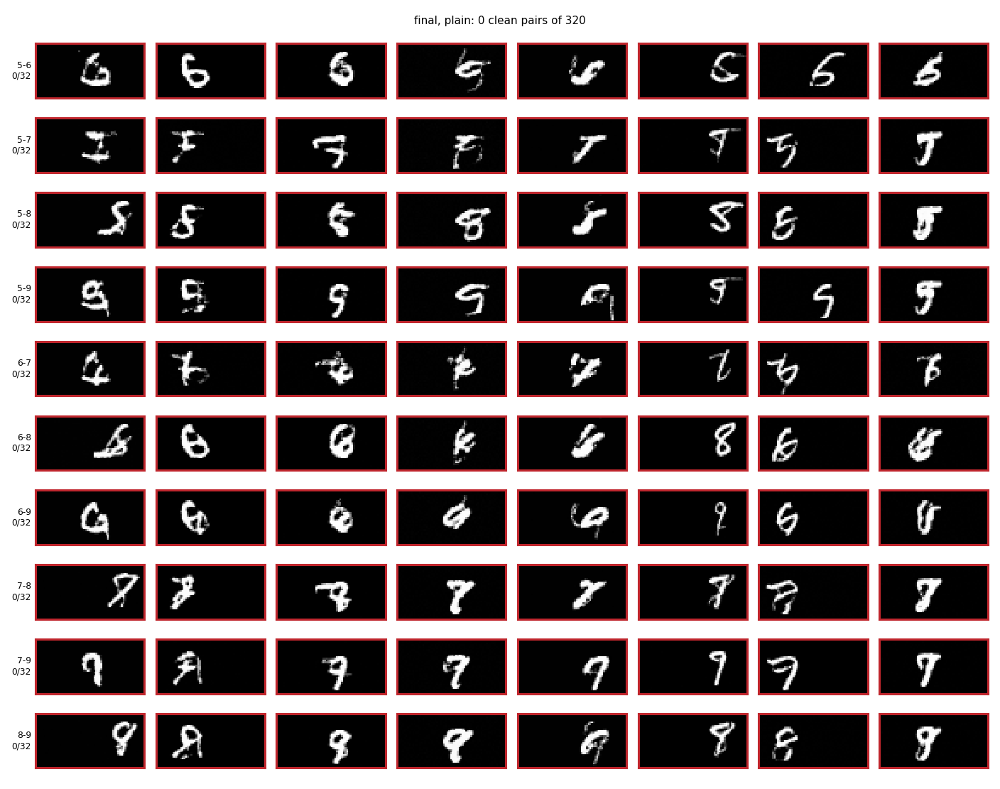
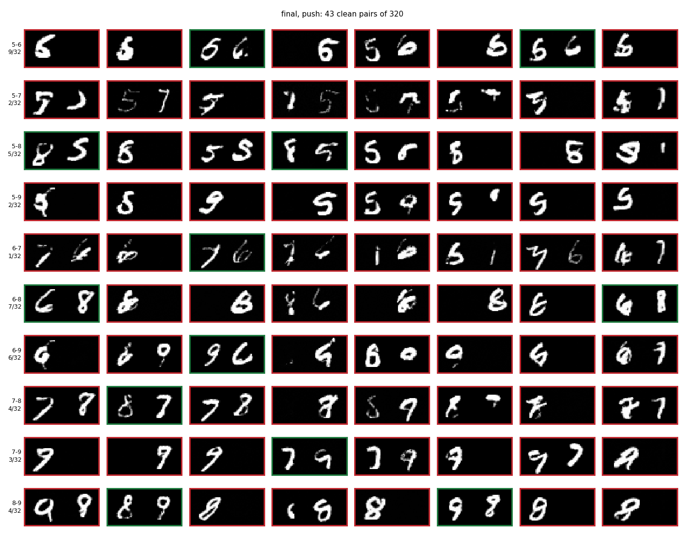
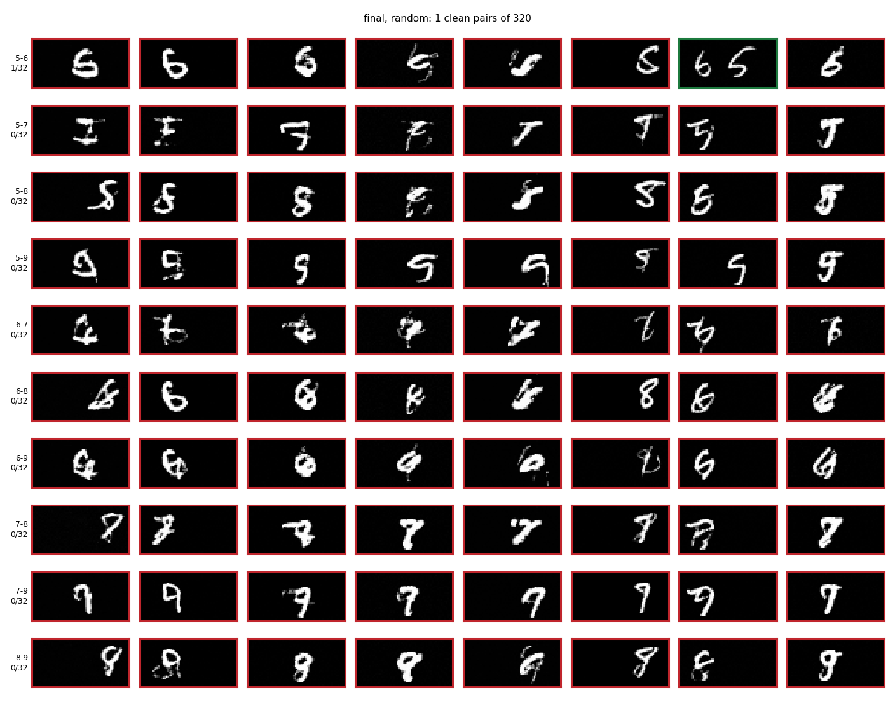
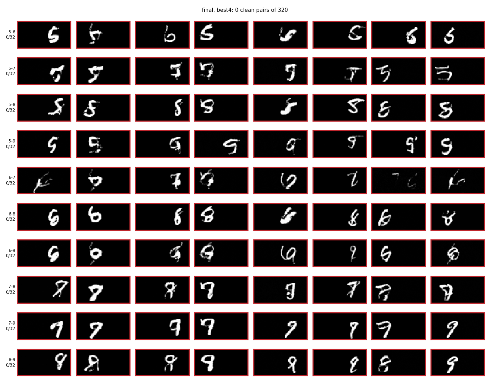
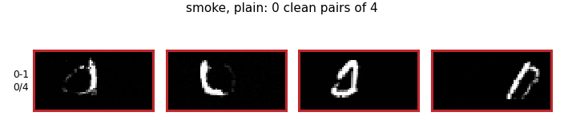
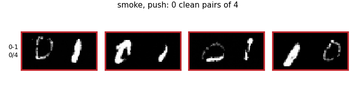

# Does the count checker's push compose unseen digits?   ✅ support · read 2026-11-24

**The claim**

On the 10 pairs among digits 5 to 9, which the count checker never trained on, adding its push while sampling turns the plain
product's 0 clean pairs of 320 into 43. The lead of 43 is 5.7 times its standard error of 7.58, a random push of the same length
gives 1, and picking the best of 4 plain samples by the checker's own score gives 0. W&B run `qhusod91` `stated`
([the push review](../../../artifacts/notes/progress/abstract-checkers/06-does-it-compose/review.md), lines 3 and 14 to 20).
The push mostly fixes layout: 161 of the 320 pushed canvases hold two separate digits, and 43 of those are both asked digits drawn
clearly.

**What a canvas is.** A canvas is a small black picture 32 pixels tall and 64 wide, with room for one handwritten digit in each
half. The frozen digit model drew one digit per canvas in training and never saw two together. The plain product asks it for both
digits at once by multiplying its two one-digit predictions, and on its own that draws one fused shape.

## Table of contents

- [Words this page uses](#words-this-page-uses)
- [What would have counted](#what-would-have-counted)
- [1. The push separates the fused digit](#1-the-push-separates-the-fused-digit)
- [2. A random push and picking the best seed do nothing](#2-a-random-push-and-picking-the-best-seed-do-nothing)
- [3. What the push does to each canvas](#3-what-the-push-does-to-each-canvas)
- [4. What the two maps do while the push acts](#4-what-the-two-maps-do-while-the-push-acts)
- [5. How the push length was chosen, and a rerun on another node](#5-how-the-push-length-was-chosen-and-a-rerun-on-another-node)
- [Where the sources disagree](#where-the-sources-disagree)
- [What this cannot tell you](#what-this-cannot-tell-you)
- [Concepts this uses](#concepts-this-uses)
- [Where this came from](#where-this-came-from)
- [Still open](#still-open)
- [Cross-references](#cross-references)

## Words this page uses

Navigation: 📋 [TOC](#table-of-contents) | [Next](#what-would-have-counted) ➡️

**Count checker.** The small checker from the [learning finding](does-a-checker-learn-plurality-on-unseen-digits.md) that
answers "two digits sitting apart?" from two maps of where each asked digit acts. It is not told which digits were asked.

**Push.** The [gradient](../../../../../Obsidian/Mathematics/Calculus/Gradient.md#where-to-learn-this) of the checker's score
with respect to [the noisy canvas](../../artifacts/scenes/digit-map-checkers/rebuild-from-fundamentals.md#1-the-noisy-canvas), scaled to a fixed share `b` of the size of the product's noise prediction, and added to it at
each pushed step.

**Clean pair.** A finished canvas the digit judge calls "two clear, right, apart": two blobs, each a confident single digit read
at least 0.9 sure, the two asked digits, one in each half. The judge never trains on canvases and never pushes.

**Push window.** Sampler steps 15 to 25 of 50, timesteps 693 down to 489, the noise levels the checker trained on.

## What would have counted

Navigation: ⬅️ [Previous](#words-this-page-uses) | 📋 [TOC](#table-of-contents) | [Next](#1-the-push-separates-the-fused-digit) ➡️

**The rule was pinned in [the push design's run settings](../../../artifacts/notes/progress/abstract-checkers/06-does-it-compose/design.md#run-settings-for-test-1) before the unseen pairs were read, and the script refuses to read them twice.**

| Result | What it takes |
|---|---|
| Support | The checker's push beats the plain product by more than 1.96 standard errors, and the random push does not |
| Null | The checker's push does not beat the plain product by that margin |
| Inconclusive | The zero push differs from plain by 1e-5 or more, or the random push also beats plain by that margin |

Standard errors come from 10,000 bootstrap resamples of the 10 pairs' per-pair differences. A second test on a model that had
seen two digits together was to run only if this one was null, so it did not run.

## 1. The push separates the fused digit

Navigation: ⬅️ [Previous](#what-would-have-counted) | 📋 [TOC](#table-of-contents) | [Next](#2-a-random-push-and-picking-the-best-seed-do-nothing) ➡️

**The same starting seeds draw one fused shape under the plain product and, with the push, often two digits.**

| Plain product, digits 5 to 9 | With the count checker's push |
|---|---|
|  One row per unseen pair, the first 8 of its 32 seeds. Every canvas holds one fused shape and every frame is red; each row reads 0/32, and the title reads 0 clean pairs of 320 `verified` (read on the picture). |  Same pairs, same seed in the same place. Many canvases now hold two separate digits; 12 of the 80 shown are framed green as clean. The row labels read 9, 2, 5, 2, 1, 7, 6, 4, 3 and 4 of 32, and the title 43 clean pairs of 320 `verified` (counted on the picture; matches the review's per-pair counts). |

**The number.** Clean pairs of 320 canvases, 10 unseen pairs at seeds 1000 to 1031, job 94134 on `mscluster79`, commit
`ae80cee6`, from `/datasets/mmolefe/poe_repair_min/loop-8/v3/test-1/final.json` as the review copies it `stated`:

| Row | Clean pairs | Two separate digits, any identity | Lead over plain | Standard error | Clears 1.96 standard errors |
|---|---|---|---|---|---|
| Plain product | 0 | 3 | | | |
| Count checker's push, b = 0.4 | 43 | 161 | 43 | 7.58 | yes |
| Random push of the same length | 1 | 4 | 1 | 0.96 | no |
| Best of 4 starting seeds, picked by the checker | 0 | 2 | | | |
| Zero push against plain, largest pixel difference | 0.0, bar under 1e-5 | | | | |

The verdict is support by the written rule. Every unseen pair gains, and the gain is uneven: 9 clean pairs for 5 and 6, 1 for 6
and 7 `stated`.

## 2. A random push and picking the best seed do nothing

Navigation: ⬅️ [Previous](#1-the-push-separates-the-fused-digit) | 📋 [TOC](#table-of-contents) | [Next](#3-what-the-push-does-to-each-canvas) ➡️

**A push of the same size in a random direction leaves the plain product's fused shapes, and so does choosing among four plain
samples by the checker's score.** The gain therefore comes from the checker's direction during sampling.

| Random push of the same length | Best of 4 plain seeds, picked by the checker |
|---|---|
|  Same layout as section 1. Nearly every canvas holds one fused shape, much like the plain sheet; one canvas, in the 5 and 6 row, is framed green. Title: 1 clean pairs of 320 `verified` (read on the picture). |  Each canvas is the one of four plain samples the checker scored highest. Every frame is red and every row reads 0/32. Title: 0 clean pairs of 320 `verified` (read on the picture). |

**The number.** Random push 1 clean pair of 320, lead 1, standard error 0.96, under 1.96 standard errors. Best of 4 seeds 0 of
320 `stated` (review, lines 18 and 19). The best-of-4 row spends four plain samples per canvas.

## 3. What the push does to each canvas

Navigation: ⬅️ [Previous](#2-a-random-push-and-picking-the-best-seed-do-nothing) | 📋 [TOC](#table-of-contents) | [Next](#4-what-the-two-maps-do-while-the-push-acts) ➡️

**The push splits the fused shape into two digits on about half the canvases, and about a quarter of those carry both asked digits
clearly.** The rest hold a wrong digit, a repeated digit, or a stroke too faint for the judge's 0.9 confidence. This matches what
the checker reads: where two digits sit, and not which digits they are `stated` (review, line 34).

| A smoke test on digits 0 and 1, plain | The same four seeds with the push |
|---|---|
|  Four canvases asked for 0 and 1, a seen pair, with no push. Each holds one mark, framed red; title 0 clean pairs of 4 `verified` (read on the picture). |  The same seeds with the push. Each canvas now holds two separate marks, one per half, and none is framed green; title 0 clean pairs of 4. The review records two separate digits on 4 of 4 and no clean pair `verified` (read on the picture; matches the review, line 66). |

**The number.** The judge's call on each of the 320 unseen canvases `stated` (review, lines 26 to 32):

| Judge's call, 320 canvases | Plain | Push |
|---|---|---|
| Two clear, right digits, one per half | 0 | 43 |
| Two digits, not both clear and right | 3 | 118 |
| Both in the same half | 20 | 3 |
| One blob | 297 | 144 |
| Damaged | 0 | 12 |

The push raises damaged canvases from 0 to 12. The plain product's two digit labels decide which digits appear, and on these
pairs they supply both right digits about one time in four `stated`.

## 4. What the two maps do while the push acts

Navigation: ⬅️ [Previous](#3-what-the-push-does-to-each-canvas) | 📋 [TOC](#table-of-contents) | [Next](#5-how-the-push-length-was-chosen-and-a-rerun-on-another-node) ➡️

**Inside the push window the two digits' maps move apart and the checker's score rises; after the window the maps drift back
together.**

> 🖼️ **Figure wanted**: centre separation of the two maps in pixels against sampler step 0 to 49, one line for the plain product
> and one for the push, with the push window (steps 15 to 25) shaded, and the checker's mean logit on a second panel. The data is
> `v3/trace/trace.json` under `/datasets/mmolefe/poe_repair_min/loop-8/`, from job 94161.

**The number.** Means over all 320 canvases of the rerun (job 94161), at selected sampler steps `stated` (review, lines 46 to 53).
Centre separation is how far apart the two maps' centres of mass sit across the canvas width; overlap is the shared share of
their mass, from 0 to 1; the logit is the checker's raw score, above 0 meaning yes.

| Sampler step | 0 | 15 | 20 | 25 | 30 | 40 | 49 |
|---|---|---|---|---|---|---|---|
| Plain: centre separation, pixels | 0.7 | 1.6 | 1.5 | 1.3 | 1.4 | 1.0 | 0.9 |
| Push: centre separation, pixels | 0.7 | 1.6 | 4.1 | 6.6 | 6.4 | 2.6 | 1.1 |
| Plain: overlap | 0.614 | 0.620 | 0.617 | 0.614 | 0.599 | 0.657 | 0.663 |
| Push: overlap | 0.614 | 0.620 | 0.619 | 0.552 | 0.525 | 0.646 | 0.667 |
| Plain: checker logit, mean | −0.21 | −0.23 | −1.26 | −4.14 | −3.66 | −1.33 | −0.15 |
| Push: checker logit, mean | −0.21 | −0.23 | 3.22 | 6.69 | 6.41 | 3.58 | −0.04 |

By the last step the separation is about 1 pixel in both rows, so a map's centre of mass at the last steps does not show where the
digits ended up. The review's reason, that late noise predictions differ mostly in stroke detail spread over both digits, is
marked `inferred` there.

## 5. How the push length was chosen, and a rerun on another node

Navigation: ⬅️ [Previous](#4-what-the-two-maps-do-while-the-push-acts) | 📋 [TOC](#table-of-contents) | [Next](#where-the-sources-disagree) ➡️

**The push length was chosen on seen digits only, and a rerun on another node gave 41 clean pairs where the recorded run gave
43.**

> 🖼️ **Figure wanted**: two panels. Left, clean pairs of 320 on the 10 seen pairs against push length b (0, 0.1, 0.2 and 0.4),
> so the reader sees the count rise with the length up to the frozen b = 0.4. Right, clean pairs per unseen pair in the recorded
> run (job 94134) against the rerun on another node (job 94161), one dot pair per unseen pair, so the reader sees counts move by up
> to 4 between nodes. The length ladder is job 94133's, which the review records at line 59 without naming its file; the per-pair
> counts are in `v3/test-1/final.json` and `v3/trace/trace.json` under `/datasets/mmolefe/poe_repair_min/loop-8/`. Render into
> `2-classifier-guidance/artifacts/results/does-the-count-checkers-push-compose-unseen-digits/`, write its card entry, then embed
> here.

On the 10 seen pairs among digits 0 to 4 at seeds 0 to 31 (job 94133), clean pairs of 320 rose with the length: 0 with no push, 8
at b = 0.1, 20 at b = 0.2 and 40 at b = 0.4. The rule froze b = 0.4, the largest of the three choices, so a longer push was not
tried `stated` (review, line 59).

Job 94161 reran the plain and pushed rows on the same pairs and seeds on `mscluster81` in place of `mscluster79`. The plain row
matched exactly, 0 clean pairs on every pair. The pushed row gave 41 of 320, and per pair it moved by up to 4 (5 and 6: 5 against
9). The rerun's lead of 41 is also more than 1.96 times the standard error of 7.58 `stated` (review, line 40). A pushed digit
render is therefore not bit-reproducible across nodes, so per-pair counts carry this much noise beyond the bootstrap error. The
verdict stays as recorded from job 94134.

## Where the sources disagree

Navigation: ⬅️ [Previous](#5-how-the-push-length-was-chosen-and-a-rerun-on-another-node) | 📋 [TOC](#table-of-contents) | [Next](#what-this-cannot-tell-you) ➡️

**Two places where two records say different things. This page reports both and resolves none.**

| What | One source | The other source |
|---|---|---|
| Which steps the push acts on | [the abstract-checker design](../../../artifacts/notes/progress/abstract-checkers/03-design.md), line 163: "Checker push, steps 0 to 15" | [the push design](../../../artifacts/notes/progress/abstract-checkers/06-does-it-compose/design.md), line 27: sampler steps 15 to 25, timesteps 693 down to 489, after board question 64 moved the checker to those noise levels; the review's line 55 reads the window as steps 15 to 25 |
| The clean pairs the push draws | [the push review](../../../artifacts/notes/progress/abstract-checkers/06-does-it-compose/review.md), line 3 and the progress board's step `V3` note: 43 of 320, job 94134 | the same review, line 40: 41 of 320 on the same pairs and seeds, job 94161 on another node. The review keeps 43 as the verdict |

## What this cannot tell you

Navigation: ⬅️ [Previous](#where-the-sources-disagree) | 📋 [TOC](#table-of-contents) | [Next](#concepts-this-uses) ➡️

**Whether this carries to SDXL.** Every result is on 32 by 64 digit canvases with one diffusion model. The SDXL test, step V4 on
the progress board, has not run.

**Whether the push chooses the right digits.** The checker reads layout. The 161 separate-digit count carries no bar and is
reported for what it shows about layout; which digits appear is left to the model's two labels.

**How a faint correct digit counts.** The clean count rests on the judge's 0.9 confidence, so a faint but correct digit counts as
not clean.

**How exact a per-pair count is.** The two-node difference of 43 against 41 is noise the bootstrap error does not include.

> [!NOTE]
> The four rows differ only in the push (none, the checker's, a random one of the same length) or, for best of 4, in selection
> with no push, so each comparison with the plain product changes one thing.

## Concepts this uses

Navigation: ⬅️ [Previous](#what-this-cannot-tell-you) | 📋 [TOC](#table-of-contents) | [Next](#where-this-came-from) ➡️

**A push of fixed length.** Toy, invented numbers: the product's noise prediction has size 10, and the checker's gradient points
along (3, 4), which has size 5. With b = 0.4 the push has size 0.4 × 10 = 4, so the gradient is rescaled to (3, 4) × 4 / 5 =
(2.4, 3.2). "Fixed length" because the push's size is always b times the prediction's size, however large or small the gradient
was. Here b = 0.4, and the random row uses a random direction rescaled the same way, which is why it is the same size. In the
design's letters, ε̂ = ε_product − ‖ε_product‖ b g / ‖g‖. The push comes from a
[classifier](../../../../../Obsidian/Artificial%20Intelligence/Machine%20Learning/Classifier.md#where-to-learn-this) on top of a
[product of experts](../../../../../Obsidian/Artificial%20Intelligence/Generative%20Modeling/Product%20Of%20Experts.md#where-to-learn-this).

**A bootstrap standard error over pairs.** Toy, invented numbers: three pairs gain 4, 1 and 1 clean pairs, a mean of 2. Draw three
pairs with replacement many times, say (4, 4, 1) with mean 3 and (1, 1, 1) with mean 1, and the spread of those means is the
standard error. "Bootstrap" because the data resamples itself; "standard error" because it is the typical wander of the mean.
Here the 10 unseen pairs' gains run from 1 to 9 clean pairs, and the review records a standard error of 7.58 clean pairs from
10,000 resamples of the 10 pairs, so a lead of 43 is 5.7 standard errors `stated`. The [bootstrap card](../../../../../Obsidian/Mathematics/Statistics/Bootstrap.md#where-to-learn-this)
and [the chapter on the bootstrap standard error](../../../../../goal-setting/learning/mathematics/statistics/sampling/textbook/08-the-percentile-bootstrap.md#84-why-with-replacement-and-the-bootstrap-standard-error)
teach it.

## Where this came from

Navigation: ⬅️ [Previous](#concepts-this-uses) | 📋 [TOC](#table-of-contents) | [Next](#still-open) ➡️

**Every number is copied from the review; the results files it quotes are on the cluster and were not opened.**

| What | Source | Mark |
|---|---|---|
| Clean pairs, separate-digit counts, standard errors, zero push, W&B `qhusod91` | [the push review](../../../artifacts/notes/progress/abstract-checkers/06-does-it-compose/review.md), lines 3 and 14 to 22, from `v3/test-1/final.json` | stated |
| The judge's calls and per-pair counts | review lines 26 to 36 | stated |
| The rerun and the map trace | review lines 40 to 55, from `v3/trace/trace.json` | stated |
| The push length and the ladder | review lines 59 to 68 | stated |
| The rule, the rows, the window and the score | [the push design](../../../artifacts/notes/progress/abstract-checkers/06-does-it-compose/design.md), lines 19 to 52 | stated |
| What each picture shows | the six pictures above, opened at full size on 2026-11-24, green frames counted on the pushed sheet | verified |
| The plan that owned the step | step V3 on [the progress board](../../../artifacts/notes/progress/board.json), run under [the Session 8 brief](../../../artifacts/notes/progress/prompts/session-8-test-abstract-checkers.md), from [the abstract-checker design](../../../artifacts/notes/progress/abstract-checkers/03-design.md#step-v3-does-its-gradient-compose-unseen-digits) | |
| Regenerate with | the step's scripts under `2-classifier-guidance/scripts/abstract_checkers/`, launched as in [launching and harvesting a run](../../../runbook/running-things-on-the-cluster/launching-and-harvesting-a-run.md) | |
| The cluster and its cards | [the environment overview](../../../environment/overview.md) | |

## Still open

Navigation: ⬅️ [Previous](#where-this-came-from) | 📋 [TOC](#table-of-contents) | [Next](#cross-references) ➡️

- [ ] The map-trace figure in section 4.
- [ ] The push-length and two-node figure in section 5.
- [ ] The same test on SDXL's six unseen object pairs (step V4 on the progress board), which waits on Loop 6's step D3.
- [ ] A push that also chooses the right digits; no identity checker has passed (the [learning finding](does-a-checker-learn-plurality-on-unseen-digits.md)).

## Cross-references

Navigation: ⬅️ [Previous](#still-open) | 📋 [TOC](#table-of-contents)

- The mention of **the push finding** in [the context page on the digit-map checkers, one sampler step, section "What one step does"](../../../context/methods/03-the-digit-map-checkers/01-overview.md#what-one-step-does).
- The mention of **the push finding's table** in [the context page on the digit-map checkers, worked on a four-pixel canvas, section "The same steps on the real runs"](../../../context/methods/03-the-digit-map-checkers/03-the-miniature.md#the-same-steps-on-the-real-runs).
- The mention of **the push finding, section 1** in [the context page on the digit-map checkers, the code that runs them, section "How it fails and how you know it worked"](../../../context/methods/03-the-digit-map-checkers/04-the-code.md#how-it-fails-and-how-you-know-it-worked).

<!-- built-to: PAGE_LOOK_FORMAT v1 -->
