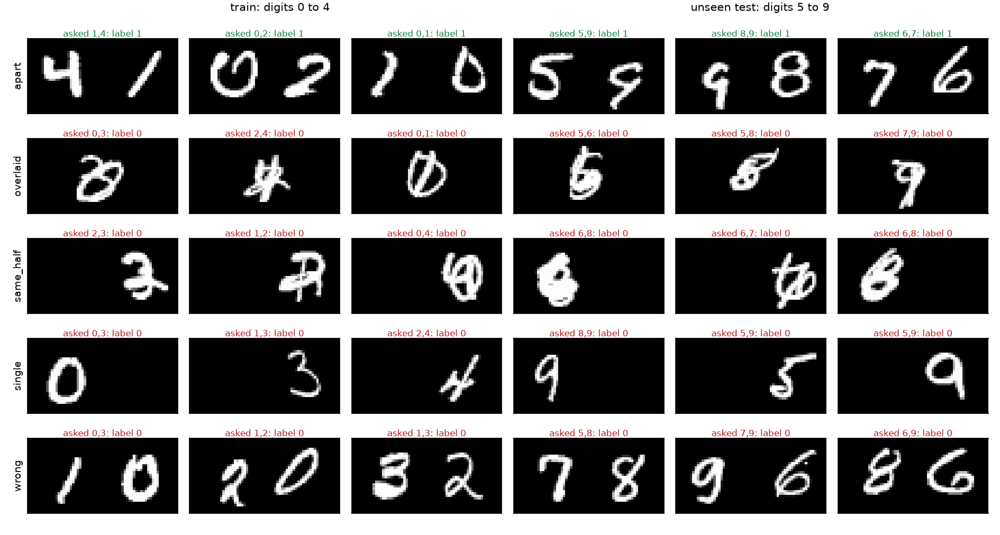
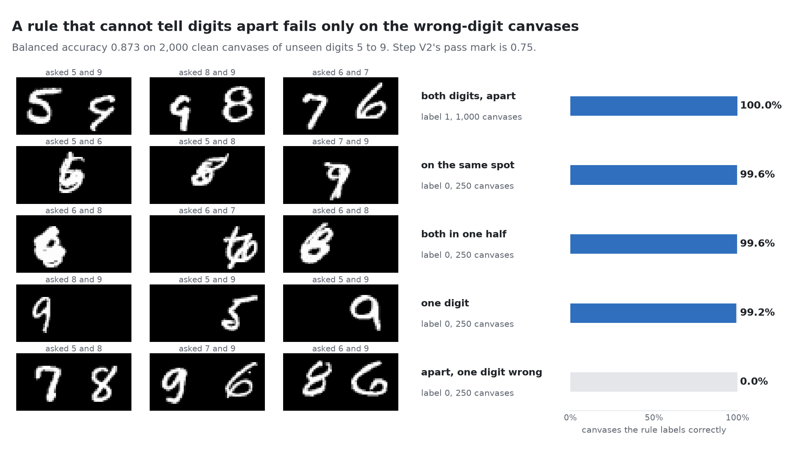

# Is the small digit environment repeatable?   ✅ passed · read 2026-11-24

**The claim**

The digit data that every later checker test trains and scores on rebuilds byte for byte: two builds give the same data hash on
the laptop and on the cluster. Asking the sampler for a push of exactly zero changes no pixel, a largest difference of 0.0
against a bar of under 1e-5, on all 20 digit pairs at 8 seeds. W&B run `xv6mbklb` `stated` ([the environment review](../../../artifacts/notes/progress/abstract-checkers/04-environment/review.md), line 3).
A later pass or miss on this test bed is therefore about the checker under test, because the data and the sampler stay fixed.

**What a canvas is.** Every test in this group works on a canvas: a small black picture 32 pixels tall and 64 wide, with room
for one handwritten digit in each half. The digits are pasted in from MNIST, the standard set of 28 by 28 handwritten digits, so
the program that builds a canvas knows exactly which digits sit where.

## Table of contents

- [What would have counted](#what-would-have-counted)
- [1. The data rebuilds to the same hash](#1-the-data-rebuilds-to-the-same-hash)
- [2. A zero push changes no pixel](#2-a-zero-push-changes-no-pixel)
- [3. What a reader blind to digits already scores](#3-what-a-reader-blind-to-digits-already-scores)
- [Where the sources disagree](#where-the-sources-disagree)
- [What this cannot tell you](#what-this-cannot-tell-you)
- [Concepts this uses](#concepts-this-uses)
- [Where this came from](#where-this-came-from)
- [Still open](#still-open)

## What would have counted

Navigation: 📋 [TOC](#table-of-contents) | [Next](#1-the-data-rebuilds-to-the-same-hash) ➡️

**The rule was pinned in [the environment design's result table](../../../artifacts/notes/progress/abstract-checkers/04-environment/design.md#what-counts-as-a-result) before the check ran.**

| Result | What it takes |
|---|---|
| Support | two rebuilds print the same data hash, and the largest absolute pixel difference between the plain sampler and the zero push is under 1e-5 on all 20 pairs at 8 seeds, in one process on one card and dtype |
| Null | the hashes differ, or the zero push differs by 1e-5 or more while two plain runs agree to under 1e-5 |
| Inconclusive | two plain runs differ from each other by 1e-5 or more, because the card's own repeatability then hides anything the push does |

The review records the outcome as "passed", which is the design's support row `stated`.

## 1. The data rebuilds to the same hash

Navigation: ⬅️ [Previous](#what-would-have-counted) | 📋 [TOC](#table-of-contents) | [Next](#2-a-zero-push-changes-no-pixel) ➡️

**Two builds give one hash on the laptop, and the cluster gives the same hash twice.** The data hash is a SHA-256 fingerprint
over the build version, the four MNIST files' own hashes, and every stored array's name, type, shape and bytes, so one changed
byte anywhere changes it.

| The five kinds of canvas every digit pair gets |
|---|
|  One row per kind of canvas, top to bottom: both asked digits apart, both on the same spot, both in one half, one digit only, and the two halves holding one asked digit and one wrong digit. The left three columns come from training (digits 0 to 4) and the right three from the unseen test split (digits 5 to 9). Only the top row is titled green, label 1; the other four rows are red, label 0 `verified` (read on the picture; matches the review). Notice the bottom row: it looks like the top row, and only the asked pair in its title makes it label 0. |

**The number.** All three checks are copied from the review's results table `stated`.

| Check | Bar | Result | Where it ran |
|---|---|---|---|
| Two rebuilds give the same data hash | identical | identical, `f70b0fb362e13e255ad332ba14ca93dfb5cf051a5dfd3c86eb30482931d5a5f3` | laptop, NumPy 2.5.5 |
| The same hash on the cluster, built twice | identical | identical, the same hash | job 93686, `mscluster79` |
| The 1% build (160 training canvases, 80 per test split), two rebuilds | identical | identical, `9b70760ad5bed2f8d1b9a0dc6714bbf37f256a9d3486f498b4e4b601278b1b0b` | laptop, and job 93685 |

The three splits hold these canvases `stated`. Each asked pair gets the same mix of kinds, so the asked pair alone says nothing
about the label.

| Split | Canvases | Pairs | `apart` | `overlaid` | `same_half` | `single` | `wrong` |
|---|---|---|---|---|---|---|---|
| `train`, digits 0 to 4 | 20,000 | 10 | 10,000 | 2,500 | 2,500 | 2,500 | 2,500 |
| `seen_test`, digits 0 to 4 | 2,000 | 10 | 1,000 | 250 | 250 | 250 | 250 |
| `unseen_test`, digits 5 to 9 | 2,000 | 10 | 1,000 | 250 | 250 | 250 | 250 |

No digit from 5 to 9 enters `train`. The build's audit passed on all three splits: every asked pair is label 1 on exactly half its
canvases, every pasted image's MNIST label matches its stored digit, and no split holds a digit outside its range `stated`.

## 2. A zero push changes no pixel

Navigation: ⬅️ [Previous](#1-the-data-rebuilds-to-the-same-hash) | 📋 [TOC](#table-of-contents) | [Next](#3-what-a-reader-blind-to-digits-already-scores) ➡️

**A push function that returns all zeros, run through the same code path as a real push, leaves every pixel where the plain
sampler puts it.** The sampler is DDIM with 50 steps on the frozen digit model, asked for both digits at once by multiplying the
model's two one-digit predictions (the plain product).

> 🖼️ **Figure wanted**: one digit pair at its 8 seeds, the plain sampler's canvases above the zero-push canvases, with the
> largest pixel difference printed under each column. The per-pair numbers are in `v1/zero-push.json` under
> `/datasets/mmolefe/poe_repair_min/loop-8/`. The loop owns where it lands under `artifacts/notes/progress/abstract-checkers/04-environment/`.

**The number.** Largest absolute pixel difference over all 20 pairs at 8 seeds, job 93686 on an RTX 3090 in float32, from the
code snapshot of commit `6dc426a2` `stated`:

| Comparison | Bar | Result |
|---|---|---|
| Plain sampler against zero push | under 1e-5 | 0.0 |
| Plain sampler against itself | under 1e-5 | 0.0 |

The second line matters because a card whose own runs disagree would hide anything the push does.

## 3. What a reader blind to digits already scores

Navigation: ⬅️ [Previous](#2-a-zero-push-changes-no-pixel) | 📋 [TOC](#table-of-contents) | [Next](#where-the-sources-disagree) ➡️

**A rule that only looks for two groups of ink with an empty column between them scores 0.873 on clean unseen canvases, above
the later pass mark of 0.75, and gets every wrong-digit canvas wrong.** That is why the later checker tests also had to separate
`apart` from `wrong`, and why the [learning finding](does-a-checker-learn-plurality-on-unseen-digits.md) reports that comparison.

| Share of each kind the layout-only rule labels correctly |
|---|
|  Left, three example canvases of digits 5 to 9 per kind. Right, one bar per kind: the share of canvases the rule labels correctly, on an axis from 0% to 100%. Both digits apart 100.0% (1,000 canvases), on the same spot 99.6% (250), both in one half 99.6% (250), one digit 99.2% (250), apart with one digit wrong 0.0% (250) `verified` (read on the picture; matches `digit-blind-reader.json`). |

**The number.** Balanced accuracy, the mean of the share of label-1 canvases and the share of label-0 canvases called correctly,
on a 0 to 1 scale where 0.5 is chance: 0.873 on the 2,000 unseen canvases and 0.871 on the 2,000 seen ones, a gap of 0.002 `verified`
(`digit-blind-reader.json`, keys `unseen_test.balanced_accuracy` and `seen_test.balanced_accuracy`). On `apart` against `wrong`
the rule scores 0.5, because it labels both kinds 1 `stated` (review, line 51). The rule and the figure come from
`2-classifier-guidance/scripts/abstract_checkers/blind_reader.py`.

## Where the sources disagree

Navigation: ⬅️ [Previous](#3-what-a-reader-blind-to-digits-already-scores) | 📋 [TOC](#table-of-contents) | [Next](#what-this-cannot-tell-you) ➡️

**No two sources disagree on this step.** The review, its design, `digit-blind-reader.json`, both pictures and the progress
board's V1 note (`board.json`, step `V1`) give the same hash, the same zero-push result and the same layout-rule scores.

## What this cannot tell you

Navigation: ⬅️ [Previous](#where-the-sources-disagree) | 📋 [TOC](#table-of-contents) | [Next](#concepts-this-uses) ➡️

**Whether any checker can learn anything.** A repeatable test bed says nothing about the checkers that later train on it.

**Whether sampled canvases look like pasted ones.** The data is pasted MNIST digits, and what the sampler draws differs from
them, so a checker that reads pasted canvases well may read sampled canvases badly. The [push finding](does-the-count-checkers-push-compose-unseen-digits.md)
tests the checker on the sampler's own output.

**Whether a real push is repeatable across machines.** The zero-push check ran in one process on one card. A pushed render later
gave 41 clean pairs on one node and 43 on another, as the push finding records.

**How the layout rule does on noisy canvases.** Its 0.873 is on clean canvases only.

## Concepts this uses

Navigation: ⬅️ [Previous](#what-this-cannot-tell-you) | 📋 [TOC](#table-of-contents) | [Next](#where-this-came-from) ➡️

**Balanced accuracy, on a toy and then on the layout rule.** A smoke alarm is tested in 6 smoky rooms and 2 clear rooms
(invented numbers), and it rings in every room.

| | Alarm rings | Alarm silent |
|---|---:|---:|
| Smoky room | 6 | 0 |
| Clear room | 2 | 0 |

Plain accuracy is 6 right of 8, which is 0.75. "Balanced" means each true class gets an equal vote: the smoky row scores 6 of 6
(1.0), the clear row 0 of 2 (0.0), and their mean is 0.5, chance. "Accuracy" is the share called right inside each row. In
symbols, balanced accuracy = ½ (right on label 1 / all label 1 + right on label 0 / all label 0).

Run back on the layout rule's unseen canvases from `digit-blind-reader.json`: label 1 is the 1,000 `apart` canvases, all called
right (1.000). Label 0 is the other 1,000: 249 overlaid, 249 same-half, 248 single and 0 wrong-digit canvases called right, 746
of 1,000 (0.746). The mean of 1.000 and 0.746 is 0.873, the recorded score. The [accuracy card](../../../../../Obsidian/Artificial%20Intelligence/Machine%20Learning/Accuracy.md#where-to-learn-this)
teaches the plain version; no vault note or journey covers the balanced one yet.

**A data hash.** No vault note or journey covers it. A hash turns any pile of bytes into one fixed-length string, and changing any
byte changes the string, so two builds with one hash hold the same bytes.

## Where this came from

Navigation: ⬅️ [Previous](#concepts-this-uses) | 📋 [TOC](#table-of-contents) | [Next](#still-open) ➡️

**The numbers are copied from the review, except the layout rule's, which were read from its local results file.**

| What | Source | Mark |
|---|---|---|
| Hashes, zero-push results, split counts, jobs, W&B `xv6mbklb` | [the environment review](../../../artifacts/notes/progress/abstract-checkers/04-environment/review.md), lines 3 to 30 and 56 to 66 | stated |
| The rule and the bars | [the environment design](../../../artifacts/notes/progress/abstract-checkers/04-environment/design.md), lines 65 to 71 | stated |
| The layout rule's scores | `artifacts/notes/progress/abstract-checkers/04-environment/digit-blind-reader.json`, opened 2026-11-24 | verified |
| What each picture shows | the two pictures above, opened at full size on 2026-11-24 | verified |
| The plan that owned the step | step V1 on [the progress board](../../../artifacts/notes/progress/board.json), run under [the Session 8 brief](../../../artifacts/notes/progress/prompts/session-8-test-abstract-checkers.md) | |
| Regenerate with | the build command in the review, and [launching and harvesting a run](../../../runbook/running-things-on-the-cluster/launching-and-harvesting-a-run.md) for the cluster job | |
| The cluster and its cards | [the environment overview](../../../environment/overview.md) | |

No context entry defines the digit canvas yet, so its meaning lives in the review's design.

## Still open

Navigation: ⬅️ [Previous](#where-this-came-from) | 📋 [TOC](#table-of-contents)

- [ ] The zero-push picture in section 2.
- [ ] A context entry for the digit canvas, its five kinds and its labels, so the four findings in this group can link one page.

<!-- built-to: PAGE_LOOK_FORMAT v1 -->
