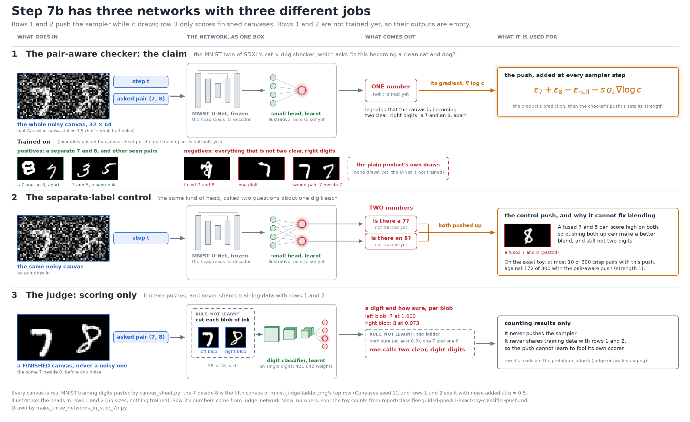

# A2b: MNIST digits on a canvas, how good the checker must be

Beside rung 2 of [the scale-up ladder](board.md#the-scale-up-ladder), gating nothing. Step 7b of
[the route](../../plans/route-classifier-guided-poe-from-toy-to-animals.md#7b--mnist-digits-on-a-canvas-how-good-must-the-checker-be)
holds the full design: a class-conditional pixel U-Net per two-digit share (0, 0.01, 0.1) on 32 × 64
canvases of real MNIST digits, five pairs held out (0 & 3, 1 & 9, 3 & 4, 3 & 6, 4 & 7), a checker
that reads the frozen U-Net's decoder features with the asked pair as an input, and a judge that
reads single digits only. Labels are exact and free here, so the checkers can be made weaker on
purpose, and the compose count against checker accuracy says whether rung 2's cat × dog checker
(0.655 held out, CLIP's ceiling 0.771) could steer at all.

## Outcomes

- [x] 📝 the bar copied into a review file in `plans/review/` before any model trains: [the review file](../../plans/review/a2b-mnist-digits-on-a-canvas.md), 2026-11-18 `verified`
- [ ] 📝 training time measured on the laptop's RTX 4070 before the three models launch
- [ ] 🖼️ screenshot: plain product and the support check, as a sheet, per share
- [ ] ✅ check passed: the judge agrees with the user's eye calls on at least 58 of 64 tiles
- [ ] 🖼️ screenshot: the five-version sheet on 7 & 8 and on the five held-out pairs
- [ ] 📈 figure: compose count against checker accuracy, with 0.655 and 0.771 marked, and the cap sweep
- [ ] ✅ check passed: the reading printed as pass or miss against the bar

## The bar

On 7 & 8, 64 seeds, on the model where plain product fuses: plain product gives two clear, right
digits on at most 8 of 64; the pair-aware push on at least 32 of 64 at some s; the random push and
the separate-label push within 6 of plain product; best-of-N at matched compute at least 8 below
the pair-aware push. On the five held-out pairs, at least 160 of 320. A share where plain product
already gives at least 32 of 64 for 7 & 8 has nothing to fix and leaves the bar.

## The result

Not run.
