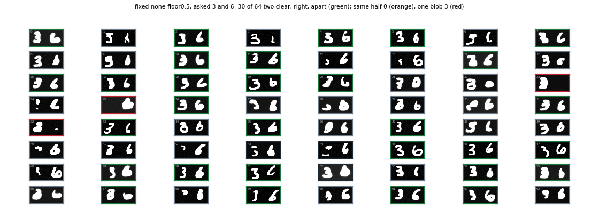

# Experts trained apart: do the step 7b pushes compose them

A follow-on to [A2b](24-mnist-one-model.md), judged by [plan 32's review file](../../plans/review/32-two-digit-experts-that-never-met.md).
The card with the counts and sheets is [the results card](../../artifacts/results/can-two-digits-compose-on-mnist/02-two-models-trained-apart/README.md).

## Outcomes

- [x] 📝 the bars written before the run, in the review file, 2026-11-19 `verified`
- [x] ✅ the experts alone: 9 of 10 digits at or above 58 of 64; the 5–9 expert's 8 (55) and, fixed-side, its 7 (57) miss `verified`
- [x] ❌ check failed: the fixed-side control, where the argument says the experts compose exactly: 139 of 320 at the best base, bar 256 `verified`
- [x] ❌ check failed: both pushes on the side-mixed experts: 4 of 320, bar 224, within 32 of plain product (0) `verified`
- [x] ✅ check passed: the pushes do no harm on the fixed-side experts: 139 of 320 without, 168 with `verified`

## The result

**They do not compose.** Two digit experts trained apart, a 0–4 expert and a 5–9 expert, give two clear, right digits on
0 of 320 seeds when each draws its digit on either side. Both pushes give 4, a random push 2, the one-half ink push 0,
and four settings of strength, cap and randomness gave 0 on the two tuning pairs. The canvases are single saturated
blobs: the product is destroyed before a push acts, and a push can only reweight what the product still has. When
each expert always draws on its own fixed side, the product keeps some mass: 139 of 320 compose with no push and
both pushes lift it to 168, still short of the 224 that would support the claim. What was not tried is a base the
two experts share.

## The sheets behind these counts

**Experts on fixed sides draw two digits, and experts on either side draw one blob.** Each sheet shows 64 canvases,
seeds 0 to 63. A green frame is a canvas the third judge counted as two clear, right digits on different halves,
orange is two digits on one half and red is one blob. Counts are from
[the counts file](../../artifacts/results/can-two-digits-compose-on-mnist/02-two-models-trained-apart/counts.json) and the sheets' own titles `verified`.

| Fixed sides, no push | Fixed sides, both pushes | Fixed sides, no push |
|---|---|---|
|  | `fixed-both-floor0.5-3-6.png` is on the cluster at `/datasets/mmolefe/poe_repair_min/artifacts-archive/2-classifier-guidance/artifacts/results/can-two-digits-compose-on-mnist/02-two-models-trained-apart/sheets/fixed-both-floor0.5-3-6.png` | `fixed-none-floor0.5-1-9.png` is on the cluster at `/datasets/mmolefe/poe_repair_min/artifacts-archive/2-classifier-guidance/artifacts/results/can-two-digits-compose-on-mnist/02-two-models-trained-apart/sheets/fixed-none-floor0.5-1-9.png` |
| Asked 3 and 6: 30 of 64 | The same seeds with both pushes: 46 of 64 | Asked 1 and 9, the highest of the five pairs without a push: 46 of 64 |

| Either side, no push | Either side, both pushes | One expert alone |
|---|---|---|
| `side-none-guided-e59-either-4-7.png` is on the cluster at `/datasets/mmolefe/poe_repair_min/artifacts-archive/2-classifier-guidance/artifacts/results/can-two-digits-compose-on-mnist/02-two-models-trained-apart/sheets/side-none-guided-e59-either-4-7.png` | `side-both-guided-e59-either-4-7.png` is on the cluster at `/datasets/mmolefe/poe_repair_min/artifacts-archive/2-classifier-guidance/artifacts/results/can-two-digits-compose-on-mnist/02-two-models-trained-apart/sheets/side-both-guided-e59-either-4-7.png` | `e59-either-alone-8.png` is on the cluster at `/datasets/mmolefe/poe_repair_min/artifacts-archive/2-classifier-guidance/artifacts/results/can-two-digits-compose-on-mnist/02-two-models-trained-apart/sheets/e59-either-alone-8.png` |
| Asked 4 and 7: 0 of 64, with 30 called one blob | The same seeds with both pushes: 0 of 64, with 33 called one blob | The 5 to 9 expert asked for an 8: 55 of 64 clear 8s, below the bar of 58 |

The other 4 condition sheets in [this result's sheets folder](../../artifacts/results/can-two-digits-compose-on-mnist/02-two-models-trained-apart/sheets) are held out of the artifact drain because they share the layout of the sheets above.
