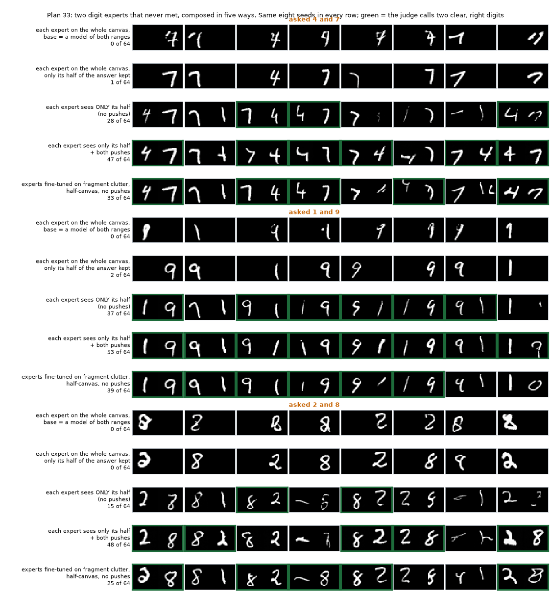
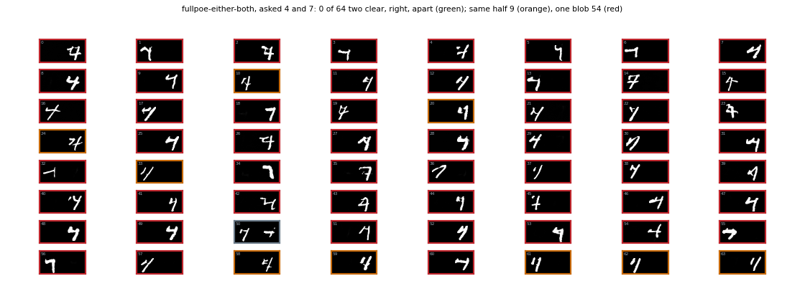
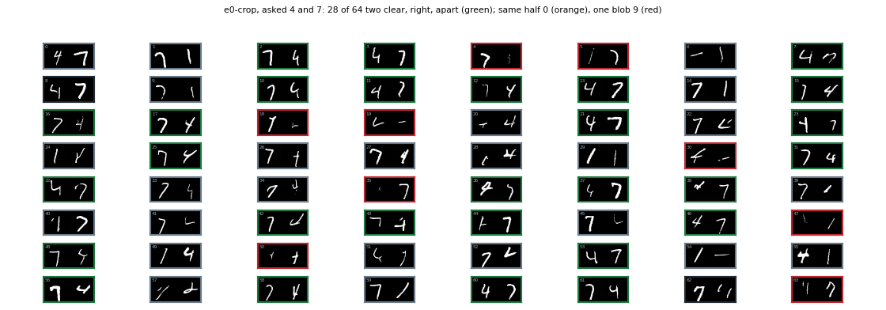
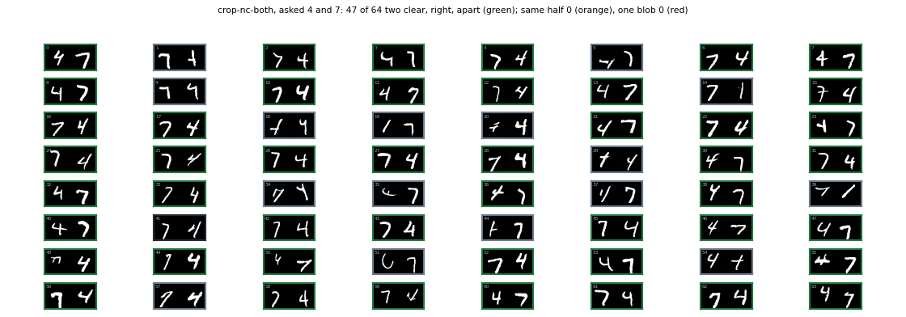
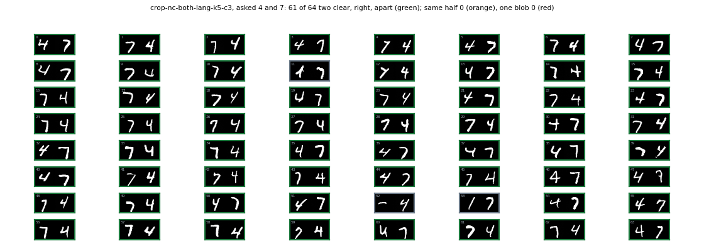
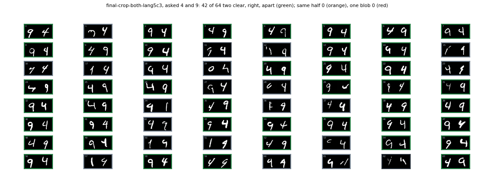
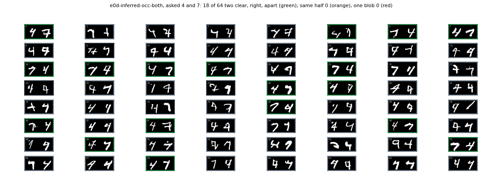
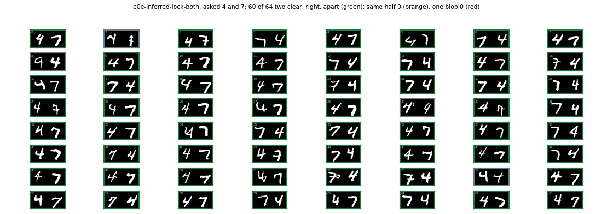
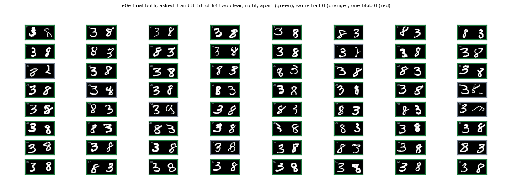
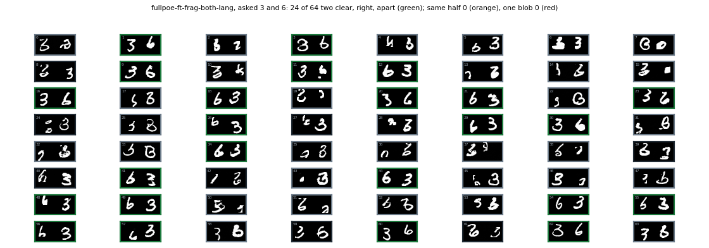

# 📒 Report: can two separately trained digit models compose while sampling? ❓ inconclusive (proposed), read 2026-11-22

**The claim**

Two digit models that never saw each other's digits draw 1,200 clean pairs of 1,280 (94%) on 20 digit pairs kept out of tuning, by the digit-reading judge, when each model works on its own half of the canvas and the side is chosen early and held `verified`. On one shared canvas with no halves, the best run reaches 121 of 320 (38%), against the 288 the plan set to support that goal `verified`.

**Why the proposed verdict is inconclusive**

1. The plan counts its headline by eye, and the by-eye reading of 1,201 to 1,208 of 1,280 waits for the owner's call on 15 tiles.
2. No run compares the side the models choose with a coin flip on these models.
3. The plan's goal is composition with no cropping, and the best run without fixed halves is the 121 of 320 above.

**What would have counted**

The bars were written on 2026-11-19, before any of these runs, in [plan 33's review file](../../plans/review/33-experts-that-compose-at-inference.md#the-bars-written-before-the-run).

| Line | Needed | Best reading |
|---|---|---|
| The headline, on the 20 unseen pairs | at least 1,152 of 1,280 (90%) and at least 45 of 64 on every pair, counted by eye | judge: 1,200, weakest pair 56. By eye: 1,201 to 1,208, waiting for the owner |
| A composition, on the five tuning pairs | 288 of 320 supports it, 160 is promising, under 32 is no effect | 310 with known halves. 121 on one shared canvas |
| An addition to the sampler or the pushes | adds at least 64 of 320 | the retrained pushes add 133. Five extra steps add 41 |

## Table of contents

- [Words this page uses](#words-this-page-uses)
- [The eight steps at a glance](#the-eight-steps-at-a-glance)
- [Step 1: the plain product draws nothing](#step-1-the-plain-product-draws-nothing)
- [Step 2: each model gets its own half](#step-2-each-model-gets-its-own-half)
- [Step 3: two checkers push every step](#step-3-two-checkers-push-every-step)
- [Step 4: extra denoising steps](#step-4-extra-denoising-steps)
- [Step 5: the first test on unseen pairs](#step-5-the-first-test-on-unseen-pairs)
- [Step 6: the models choose their side](#step-6-the-models-choose-their-side)
- [Step 7: the side is chosen early and held](#step-7-the-side-is-chosen-early-and-held)
- [Step 8: the final test on unseen pairs](#step-8-the-final-test-on-unseen-pairs)
- [Side road: training with clutter](#side-road-training-with-clutter)
- [Where the sources disagree](#where-the-sources-disagree)
- [What this cannot tell you](#what-this-cannot-tell-you)
- [Concepts this uses](#concepts-this-uses)
- [Where this came from](#where-this-came-from)
- [Still open](#still-open)

## Words this page uses

Navigation: 📋 [TOC](#table-of-contents) | [Next](#the-eight-steps-at-a-glance) ➡️

**Canvas:** one 32 by 64 pixel image with room for a digit in its left half and its right half.

**The two models:** one trained only on digits 0 to 4 and one only on digits 5 to 9. Neither has seen the other's digits.

**Clean pair:** a finished canvas that the digit-reading judge calls two clear, correct digits, one in each half, each read at least 0.9 sure.

**Sampling step:** one of the 50 steps that turn pure noise into a picture.

**Tuning pairs:** the five digit pairs used to choose settings (1 and 9, 3 and 6, 4 and 7, 2 and 8, 0 and 5), with 64 canvases each on seeds 0 to 63, so 320 canvases.

**Unseen pairs:** the other 20 pairs of one digit from each model, with 64 canvases each, so 1,280 canvases. No model and no retrained checker trained on a canvas holding one of them.

**Both pushes:** two small trained checkers whose gradients nudge every sampling step toward a canvas showing the asked pair.

## The eight steps at a glance

Navigation: ⬅️ [Previous](#words-this-page-uses) | 📋 [TOC](#table-of-contents) | [Next](#step-1-the-plain-product-draws-nothing) ➡️

**Each row is one step of the work, in order, with the clean pairs it reached.**

| Step | What changed | Clean pairs | Canvases counted |
|---|---|---:|---|
| [1. The plain product](#step-1-the-plain-product-draws-nothing) | the two models multiplied on one canvas | 0, at most 4 with repairs | 320, tuning pairs |
| [2. Each model on its own half](#step-2-each-model-gets-its-own-half) | each model sees only its half, side set by a coin flip | 124 | 320, tuning pairs |
| [3. Checker pushes](#step-3-two-checkers-push-every-step) | two small checkers nudge every step | 257 | 320, tuning pairs |
| [4. Extra denoising steps](#step-4-extra-denoising-steps) | five extra steps before each sampling step | 298 | 320, tuning pairs |
| [5. First test](#step-5-the-first-test-on-unseen-pairs) | step 4's setting, seeds 64 to 127 | 1,088 | 1,280, unseen pairs |
| [6. The models choose the side](#step-6-the-models-choose-their-side) | no coin flip, side chosen at every step | at most 56 | 320, tuning pairs |
| [7. Side chosen early and held](#step-7-the-side-is-chosen-early-and-held) | side fixed after the first 10 of 50 steps | 310 | 320, tuning pairs |
| [8. Final test](#step-8-the-final-test-on-unseen-pairs) | step 7's setting, seeds 128 to 191 | 1,200 | 1,280, unseen pairs |
| [Side road: clutter](#side-road-training-with-clutter) | models retrained with stroke fragments, one shared canvas | 121 at best | 320, tuning pairs |

Five ways of combining the same two models on the same eight seeds, for three digit pairs. A green frame is a canvas the judge calls clean. The top two rows hold one digit per canvas, and green appears once each model sees only its own half. Each row's printed count is out of 64 and matches its count file `verified`.

> [!NOTE]
> Every count on this page is the judge's unless the line says by eye. Steps 5 and 8 use different digit pairs and seeds from the other steps, so a count out of 1,280 and a count out of 320 are two separate readings.

## Step 1: the plain product draws nothing

Navigation: ⬅️ [Previous](#the-eight-steps-at-a-glance) | 📋 [TOC](#table-of-contents) | [Next](#step-2-each-model-gets-its-own-half) ➡️

**Multiplying the two models draws 0 clean pairs of 320, and the repairs tried reach at most 4.** The [step 1 page](../../artifacts/results/can-two-digits-compose-on-mnist/03-composing-the-two-models-while-sampling/01-the-plain-product-draws-nothing/README.md) explains why a canvas holding one digit from each model has almost no chance under either.

With both pushes, 0 of 64 are clean for 4 and 7, and most canvases hold a 4 and a 7 fused into one shape `verified`.

The step's other 24 pictures, by folder and file count: `sheets/each-model-sees-the-whole-canvas/` (5), `sheets/plain-product-with-both-pushes/` (4), `sheets/plain-product-with-both-pushes-and-extra-steps/` (5), `sheets/shared-background-from-a-third-model/` (5), `sheets/whole-canvas-with-a-zero-strength-push/` (5).

Clean pairs of 320: plain product 0, an average "no digit" background 0, a third model as background 0, both pushes 1, both pushes with extra steps 0, and each model kept on one half while seeing the whole canvas 4 `verified` (the [step 1 count files](../../artifacts/results/can-two-digits-compose-on-mnist/03-composing-the-two-models-while-sampling/01-the-plain-product-draws-nothing/counts) and [the average-background count](../../artifacts/results/can-two-digits-compose-on-mnist/02-two-models-trained-apart/counts/cells/side-none-avgnull/counts.json)).

## Step 2: each model gets its own half

Navigation: ⬅️ [Previous](#step-1-the-plain-product-draws-nothing) | 📋 [TOC](#table-of-contents) | [Next](#step-3-two-checkers-push-every-step) ➡️

**Showing each model only its own half raises clean pairs from 4 to 124 of 320, with no training.** A coin flip per seed picks which model gets which half. The [step 2 page](../../artifacts/results/can-two-digits-compose-on-mnist/03-composing-the-two-models-while-sampling/02-giving-each-model-its-own-half/README.md) walks one sampling step.

Each model on its own half: 28 of 64 clean for 4 and 7, up from 1 with the whole canvas shown `verified`.

The step's other 10 pictures, by folder and file count: the step folder itself (1), `sheets/each-model-on-its-own-half/` (4), `sheets/each-model-on-its-own-half-second-run/` (5).

One real step, 26 of 50 on seed 0 in a run with both pushes, shows the difference. Shown the whole canvas, both models put their digit on the right. Shown only their halves, they draw a 4 on the left and a 7 on the right `verified` (the explainer on the step 2 page).

Clean pairs of 64, by digit pair: 1 and 9 37, 3 and 6 24, 4 and 7 28, 2 and 8 15, 0 and 5 20, which add to 124 of 320 `verified`. The plan's no-effect line is 32 and its promising line is 160, so 124 sits between them `stated` ([plan 33's review file](../../plans/review/33-experts-that-compose-at-inference.md#the-bars-written-before-the-run)).

## Step 3: two checkers push every step

Navigation: ⬅️ [Previous](#step-2-each-model-gets-its-own-half) | 📋 [TOC](#table-of-contents) | [Next](#step-4-extra-denoising-steps) ➡️

**Two small trained checkers that push every sampling step raise clean pairs from 124 to 257 of 320.** The [step 3 page](../../artifacts/results/can-two-digits-compose-on-mnist/03-composing-the-two-models-while-sampling/03-adding-the-checker-pushes/README.md) explains what a push is and what each checker trained on.

Both pushes from the retrained checkers: 47 of 64 clean for 4 and 7 `verified`.

The step's other 44 pictures, by folder and file count: `sheets/both-pushes-first-checkers/` (5), `sheets/both-pushes-retrained-checkers/` (4), `sheets/both-pushes-sampler-noise-0-5/` (5), `sheets/both-pushes-size-limit-0-3/` (5), `sheets/both-pushes-strength-3/` (5), `sheets/both-pushes-strength-30/` (5), `sheets/one-half-ink-push-first-checkers/` (5), `sheets/one-half-ink-push-second-run/` (5), `sheets/zero-strength-push/` (5).

Over all five pairs, the ink checker alone reaches 213 of 320 (40 of 64 on 4 and 7), both pushes from the first checkers reach 241 (41), and the retrained checkers reach 257 (47) `verified`.

A push of exactly zero gives the same 124 as no push `verified`. The retrained pushes add 133 over no pushes, and the plan asked for 64 `stated`.

| Setting changed from the default | Clean pairs of 320 | Change from 257 |
|---|---:|---:|
| Strength 10 to 3 | 251 | 6 fewer |
| Strength 10 to 30 | 247 | 10 fewer |
| Size limit 0.1 to 0.3 | 211 | 46 fewer |
| Sampler noise 1.0 to 0.5 | 197 | 60 fewer |

None of the four added the 10 clean pairs required, so the default settings stay `verified`. The move from 241 to 257 changes two things at once: the retraining removed the pairs the final test uses, and it trained the pair checker on pushed canvases of the five tuning pairs. So 257 is a tuning number `stated`.

## Step 4: extra denoising steps

Navigation: ⬅️ [Previous](#step-3-two-checkers-push-every-step) | 📋 [TOC](#table-of-contents) | [Next](#step-5-the-first-test-on-unseen-pairs) ➡️

**Five extra denoising steps before each sampling step raise clean pairs from 257 to 298 of 320, and twenty raise them to 306.** Each extra step is a [Langevin corrector](../../../../../Obsidian/Mathematics/Statistics/Markov%20Chain%20Monte%20Carlo/Langevin%20Dynamics.md#where-to-learn-this) step: a small move along the noise prediction plus a small random kick, at the same noise level. The [step 4 page](../../artifacts/results/can-two-digits-compose-on-mnist/03-composing-the-two-models-while-sampling/04-adding-extra-denoising-steps/README.md) works one by hand.

Five extra steps: 61 of 64 clean for 4 and 7, against 47 with none and 64 with twenty `verified`.

The step's other 10 pictures, by folder and file count: `sheets/five-extra-steps/` (4), `sheets/twenty-extra-steps/` (5), `sheets/zero-extra-steps/` (1).

| Extra steps before each sampling step | Noise predictions per canvas | Clean pairs of 320 | Gain | Gain the plan asked for |
|---:|---:|---:|---:|---:|
| 0 | 50 | 257 | | |
| 5 | 295 | 298 | 41 | 64 |
| 20 | 1,030 | 306 | 8 more | 10 |

Neither gain reached its bar `verified`. The review file then names the five-step setting for step 5, with no written decision setting the 64 aside `stated`. The twenty-step run comes after step 5 in the review file's order of entries, so it did not feed that test `stated`.

## Step 5: the first test on unseen pairs

Navigation: ⬅️ [Previous](#step-4-extra-denoising-steps) | 📋 [TOC](#table-of-contents) | [Next](#step-6-the-models-choose-their-side) ➡️

**On the 20 unseen pairs, the step 4 setting draws 1,088 clean pairs of 1,280 (85%), against 454 with no pushes and no extra steps.** The comparison run lacks both additions, so this test cannot say how much each adds `stated`. The [step 5 page](../../artifacts/results/can-two-digits-compose-on-mnist/03-composing-the-two-models-while-sampling/05-first-test-on-20-unseen-pairs/README.md) holds every pair's count.

Both pushes and five extra steps: 42 of 64 clean for 4 and 9, the weakest of the 20 pairs, against 23 with neither `verified`.

The step's other 45 pictures, by folder and file count: `eye-check/` (6), `sheets/both-pushes-and-five-extra-steps/` (19), `sheets/no-pushes/` (20).

The eye check read the 165 tiles the judge rejected on the 12 weakest pairs: 48 clearly right, 38 plausible and 79 wrong `verified` ([the step 5 eye calls](../../artifacts/results/can-two-digits-compose-on-mnist/03-composing-the-two-models-while-sampling/05-first-test-on-20-unseen-pairs/eye-check/eye-calls.json)).

| Reading | Clean pairs of 1,280 | Share |
|---|---:|---:|
| The judge alone | 1,088 | 85.0% |
| Adding the 48 clearly right tiles | 1,136 | 88.8% |
| The target | 1,152 | 90.0% |
| Also adding the 38 plausible tiles and an estimate for 27 uncalled tiles | about 1,190 | 93% |

The target sits inside that range, so the step page reads it as neither met nor missed `stated`. The weakest pair, 4 and 9, reads 42 by the judge and 43 to 46 by eye, against a floor of 45 `stated`.

## Step 6: the models choose their side

Navigation: ⬅️ [Previous](#step-5-the-first-test-on-unseen-pairs) | 📋 [TOC](#table-of-contents) | [Next](#step-7-the-side-is-chosen-early-and-held) ➡️

**With no side given to them, the two models draw at most 56 clean pairs of 320 on the full canvas.** The [step 6 page](../../artifacts/results/can-two-digits-compose-on-mnist/03-composing-the-two-models-while-sampling/06-letting-the-models-choose-their-side/README.md) shows how each attempt picks a side.

Other half hidden, both pushes: 18 of 64 clean for 4 and 7, with two shapes in nearly every tile. On the same pair, soft masks give 1 and sides forced apart give 0 `verified`.

The step's other 39 pictures, by folder and file count: `sheets/hard-masks/` (5), `sheets/hard-masks-with-both-pushes/` (5), `sheets/side-chosen-every-step/` (5), `sheets/side-chosen-every-step-other-half-hidden/` (5), `sheets/side-chosen-every-step-other-half-hidden-with-both-pushes/` (4), `sheets/side-chosen-every-step-with-both-pushes/` (5), `sheets/soft-masks/` (5), `sheets/soft-masks-with-both-pushes/` (5).

| How the side is set | Clean pairs of 320, no pushes | With both pushes |
|---|---:|---:|
| Soft masks | 0 | 2 |
| Hard masks | 0 | 0 |
| Side chosen every step, sides forced apart | 0 | 0 |
| The same, with the other half hidden | 34 | 56 |

All eight counts are `verified` from the step 6 count files (on the cluster at `/datasets/mmolefe/poe_repair_min/artifacts-archive/2-classifier-guidance/artifacts/results/can-two-digits-compose-on-mnist/03-composing-the-two-models-while-sampling/06-letting-the-models-choose-their-side/counts`). A side chosen afresh at every step keeps swapping: on 8 canvases of 4 and 7 with both pushes it swaps 14.1 times per canvas on average, from 10 to 19 `verified` (the side-flip explainer on the step 7 page).

## Step 7: the side is chosen early and held

Navigation: ⬅️ [Previous](#step-6-the-models-choose-their-side) | 📋 [TOC](#table-of-contents) | [Next](#step-8-the-final-test-on-unseen-pairs) ➡️

**Choosing the side during the first 10 of 50 sampling steps and then holding it raises clean pairs from 56 to 310 of 320.** The [step 7 page](../../artifacts/results/can-two-digits-compose-on-mnist/03-composing-the-two-models-while-sampling/07-choosing-the-side-early-and-holding-it/README.md) walks the vote, the hold and the hidden half.

Side held, both pushes: 60 of 64 clean for 4 and 7, against 47 with the side held and no pushes `verified`.

The step's other 12 pictures, by folder and file count: the step folder itself (3), `sheets/side-held-no-pushes/` (5), `sheets/side-held-with-both-pushes/` (4).

At step 4 of 50 the two ways of sharing the canvas score 1.58 and 1.59 thousandths. Chosen at every step, the side swaps 14.1 times per canvas, and held it swaps 0 times after step 10. Shown the whole canvas, the 0 to 4 model starts a second 4, and with the other half hidden it draws one `verified` (the three explainers on the step 7 page).

Over all five pairs the held side gives 259 of 320 with no pushes and 310 with both, and with both pushes the pairs read 59, 64, 60, 64 and 63 of 64 `verified`. Nothing has compared this vote with a coin flip on these models. On a small exact toy, a held coin flip gave 3,859 of 4,000 and the vote gave 3,840 `stated` ([the session note that records it](../../../artifacts/notes/session-closes/8959e932.md)).

## Step 8: the final test on unseen pairs

Navigation: ⬅️ [Previous](#step-7-the-side-is-chosen-early-and-held) | 📋 [TOC](#table-of-contents) | [Next](#side-road-training-with-clutter) ➡️

**The step 7 setting draws 1,200 clean pairs of 1,280 (94%) on the 20 unseen pairs at new seeds, and 1,043 (81%) without its pushes.** The [step 8 page](../../artifacts/results/can-two-digits-compose-on-mnist/03-composing-the-two-models-while-sampling/08-final-test-on-20-unseen-pairs/README.md) holds every pair's count.

Both pushes: 56 of 64 clean for 3 and 8, the weakest of the 20 pairs, against 45 with no pushes `verified`.

The step's other 42 pictures, by folder and file count: `eye-check/` (3), `sheets/no-pushes/` (20), `sheets/with-both-pushes/` (19).

| Written bar | Needed | Both pushes | No pushes |
|---|---|---:|---:|
| All 20 pairs together | at least 1,152 of 1,280 (90%) | 1,200 | 1,043 |
| The weakest single pair | at least 45 of 64 | 56 (3 and 8) | 44 (0 and 8) |

By the judge, the run with pushes clears both bars and the run without them misses both `verified`. The plan counts its headline by eye. Claude called the 15 tiles the judge rejected on the two pairs under 58 of 64, at full size with the judge's reason hidden: 1 clear, 7 plausible and 7 wrong ([the calls](../../artifacts/results/can-two-digits-compose-on-mnist/03-composing-the-two-models-while-sampling/08-final-test-on-20-unseen-pairs/eye-check/eye-calls.json)). Those calls give 1,201 of 1,280 counting clear tiles and 1,208 counting plausible ones too `verified`.

> [!IMPORTANT]
> The by-eye count waits for the owner, who can overrule any call, so the plan's headline bar stays unticked. The other 65 rejected tiles were not called, and the 1,200 tiles the judge accepted were not re-checked by eye `stated`.

## Side road: training with clutter

Navigation: ⬅️ [Previous](#step-8-the-final-test-on-unseen-pairs) | 📋 [TOC](#table-of-contents) | [Next](#where-the-sources-disagree) ➡️

**Retraining the two models with stroke fragments reaches 121 of 320 on one shared canvas, the closest any run comes to the plan's goal and still under its bar of 288.** Nothing in steps 1 to 8 depends on this work. The [side road page](../../artifacts/results/can-two-digits-compose-on-mnist/03-composing-the-two-models-while-sampling/side-road-training-with-clutter/README.md) has every run.

Fine-tuned on clutter, whole canvas with both pushes and extra steps: 24 of 64 clean for 3 and 6, against 0 for the original models with the same sampler `verified`.

The step's other 46 pictures, by folder and file count: the step folder itself (2), `sheets/fine-tuned-models-own-halves/` (5), `sheets/fine-tuned-models-plain-product/` (5), `sheets/fine-tuned-models-whole-canvas-with-both-pushes/` (5), `sheets/fine-tuned-models-whole-canvas-with-both-pushes-and-extra-steps/` (4), `sheets/fragment-models-own-halves/` (5), `sheets/fragment-models-own-halves-with-both-pushes/` (5), `sheets/fragment-models-plain-product/` (5), `sheets/fragment-models-whole-canvas-with-both-pushes/` (5), `sheets/fragment-models-whole-canvas-with-both-pushes-and-extra-steps/` (5).

Each model trained on its own digits with broken stroke fragments of those digits placed beside them `stated` (the fragments explainer on the side road page).

| How the two models are combined, clean pairs of 320 | Original models | Fragment models | Fine-tuned models |
|---|---:|---:|---:|
| Plain product, whole canvas | 0 | 9 | 11 |
| Whole canvas, both pushes | 1 | 66 | 75 |
| Whole canvas, both pushes, extra steps | 0 | 94 | 121 |
| Own halves, no pushes | 124 | 146 | 157 |
| Own halves, both pushes | 257 | 260 | no run |

The counts are `verified` from the side road's count files (on the cluster at `/datasets/mmolefe/poe_repair_min/artifacts-archive/2-classifier-guidance/artifacts/results/can-two-digits-compose-on-mnist/03-composing-the-two-models-while-sampling/side-road-training-with-clutter/counts`). With extra marks allowed the best run reads 123 of 320, under the plan's promising line of 160 `verified`. Both clutter model pairs miss the plan's own-digit check of 58 of 64 on some digits, so these counts carry that shortfall `stated`. One more training picture in this folder shows clothing items beside digits. It is left off this page because it shows product photographs, and no model here trained on it.

## Where the sources disagree

Navigation: ⬅️ [Previous](#side-road-training-with-clutter) | 📋 [TOC](#table-of-contents) | [Next](#what-this-cannot-tell-you) ➡️

**Nine places where two sources say different things, each left as found for the owner.**

| What | One source says | Another says |
|---|---|---|
| Which count is the headline | [The review's bars](../../plans/review/33-experts-that-compose-at-inference.md#the-bars-written-before-the-run): the headline is counted by eye | [The results card](../../artifacts/results/can-two-digits-compose-on-mnist/README.md) leads with the judge's 1,200 of 1,280. The by-eye count, 1,201 to 1,208, waits for the owner |
| Seeds of the final test | [Plan 33](../../plans/33-experts-that-compose-at-inference.md), its seeds rule and task 1.6, and the [launcher's](../../scripts/mnist/two_experts_e0e_final.sh) header comment: 64 to 127 | The same launcher's command (`--eval-seed0 128`) and the review's final reading: 128 to 191 |
| Whether the plan has run | The review's line 3: "Nothing has run" | The same file, lines 130 to 168: dated readings of every experiment |
| Whether the extra steps were adopted | Review line 145: the gain of 41 is under the 64 asked, so "not adopted" | Review line 146: the chosen setting includes them |
| Whether zero extra steps changes the sampler | Review line 145: the code "leaves the sampler unchanged" | [Step 4's page](../../artifacts/results/can-two-digits-compose-on-mnist/03-composing-the-two-models-while-sampling/04-adding-extra-denoising-steps/README.md#zero-extra-steps-leaves-every-judge-call-the-same): 58 of the 64 saved canvases differ from the default by at least one pixel, which a recount of the two sheets confirms `verified`. The judge's calls match on all 64 |
| What the 27 uncalled tiles add at step 5 | Review line 150: the same rate "would add about 8" | [Step 5's page](../../artifacts/results/can-two-digits-compose-on-mnist/03-composing-the-two-models-while-sampling/05-first-test-on-20-unseen-pairs/README.md#why-the-90-target-is-neither-met-nor-missed): about 14. The sums are 1,182 and 1,188, and both sources write the upper bound as about 1,190 |
| Whether the shared-canvas run with extra steps finished | Review line 158: "still running" | [Its count file](../../artifacts/results/can-two-digits-compose-on-mnist/03-composing-the-two-models-while-sampling/01-the-plain-product-draws-nothing/counts/plain-product-with-both-pushes-and-extra-steps.json): 0 of 320 |
| What counts as the first composition | Review line 130: 124 is "the first non-zero composition of two experts that never met" | [Step 2's page](../../artifacts/results/can-two-digits-compose-on-mnist/03-composing-the-two-models-while-sampling/02-giving-each-model-its-own-half/README.md#what-this-cannot-claim): 4 of 320 came earlier in two runs, and plan 32's fixed-side models reached 139 |
| What the plain product draws | [Plan 32's review](../../plans/review/32-two-digit-experts-that-never-met.md): "most hold one fat saturated white blob in one half" | The judge on the same run: 99 of 320 one shape and 194 two shapes that are not both clear. Both readings give 0 clean pairs `verified` |

## What this cannot tell you

Navigation: ⬅️ [Previous](#where-the-sources-disagree) | 📋 [TOC](#table-of-contents) | [Next](#concepts-this-uses) ➡️

**The 94% holds for two known halves, on digits, mostly by one judge.**

> [!WARNING]
> Steps 2 to 8 all split the canvas into a fixed left and right half. A cat and a dog in one photo do not come with that split, so these results do not show two models placing objects freely or overlapping them.

**Whether the models' vote helps.** No run holds a random side with everything else the same, so step 8's count may owe nothing to the vote.

**How much each addition adds on unseen pairs.** Step 5's comparison changes the pushes and the extra steps together. Steps 5 and 8 differ in both method and seeds, so that comparison is mixed.

**How independent the final test is.** Step 5 had already read these 20 pairs when step 7's method was designed. Step 8 uses new seeds on the same pairs.

**How exact the judge is.** The review puts the judge about 5% below a careful eye. Each setting ran once, so a gap of a few canvases cannot be told from scatter.

## Concepts this uses

Navigation: ⬅️ [Previous](#what-this-cannot-tell-you) | 📋 [TOC](#table-of-contents) | [Next](#where-this-came-from) ➡️

**Three ideas carry the page, each shown first on an invented toy and then on this project's numbers.**

**Product of two models.** Two friends rate three films from 0 to 1 (invented numbers), and you watch only what both like, so you multiply.

| Film | Friend A | Friend B | Multiplied |
|---|---:|---:|---:|
| A comedy | 1 | 0 | 0 |
| A thriller | 0 | 1 | 0 |
| A comedy-thriller | 0 | 0 | 0 |

"Product" is the last column, and "two models" are the two middle columns. Any zero in a row makes that row's product zero. In symbols, p(x) is proportional to p_A(x) times p_B(x). Here the 0 to 4 model plays friend A and the 5 to 9 model plays friend B, and the plain product draws 0 clean pairs of 320. No run measured these chances, so the zero-chance reading is the plan's explanation of that count. The vault note on the [product of experts](../../../../../Obsidian/Artificial%20Intelligence/Generative%20Modeling/Product%20Of%20Experts.md#where-to-learn-this) teaches it.

**A capped push.** A friend editing your 100-word note may change at most 10% of its length (invented numbers). They propose 52 changed words, the limit is 10, so their edit is scaled by 10 / 52.

| Word in the name | In the toy | In step 26 of 50, from [the step 2 page](../../artifacts/results/can-two-digits-compose-on-mnist/03-composing-the-two-models-while-sampling/02-giving-each-model-its-own-half/README.md) |
|---|---:|---:|
| Size of what it pushes against | 100 | 44.8 |
| Push before the cap | 52 | 23.6 |
| Cap, 10% of that size | 10 | 4.5 |

The push comes from a [classifier](../../../../../Obsidian/Artificial%20Intelligence/Machine%20Learning/Classifier.md#where-to-learn-this), and its direction is the score's [gradient](../../../../../Obsidian/Mathematics/Calculus/Gradient.md#where-to-learn-this). The rule reads: new push = push times the smaller of 1 and (cap times prediction size, over push size).

**A vote that is added up and then held.** Two options are polled for four days (invented numbers), and the margin for option A is +1, -1, +2 and 0. The running total ends at +2, so A wins and the poll stops.

| Word in the name | In the toy | In step 7 |
|---|---|---|
| Vote | one day's margin | one step's gap between the two ways of sharing the canvas, such as 1.58 against 1.59 thousandths |
| Added up | the running total, +2 | the total over the first 10 of 50 steps |
| Held | no more polls | swaps per canvas fall from 14.1 to 0 after step 10, and clean pairs rise from 56 to 310 of 320 |

No vault note or learning journey covers this vote yet.

## Where this came from

Navigation: ⬅️ [Previous](#concepts-this-uses) | 📋 [TOC](#table-of-contents) | [Next](#still-open) ➡️

**Each number traces to one of these sources, opened on 2026-11-22, and its mark says how.**

| What | Source | Mark |
|---|---|---|
| Every judge count | the 42 count files under [stage 3's step folders](../../artifacts/results/can-two-digits-compose-on-mnist/03-composing-the-two-models-while-sampling/README.md), recomputed per pair and per call | `verified` |
| The bars, written before the runs | [plan 33's review file](../../plans/review/33-experts-that-compose-at-inference.md), 2026-11-19 | `stated` |
| The design | [plan 33](../../plans/33-experts-that-compose-at-inference.md) | `stated` |
| The step 5 eye calls | [48 clear and 38 plausible, recounted](../../artifacts/results/can-two-digits-compose-on-mnist/03-composing-the-two-models-while-sampling/05-first-test-on-20-unseen-pairs/eye-check/eye-calls.json) | `verified` |
| The step 8 eye calls | [15 calls, recounted](../../artifacts/results/can-two-digits-compose-on-mnist/03-composing-the-two-models-while-sampling/08-final-test-on-20-unseen-pairs/eye-check/eye-calls.json), made by Claude and open to the owner's veto | `verified` |
| Teaching, code and limits of each step | the step pages linked from each section | `stated` |
| The stages before this one | [one model that saw a few pairs](24-mnist-one-model.md) and [two models trained apart](32-mnist-two-experts.md) | `stated` |

The launch scripts for each run are named on its step page, and no runbook recipe covers these runs yet.

## Still open

Navigation: ⬅️ [Previous](#where-this-came-from) | 📋 [TOC](#table-of-contents)

**Three things would move this page's verdict.**

- [ ] The owner's call on the 15 tiles counted by eye at step 8.
- [ ] A run that holds a random side with everything else the same, to show whether the models' vote helps.
- [ ] A shared-canvas composition with no fixed halves that reaches the plan's 288 of 320.

## Cross-references

- The mention of **the digit-composition finding, step 7** in [the context page on the product of experts, one sampler step, section "What is measured where"](../../../context/methods/01-the-product-of-experts/01-overview.md#what-is-measured-where).
- The mention of **the digit-composition finding** in [the context page on the product of experts, the code that runs it, section "How it fails and how you know it worked"](../../../context/methods/01-the-product-of-experts/04-the-code.md#how-it-fails-and-how-you-know-it-worked).

<!-- built-to: PAGE_LOOK_FORMAT v1 -->
