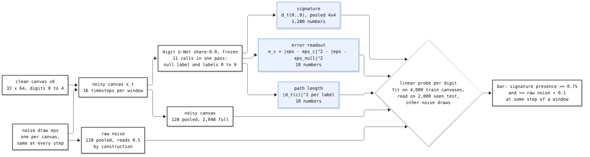

# Does the digit model's score path carry which digits are present?   ⚪ null by the written rule · read 2026-11-24

**The claim**

On small canvases of handwritten digits, the digit diffusion model's own noise predictions for all ten digit labels on one
noisy canvas let a small trained reader say which digits are on the canvas at best 0.700 balanced accuracy, at timestep 480,
against a bar of 0.75. That is null by the rule written before the run. In the noisier window the brief asked for it reads at
chance, 0.513 at best. W&B run
`gq51nl74` `verified` ([the score path review](../../artifacts/notes/progress/score-space/05-signal/review.md), line 3; the
numbers match [the score path result file](../../artifacts/notes/progress/score-space/05-signal/full.json)).

**What else it shows.** At the noise levels that match SDXL's first 16 steps, those ten predictions say more about which
digits are present than the canvas they were computed from: 0.700 against 0.593 at timestep 480, with the same reader `verified`
([the score path result file](../../artifacts/notes/progress/score-space/05-signal/full.json), key `sdxl`, rows `signature` and
`canvas` at t 480, opened 2026-11-24). The pipeline works: the reader on [the noisy canvas](../artifacts/scenes/digit-map-checkers/rebuild-from-fundamentals.md#1-the-noisy-canvas) passed its positive control at full size.

**Why it was asked.** The plan was to train an encoder that reads this path of predictions into the same space as a frozen
text encoder, so a caption could name digits the model never drew together. That is worth building only if the path carries
which digits are present at all, so this step came first and the encoder steps ran only if it passed
([the score path design](../../artifacts/notes/progress/score-space/04-design.md), lines 3 and 105).

**What a canvas is.** A canvas is a small black picture 32 pixels tall and 64 wide, with room for one handwritten digit in each
half. The frozen digit model drew one digit per canvas in training and never saw two together (design, line 49). This step
reads digits 0 to 4 only.

## Table of contents

- [Words this page uses](#words-this-page-uses)
- [What would have counted](#what-would-have-counted)
- [1. The signature misses the bar in both windows](#1-the-signature-misses-the-bar-in-both-windows)
- [2. What the other inputs read](#2-what-the-other-inputs-read)
- [3. The checks that the reader works](#3-the-checks-that-the-reader-works)
- [Where the sources disagree](#where-the-sources-disagree)
- [What this cannot tell you](#what-this-cannot-tell-you)
- [Concepts this uses](#concepts-this-uses)
- [Where this came from](#where-this-came-from)
- [Still open](#still-open)
- [Cross-references](#cross-references)

## Words this page uses

Navigation: 📋 [TOC](#table-of-contents) | [Next](#what-would-have-counted) ➡️

**Timestep t.** How much noise a canvas carries, from t 999 (almost pure noise) down to t 0 (clean). The share of the clean
canvas left in the noisy one, $\sqrt{\bar\alpha_t}$, is 0.006 at t 999 and 0.087 at t 693 (design, line 29).

**The score path.** The digit model's noise predictions taken step after step as a canvas is noised. A diffusion model's noise
prediction is its score, scaled, which is where the name comes from
([noise prediction is the score](../../../../goal-setting/learning/deep-learning/diffusion-models/02-sampler-correctors-for-composition/plans/08-noise-prediction-is-the-score.md)).

**The signature.** At one timestep and one noisy canvas $x_t$, ten maps, one per digit label $c = 0, \dots, 9$: the model's
noise prediction when asked for digit $c$ minus its prediction when asked for nothing,
$d_t(c) = \epsilon_\theta(x_t, t, c) - \epsilon_\theta(x_t, t, \varnothing)$. The maps keep their sign and their size
(design, line 23). Asking for every label, and not only the canvas's own digits, keeps the answer out of the input.

**The two windows.** The early window is 16 timesteps from t 999 to t 693, the brief's steps 0 to 15 of 50. The SDXL-matched
window is 16 timesteps from t 712 to t 480, which carry the same share of signal as SDXL's steps 0 to 15 (design, lines 29 and
31). Each is read on its own and never mixed into one number.

**Presence accuracy.** For each digit, the balanced accuracy of calling "this digit is on the canvas": the mean of the share of
canvases holding it that are called yes and the share not holding it that are called no. It runs from 0 to 1, 0.5 is chance,
and it is averaged over digits 0 to 4 (design, line 33). It is taught on a small table under [Concepts this uses](#concepts-this-uses).

**The reader.** A small network fitted at one timestep on 4,000 training canvases and read on 2,000 other canvases with a
different noise draw, one output per digit. Its inputs are the rows of the table in section 2.

**`apart` against `wrong`.** On canvases with two separate digits, telling the asked pair from a canvas where one digit is
wrong. Layout alone scores 0.5 there, so it measures which digits are present and not where they sit (design, line 35).

## What would have counted

Navigation: ⬅️ [Previous](#words-this-page-uses) | 📋 [TOC](#table-of-contents) | [Next](#1-the-signature-misses-the-bar-in-both-windows) ➡️

**The rule was pinned in [the score path design](../../artifacts/notes/progress/score-space/04-design.md#run-group-1-step-x5-does-the-signature-carry-the-digits)
before the full read, and its bar sits in `x5_signal.py` as `MIN_PRESENCE = 0.75` and `MIN_OVER_NOISE = 0.10`** (review, line 20).

The bar: the signature reads presence at 0.75 or more at some step of a window, and at least 0.1 above the same reader on the
raw noise at that step (design, line 90).

| Result | What it takes (design, lines 92 to 97) |
|---|---|
| Support | The bar holds in the early window |
| Support at SDXL's noise only | The bar misses in the early window and holds in the SDXL-matched window |
| Null | The positive control and the overfit test pass, and the bar misses in both windows |
| Inconclusive | The canvas row misses the positive control, or the overfit test fails |

**What would have surprised the design** (line 101): the signature reading presence above 0.75 in the early window, where the
canvas holds at most 8.7% of its signal.

## 1. The signature misses the bar in both windows

Navigation: ⬅️ [Previous](#what-would-have-counted) | 📋 [TOC](#table-of-contents) | [Next](#2-what-the-other-inputs-read) ➡️

**In the early window nothing but the error readout leaves chance; in the SDXL-matched window the signature climbs to 0.700
and is still rising when the window ends.**

Two panels. Up the side is presence accuracy, balanced, for digits 0 to 4 on the 2,000 `seen_test` canvases, from 0.45 to
0.80; along the bottom is the timestep, noisier at the left. Each point is one reader fitted at one timestep. The left panel is
the early window (t 999 to 693, canvas share 0.006 to 0.087), the right panel the SDXL-matched window (t 712 to 480). The
dashed line is the 0.75 bar and the dotted line is chance at 0.5. On the left every line sits at 0.49 to 0.53 except the error
readout (blue), at 0.61 to 0.66. On the right the signature (thick red) rises from 0.50 to 0.70 and is steepest at the end,
past the path length (0.62) and the noisy canvas (0.59); raw noise and shuffled labels stay at 0.50, and no line reaches 0.75
`verified` (read on the picture; matches the review, line 5).

**The number.** The bar, window by window `stated` (the table is the review's, lines 22 to 25; its best values match the
`verdict` entries of [the score path result file](../../artifacts/notes/progress/score-space/05-signal/full.json), read on
2026-11-24, and the early window's raw-noise cell does not, see [Where the sources disagree](#where-the-sources-disagree)):

| Window | Signature, best step | Raw noise at that step | 0.75 met | 0.1 over noise met | Result |
|---|---|---|---|---|---|
| Early, t 999 to 693 | 0.513 at t 754 | 0.50 | no | no | miss |
| SDXL-matched, t 712 to 480 | 0.700 at t 480 | 0.499 | no | yes, by 0.20 | miss |

Both windows miss and the control and the overfit test passed, so the design's table makes this null. The signature reads
0.680 at t 495 and 0.700 at t 480 `verified` (`full.json`, key `sdxl.signature`).

## 2. What the other inputs read

Navigation: ⬅️ [Previous](#1-the-signature-misses-the-bar-in-both-windows) | 📋 [TOC](#table-of-contents) | [Next](#3-the-checks-that-the-reader-works) ➡️

**The signature reads more than the canvas it is computed from, and it reads which digits are present as well as where.**

Where each input comes from. A clean canvas of digits 0 to 4 and one noise draw make the noisy canvas. The frozen digit model
is called 11 times on it, with no label and with each label 0 to 9, which gives the signature, the error readout and the path
length (the three blue boxes). The noisy canvas and the raw noise go straight to the reader, which is fitted on 4,000
training canvases and read on 2,000 `seen_test` canvases with other noise draws `verified` (read on the picture). The picture
labels the reader "linear probe per digit" and the signature "pooled 4x4, 1,280 numbers", which differs from the reader the
full read used; both are under [Where the sources disagree](#where-the-sources-disagree).

**The number.** Presence accuracy at the first, middle and last step of each window, and the best `apart` against `wrong`
`stated` (review, lines 31 to 40):

| Input | Early t 999 | t 836 | t 693 | Matched t 712 | t 585 | t 480 | Best `apart` against `wrong` |
|---|---:|---:|---:|---:|---:|---:|---|
| Signature, ten $d_t$ maps | 0.493 | 0.502 | 0.510 | 0.502 | 0.565 | 0.700 | 0.655 at t 480 |
| Noisy canvas $x_t$ | 0.497 | 0.496 | 0.494 | 0.505 | 0.523 | 0.593 | 0.576 at t 480 |
| Raw noise | 0.505 | 0.497 | 0.497 | 0.500 | 0.504 | 0.499 | about 0.5 |
| Error readout, 10 numbers | 0.608 | 0.656 | 0.656 | 0.643 | 0.711 | 0.742 | 0.681 at t 480 |
| Path length, 10 numbers | 0.491 | 0.501 | 0.526 | 0.521 | 0.572 | 0.621 | 0.576 at t 480 |
| Signature, labels shuffled | 0.50 to 0.51 throughout | | | | | | about 0.5 |

**More than the canvas.** In the matched window the signature leads the noisy canvas from about t 600 onward, by 0.107 at
t 480, with the same reader on both (review, line 42).

**Which digits, not only where.** On `apart` against `wrong` the signature reaches 0.655.
[Loop 8's map reader](../../artifacts/notes/progress/abstract-checkers/05-does-it-learn/review.md#the-rehearsal-at-sdxls-noise-level),
which read only the asked pair's two maps, normalised and unsigned, scored 0.511 on the same comparison in the same window
(review, line 44). That reader is the one in [the checker learning finding](abstract-checkers-on-digits/does-a-checker-learn-plurality-on-unseen-digits.md).

**The size of the maps is not the signal.** The path length, the squared size of each label's map, reads 0.621 at t 480,
below the signature's 0.700 (review, line 46).

**The error readout is a judge, never a push.** It compares each label's prediction with the noise that made the canvas, reads
0.61 to 0.66 in the early window where nothing else reads, and peaks at 0.746 at t 495. Knowing that noise and the noisy
canvas together gives back the clean canvas scaled down, so its score partly reflects access to the noise and cannot be had
during sampling; the review marks that reason inferred (review, line 48).

**The window read as one path.** A logistic regression on all 16 steps stacked, each map pooled to 2 by 4, reads 0.607 in the
early window, where every single step reads 0.49 to 0.51, and 0.674 in the matched window `verified` (read from
`signature_window` in the result file). In this read the 16 steps share one noise draw, so a combination across steps can
partly cancel that draw; the review marks that inferred and says this does not yet show a sampled path carries the digits
(review, line 50).

## 3. The checks that the reader works

Navigation: ⬅️ [Previous](#2-what-the-other-inputs-read) | 📋 [TOC](#table-of-contents) | [Next](#where-the-sources-disagree) ➡️

**At timestep 100, where the canvas keeps 0.946 of its signal, the reader on the noisy canvas reads presence at 0.950 against
its 0.9 floor, so the pipeline can read digits when they are there to read.**

> 🖼️ **Figure wanted**: one `seen_test` canvas of two digits at t 100 and at t 480, each beside its ten signature maps, with
> the reader's presence call for each digit, so the reader sees what the ten maps look like when presence is readable and
> when it is not. The cached signatures are under `/datasets/mmolefe/poe_repair_min/loop-10/`. Render into
> `2-classifier-guidance/artifacts/results/does-the-score-path-carry-which-digits-are-present/`, write its card entry, then
> embed here.

**The number.** The ladder before the full read `verified` (`control.json`, `overfit.json` and `smoke.json` under
`/datasets/mmolefe/poe_repair_min/loop-10/x5/` for the linear reader, and the same three under `x5/conv/` for the
convolutional one, opened 2026-11-24; the job numbers and durations are from the review, lines 54 to 62); the final control is `verified` against
`control` in the result file (canvas 0.95015869, signature 0.90358622):

| Job | Reader | Rung | Result | Bar |
|---|---|---|---|---|
| 94160, 8.5 min | linear | smoke | shapes right, values finite, 2,714 canvas forward passes a second | runs |
| | | positive control, t 100, 1,000 fitting canvases | signature 0.779, noisy canvas 0.764 | 0.9 for both: missed |
| | | overfit | 16 of 16 | 15 |
| 94180, about 10 min | convolutional | positive control, t 100, 1,000 fitting canvases | signature 0.802, noisy canvas 0.890 | 0.9 for both: missed |
| | | overfit | 16 of 16 | 15 |
| 94184, 25.5 min | convolutional | positive control, t 100, 4,000 fitting and 2,000 reading canvases | noisy canvas 0.950, signature 0.904 | 0.9 on the canvas only: passed |
| | | full read | the tables above | the bar above |

**Two reader changes, both before the full read and both on the owner's word.** A straight-line reader could not follow a
digit that moves across the canvas, so on board question 72 every grid input got one small convolutional reader. At 1,000
fitting canvases it still left the canvas at 0.890, so on board question 74 the control was rerun at the full read's size with
only the canvas row gating. No bar was changed (review, line 64).

**Cost.** About 0.74 GPU-hours on `bigbatch` RTX 3090s, against the design's budget of about 0.5 for this step (review, line 72).

## Where the sources disagree

Navigation: ⬅️ [Previous](#3-the-checks-that-the-reader-works) | 📋 [TOC](#table-of-contents) | [Next](#what-this-cannot-tell-you) ➡️

**Eight places where two records say different things. This page reports both and resolves none.**

| What | One source | The other source |
|---|---|---|
| The reader in the full read | [the probe-input diagram's source](../../artifacts/notes/progress/score-space/05-signal/what-each-probe-reads.mmd), line 17: "linear probe per digit"; [the score path design](../../artifacts/notes/progress/score-space/04-design.md), line 63, asks "Can a linear probe on the signature read which digits are present" | the same design, line 78: "One small convolutional probe, the same architecture for every input that has a grid", with logistic regression for the error readout and path length; [the score path review](../../artifacts/notes/progress/score-space/05-signal/review.md), line 64, and the result file's `"probe": "conv"` |
| The signature's size at the reader | [the probe-input diagram's source](../../artifacts/notes/progress/score-space/05-signal/what-each-probe-reads.mmd), line 11: "d_t(0..9), pooled 4x4, 1,280 numbers" | [the score path design](../../artifacts/notes/progress/score-space/04-design.md), line 69: "the ten $d_t(c)$ maps, pooled 2 by 2", 10 by 16 by 32 per step, and line 78 for the reader. Line 55 pools 4 by 4 for the cache, and line 78 gives 1,280 numbers for the stacked window pooled 2 by 4 |
| The noisy canvas and raw noise at the reader | [the probe-input diagram's source](../../artifacts/notes/progress/score-space/05-signal/what-each-probe-reads.mmd), lines 14 and 15: "128 pooled" | [the score path design](../../artifacts/notes/progress/score-space/04-design.md), lines 70 and 71: "pooled 2 by 2", 1 by 16 by 32 |
| Path length's best `apart` against `wrong` | [section 2's table](#2-what-the-other-inputs-read) and [the score path review](../../artifacts/notes/progress/score-space/05-signal/review.md), line 39: "0.576 at t 480" | [the score path result file](../../artifacts/notes/progress/score-space/05-signal/full.json), key `sdxl.path_length[].apart_vs_wrong`: 0.561 at t 480, and its best, 0.5765, at t 539 |
| The signature with labels shuffled | [section 2's table](#2-what-the-other-inputs-read) and [the score path review](../../artifacts/notes/progress/score-space/05-signal/review.md), line 40: "0.50 to 0.51 throughout" | [the score path result file](../../artifacts/notes/progress/score-space/05-signal/full.json), `presence` under keys `early.shuffled` and `sdxl.shuffled`: 0.494 to 0.511 (0.494 to 0.507 in the early window, 0.496 to 0.511 in the matched window) |
| Raw noise's best `apart` against `wrong` | [section 2's table](#2-what-the-other-inputs-read) and [the score path review](../../artifacts/notes/progress/score-space/05-signal/review.md), line 37: "about 0.5" | [the score path result file](../../artifacts/notes/progress/score-space/05-signal/full.json), key `sdxl.raw_noise[].apart_vs_wrong`: reaches 0.543 at t 570; `early.raw_noise[].apart_vs_wrong` reaches 0.5245 at t 693 |
| The signature's lead over the noisy canvas at t 480 | [section 2](#2-what-the-other-inputs-read) and [the score path review](../../artifacts/notes/progress/score-space/05-signal/review.md), line 42: "by 0.107 at t 480" | [the score path result file](../../artifacts/notes/progress/score-space/05-signal/full.json), `presence` at t 480: `sdxl.signature` 0.6995 minus `sdxl.canvas` 0.5933, which is 0.106 |
| Raw noise at the early window's best step | [section 1's table](#1-the-signature-misses-the-bar-in-both-windows) and [the score path review](../../artifacts/notes/progress/score-space/05-signal/review.md), line 24: 0.50 at t 754 | [the score path result file](../../artifacts/notes/progress/score-space/05-signal/full.json), key `early.raw_noise[].presence` at t 754: 0.4934, which is 0.49 at two places |

## What this cannot tell you

Navigation: ⬅️ [Previous](#where-the-sources-disagree) | 📋 [TOC](#table-of-contents) | [Next](#concepts-this-uses) ➡️

**Whether the sampler's own path reads the same.** Every canvas here is a clean canvas noised to each timestep, and the
stacked read shares one noise draw across its 16 steps. A sampler's own path does not share its noise that way (review, lines
50 and 77).

**Whether this carries to SDXL.** The digit model is a pixel U-Net with eleven labels. SDXL reads text through cross-attention
and predicts noise in a latent space, so a pass here would have said the idea can work, and a miss says nothing about SDXL
(design, line 184).

**Anything about attribute binding, size or position.** Digits hold count, which digits, and left-right order only (design,
line 183).

**How sure the 0.700 is.** No confidence interval was computed for this step; the 0.700 against 0.75 gap is one run on 2,000
canvases ([the loop summary](../../artifacts/notes/progress/score-space/executive-summary.md), line 101).

> [!NOTE]
> Every row in section 2 uses the same canvases, labels, noise draws and windows and differs only in what the reader reads,
> so each comparison between rows changes one thing. The two windows are a second axis and are never pooled into one number.

## Concepts this uses

Navigation: ⬅️ [Previous](#what-this-cannot-tell-you) | 📋 [TOC](#table-of-contents) | [Next](#where-this-came-from) ➡️

The toy numbers below are invented unless they say otherwise.

**Presence accuracy, a balanced accuracy per digit**

Ten canvases, 4 holding a 3 and 6 without one. The reader says "a 3 is here" on 3 of the 4 that hold one and on 1 of the 6 that
do not. Lay it out with the truth down the side and the reader's call across the top:

| | reader says yes | reader says no |
|---|---|---|
| a 3 is there (4) | 3 | 1 |
| no 3 (6) | 1 | 5 |

"Balanced" because each row gets the same say: the top row's share called yes is 3 / 4 = 0.75, the bottom row's share called no
is 5 / 6 = 0.833, and their mean is 0.79. "Presence" because the question is only whether the digit is there. Do this for each
digit 0 to 4 and average the five. Run back on this page: the signature's 0.700 at t 480 is that average over digits 0 to 4 on
2,000 `seen_test` canvases, and a reader that says yes to everything would score 0.5. The
[balanced accuracy section of the readout guidance chapter](../../../../goal-setting/learning/deep-learning/diffusion-models/13-classifier-guidance-by-hand/textbook/06-readout-guidance-on-one-small-network.md#balanced-accuracy-the-hit-rate-on-each-class-averaged)
teaches it on a small network.

**The signature, on four pixels**

A canvas of 4 pixels. Asked for nothing, the model predicts noise (0.2, 0.1, 0.0, 0.3). Asked for a 3, it predicts
(0.5, 0.1, 0.0, 0.3), so $d_t(3)$ = (0.3, 0, 0, 0): the 3 changes only pixel 1. Asked for a 7, it predicts (0.2, 0.1, -0.4, 0.3),
so $d_t(7)$ = (0, 0, -0.4, 0). "Signed" keeps the minus on the 7's map; "unnormalised" keeps 0.3 and 0.4 as they are, so the
size of each label's effect stays readable. The signature is all ten such maps at one timestep. Here each map covers the
32 by 64 canvas and is pooled 2 by 2 to 16 by 32 before the reader, so one timestep gives 10 × 16 × 32 numbers (design, line
69). The [classifier-free guidance card](../../../../Obsidian/Artificial%20Intelligence/Generative%20Modeling/Diffusion%20Models/Classifier-Free%20Guidance.md#where-to-learn-this)
teaches the same difference, a labelled prediction minus an unlabelled one, as it is used for guidance.

**A positive control**

Before trusting a thermometer that reads a patient as normal, put it in boiling water and check it says 100. Here the boiling
water is timestep 100, where the canvas keeps 0.946 of its signal and the digits are plainly there: the reader on the noisy
canvas must reach 0.9 before any miss at higher noise is believed. It read 0.950, so the misses in section 1 are about the
noise and not a broken pipeline. The reader itself, a small network trained to read one answer from one input, has no page in
the learning tree.

## Where this came from

Navigation: ⬅️ [Previous](#concepts-this-uses) | 📋 [TOC](#table-of-contents) | [Next](#still-open) ➡️

**The verdict, the best values, the control, the stacked reads and the ladder were checked against the result files on
2026-11-24; the per-step table, the reader changes and the cost are copied from the review.**

| What | Source | Mark |
|---|---|---|
| Verdict `null`, best 0.700 at t 480 and 0.513 at t 754, control 0.950 and 0.904, stacked 0.607 and 0.674, reader `conv`, W&B `gq51nl74` | [the score path result file](../../artifacts/notes/progress/score-space/05-signal/full.json), read 2026-11-24, copied by the review from `/datasets/mmolefe/poe_repair_min/loop-10/x5/conv/full.json` (review, line 7) | verified |
| The ladder's scores and the overfit counts | `control.json`, `overfit.json` and `smoke.json` in `/datasets/mmolefe/poe_repair_min/loop-10/x5/` and in its `conv/` folder, opened 2026-11-24 | verified |
| The per-step table, `apart` against `wrong`, the ladder's jobs and durations, the reader changes, the cost | [the score path review](../../artifacts/notes/progress/score-space/05-signal/review.md), lines 22 to 72 | stated |
| The rule, the inputs, the windows, the data and the model | [the score path design](../../artifacts/notes/progress/score-space/04-design.md), lines 21 to 101 | stated |
| The owner skipping the encoder steps | [the loop verdict](../../artifacts/notes/progress/score-space/09-verdict.md), line 3, board question 76 | stated |
| What each picture shows | the two pictures above, opened at full size on 2026-11-24 and passed through `is_showable` in `scripts/shared/disallowed_subjects.py` with their labels | verified |
| The plan that owned the step | step X5 on [the progress board](../../artifacts/notes/progress/board.json), run under [the Session 10 brief](../../artifacts/notes/progress/prompts/session-10-the-score-path-as-a-third-space.md), designed in [the score path design](../../artifacts/notes/progress/score-space/04-design.md#run-group-1-step-x5-does-the-signature-carry-the-digits) | |
| Regenerate with | `2-classifier-guidance/scripts/score_space/x5_signal.py --probe conv` and the figure script `x5_figure.py` beside it, launched as in [launching and harvesting a run](../../runbook/running-things-on-the-cluster/launching-and-harvesting-a-run.md) | |
| The cluster and its cards | [the environment overview](../../environment/overview.md) | |

## Still open

Navigation: ⬅️ [Previous](#where-this-came-from) | 📋 [TOC](#table-of-contents) | [Next](#cross-references) ➡️

- [ ] Whether a reader trained across both windows at once, or a later window, reaches 0.75. Trying it on this data needs a new design (review, line 76).
- [ ] Whether the signature computed along the sampler's own path, where the noise is not shared across steps, reads the same (review, line 77).
- [ ] Whether the stacked early window's 0.607 comes from cancelling the shared noise draw (review, line 78).
- [ ] The text-aligned encoder and the two arithmetic tests were not run, by the design's rule and the owner's answer to board question 76.
- [ ] The figure of one canvas and its ten maps in section 3.
- [ ] The eight disagreements under [Where the sources disagree](#where-the-sources-disagree).

## Cross-references

Navigation: ⬅️ [Previous](#still-open) | 📋 [TOC](#table-of-contents)

- The mention of **the score-path finding** in [the context page on the score path, one canvas end to end, section "What one canvas goes through"](../../context/methods/07-the-score-path/01-overview.md#what-one-canvas-goes-through).
- The mention of **the finding's limits** in [the context page on the score path, the network view, section "The system"](../../context/methods/07-the-score-path/02-the-network-view.md#the-system).
- The mention of **the finding's limits** in [the context page on the score path, the code it is built from, section "The DDIM step that moves the canvas"](../../context/methods/07-the-score-path/04-the-code.md#the-ddim-step-that-moves-the-canvas).

<!-- built-to: PAGE_LOOK_FORMAT v1 -->
