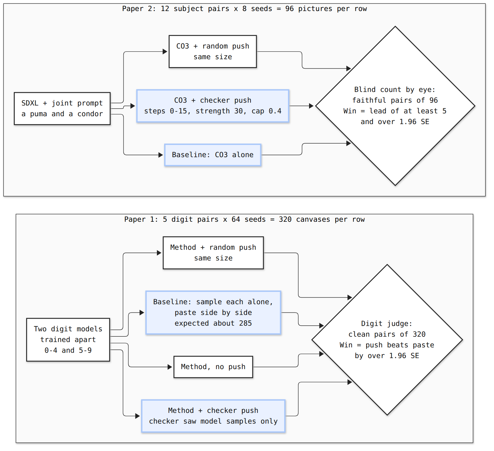
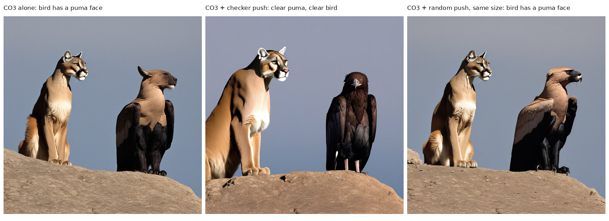
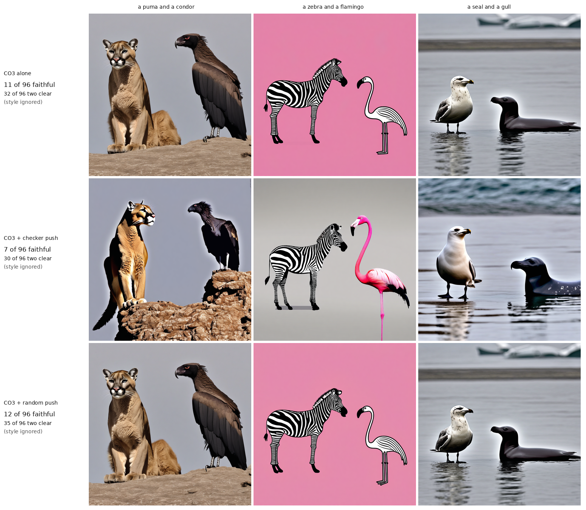
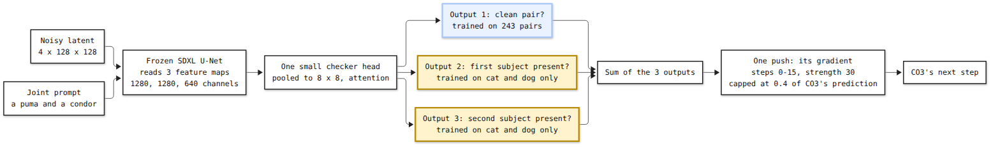

# Does adding the kept push to CO3 beat CO3 alone?   ⚪ null · read 2026-11-24

**The claim**

On 12 subject pairs at 8 seeds each, CO3 with the kept push makes 7 faithful pairs of 96 pictures and CO3 alone makes 11.
The lead is -4, so the verdict is null `stated` ([the step's review](../../../artifacts/notes/progress/method-search/01-beat-the-baseline/review.md), lines 87 to 89).
A random push of the same size makes 12, one more than CO3 alone, so the rule that would make the run inconclusive does not fire.
W&B run `s7o6404z`.

**What CO3 and the kept push are.** CO3 is a published sampler correction for composing two prompts: it combines the model's
predictions for each subject as a product and corrects each sampling step with the joint prompt's and the single subjects'
predictions `stated` ([the two problem statements](../../../artifacts/notes/progress/problem-statements.md#paper-2-restoring-plurality-in-one-model),
lines 85 and 118; [the PoE composition page](../../../context/world/poe-composition.md#further-illustrations), line 188). It is
run here at its released settings. The kept push is the gradient of a small checker network, which reads SDXL's own features and
scores whether a partly drawn picture holds a clean pair, added to the sampler's prediction at strength 30 on steps 0 to 15 of 50
and capped at 0.4 of the prediction's size `stated` ([the kept push comparison](../classifier-guided-poe/how-close-the-kept-push-comes-to-the-joint-prompt.md)).
It is the recipe kept from the cat and dog improvement rounds, and this test asks whether it helps a stronger baseline than the
plain product it was tuned on.

> [!NOTE]
> The step behind this page (step M1 on the progress board) asked the same question of both papers, with a separate bar, data and
> verdict for each. This page holds Paper 2's answer. Paper 1's answer, whether composing two digit models trained apart beats
> sampling each alone and pasting, is in [the digit-half finding](does-composing-two-digit-models-beat-sampling-and-pasting.md).

## Table of contents

- [Words this page uses](#words-this-page-uses)
- [What would have counted](#what-would-have-counted)
- [1. The three rows on the same seeds](#1-the-three-rows-on-the-same-seeds)
- [2. What the push follows](#2-what-the-push-follows)
- [3. What the blind count shows beyond the verdict](#3-what-the-blind-count-shows-beyond-the-verdict)
- [Where the sources disagree](#where-the-sources-disagree)
- [What this cannot tell you](#what-this-cannot-tell-you)
- [Concepts this uses](#concepts-this-uses)
- [Where this came from](#where-this-came-from)
- [Still open](#still-open)
- [Cross-references](#cross-references)

## Words this page uses

Navigation: 📋 [TOC](#table-of-contents) | [Next](#what-would-have-counted) ➡️

**CO3 alone.** CO3 as released, with the settings in the replications hub's `co3_common.py` unchanged: CFG++ at guidance 0.8, 50
steps, 6 corrected steps `stated` ([the step's design](../../../artifacts/notes/progress/method-search/01-beat-the-baseline/design.md#paper-2-co3-with-the-push-against-co3-alone), line 91).

**CO3 with the kept push.** CO3 plus the kept recipe's push: strength 30 on steps 0 to 15, capped at 0.4 of CO3's guided prediction
(design, line 97). The push is subtracted from both of CO3's predictions after its corrector has run on that step, so the latent
moves as it does in the kept recipe's own sampler (design, lines 100 to 104).

**Random push.** CO3 plus a random direction scaled, step by step, to the length of the real push for the same pair and seed
(design, lines 24 and 98). It shows whether the checker's direction matters or any disturbance of that size would do.

**Faithful pair.** A picture with exactly one clear first subject and one clear second subject as separate bodies, nothing borrowed
from the other, and an intact photograph. This is the count the bar uses
([the blind count rubric](../../../artifacts/notes/progress/method-search/01-beat-the-baseline/blind-count-rubric.md), lines 19 and 28).

**Damaged, or not an intact photograph.** Melted or broken anatomy, garbled faces, stray limbs, or a drawing, cartoon, poster or
collage (rubric, lines 25 and 26). A clean drawing of both subjects is two clear and damaged, so it is not faithful.

**Blind count.** All 288 pictures shuffled under neutral 12-character names and called one at a time at full size, with the key
that names the method opened only after every call was saved (design, lines 117 to 120; rubric, lines 7 and 8).

## What would have counted

Navigation: ⬅️ [Previous](#words-this-page-uses) | 📋 [TOC](#table-of-contents) | [Next](#1-the-three-rows-on-the-same-seeds) ➡️

**The bar was written in [the step's design](../../../artifacts/notes/progress/method-search/01-beat-the-baseline/design.md#paper-2-co3-with-the-push-against-co3-alone) before any run, and it lives in code as `paper2_verdict` in `2-classifier-guidance/scripts/method_search/beat_baseline_bars.py`.**

| Result | What it takes, on faithful pairs of 96 |
|---|---|
| Support | CO3 with the push leads CO3 alone by at least 5 of 96 and by more than 1.96 standard errors |
| Null | neither side has that lead |
| Loses | CO3 alone leads CO3 with the push by at least 5 of 96 and by more than 1.96 standard errors |
| Inconclusive | the zero-push check fails, or the random push leads CO3 alone by at least 5 of 96 and by more than 1.96 standard errors |

The standard error comes from 10,000 bootstrap resamples of the 12 pairs, using each pair's matched difference over its 8 seeds. A
pushed render is not bit-reproducible and has moved by about 2 of 96 when repeated, so a lead under 5 of 96 counts as a tie
`stated` (design, lines 130 to 139). A win needed a lead of at least 5 and more than 10.08, which is 1.96 times the standard
error of 5.14.

| How the three rows feed the blind count |
|---|
|  The upper panel is this page: SDXL with the joint prompt (the example is a puma and a condor) feeds three rows, 12 subject pairs by 8 seeds, so 96 pictures per row, into a blind count by eye, where a win is a lead of at least 5 and over 1.96 standard errors. The pushed row's box reads steps 0 to 15, strength 30, cap 0.4 `verified` (read on the picture; matches the design, lines 87, 97 and 136). The lower panel is Paper 1's comparison, which [the digit-half finding](does-composing-two-digit-models-beat-sampling-and-pasting.md) covers. |

**The checks that had to pass first** `stated` (review, lines 39 to 49):

| Check | Result |
|---|---|
| A zero push reproduces CO3's own loop | largest absolute difference between final latents 0.0, against a bar of 1e-5, in one process on a Quadro RTX 8000 at float16; two plain CO3 runs in that process also differed by 0.0 |
| The real push changes the render | largest absolute difference in the final latent 3.79; the push acted on all 16 steps from 0 to 15, and the cap fired on 2 of them |
| Every tuning prompt gives CO3 two concepts | yes, on all 12 |
| Time per picture on the RTX 8000 | one seed took 43.2 seconds for CO3 alone, 58.3 with the push and 45.2 with the random push |

| One pair at one seed, three rows, from the smoke run |
|---|
|  Left to right: CO3 alone, CO3 with the checker push, CO3 with a random push of the same size, all for the prompt a puma and a condor at seed 6001. The sheet's labels read bird has a puma face, clear puma and clear bird, and bird has a puma face `verified` (read and seen at full size; matches the review, line 53). It shows the code runs and the three rows differ, and it is no evidence for either side of the bar `stated` (review, line 55). The blind count's call on the full run's pushed picture at this pair and seed differs from the label; see [Where the sources disagree](#where-the-sources-disagree). |

## 1. The three rows on the same seeds

Navigation: ⬅️ [Previous](#what-would-have-counted) | 📋 [TOC](#table-of-contents) | [Next](#2-what-the-push-follows) ➡️

**All three rows draw two separate bodies on every picture, and the push does not raise the faithful count: 7 of 96 against 11 for
CO3 alone and 12 for the random push.**

| Three rows, three pairs, seed 6002 |
|---|
|  Rows top to bottom: CO3 alone, CO3 with the checker push, CO3 with a random push. Columns: a puma and a condor, a zebra and a flamingo, a seal and a gull, all at seed 6002, the first three tuning pairs. Every tile shows two separate animals, and the zebra and flamingo column is drawn as flat graphic art in all three rows `verified` (seen at full size). The CO3-alone and random-push rows look nearly the same at this seed `verified` (seen). The row labels read 11, 7 and 12 of 96 faithful and 32, 30 and 35 of 96 two clear with style ignored, matching the review. None of these nine pictures is faithful in the blind count: eight are called two bodies, for borrowed parts such as a puma with a feathered chest or a seal with a beak-like snout, and the pushed zebra and flamingo is called two clear but damaged as a drawing `verified` ([the blind calls](../../../artifacts/notes/progress/method-search/01-beat-the-baseline/paper-2-blind-calls.csv), lines 9, 82, 87, 142, 156, 182, 199, 241 and 253, matched to the sheet through [the method key](../../../artifacts/notes/progress/method-search/01-beat-the-baseline/paper-2-blind-key.json)). |

**The number.** Pictures of 96 per row (12 tuning pairs by seeds 6001 to 6008), Slurm jobs 93523 and 93524, commit pair
`99ac88a8-f2bdb6d`, W&B run `s7o6404z` `stated` (review, lines 18, 19, 89 and 97 to 101):

| Row, of 96 pictures | Faithful pair | Two clear subjects, style ignored | Two bodies, not both clear | One subject or a fused hybrid | Not an intact photograph |
|---|---:|---:|---:|---:|---:|
| CO3 alone | 11 | 32 | 64 | 0 | 73 |
| CO3 with the checker push | 7 | 30 | 66 | 0 | 80 |
| CO3 with a random push | 12 | 35 | 61 | 0 | 72 |

CO3 with the push trails CO3 alone by 4 faithful pairs. A win needed a lead of at least 5 and more than 10.08 (1.96 times the
standard error of 5.14), and the loss rule needs CO3 alone ahead by at least 5, so the verdict is null by the written rule `stated`
(review, lines 87 to 89). The counts were read from [the scored result](../../../artifacts/notes/progress/method-search/01-beat-the-baseline/paper-2-blind-result.json),
whose `faithful`, `lead_push_over_co3`, `se_push_minus_co3` and `verdict` fields agree with the review `verified` (opened 2026-11-24).

## 2. What the push follows

Navigation: ⬅️ [Previous](#1-the-three-rows-on-the-same-seeds) | 📋 [TOC](#table-of-contents) | [Next](#3-what-the-blind-count-shows-beyond-the-verdict) ➡️

**The push is the gradient of three checker outputs summed, and two of them, the ones asking whether each subject is present, were
trained only on cat and dog pictures.**

| From [the noisy latent](../../artifacts/scenes/noisyclip-sentence-score/rebuild-from-fundamentals.md#1-the-noisy-latent) to CO3's next step |
|---|
|  Left to right: the noisy latent (4 by 128 by 128) and the joint prompt go through the frozen SDXL U-Net, which hands three feature maps (1,280, 1,280 and 640 channels) to one small checker head. The head has three outputs: clean pair, trained on 243 pairs, and first and second subject present, each trained on cat and dog only, the last two boxed in yellow. Their sum gives one push at steps 0 to 15, strength 30, capped at 0.4 of CO3's prediction `verified` (read on the picture; matches the design, lines 97 and 111 to 113). The 243 pairs come from the diagram; the design's text gives no count for that output `stated`. |

**The number.** The two presence outputs trained on the 1,603 cat and dog pictures, because the presence labels file has no label
for the other 1,256 pictures and the loss masks them, so on the 12 tuning pairs those outputs never trained on the subjects asked
for `stated` (design, lines 111 to 115). The checkpoint is the kept one, `head_step_002000.pt` of the multi-pair [readout checker](../../../context/methods/02-the-readout-checker/01-overview.md), and
none of the 12 tuning pairs is in its training list `stated` (design, lines 106 to 108). The review draws the consequence: this
result covers the kept push as it stands `stated` (review, line 115). Which outputs should drive the push is a separate later step
(M2 on the progress board) `stated` (design, lines 114 and 115).

## 3. What the blind count shows beyond the verdict

Navigation: ⬅️ [Previous](#2-what-the-push-follows) | 📋 [TOC](#table-of-contents) | [Next](#where-the-sources-disagree) ➡️

**CO3 already separates the two bodies on all 288 pictures; what fails is borrowed parts, wrong species, extra subjects and drawn
style.** These readings came after the run and carry no bar of their own `stated` (review, line 103).

> 🖼️ **Figure wanted**: faithful pairs per subject pair, as grouped horizontal bars, one group per tuning pair and one bar each for
> CO3 alone, CO3 with the push and CO3 with a random push, x from 0 to 8 seeds, so the reader sees that four pairs hold every
> faithful picture. Data from `faithful_per_pair` in `artifacts/notes/progress/method-search/01-beat-the-baseline/paper-2-blind-result.json`.
> Label the pair the guard holds from display by its counts only, with no picture. Render into `2-classifier-guidance/artifacts/results/the-method-search/`,
> write its card entry, then embed here.

> 🖼️ **Figure wanted**: one faithful picture beside one two-bodies picture with a borrowed part, from the same pair and row, each
> labelled with its blind call and note from `paper-2-blind-calls.csv`. The renders are on the cluster under
> `/datasets/mmolefe/poe_repair_min/loop-6/m1/paper-2/full/`; check each with `is_showable` and the held-pictures list at full
> size, and never from the pair the guard holds from display. Render into `2-classifier-guidance/artifacts/results/the-method-search/`, write its card
> entry, then embed here.

**The number.** Each reading below is copied from the review `stated` (review, lines 105 to 113):

| Reading | What the count shows |
|---|---|
| Drawn style drives most of the damage count | The prompts do not ask for a photograph, CO3 often draws an illustration, and the rubric counts a drawing as damaged. Reviewers' notes name a drawn style on 53, 41 and 53 of the 96 pictures in the three rows |
| The null holds with style ignored | On two clear subjects, the push is 2 below CO3 alone, against a margin of 11.25 |
| CO3 already separates the bodies | None of the 288 pictures is one subject or a fused hybrid. What remains is borrowed parts, the wrong species or an extra subject |
| Few pairs produce any faithful picture | Eight of the 12 pairs make 0 in all three rows. The other four, as CO3 alone, push and random: lighthouse and sailboat (6, 3, 6), bobcat and quail (3, 0, 3), seal and gull (2, 1, 3), eagle and fox (0, 3, 0) |
| Reviewers differ in strictness | The six reviewers passed 7, 0, 6, 4, 4 and 9 of their 48 pictures. Each batch mixes all three rows, so this adds noise to the comparison and does not favour a row |

The per-pair counts in the fourth row agree with `faithful_per_pair` in the scored result `verified` (opened 2026-11-24).

## Where the sources disagree

Navigation: ⬅️ [Previous](#3-what-the-blind-count-shows-beyond-the-verdict) | 📋 [TOC](#table-of-contents) | [Next](#what-this-cannot-tell-you) ➡️

**The verdict, counts, bar and run id agree everywhere they appear; two smaller points differ and are recorded here unresolved.**
The review, the design, the code's `paper2_verdict`, the scored result, the seed-6002 sheet and the progress board's step note
(`board.json`, step `M1`: "Paper 2: CO3 with push 7, CO3 alone 11 of 96, margin 10.08") give the same verdict and numbers.

**The pushed puma and condor at seed 6001.** The smoke sheet labels the pushed picture "clear puma, clear bird", and the review's
alt text reads "the checker push draws a clear puma beside a clear dark bird" (`artifacts/notes/progress/method-search/01-beat-the-baseline/review.md`,
line 53). The blind count's call on the full run's pushed picture at the same pair and seed is `two_bodies`, not faithful, with the
note "puma and feather-headed vulture not clearly a condor" (`artifacts/notes/progress/method-search/01-beat-the-baseline/paper-2-blind-calls.csv`,
line 108, id `4b3cd605e89d`). The smoke picture came from Slurm job 93481 and the full run from jobs 93523 and 93524 (review, lines
17 to 19), and pushed renders are not bit-reproducible (design, line 131), so the two may not be the same picture. Nothing read here
says whether they are.

**Seconds per picture and the render cost.** The design gives CO3 alone a measured median of 38.4 seconds per picture and budgets 60
seconds, or 4.8 GPU-hours for 288 pictures (`design.md`, lines 146 and 147). The review's smoke timing gives 43.2 seconds for CO3
alone and projects about 3.9 GPU-hours for all 96 pair and seed combinations (`review.md`, lines 47 to 49), and it also records
that the 288 renders used 4.37 GPU-hours (`review.md`, line 23). The sources do not say which card the 38.4-second median came from.

## What this cannot tell you

Navigation: ⬅️ [Previous](#where-the-sources-disagree) | 📋 [TOC](#table-of-contents) | [Next](#concepts-this-uses) ➡️

**Anything a paper may claim.** The runs used tuning data only: the 12 tuning pairs at seeds 6001 to 6008. The 12 held-out pairs
and seeds 7001 to 7008 were not touched, and tuning pairs and seeds cannot support a claim in either paper `stated` (design, lines
32, 87 to 89 and 170).

**Whether a checker built for this paper helps CO3.** The checker is a checkpoint from before the step that chooses the checker's
design (D3 on the progress board), and its two presence outputs never trained on these subjects. The result says whether the kept
push helps CO3; the checker that step chooses may do better or worse `stated` (design, lines 106 to 115 and 171). That checkpoint's
training list also holds 54 tiles over 27 pairs naming a subject on the guard's decision list, so it cannot be frozen as a recipe
`stated` (design, lines 108 and 109).

**How far two callers would agree.** Each picture got one call, and the six reviewers' pass rates differ. No picture was called
twice, so the count carries no measured agreement between callers.

**One of the 12 pairs as a picture.** One tuning pair names a subject the subject guard holds back from display. It is counted in
every row, and its pictures stay off every sheet and page `stated` (design, lines 122 and 123).

> [!NOTE]
> The three rows differ only in the push: model, prompts, seeds and CO3's own settings are the same in every row (design, line 85),
> so each comparison on this page is clean. The comparison with the kept push's earlier cat and dog results is not made here,
> because those ran on plain product, a different pair and different seeds.

## Concepts this uses

Navigation: ⬅️ [Previous](#what-this-cannot-tell-you) | 📋 [TOC](#table-of-contents) | [Next](#where-this-came-from) ➡️

The toy numbers below are invented.

**A matched difference over groups, its bootstrap standard error, and a floor**

Two coffee machines brew the same four beans, two cups each, and a taster passes or fails each cup. On each bean, count machine A's
passes minus machine B's: say +1, 0, -2 and 0. Those are the matched differences, one per bean, and their sum is a lead of -1.
"Matched" because each difference compares the two machines on the same bean. Draw four beans with replacement many times, such as
(+1, +1, 0, -2) and (0, 0, -2, -2), sum each draw, and the spread of those sums is the standard error: how far the lead would
typically wander on another set of beans. "Bootstrap" because the data resamples itself. A lead counts when it is more than 1.96
standard errors, about the 95% edge of a normal spread, and here also at least a floor of 5, because brewing the same cup twice can
change the count by about 2. Run back on this page: each subject pair is a bean, its 8 seeds are its cups, CO3 with the push and
CO3 alone are the two machines, and the lead of -4 faithful pairs sits inside 1.96 × 5.14 = 10.08 and under the floor of 5, so
it does not count either way. The [bootstrap card](../../../../../Obsidian/Mathematics/Statistics/Bootstrap.md#where-to-learn-this)
and [the chapter on the bootstrap standard error](../../../../../goal-setting/learning/mathematics/statistics/sampling/textbook/08-the-percentile-bootstrap.md#84-why-with-replacement-and-the-bootstrap-standard-error)
teach it.

**A capped push from a checker's gradient**

A checker gives a half-drawn picture a score for "clean pair, first subject present, second subject present". Its
[gradient](../../../../../Obsidian/Mathematics/Calculus/Gradient.md#where-to-learn-this) says which way to change each value of the
latent to raise that score, and adding it to the noise prediction while sampling nudges the picture that way. Toy: the prediction has
size 10, the gradient times the strength has size 6, and a cap of 0.4 limits the push to size 4, so the push is shrunk to two thirds.
Run back on this page: the strength is 30, the cap is 0.4 of CO3's guided prediction, the push acts on steps 0 to 15 of 50, and in
the smoke check the cap fired on 2 of those 16 steps. CO3's guided prediction comes from
[classifier-free guidance](../../../../../Obsidian/Artificial%20Intelligence/Generative%20Modeling/Diffusion%20Models/Classifier-Free%20Guidance.md#where-to-learn-this)
applied to a [product of experts](../../../../../Obsidian/Artificial%20Intelligence/Generative%20Modeling/Product%20Of%20Experts.md#where-to-learn-this).

**The rung and the two marks of the blind count**

Four toy pictures of a cat and a dog: one shows a single animal, one a cat with dog ears, one a clear cat and a clear dog as
photographs, and one a clear cat and a clear dog as a cartoon. Their rungs are one, two bodies, two clear and two clear. "Damaged" is
1 only for the cartoon. "Faithful" needs the two-clear rung and no damage, so only the third picture is faithful. Run back on this
page: CO3 alone has 32 pictures on the two-clear rung and 11 faithful, so its 11 faithful pictures are the two-clear ones the caller
did not mark damaged, and the reviewers' notes name a drawn style on 53 of its 96 pictures (review, lines 99 and 106). No CO3 picture sits on the one or hybrid
rung. The rule is in [the blind count rubric](../../../artifacts/notes/progress/method-search/01-beat-the-baseline/blind-count-rubric.md#the-rung);
no concept card or textbook page teaches this ladder.

## Where this came from

Navigation: ⬅️ [Previous](#concepts-this-uses) | 📋 [TOC](#table-of-contents) | [Next](#still-open) ➡️

**Every verdict, count, bar and run id is copied from the review; the scored result, the calls and the key were opened to check
them, and the 288 full-size renders are on the cluster and were not opened.**

| What | Source | Mark |
|---|---|---|
| Faithful pairs and rungs per row, the lead, the bar, the verdict, W&B `s7o6404z` | [the step's review](../../../artifacts/notes/progress/method-search/01-beat-the-baseline/review.md), lines 87 to 101 | stated |
| The readings after the run | review, lines 103 to 115 | stated |
| The controls and the smoke picture | review, lines 37 to 55 | stated |
| The runs: Slurm jobs 93468, 93481, 93523, 93524, commit pair `99ac88a8-f2bdb6d`, outputs under `/datasets/mmolefe/poe_repair_min/loop-6/m1/paper-2/` | review, lines 8 to 23 | stated |
| The rows, CO3's settings, where the push enters, the checker, the bar | [the step's design](../../../artifacts/notes/progress/method-search/01-beat-the-baseline/design.md), lines 83 to 142 | stated |
| The rung ladder and the two marks | [the blind count rubric](../../../artifacts/notes/progress/method-search/01-beat-the-baseline/blind-count-rubric.md), lines 10 to 28 | stated |
| Counts per row and per pair, the lead and its standard error | [the scored result](../../../artifacts/notes/progress/method-search/01-beat-the-baseline/paper-2-blind-result.json), opened 2026-11-24 | verified |
| The calls on the nine seed-6002 tiles and the seed-6001 pushed picture | [the blind calls](../../../artifacts/notes/progress/method-search/01-beat-the-baseline/paper-2-blind-calls.csv) matched through [the method key](../../../artifacts/notes/progress/method-search/01-beat-the-baseline/paper-2-blind-key.json), opened 2026-11-24 | verified |
| The verdict rule in code | `paper2_verdict` and `PAPER2_MIN_LEAD = 5` in `2-classifier-guidance/scripts/method_search/beat_baseline_bars.py`, read 2026-11-24 | verified |
| What CO3 is | [the two problem statements](../../../artifacts/notes/progress/problem-statements.md#paper-2-restoring-plurality-in-one-model), lines 85 and 118 | stated |
| What each picture shows | the four pictures above, opened at full size on 2026-11-24, every path and visible label checked with `is_showable` and against the held-pictures list | verified |
| The plan that owned the step | step M1 on the progress board, its row "M1 Each method beats its simple baseline" in `artifacts/notes/progress/board.json`, designed in [the step's design](../../../artifacts/notes/progress/method-search/01-beat-the-baseline/design.md) and run under [the Session 6 brief](../../../artifacts/notes/progress/prompts/session-6-find-the-best-method.md). The [two-papers route](../../../plans/route-two-papers.md)'s step list does not carry M1 | |
| Regenerate with | `m1_paper2.sbatch`, `paper2_rows.py`, `co3_push.py` and `paper2_blind.py` under `2-classifier-guidance/scripts/method_search/`, launched as in [launching and harvesting a run](../../../runbook/running-things-on-the-cluster/launching-and-harvesting-a-run.md) | |
| The cluster and its cards | [the environment overview](../../../environment/overview.md) | |

## Still open

Navigation: ⬅️ [Previous](#where-this-came-from) | 📋 [TOC](#table-of-contents) | [Next](#cross-references) ➡️

- [ ] The faithful-pairs-per-subject-pair figure in section 3.
- [ ] The faithful-beside-borrowed-part figure in section 3.
- [ ] The same comparison with the checker the design step chooses (D3 on the progress board), retrained on the cleaned list.
- [ ] Whether the smoke run's pushed puma and condor at seed 6001 is the picture the blind count called at line 108 of the calls.
- [ ] A second caller on a sample of the 288 pictures, so the count carries a measured agreement between callers.

## Cross-references

Navigation: ⬅️ [Previous](#still-open) | 📋 [TOC](#table-of-contents)

- The mention of **the CO3 finding** in [the context page on the readout checker, the push and its cap, section "How the kept settings were chosen"](../../../context/methods/02-the-readout-checker/03-the-push-and-its-cap.md#how-the-kept-settings-were-chosen).
- The mention of **the CO3 push finding** in [the context page on the sentence-score push, one sampler step, section "Words this page uses"](../../../context/methods/04-the-sentence-score-push/01-overview.md#words-this-page-uses).

<!-- built-to: PAGE_LOOK_FORMAT v1 -->
