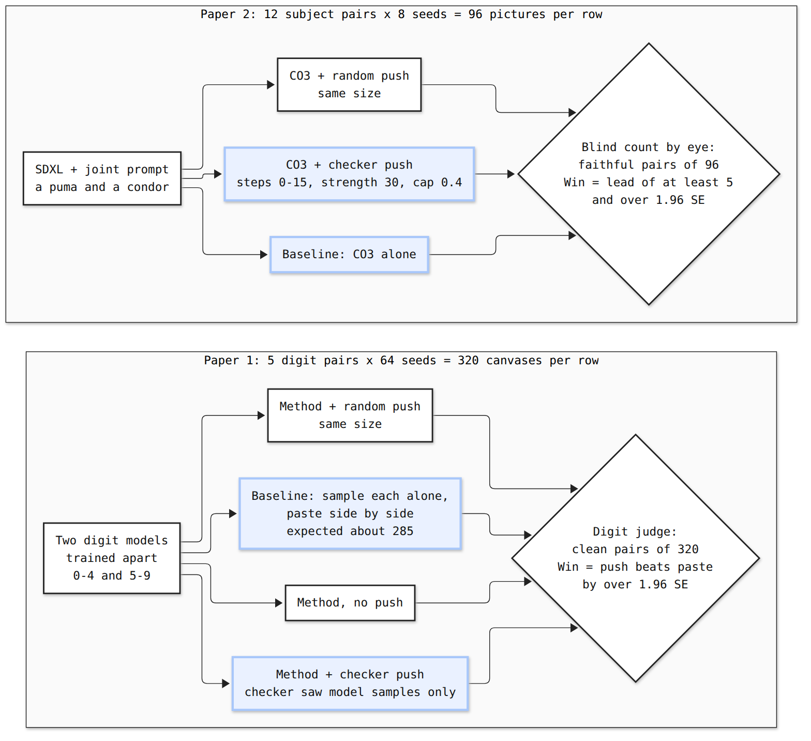
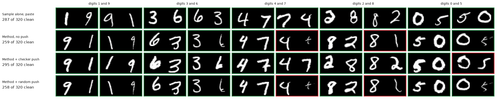
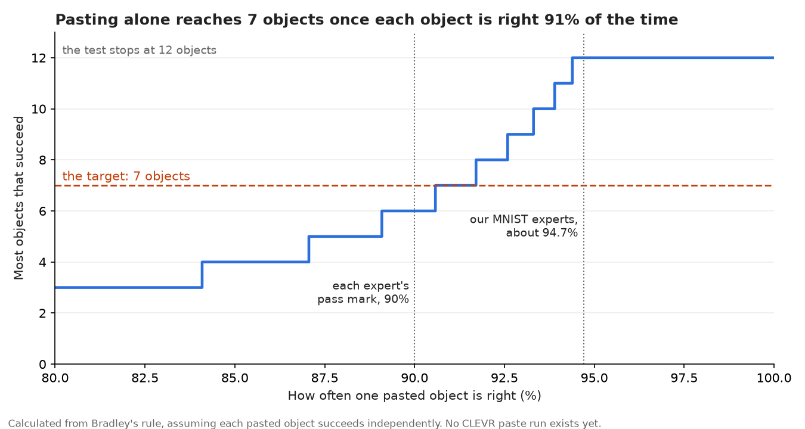

# Does composing two digit models trained apart beat sampling each alone and pasting?   ⚪ null · read 2026-11-24

**The claim**

Paper 1's method, with its checker push, draws 295 clean digit pairs of 320 canvases, and sampling each digit alone and pasting the
two halves side by side draws 287. The lead of 8 is under the bar of 13.54, which is 1.96 times its standard error of 6.91, so the
verdict is null `stated` ([the step's review](../../../artifacts/notes/progress/method-search/01-beat-the-baseline/review.md), lines
59 and 60). The push does real work inside the method: it lifts it by 36 pairs where a random push of the same size changes nothing,
and that lift brings the method level with pasting.

**What Paper 1 is.** Paper 1 asks whether two diffusion models trained on disjoint data, so that neither has seen both concepts in
one image, can draw both as separate objects with the help of a small checker trained only on their own samples
([the two problem statements](../../../artifacts/notes/progress/problem-statements.md#paper-1-composing-experts-that-never-met)).
This test runs it on handwritten digits, where pasting is the cheapest thing a reviewer would try first.

> [!NOTE]
> The step behind this page (step M1 on the progress board) asked the same question of both papers, with a separate bar, data and
> verdict for each. This page holds Paper 1's answer. Paper 2's answer, whether adding the kept push to CO3 beats CO3 alone on SDXL,
> is in [the SDXL-half finding](does-adding-the-kept-push-to-co3-beat-co3-alone.md).

## Table of contents

- [Words this page uses](#words-this-page-uses)
- [What would have counted](#what-would-have-counted)
- [1. The four rows on the same seeds](#1-the-four-rows-on-the-same-seeds)
- [2. The checker's direction is what lifts the method](#2-the-checkers-direction-is-what-lifts-the-method)
- [3. The digit judge against the eye](#3-the-digit-judge-against-the-eye)
- [4. Why pasting is a strong baseline on digits](#4-why-pasting-is-a-strong-baseline-on-digits)
- [Where the sources disagree](#where-the-sources-disagree)
- [What this cannot tell you](#what-this-cannot-tell-you)
- [Concepts this uses](#concepts-this-uses)
- [Where this came from](#where-this-came-from)
- [Still open](#still-open)

## Words this page uses

Navigation: 📋 [TOC](#table-of-contents) | [Next](#what-would-have-counted) ➡️

**Expert.** One of two small diffusion models trained apart on MNIST digits: `e04-either` draws digits 0 to 4 and `e59-either` draws
digits 5 to 9, each on either side of a canvas 32 pixels tall and 64 wide.

**Sample and paste.** Each expert draws its digit alone on the full canvas. The half holding more ink is cut from each, and the two
halves are placed on opposite sides.

**The method.** The two experts choose which side each digit takes over the first 10 of 50 sampler steps, hold that choice, and each
supplies the noise prediction on its own half (`--compose inferred-lock` in the code).

**Checker push.** Two small classifiers, a pair checker and a separate checker, trained on expert samples only. Their gradient is added
to the noise prediction while sampling, at strength 10 and capped at 0.1 of the prediction's size.

**Random push.** A random direction scaled, step by step, to the length of the real push. It shows whether the checker's direction
matters or any disturbance of that size would do.

**Clean digit pair.** A canvas the digit judge (`judge-v3`) calls "two clear, right, apart": exactly two blobs, one in each half, read
as the asked digits with at least 0.9 confidence each. The judge only scores; it trains nothing and filters nothing.

## What would have counted

Navigation: ⬅️ [Previous](#words-this-page-uses) | 📋 [TOC](#table-of-contents) | [Next](#1-the-four-rows-on-the-same-seeds) ➡️

**The bar was written in [the step's design](../../../artifacts/notes/progress/method-search/01-beat-the-baseline/design.md#paper-1-the-method-against-sample-and-paste) before any run, and it lives in code in `2-classifier-guidance/scripts/method_search/beat_baseline_bars.py`.**

| Result | What it takes, on clean digit pairs of 320 |
|---|---|
| Support | the method with the push minus paste is more than 1.96 standard errors above zero |
| Null | the difference is within 1.96 standard errors |
| Loses | paste minus the method with the push is more than 1.96 standard errors above zero |
| Inconclusive | the zero-push check fails, or the random push beats the method with no push by more than 1.96 standard errors |

The standard error comes from 10,000 bootstrap resamples of the matched canvas differences, resampled within each digit pair,
because five pairs are too few to resample as units `stated` (design, lines 70 to 78).

| How the four rows feed the digit judge |
|---|
|  The lower panel is this page: two digit models trained apart (0 to 4 and 5 to 9) feed four rows, 5 digit pairs by 64 seeds, so 320 canvases per row, into the digit judge, where a win is the push beating paste by over 1.96 standard errors. The paste box carries the design's expectation of about 285 `verified` (read on the picture; matches the design, line 80). The upper panel is Paper 2's comparison, which this page does not cover. |

**The checks that had to pass first** `stated` (review, lines 27 to 35):

| Check | Result |
|---|---|
| Both checkers memorise 16 canvases | 16 of 16 for each, against a bar of 15 |
| The loss falls on 1% of the pool (300 training samples, 1,000 updates) | pair checker 0.5793 at update 500 to 0.5035 at update 1,000; separate checker 0.3453 to 0.3243 |
| A zero push reproduces the method without a push | largest absolute difference 0.0, against a bar of 1e-5, in one process on an RTX 3090 |
| All four rows run | yes, on digits 4 and 7 at 8 seeds |

## 1. The four rows on the same seeds

Navigation: ⬅️ [Previous](#what-would-have-counted) | 📋 [TOC](#table-of-contents) | [Next](#2-the-checkers-direction-is-what-lifts-the-method) ➡️

**Pasting and the pushed method both draw two clear digits on nearly every canvas; the method without its push drops faint or broken
second digits.**

| Four rows, five digit pairs, seeds 0 and 1 |
|---|
|  Rows top to bottom: paste, the method with no push, the method with the checker push, the method with a random push. Columns: digit pairs 1 and 9, 3 and 6, 4 and 7, 2 and 8, 0 and 5, two seeds each. A green frame is a canvas the judge calls clean, a red frame one it does not. On these 10 canvases per row, paste has 10 green, no push 8, checker push 9 and random push 8 `verified` (counted on the picture). The red no-push and random-push canvases hold a 4 beside a faint mark and an 8 beside a stray stroke; the red pushed canvas is a 0 and 5 whose 0 is malformed `verified` (seen at full size). The row labels read 287, 259, 295 and 258 of 320 clean, matching the review. |

**The number.** Clean digit pairs of 320 canvases (5 pairs by seeds 0 to 63), Slurm job 93598, commit pair `7df3e0b1-f2bdb6d`, W&B
run `vekm3sfh` `stated` (review, lines 15 and 64 to 69):

| Row | Clean digit pairs of 320 | 1 and 9 | 3 and 6 | 4 and 7 | 2 and 8 | 0 and 5 |
|---|---:|---:|---:|---:|---:|---:|
| Sample alone and paste | 287 | 57 | 58 | 55 | 58 | 59 |
| Method, no push | 259 | 58 | 53 | 49 | 47 | 52 |
| Method with the checker push | 295 | 59 | 61 | 53 | 60 | 62 |
| Method with a random push | 258 | 56 | 51 | 49 | 50 | 52 |

The method with the push leads paste by 8, under the bar of 13.54 (1.96 times the standard error of 6.91), so the verdict is null by
the written rule `stated` (review, lines 59 and 60).

## 2. The checker's direction is what lifts the method

Navigation: ⬅️ [Previous](#1-the-four-rows-on-the-same-seeds) | 📋 [TOC](#table-of-contents) | [Next](#3-the-digit-judge-against-the-eye) ➡️

**The checker push lifts the method by 36 pairs and a random push of the same size changes nothing; without the push the method is
28 pairs below paste.** These leads were read after the run and carry no bar of their own `stated` (review, line 71).

> 🖼️ **Figure wanted**: the four matched leads below as horizontal bars in clean digit pairs of 320, each with its 1.96 standard
> error margin drawn as a band around zero, so the reader sees which bars clear their band. Data from the review's table at lines
> 73 to 78. Render into `2-classifier-guidance/artifacts/results/the-method-search/`, write its card entry, then embed here.

**The number.** Lead in clean digit pairs of 320, each margin 1.96 standard errors `stated` (review, lines 73 to 78):

| Comparison | Lead, of 320 | Margin |
|---|---:|---:|
| Checker push over no push | +36 | 15.61 |
| Checker push over random push | +37 | 15.47 |
| Random push over no push | -1 | 8.75 |
| No push over paste | -28 | 16.57 |

The random push over no push is -1, inside its margin of 8.75, so the inconclusive rule in the bar table does not fire. The checker's
direction does real work: it lifts the method by 36 pairs where a random push of the same size changes nothing, and that lift brings
the method level with paste `stated` (review, lines 80 and 81).

## 3. The digit judge against the eye

Navigation: ⬅️ [Previous](#2-the-checkers-direction-is-what-lifts-the-method) | 📋 [TOC](#table-of-contents) | [Next](#4-why-pasting-is-a-strong-baseline-on-digits) ➡️

**On 64 canvases called by eye before the key was opened, the eye and the judge agree on 58.**

> 🖼️ **Figure wanted**: the six canvases where the eye and the digit judge disagree, each labelled with its row, digit pair, the
> judge's call and the eye's call. The canvases are on the cluster under `/datasets/mmolefe/poe_repair_min/loop-6/m1/paper-1/full/rows/`.
> Render into `2-classifier-guidance/artifacts/results/the-method-search/`, write its card entry, then embed here.

**The number.** 64 canvases, 16 per row, shuffled across the four rows and called by eye at full size. The two agree on 58. The eye
called 5 clean that the judge rejected and rejected 1 the judge called clean, and the six disagreements fall in all four rows
`stated` (review, lines 83 to 85). The design asked for this check as its second control (design, line 68).

## 4. Why pasting is a strong baseline on digits

Navigation: ⬅️ [Previous](#3-the-digit-judge-against-the-eye) | 📋 [TOC](#table-of-contents) | [Next](#where-the-sources-disagree) ➡️

**Each digit expert draws its own digit right about 94.7% of the time, and at that rate pasting is predicted to succeed far past two
objects.** This chart is a calculation for the planned CLEVR test with more objects, and it sets the context for why paste reached 287
of 320 here.

| How far pasting reaches as one object's success rate rises |
|---|
|  x: how often one pasted object is right, 80 to 100%. y: the most objects that succeed under Bradley's counting rule (a count K succeeds when K objects appear in at least 50% of images and at least K-2 in at least 90%), capped at 12 where the test stops. The blue step line crosses the dashed target of 7 objects at about 90.6% and reaches 12 before the dotted line marking "our MNIST experts, about 94.7%" `verified` (read on the picture). The footer reads "Calculated from Bradley's rule, assuming each pasted object succeeds independently. No CLEVR paste run exists yet." |

**The number.** Paste is predicted to reach 7 objects when one object's success rate is at least 90.6%, if objects succeed
independently `stated` ([the CLEVR scaling plan](../../../artifacts/notes/progress/targets/clevr-scaling-plan.md#the-order-of-the-runs),
lines 33 and 34). The design predicted from the experts' solo counts that paste would reach about 285 of 320 on these five pairs, and
that a paste count under 250 would mean the paste step itself damages digits `stated` (design, lines 80 and 81). Paste reached 287.

## Where the sources disagree

Navigation: ⬅️ [Previous](#4-why-pasting-is-a-strong-baseline-on-digits) | 📋 [TOC](#table-of-contents) | [Next](#what-this-cannot-tell-you) ➡️

**No disagreement was found for Paper 1's comparison.** The review, the design, the two pictures above and the progress board's step
note (`board.json`, step `M1`: "Paper 1: push 295, paste 287 of 320, margin 13.54") give the same rows, counts, bar and verdict.

## What this cannot tell you

Navigation: ⬅️ [Previous](#where-the-sources-disagree) | 📋 [TOC](#table-of-contents) | [Next](#concepts-this-uses) ➡️

**Anything a paper may claim.** The runs used tuning data only: the five tuning pairs at seeds 0 to 63. The 20 digit pairs kept out
of tuning were not touched, and the design says tuning pairs and seeds cannot support a claim in either paper `stated` (design, lines
32, 42 and 170).

**Whether the method beats paste on harder pictures.** Digits sit at 32 by 64 pixels with two fixed halves, where pasting cannot
overlap or shade anything. Whether pasting stays this strong with more objects is the planned CLEVR test.

**Why the method without its push draws fewer clean pairs than paste.** The 28-pair gap is recorded, and nothing run here separates
its causes.

> [!NOTE]
> Paste against the method with the push differs in how the two digits reach the canvas and in the push together, so that comparison
> is mixed. The comparisons inside the method (checker push, random push, no push) each change only the push.

## Concepts this uses

Navigation: ⬅️ [Previous](#what-this-cannot-tell-you) | 📋 [TOC](#table-of-contents) | [Next](#where-this-came-from) ➡️

The toy numbers below are invented.

**A matched difference and its bootstrap standard error**

Two coffee machines brew the same five beans, and a taster scores each cup pass or fail. On bean 1 machine A passes 3 cups more than
machine B, and on the others 1, 0, 2 and -1 more: those are the matched differences, one per bean, and their sum is a lead of 5.
"Matched" because each difference compares the two machines on the same bean. Draw five beans with replacement many times, say
(1, 1, 3, 0, 2) and (-1, 0, 0, -1, 1), sum each draw, and the spread of those sums is the standard error: how far the lead would
typically wander on another set of beans. "Bootstrap" because the data resamples itself. A lead counts when it is more than 1.96
standard errors, about the 95% edge of a normal spread. Run back on this page: each canvas is a bean, paste and the pushed method are
the two machines on the same seed, and the lead of 8 clean pairs sits under 1.96 × 6.91 = 13.54, so it does not count. Here the
resampling is done within each digit pair, because five pairs are too few to resample as units. The
[bootstrap card](../../../../../Obsidian/Mathematics/Statistics/Bootstrap.md#where-to-learn-this) and
[the chapter on the bootstrap standard error](../../../../../goal-setting/learning/mathematics/statistics/sampling/textbook/08-the-percentile-bootstrap.md#84-why-with-replacement-and-the-bootstrap-standard-error)
teach it.

**A push from a checker's gradient**

A checker gives a canvas a score for "two right digits, apart". Its
[gradient](../../../../../Obsidian/Mathematics/Calculus/Gradient.md#where-to-learn-this) says which way to change each pixel to raise
that score, and adding it to the noise prediction while sampling nudges the canvas that way. Toy: the prediction has size 10, the
gradient has size 5, and a cap of 0.1 limits the push to size 1, so the gradient is shrunk to a fifth. Here the cap is 0.1 of the
prediction at strength 10. The checker is a [classifier](../../../../../Obsidian/Artificial%20Intelligence/Machine%20Learning/Classifier.md#where-to-learn-this)
on top of two experts combined as a [product of experts](../../../../../Obsidian/Artificial%20Intelligence/Generative%20Modeling/Product%20Of%20Experts.md#where-to-learn-this).

## Where this came from

Navigation: ⬅️ [Previous](#concepts-this-uses) | 📋 [TOC](#table-of-contents) | [Next](#still-open) ➡️

**Every number is copied from the review; the results files it summarises are on the cluster and were not opened.**

| What | Source | Mark |
|---|---|---|
| Clean pairs per row and per digit pair, the lead, the bar, the verdict | [the step's review](../../../artifacts/notes/progress/method-search/01-beat-the-baseline/review.md), lines 59 to 69 | stated |
| The matched leads and margins | review, lines 71 to 81 | stated |
| The judge against the eye | review, lines 83 to 85 | stated |
| The controls | review, lines 27 to 35 | stated |
| The runs: Slurm jobs 93461, 93583, 93598, W&B `vekm3sfh`, outputs under `/datasets/mmolefe/poe_repair_min/loop-6/m1/paper-1/` | review, lines 8 to 15 | stated |
| The rows, the checker's data, the bar, the prediction of about 285 | [the step's design](../../../artifacts/notes/progress/method-search/01-beat-the-baseline/design.md), lines 38 to 81 | stated |
| Bradley's rule and the 90.6% threshold | [the CLEVR scaling plan](../../../artifacts/notes/progress/targets/clevr-scaling-plan.md), lines 33 to 34 and 79 to 80 | stated |
| What each picture shows | the three pictures above, opened at full size on 2026-11-24, frames counted on the four-row sheet, every label checked with `is_showable` and against the held-pictures list | verified |
| The plan that owned the step | step M1 of [the two-papers route](../../../plans/route-two-papers.md#the-steps), run under [the Session 6 brief](../../../artifacts/notes/progress/prompts/session-6-find-the-best-method.md) | |
| Regenerate with | the scripts under `2-classifier-guidance/scripts/method_search/`, launched as in [launching and harvesting a run](../../../runbook/running-things-on-the-cluster/launching-and-harvesting-a-run.md) | |
| The cluster and its cards | [the environment overview](../../../environment/overview.md) | |

## Still open

Navigation: ⬅️ [Previous](#where-this-came-from) | 📋 [TOC](#table-of-contents)

- [x] Paper 2's half of the step: CO3 with the kept push drew 7 faithful pairs of 96 against 11 for CO3 alone, null by its own bar,
      W&B `s7o6404z` ([the step's review](../../../artifacts/notes/progress/method-search/01-beat-the-baseline/review.md), lines 87 to
      115). It has its own page, [the SDXL-half finding](does-adding-the-kept-push-to-co3-beat-co3-alone.md).
- [ ] The matched-leads figure in section 2.
- [ ] The eye-against-judge figure in section 3.
- [ ] The same comparison on the 20 digit pairs kept out of tuning, and on CLEVR with more objects, where pasting may fail.

<!-- built-to: PAGE_LOOK_FORMAT v1 -->
