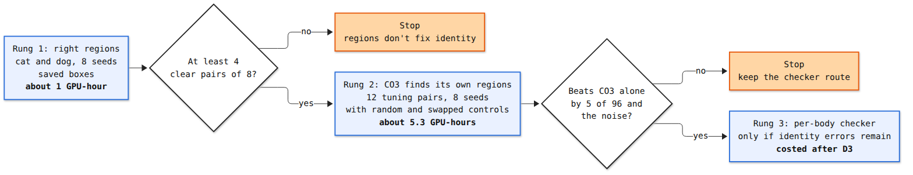
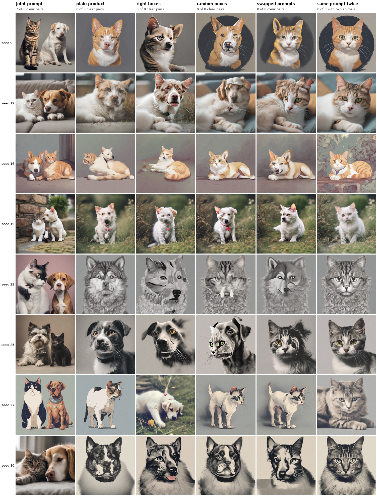
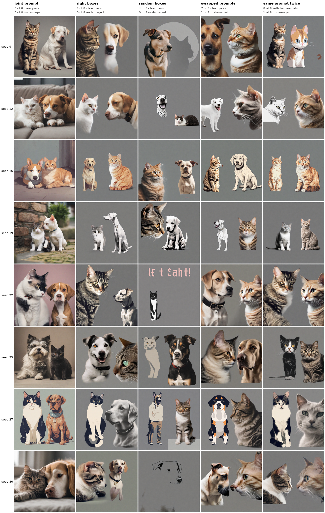
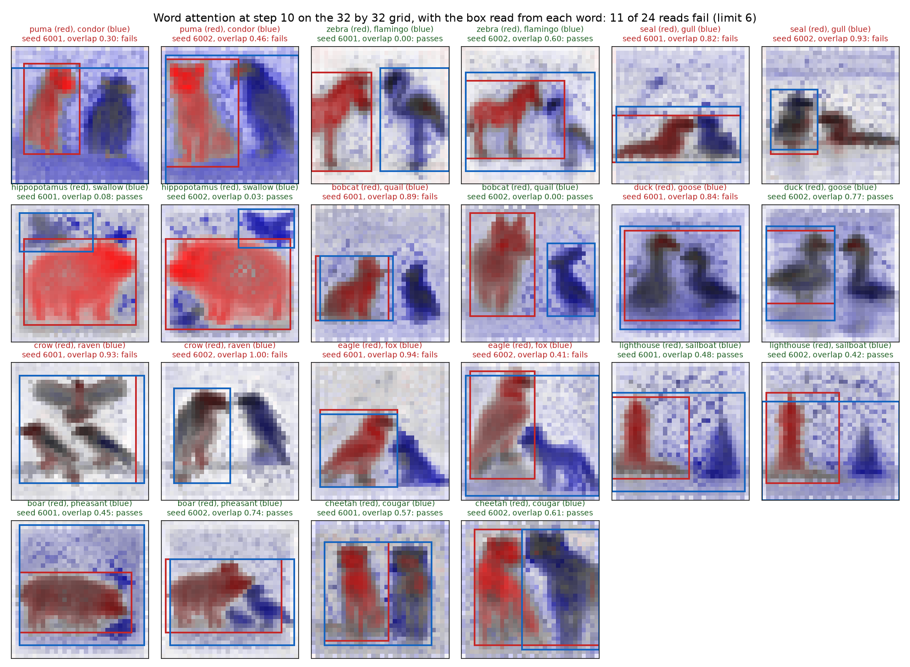

# Does giving each subject its own region fix which animal each body becomes?   rung 1 with bootstrapping: regions without names · rung 2: stopped at its mask check · verified 2026-11-24

**The claim**

When SDXL is handed the right box for the cat and the right box for the dog, and each region is first drawn alone over a flat colour
for 15 of 50 steps, all 8 seeds give a clear cat beside a clear dog. All 8 of those pictures are damaged, cut-outs on flat grey, and
the written verdict is "regions without names": on the right boxes, swapping the two prompts or giving both regions "a cat"
still makes two animals, and the prompt each region carries decides its species `stated`
([the step's review](../../../artifacts/notes/progress/method-search/04-bind-each-body/review.md), lines 3 and 64 to 70). The same
fusion without that first stage separates the animals on 0 of 8 seeds. The second rung, where CO3 would find its own regions from
word attention, stopped at its check on the masks: 11 of 24 reads failed against a limit of 6, so no rung 2 picture was rendered.

**Why this was asked.** CO3, the strongest sampler correction measured in this project, drew two separate bodies in all 96 tuning
pictures, and only 11 were faithful, because bodies borrow parts, take the wrong species or gain an extra subject. This step tests
whether letting each subject's prediction act only inside its own region fixes that `stated`
([the step's design](../../../artifacts/notes/progress/method-search/04-bind-each-body/design.md), lines 5 to 8).

## Table of contents

- [Words this page uses](#words-this-page-uses)
- [What would have counted](#what-would-have-counted)
- [1. Right regions alone fuse the animals](#1-right-regions-alone-fuse-the-animals)
- [2. With bootstrapping, two regions make two animals whatever prompt they carry](#2-with-bootstrapping-two-regions-make-two-animals-whatever-prompt-they-carry)
- [3. Word attention at step 10 could not supply CO3's regions](#3-word-attention-at-step-10-could-not-supply-co3s-regions)
- [Where the sources disagree](#where-the-sources-disagree)
- [What this cannot tell you](#what-this-cannot-tell-you)
- [Concepts this uses](#concepts-this-uses)
- [Where this came from](#where-this-came-from)
- [Still open](#still-open)

## Words this page uses

Navigation: 📋 [TOC](#table-of-contents) | [Next](#what-would-have-counted) ➡️

**Mask.** A soft weight per cell of SDXL's 128 by 128 latent grid. The two subjects' masks sum to 1 at every cell.

**Regional sampler.** It predicts $\epsilon_u + g\,[m_A(\epsilon_A-\epsilon_u) + m_B(\epsilon_B-\epsilon_u)]$, where $\epsilon_u$ is the
prediction with no prompt, $g$ the guidance, $\epsilon_A$ and $\epsilon_B$ the predictions for each subject's own prompt, and $m_A$ and
$m_B$ the masks. Each subject acts mainly inside its own mask.

**Right boxes.** The two animals' boxes, detected on the joint prompt's own render of the same seed. No deployed method would have
them, so rung 1 is an upper bound and supports no claim.

**Bootstrapping.** The one part of MultiDiffusion (arXiv 2302.08113) the plain fusion leaves out: for the first 15 of 50 steps each
region is denoised over a constant colour, and the latents are fused. It is unrelated to the statistical bootstrap.

**Clear pair.** A picture on the `two_clear` rung of [the blind count rubric](../../../artifacts/notes/progress/method-search/01-beat-the-baseline/blind-count-rubric.md):
exactly one clear cat and one clear dog as separate bodies, with no borrowed features.

**Damaged.** The rubric's mark for a picture that is not an intact photograph: melted or broken anatomy, garbled faces, stray limbs,
or a drawing, cartoon, poster or collage.

**CO3.** A published sampler correction for the product of two prompts, run here at its released settings.

## What would have counted

Navigation: ⬅️ [Previous](#words-this-page-uses) | 📋 [TOC](#table-of-contents) | [Next](#1-right-regions-alone-fuse-the-animals) ➡️

**Rung 1's bar was written on 2026-11-04 in [the oracle-layout plan](../../../3-understanding-compositionality/plans/10-what-poe-loses-when-it-composes/is-the-layout-the-missing-piece.md), and the step's design copied it before any run.**

| The ladder of three rungs |
|---|
|  Rung 1 (right regions, cat and dog, 8 seeds, about 1 GPU-hour) goes on to rung 2 at 4 or more clear pairs of 8, and stops with "regions don't fix identity" below that. Rung 2 (CO3 finds its own regions, 12 tuning pairs, 8 seeds, random and swapped controls, about 5.3 GPU-hours) goes on to rung 3 only if it beats CO3 alone by 5 of 96 and the noise `verified` (read on the picture; matches [the binding design](../../../artifacts/notes/progress/targets/binding-each-body-design.md), lines 22 to 26). The stop rule drawn for rung 1 differs from the step's design; see [Where the sources disagree](#where-the-sources-disagree). |

**Rung 1, on 8 cat and dog seeds** `stated` (design, lines 54 to 62):

| Result | What it takes | What happens |
|---|---|---|
| Support | right boxes reach at least 4 clear pairs of 8, and random boxes reach fewer | rung 2 runs |
| Layout content irrelevant | right boxes reach at least 4, and random boxes are within 1 | rung 2 runs, and the review says the regions' place did not matter |
| Regions without names | right boxes reach at least 4, and swapped or same prompt is within 1 | rung 2 runs, and the review says which prompt a region carries did not matter |
| Inconclusive | right boxes reach 2 or 3 | the idea stops at this rung |
| Null | right boxes reach 0 or 1 | held until bootstrapping has run, because a null from this composer alone cannot separate "regions are not enough" from "the composer is wrong" |

The same-prompt row asks for a cat in both regions, so its count in the bar is pictures with at least two separate, clear animals.
Every other row counts clear pairs `verified` (`counts_used_by_the_bar` in `rung-1-bootstrapped-result.json`, beside
the review, opened 2026-11-24).

**Rung 2's check on the masks, before any render.** Boxes are read at step 10 on the 12 tuning pairs at seeds 6001 and 6002, 24 reads.
A read fails if either box covers at least 80% of the grid, or if the two boxes overlap with an intersection over union of at least 0.8.
If more than 25% of reads fail, rung 2 stops and renders nothing `verified` (`reads`, `max_box_share`, `max_read_iou` and
`max_degenerate_share` in `rung-2-mask-reads.json`, and the same limits in `m9_rung2.py`, lines 35 to 38, opened 2026-11-24).

> [!NOTE]
> On the bootstrapped counts (right boxes 8, random boxes 4) the support row's two conditions also hold, and the bar table does not say
> which row applies when two do. The review records "regions without names", and this page keeps that label `inferred` (read off the
> table against the recorded counts).

## 1. Right regions alone fuse the animals

Navigation: ⬅️ [Previous](#what-would-have-counted) | 📋 [TOC](#table-of-contents) | [Next](#2-with-bootstrapping-two-regions-make-two-animals-whatever-prompt-they-carry) ➡️

**Fusing the two predictions by region from step 0 separates the animals on none of the 8 seeds, even with the layout taken from a
render that succeeded.**

| Six conditions by eight seeds, no bootstrapping |
|---|
|  Columns: joint prompt, plain product, right boxes, random boxes, swapped prompts, same prompt twice. Rows: seeds 9, 12, 16, 19, 22, 25, 27 and 30. The joint prompt column shows a cat beside a dog in every row, and its seed 19 tile has a white animal with a cat's face beside the cat. Every tile in the other five columns holds one animal or one fused cat-dog `verified` (seen at full size). The column headers read 7 of 8, then 0 of 8 for each region row, matching `rung-1-result.json`, which lists seed 19 as the joint prompt's one miss `verified` (read on the picture and in the file). |

**The number.** Of 8 seeds, all 48 pictures called blind at full size by two reviewers, who agreed on 47; a third blind call settled the
other, the joint render on seed 19, as two bodies with borrowed parts. Slurm job 93794 `verified` (`rows`,
`reviewers_agree_on_two_clear` and `pictures_the_reviewers_differed_on` in `rung-1-result.json`, the seed-19 call in
`rung-1-calls-third.csv` matched through `rung-1-key.json`, and the job in the first line of
`/datasets/mmolefe/poe_repair_min/loop-6/logs/l6-m9-r1-93794.log`, opened 2026-11-24):

| Row | Clear pairs of 8 | Pictures with two separate animals, of 8 |
|---|---|---|
| Joint prompt | 7 | 8 |
| Plain product | 0 | 0 |
| Right boxes | 0 | 0 |
| Random boxes | 0 | 0 |
| Swapped prompts | 0 | 0 |
| Same prompt twice | 0 | 0 |

Right boxes drew 6 fused cat-dogs and 2 single animals. The bar calls 0 of 8 a null, and the oracle-layout plan holds a null until
bootstrapping has run on the same layouts `stated` (review, lines 43 to 45). The two controls on seed 9 passed: the joint render matches
the picture its boxes came from with a mean absolute difference of 0.0 of 255, and masks of 0.5 at guidance 7.5 differ from the plain
product at guidance 3.75 by 1.53 of 255, both against a limit of 3 `verified` (`loop-6/m9/full/refs_check.json` and
`loop-6/m9/full/composer_check.json` on the cluster, opened 2026-11-24).

## 2. With bootstrapping, two regions make two animals whatever prompt they carry

Navigation: ⬅️ [Previous](#1-right-regions-alone-fuse-the-animals) | 📋 [TOC](#table-of-contents) | [Next](#3-word-attention-at-step-10-could-not-supply-co3s-regions) ➡️

**Drawing each region alone over flat colour for the first 15 steps gives two separate animals on all 8 seeds with the right boxes,
with swapped prompts and with the same prompt twice, and 4 of 8 with random boxes; no right-box picture is an intact photograph.**

| Five conditions by eight seeds, with bootstrapping |
|---|
|  Columns: joint prompt, right boxes, random boxes, swapped prompts, same prompt twice; rows are the same 8 seeds. Every right-box tile is a cat and a dog as separate cut-outs on flat grey. Every same-prompt tile holds two cats and no dog, and every swapped tile a cat and a dog. Random-box tiles include a single cat under garbled lettering, a dog-headed figure in clothes and a line drawing of one dog `verified` (seen at full size). Headers read clear pairs and undamaged of 8: joint 6 and 5, right 8 and 0, random 4 and 0, swapped 7 and 1, same prompt "8 of 8 with two animals" and 1 `verified` (read on the picture; matches the review and `rung-1-bootstrapped-result.json`). |

**The number.** Of 8 seeds, the 32 region pictures shuffled with the 8 joint renders and called blind at full size. The two reviewers
agreed on `two_clear` for 38 of 40, and a third blind call settled the 3 pictures they split on for `two_clear` or for the count of
animals. Slurm job 93906, commit pair `100772b7-15d8bdd` `verified` (`rows` and the agreement keys in
`rung-1-bootstrapped-result.json`; the undamaged column from the two reviewers' `damaged` calls in
`rung-1-bootstrapped-calls-first.csv` and `-second.csv`, matched through `rung-1-bootstrapped-key.json`; the job and commit pair in
the first line of `loop-6/logs/l6-m9-r1-93906.log`; opened 2026-11-24):

| Row | Clear pairs of 8 | Two separate animals, of 8 | Marked undamaged by both reviewers, of 8 |
|---|---|---|---|
| Joint prompt | 6 | 8 | 5 |
| Right boxes | 8 | 8 | 0 |
| Random boxes | 4 | 4 | 0 |
| Swapped prompts | 7 | 8 | 1 |
| Same prompt twice | 0 | 8 | 1 |

Right boxes reach 8, which clears the bar of 4, and random boxes reach 4, which is more than 1 below. Swapped prompts reach 7 and the
same prompt reaches 8 pictures with two animals, so both are within 1 of right boxes, and the written verdict is "regions without names" `verified` (`counts_used_by_the_bar`, `bar_on_right_boxes` and `verdict` in
`rung-1-bootstrapped-result.json`, with the rule in `m9_count.py`, lines 99 and 101, opened 2026-11-24).

**What the pictures add to that label.** The same-prompt row drew two cats on all 8 seeds and the swapped row drew a cat and a dog, so
the prompt a region carries does decide its species. Any two bootstrapped regions make two objects, wherever the boxes sit relative to
the joint render's layout `stated` (review, lines 68 to 70). The random-box row reached two animals on 4 of 8; see
[Where the sources disagree](#where-the-sources-disagree).

**Why this is not yet a usable method.** Bootstrapping is what separated the animals, since the same fusion without it reached 0 of 8.
It also leaves cut-outs on flat grey, and neither reviewer passed any right-box picture as undamaged, against 5 of 8 for the joint
prompt. The joint renders were 7 clear pairs in the first count and 6 in this one, so a difference of 1 between rows is within how much
the calls move `stated` (review, lines 72 to 74).

## 3. Word attention at step 10 could not supply CO3's regions

Navigation: ⬅️ [Previous](#2-with-bootstrapping-two-regions-make-two-animals-whatever-prompt-they-carry) | 📋 [TOC](#table-of-contents) | [Next](#where-the-sources-disagree) ➡️

**At step 10 most attention maps already hold two separate bodies, but the box read from the second subject's word lands on the wrong
body or spreads over the frame on 11 of 24 reads, past the limit of 6, so rung 2 rendered nothing.**

| Each word's attention at step 10, with the box read from it |
|---|
|  One tile per pair and seed (6001 and 6002) on the 32 by 32 attention grid: red is the first subject's word, blue the second's, dark where both are high, and each tile carries the two boxes read from them with their overlap (intersection over union, 0 to 1) and "passes" or "fails" above. 22 reads are shown and 10 are marked fails: 7 with overlap of at least 0.8 (seal and gull at both seeds, bobcat and quail at 6001, duck and goose at 6001, crow and raven at both seeds, eagle and fox at 6001) and 3 where a box covers most of the frame (puma and condor at both seeds, eagle and fox at 6002) `verified` (counted on the picture). On bobcat and quail at 6001 the blue box sits on the bobcat; on puma and condor the blue box spans the frame `verified` (seen). One pair, held back from display by the subject guard, is counted and left off; `rung-2-mask-reads.json` records its seed 6002 read as the eleventh fail `verified` (read in the file). |

**The number.** 11 of 24 reads fail, against a limit of 6 (25% of 24): 7 on overlap and 4 on box size, with a median overlap of 0.53.
The written rule stops rung 2 here, so the comparison with CO3 alone on faithful pairs of 96 has not been made. Slurm job 93936, commit
pair `d5aeb4b6-15d8bdd` `verified` (the first line of `loop-6/logs/l6-m9-r2-93936.log`, and `max_degenerate_share` in
`rung-2-mask-reads.json`, opened 2026-11-24); the 11 fails, the 7 and 4 split and a median overlap of 0.527 match
`rung-2-mask-reads.json` `verified` (read in the file).

**The zero-binding control passes.** With the regions computed and discarded, the final latent matches plain CO3 with a largest
absolute difference of 0.0, against a limit of 1e-5, on an RTX 3090 at fp16. That process's plain CO3 picture differs from the one in
[the baseline comparison](does-composing-two-digit-models-beat-sampling-and-pasting.md) by 2.38 of 255 in mean absolute pixel value, inside the project's limit of 3 `verified` (`device`, `dtype`, `zero_binding_max_abs` and `zero_bar` in
`rung-2-zero-binding-check.json`, and `MAX_PIXEL_DIFF` in `m9_rung1.py`, opened 2026-11-24); `rung-2-zero-binding-check.json` holds 0.0 and 2.3833 `verified` (read in the
file). The same run showed the first box reader returning the whole grid for both subjects (review, line 16).

**What the attention maps show.** The reader fails for two visible reasons. In reads such as bobcat and quail at seed 6001, the second
word lights up both bodies, and its largest part is the first subject's body. In reads such as puma and condor, the second word's map
keeps a background floor, so its box spreads across the frame. This says the box reader could not supply regions, and it says nothing
yet about whether regions would fix identity on CO3 `stated` (review, lines 92 to 95).

**GPU time.** Rung 1 used 3.23 GPU-hours against a budget of about 1, of which 1.99 was a bootstrapping smoke test that ran through a
cluster stall. Rung 2's two checks used 0.30, so the step stands at 3.53 of the 6.3 GPU-hours added for it `stated` (review, lines 99
to 101).

## Where the sources disagree

Navigation: ⬅️ [Previous](#3-word-attention-at-step-10-could-not-supply-co3s-regions) | 📋 [TOC](#table-of-contents) | [Next](#what-this-cannot-tell-you) ➡️

**Six places where two records say different things. This page reports both and resolves none.**

| What | One source | The other source |
|---|---|---|
| Whether the step has run | [the progress board](../../../artifacts/notes/progress/board.json), line 635: step `M9` has `"state": "todo"` | [the step's review](../../../artifacts/notes/progress/method-search/04-bind-each-body/review.md), lines 3 and 9 to 17: rung 1 finished with and without bootstrapping, and rung 2 stopped at its mask check |
| The eighth seed | [the oracle-layout plan](../../../3-understanding-compositionality/plans/10-what-poe-loses-when-it-composes/is-the-layout-the-missing-piece.md), line 213: "seeds 9, 12, 16, 19, 20, 22, 25, 27 selected" | [the step's design](../../../artifacts/notes/progress/method-search/04-bind-each-body/design.md), lines 31 and 32: seeds from `boxes.json` with 30 in place of 20; both sheets and both result files use seed 30 |
| What a rung 1 count under 4 does | [the binding design](../../../artifacts/notes/progress/targets/binding-each-body-design.md), line 24: "Under 4 clear pairs of 8 with the right boxes stops the idea", and its ladder picture draws "no" to "Stop: regions don't fix identity" | [the step's design](../../../artifacts/notes/progress/method-search/04-bind-each-body/design.md), lines 61 and 62: 2 or 3 stops, and 0 or 1 is held until bootstrapping has run; the first count of 0 was held this way |
| The joint prompt's seed 25 | `rung-1-result.json` (beside the review), line 12: seed 25 among the 7 clear pairs | `rung-1-bootstrapped-result.json`, lines 7 to 14: seed 25 absent from the 6 clear pairs. The review, line 74, reads the 7 against 6 as how much the calls move |
| Whether box placement matters once bootstrapping is on | [the step's review](../../../artifacts/notes/progress/method-search/04-bind-each-body/review.md), lines 69 and 70: "any two bootstrapped regions make two objects, wherever the boxes sit relative to the joint render's layout" | the same review, line 61, and `rung-1-bootstrapped-result.json`: random boxes give two separate animals on 4 of 8, against 8 of 8 for right boxes |
| The GPU time to render rung 2 | [the step's design](../../../artifacts/notes/progress/method-search/04-bind-each-body/design.md), line 115, and the ladder picture: about 5.3 GPU-hours for 288 renders and a smoke test | [the step's review](../../../artifacts/notes/progress/method-search/04-bind-each-body/review.md), line 101: "Rendering rung 2 would add about 4.8" |

## What this cannot tell you

Navigation: ⬅️ [Previous](#where-the-sources-disagree) | 📋 [TOC](#table-of-contents) | [Next](#concepts-this-uses) ➡️

**Whether regions would fix identity on CO3.** Rung 2 stopped at its masks, so no CO3 picture with regions exists. The result says word
attention at step 10 could not supply regions, and nothing more.

**Anything beyond one pair.** Rung 1 covers cat and dog only, with boxes from joint renders that already drew both animals, so it is an
upper bound and supports no claim. Tuning pairs and seeds support no paper claim `stated` (design, lines 120 and 121).

**Whether separation and intact pictures can come together.** Bootstrapping separated the animals and damaged every right-box picture.
No run here separates the two effects.

> [!NOTE]
> Within each count the region rows differ from each other in one thing: where the boxes sit (right against random) or which prompt
> each region carries (right against swapped and same). Rung 1 with bootstrapping against rung 1 without it changes only bootstrapping.
> The joint prompt and the region rows differ in the sampler as a whole, so that comparison is mixed.

## Concepts this uses

Navigation: ⬅️ [Previous](#what-this-cannot-tell-you) | 📋 [TOC](#table-of-contents) | [Next](#where-this-came-from) ➡️

The toy numbers below are invented.

**Intersection over union**

Two sheets of paper on a desk: one covers 6 squares of a grid, the other 4, and they share 2. The intersection is the 2 shared
squares, the union is every square either covers, 6 + 4 − 2 = 8, and intersection over union is 2 / 8 = 0.25. "Intersection" because
it counts where both sheets lie, "over union" because it divides by everything either covers, so 0 means apart and 1 means the same
box. Run back on this page: two boxes read from the two subjects' words that overlap at 0.8 or more cannot give each subject its own
region, and 7 of the 24 reads failed this way, with a median overlap of 0.53.

**A word's attention map**

A coffee shop with four tables: when the barista calls "latte", heads turn at tables 1 and 2 with weights 0.6 and 0.3, and 0.05 at each
of the others. Those weights over the tables are the word's map, and the box around the tables that turned most is where "latte" sits.
SDXL does the same with [cross-attention](../../../../../Obsidian/Artificial%20Intelligence/Deep%20Learning/Cross-Attention.md#where-to-learn-this):
each cell of a 32 by 32 grid gives a weight to each word of the prompt. "Word" because one map per word, "attention" because the
weights say how much each cell attends to that word. Here the map is read once at step 10, smoothed, cut with Otsu's threshold (a cut
chosen from the map's own histogram, with no setting to tune) and reduced to the box around its largest connected part. When the
second word lights up both bodies, as on bobcat and quail at seed 6001, that box lands on the wrong body.

**The four rungs of a blind call**

The rubric reads each picture as one of four rungs, lowest first: `one` (one subject or none), `hybrid` (one body mixing both),
`two_bodies` (two bodies that fail the next rung, by borrowed parts, a wrong or repeated subject) and `two_clear` (exactly one clear
cat and one clear dog). Toy: of 4 pictures, one fused cat-dog is `hybrid`, a cat beside a cat is `two_bodies`, and two clean cut-outs
are `two_clear` even when the second mark, damaged, is 1. Here right boxes with bootstrapping are 8 `two_clear` and 0 undamaged
`stated` ([the blind count rubric](../../../artifacts/notes/progress/method-search/01-beat-the-baseline/blind-count-rubric.md),
lines 127 to 143).

## Where this came from

Navigation: ⬅️ [Previous](#concepts-this-uses) | 📋 [TOC](#table-of-contents) | [Next](#still-open) ➡️

**The counts, verdicts, controls and run ids were read off the result and call files beside the review, the check files under
`/datasets/mmolefe/poe_repair_min/loop-6/m9/` and the job logs under `loop-6/logs/` on 2026-11-24. The GPU time, the design's
rules and the reviewers' readings of the pictures are copied from the review and the design.**

| What | Source | Mark |
|---|---|---|
| Rung 1 counts without bootstrapping | [the step's review](../../../artifacts/notes/progress/method-search/04-bind-each-body/review.md), lines 28 to 45; `rung-1-result.json`, `rung-1-calls-first.csv`, `-second.csv` and `-third.csv` beside it, and `loop-6/m9/full/refs_check.json` and `composer_check.json` on the cluster, opened 2026-11-24 | verified |
| Rung 1 counts with bootstrapping and the verdict | review, lines 47 to 74; `rung-1-bootstrapped-result.json`, whose `verdict` reads "regions without names", and the three `rung-1-bootstrapped-calls` files, opened 2026-11-24 | verified |
| Rung 2 mask reads and the zero-binding check | review, lines 76 to 95; `rung-2-mask-reads.json` and `rung-2-zero-binding-check.json`, byte-identical to `loop-6/m9/rung2/mask-read/reads.json` and `loop-6/m9/rung2/controls/check.json` on the cluster, opened 2026-11-24 | verified |
| The runs: Slurm jobs 93724, 93794, 93852, 93906, 93935 and 93936, outputs under `/datasets/mmolefe/poe_repair_min/loop-6/m9/` | the first and last line of each job's log, `l6-m9-r1-*.log` and `l6-m9-r2-*.log` under `loop-6/logs/`, opened 2026-11-24; review, lines 7 to 17 | verified |
| GPU time | review, lines 99 to 101 | stated |
| The rows, the bars and the mask rule | [the step's design](../../../artifacts/notes/progress/method-search/04-bind-each-body/design.md), lines 21 to 116 | stated |
| The three-rung ladder | [the binding design](../../../artifacts/notes/progress/targets/binding-each-body-design.md) | stated |
| What each picture shows | the four pictures above, opened at full size on 2026-11-24, every label checked with `is_showable` and against the held-pictures list | verified |
| The plan that owned the step | step M9 on the progress board, its row "M9 Regions bind each body" in `artifacts/notes/progress/board.json`, designed in [the step's design](../../../artifacts/notes/progress/method-search/04-bind-each-body/design.md) and run under [the Session 6 brief](../../../artifacts/notes/progress/prompts/session-6-find-the-best-method.md). The [two-papers route](../../../plans/route-two-papers.md)'s step list does not carry M9 | |
| Regenerate with | the step's scripts, launched as in [launching and harvesting a run](../../../runbook/running-things-on-the-cluster/launching-and-harvesting-a-run.md) | |
| The cluster and its cards | [the environment overview](../../../environment/overview.md) | |

## Still open

Navigation: ⬅️ [Previous](#where-this-came-from) | 📋 [TOC](#table-of-contents)

- [ ] Whether regions fix identity on CO3: rung 2 needs regions from a reader that passes the mask check, then about 4.8 GPU-hours of
      renders by the review's estimate.
- [ ] Whether bootstrapping can separate the animals without leaving cut-outs on flat grey.
- [ ] MultiDiffusion's own code on the same eight layouts, which the design runs only if bootstrapping reaches 0 or 1 and so did not run.
- [ ] The six disagreements under [Where the sources disagree](#where-the-sources-disagree).

<!-- built-to: PAGE_LOOK_FORMAT v1 -->
