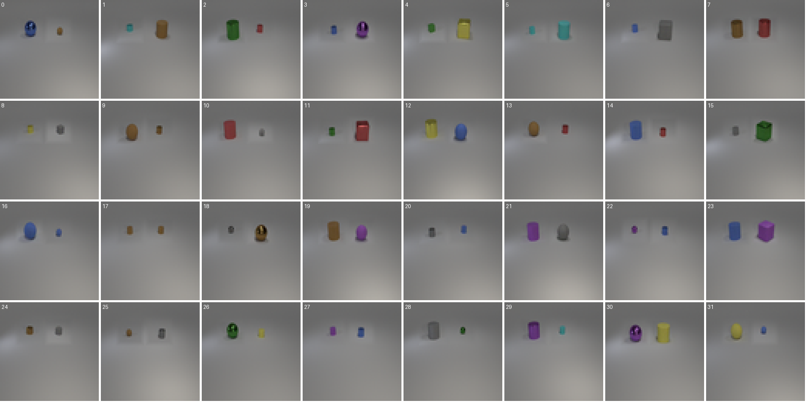
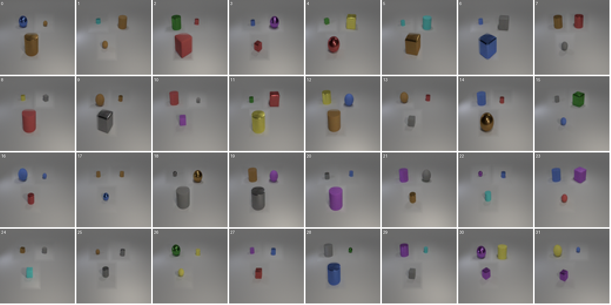
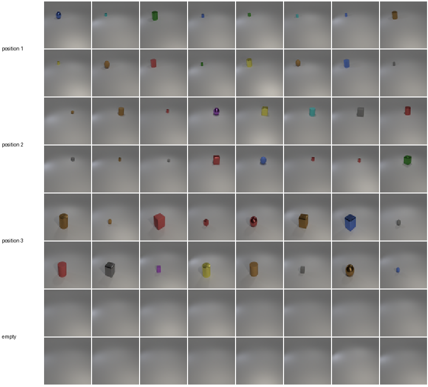
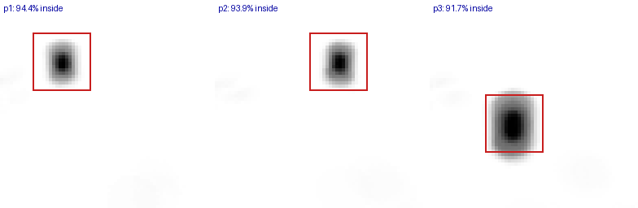
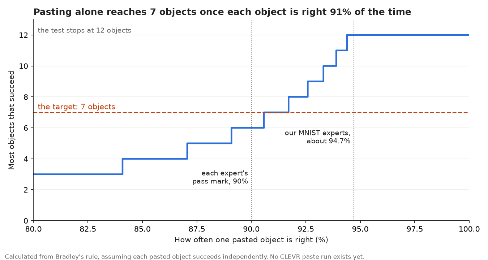

# Does sample-and-paste already solve small CLEVR?   paste predicted to reach 7 objects, so the step stops · verified 2026-11-24

**The claim**

Three small image generators, each trained only on pictures of one object at one fixed place, were sampled alone, and their objects
were cut out and pasted onto an empty scene. Both objects land in place in 1,024 of 1,024 images with two generators, and all three
in 1,024 of 1,024 with three `verified` (`/datasets/mmolefe/poe_repair_min/loop-6/m7/full/paste/tall-p3/paste-score.json`, keys
`two`, `three`, `paste_rate`, `bar` and `verdict`, opened 2026-11-24). That paste rate of 1.0 clears the bar of 0.906, the rate at
which a published counting rule predicts pasting reaches 7 objects, so the written verdict is "paste predicted to reach 7" and the
test stops here. Counting objects at fixed, separated places therefore cannot tell Paper 1's method apart from pasting, so Paper 1's
next test uses experts told what to draw and not where, which leaves no fixed place to paste into `stated` ([the step's review](../../../artifacts/notes/progress/method-search/01c-clevr-paste-first/review.md),
lines 103 to 105).

**Why this was asked.** Paper 1 asks whether diffusion models trained on separate data, so that none has seen the concepts together,
can draw them as separate objects in one picture
([the two problem statements](../../../artifacts/notes/progress/problem-statements.md#paper-1-composing-experts-that-never-met)). On
handwritten digits, pasting drew 287 clean pairs of 320 and Paper 1's method 295, a null by its bar
([the digit version of this question](does-composing-two-digit-models-beat-sampling-and-pasting.md)). This test asks, before any
tuning on CLEVR, whether pasting is already good enough there to make counting objects a useless test `stated`
([the step's design](../../../artifacts/notes/progress/method-search/01c-clevr-paste-first/design.md), lines 5 to 7).

> [!NOTE]
> The step behind this page is step M7 on the progress board, "M7 CLEVR paste test first", whose design and review are linked above.
> The step it would have fed, the small CLEVR comparison of every method (step M6 on the board), does not run on these models.

## Table of contents

- [Words this page uses](#words-this-page-uses)
- [What would have counted](#what-would-have-counted)
- [1. Every pasted object lands in place](#1-every-pasted-object-lands-in-place)
- [2. Each generator alone draws its object in place](#2-each-generator-alone-draws-its-object-in-place)
- [3. The paste window holds each object](#3-the-paste-window-holds-each-object)
- [4. Why a rate of 1.0 predicts at least 7 objects](#4-why-a-rate-of-10-predicts-at-least-7-objects)
- [Where the sources disagree](#where-the-sources-disagree)
- [What this cannot tell you](#what-this-cannot-tell-you)
- [Concepts this uses](#concepts-this-uses)
- [Where this came from](#where-this-came-from)
- [Still open](#still-open)

## Words this page uses

Navigation: 📋 [TOC](#table-of-contents) | [Next](#what-would-have-counted) ➡️

**CLEVR.** Computer-rendered scenes of plain solid shapes (cubes, balls and cylinders, matte or shiny, in several colours) on a grey
floor, made by the public [CLEVR generator](https://github.com/facebookresearch/clevr-dataset-gen) in Blender. Here each scene is
rendered at 320 by 240 and squashed to 64 by 64 pixels, which is what "small" means in the title `stated` (design, lines 45 to 48).

**Expert.** A small diffusion model, an image generator that starts from noise and removes it step by step, trained only on 5,000
pictures of one object at one position. Three experts cover positions 1, 2 and 3, at (0.30, 0.30), (0.60, 0.30) and (0.40, 0.60) as
fractions of the image width and height. A fourth model of the same size, the background model, is trained only on 5,000 empty scenes
`stated` (design, lines 11 to 13 and 34 to 38). All four are EDM2's `edm2-img64-xs`, trained for 2,000,896 images seen
`stated` (design, lines 58 to 62; review, line 20).

**Sample and paste.** Each expert and the background model draw one sample each from their own seeds. Around each asked position a
window is cut from that expert's sample, its outer 2 pixels faded, and laid on the background sample `stated` (design, lines 15 and
72 to 73). Positions 1 and 2 use windows 18 by 18 pixels and position 3 a window 18 wide and 24 tall `verified`
(`m7/full/paste/tall-p3/windows.json`, opened 2026-11-24).

**Scorer.** A small convolutional classifier that reads a 64 by 64 picture and answers, for each of the three positions, whether an
object is there, with a threshold of 0.5 `stated` (design, lines 66 to 68).

**In-place rate.** The share of images in which the scorer finds an asked object at its asked position, from 0 to 1. The paste
rate is the mean of the three objects' in-place rates on the 1,024 pasted images with three experts `stated` (design, lines 17 and
90).

## What would have counted

Navigation: ⬅️ [Previous](#words-this-page-uses) | 📋 [TOC](#table-of-contents) | [Next](#1-every-pasted-object-lands-in-place) ➡️

**The bar was written in [the step's design](../../../artifacts/notes/progress/method-search/01c-clevr-paste-first/design.md#the-bar-fixed-before-the-first-run) before the first run.**

| Result | What it takes | What happens |
|---|---|---|
| Paste predicted to reach 7 | paste rate at least 0.906 | the step stops, and the owner gets a replacement test where pasting fails |
| Paste falls short | paste rate below 0.906 | the small CLEVR comparison of every method runs on these models |
| Inconclusive | an expert misses 90%, the scorer misses 99%, or the window check fails | the failure is reported, and no verdict is read |

The 0.906 comes from Bradley's counting rule with objects assumed to succeed independently, because $0.906^7 \approx 0.50$ `stated`
(design, lines 90 to 97). Section 4 and [Concepts this uses](#concepts-this-uses) work it through.

> [!WARNING]
> The window check changed after its written form failed. The first check counted every changed pixel in the frame and missed its
> mark of 95% at all three positions. The owner chose a new check and a taller position 3 window on board question 66, before any
> paste existed, and the verdict is read under that new check `stated` (review, lines 77 to 91; design, lines 75 to 78). Section 3
> shows both.

## 1. Every pasted object lands in place

Navigation: ⬅️ [Previous](#what-would-have-counted) | 📋 [TOC](#table-of-contents) | [Next](#2-each-generator-alone-draws-its-object-in-place) ➡️

**Every one of the 2,048 pasted images holds every asked object at its place, and none holds an object where none was asked.**

| Two experts pasted, first 32 images | Three experts pasted, first 32 images |
|---|---|
|  Eight columns by four rows, tiles numbered 0 to 31, each one 64 by 64 pasted image enlarged. All 32 hold one object at the upper left (position 1) and one at the upper right (position 2) `verified` (counted on the picture). Several objects sit on a faintly lighter square, for example the right-hand object in tiles 0, 8 and 10 and both objects in tile 25 `verified` (seen at full size). |  The same layout. All 32 hold a third, larger object at the lower centre (position 3) as well `verified` (counted on the picture). The two upper objects in each tile are the same as in the same-numbered tile on the left `verified` (compared by eye). |

**The number.** From `m7/full/paste/tall-p3/paste-score.json` on the cluster `verified` (opened 2026-11-24; the step folder keeps a
copy):

| Paste | Images | In place, position 1 | In place, position 2 | In place, position 3 | Images with every asked object | Objects where none was asked |
|---|---:|---:|---:|---:|---:|---:|
| Two experts | 1,024 | 1.0 | 1.0 | not asked | 1.0, so 1,024 of 1,024 | 0 |
| Three experts | 1,024 | 1.0 | 1.0 | 1.0 | 1.0, so 1,024 of 1,024 | 0 |

The paste rate is 1.0 against the bar of 0.906, and the file's verdict reads "paste predicted to reach 7, M7 stops" `verified` (same
file, keys `paste_rate`, `bar` and `verdict`). The first 32 images of each count, enlarged and called by eye, agree with the scorer on
64 of 64 `stated` (review, lines 97 and 98). The lighter squares are a seam where the expert's floor meets the background's, and the
in-place rate does not measure it `stated` (review, lines 98 and 99).

## 2. Each generator alone draws its object in place

Navigation: ⬅️ [Previous](#1-every-pasted-object-lands-in-place) | 📋 [TOC](#table-of-contents) | [Next](#3-the-paste-window-holds-each-object) ➡️

**Each expert draws its own object at its own place, and nothing elsewhere, in 256 of 256 samples, so the paste starts from objects
that are already right.**

| The four models alone, first 16 samples each |
|---|
|  Four blocks of two rows by eight samples, labelled position 1, position 2, position 3 and empty. Every sample in the first three blocks holds one object at its block's position, the position 3 objects drawn larger because that place sits nearer the camera, and the 16 empty samples hold no object `verified` (counted on the picture). |

**The number.** Each expert on its first 256 samples, against a bar of 90% `verified` (`m7/full/samples/experts.json` on the cluster,
opened 2026-11-24):

| Model | Samples | Object at its own position | Exactly its object and nothing else | Objects elsewhere |
|---|---:|---:|---:|---:|
| Position 1 expert | 256 | 1.0 | 1.0 | 0 |
| Position 2 expert | 256 | 1.0 | 1.0 | 0 |
| Position 3 expert | 256 | 1.0 | 1.0 | 0 |
| Background model | 256 | share with no object 1.0 | | |

**The scorer was checked before it scored anything.** It memorised 16 training pictures, 16 of 16 right at each position against a
bar of 15, and on 400 held-out renders it is right at all three positions in 100% of them, against a bar of 99%, W&B `guf6vtho`
`verified` (`m7/full/scorer/overfit.json` and `m7/full/scorer/scorer.json` on the cluster, opened 2026-11-24).

## 3. The paste window holds each object

Navigation: ⬅️ [Previous](#2-each-generator-alone-draws-its-object-in-place) | 📋 [TOC](#table-of-contents) | [Next](#4-why-a-rate-of-10-predicts-at-least-7-objects) ➡️

**The first window check missed its mark of 95% at every position; the check the owner set in its place passes at every position.**

| Where pixels change, first check |
|---|
|  One panel per position, each a 64 by 64 map over 256 real single-object renders: darker means a pixel changes from the mean empty scene in more renders. The red box is the 18 by 18 window of the first check. The labels read 94.4%, 93.9% and 91.7% inside `verified` (read on the picture). Position 3's dark blob runs past its window at the top and bottom, and faint scattered smudges lie outside all three windows `verified` (seen at full size). |

**The number.** The share of changed pixels that fall inside the window, over 256 real renders per position, where a pixel counts as
changed when a colour channel differs from the mean empty scene by more than 0.1 on a 0-to-1 scale `verified` (the step folder's copies
of `window-control-written-rule.json` and `window-footprint-tall-p3.json`, opened 2026-11-24):

| Position | First check, 18 by 18 windows, every changed pixel | Check in use, position 3 window 18 by 24, the object's own footprint | First check's rule on the windows in use |
|---|---:|---:|---:|
| 1 | 0.9439 | 1.0 | 0.9439 |
| 2 | 0.9394 | 1.0 | 0.9394 |
| 3 | 0.9165 | 0.998 | 0.9764 |

The footprint is the set of pixels that change in at least 2% of renders and connect to the position. Position 3's objects reach 24
pixels tall against a window of 18, and 2,301 of its 3,170 outside pixels lie on that footprint. The outside pixels at positions 1 and
2, 820 and 977 of them, are scattered across the frame, about 3 per picture against 0.39 per picture in an empty scene `stated`
(review, lines 83 to 86). Under the first check's rule, positions 1 and 2 still miss 95% with the windows in use.

> 🖼️ **Figure wanted**: the same three pixel-change maps with the windows the paste used (position 3 at 18 wide and 24 tall, from
> row 28) drawn in red and each object's footprint outlined, each panel labelled with its footprint share, 1.0, 1.0 and 0.998, from
> `window-footprint-tall-p3.json` in the step folder. Render into `2-classifier-guidance/artifacts/results/the-method-search/`, write
> its card entry, then embed here.

## 4. Why a rate of 1.0 predicts at least 7 objects

Navigation: ⬅️ [Previous](#3-the-paste-window-holds-each-object) | 📋 [TOC](#table-of-contents) | [Next](#where-the-sources-disagree) ➡️

**Three experts cannot draw 7 objects, so the 7 is a prediction from how often one pasted object is right, and at a rate of 1.0 every
count up to the test's cap of 12 is predicted to succeed.**

| How far pasting reaches as one object's success rate rises |
|---|
|  x: how often one pasted object is right, 80 to 100%. y: the most objects that succeed under Bradley's counting rule, capped at 12 where the test stops. The blue step line reaches the dashed target of 7 objects at about 90.6% and stays at the cap of 12 from about 94.4% to 100% `verified` (read on the picture). This run's rate of 1.0 sits at the right edge of the chart. The footer predates this run, as [Where the sources disagree](#where-the-sources-disagree) records. |

**The number.** Paste is predicted to reach 7 objects once one object's success rate is at least 90.6%, if objects succeed
independently `stated` ([the CLEVR scaling plan](../../../artifacts/notes/progress/targets/clevr-scaling-plan.md#the-order-of-the-runs),
lines 31 to 34). The scaling plan's rule asks that a count K appear whole in at least 50% of images and with at least K-2 objects in at
least 90% ([how every method is scored](../../../artifacts/notes/progress/targets/clevr-scaling-plan.md#how-every-method-is-scored),
lines 87 and 88). Recomputed on 2026-11-24: $0.906^7 = 0.501$, and with 7 objects at 0.906 each, at least 5 are right in 0.978 of images
`verified` (recomputed).

## Where the sources disagree

Navigation: ⬅️ [Previous](#4-why-a-rate-of-10-predicts-at-least-7-objects) | 📋 [TOC](#table-of-contents) | [Next](#what-this-cannot-tell-you) ➡️

**Four places disagree with the verdict above; this page records them and resolves none.**

| What one source says | What another says |
|---|---|
| [The step's review](../../../artifacts/notes/progress/method-search/01c-clevr-paste-first/review.md), line 3: "M7 has no verdict yet." | The same review, lines 95 to 97, gives the verdict "Paste is predicted to reach 7 objects, so M7 stops", and the progress board (`artifacts/notes/progress/board.json`, step `M7`, lines 518 and 523) marks the step `done` with the note "paste places every object in 1,024 of 1,024 at 2 and 3 experts (paste rate 1.0 against 0.906), so M7 stops". |
| The review, lines 63 and 64: "The expert check on 256 samples is still to run." | The same review, line 22 and lines 68 and 69, records it passed, 256 of 256 for each expert, which `experts.json` confirms. |
| The progress board, `board.json` lines 593 to 601: step `M6`, "M6 Small CLEVR test", needs M7 and is `todo`. | The review, lines 103 and 104: "step M6 does not run on these models"; the design, line 96, runs it only if paste falls short. |
| The footer of [the paste-reach chart](../../../artifacts/notes/progress/targets/how-far-sample-and-paste-reaches.png): "No CLEVR paste run exists yet." | The review, lines 95 to 97, and the scaling plan, lines 34 to 36, report the run. |

## What this cannot tell you

Navigation: ⬅️ [Previous](#where-the-sources-disagree) | 📋 [TOC](#table-of-contents) | [Next](#concepts-this-uses) ➡️

**Anything a paper may claim.** The runs used tuning positions only, none of them one of Bradley's 12, and the scaling plan says this
step supports no claim `stated` (design, line 40; scaling plan, line 38).

**Whether pasting reaches 7 objects in practice.** Three experts cannot show 7 objects, so the 7 assumes objects succeed independently.
The models trained on 5,000 images for a quarter of the earlier length, far less than Bradley's `stated` (design, lines 124 to 126).

**Anything about crowded scenes.** At three separated places nothing overlaps or shades anything. That is the case a replacement test
would target `stated` (design, line 126).

**Whether the pictures look right.** The in-place rate does not measure the lighter seams around pasted objects, and the scaling plan
says a count with a degraded image does not pass. Nothing here scores image quality.

> [!NOTE]
> The two-expert and three-expert pastes show the same top two objects tile for tile on the sheets, so the two counts are not two
> independent draws of experts 1 and 2.

## Concepts this uses

Navigation: ⬅️ [Previous](#what-this-cannot-tell-you) | 📋 [TOC](#table-of-contents) | [Next](#where-this-came-from) ➡️

The toy numbers below are invented.

**Independent successes multiply**

A dart player hits the board 9 times in 10. Throw three darts: if one throw does not change the next, the chance all three hit is
0.9 × 0.9 × 0.9 = 0.729. "Independent" means each dart's chance stays 0.9 whatever the others did, and that is what lets the chances
multiply. Run back on this page: one pasted object right is one dart hitting, at a rate of 0.906, and seven of them all right is
$0.906^7 = 0.501$, just over half. At this run's rate of 1.0 every power of 1.0 is 1.0, so the prediction does not fall at any count.
The [statistical independence card](../../../../../Obsidian/Mathematics/Statistics/Probability/Statistical%20Independence.md#where-to-learn-this)
teaches it.

**Bradley's counting rule**

The rule asks two things of a count K: all K objects present in at least 50% of images, and at least K-2 present in at least 90%. Toy:
the dart player throws 6 darts per round. All 6 hit in $0.9^6 = 0.531$ of rounds, over the 50% line, and at least 4 of 6 hit in 0.984
of rounds, over the 90% line, so 6 succeeds; at 7 darts all hit in only 0.478 of rounds, so 7 fails. "At least K-2 of K" is a
[binomial count](../../../../../Obsidian/Mathematics/Statistics/Distributions/Binomial%20Distribution.md#where-to-learn-this), the
number of hits in K tries at one fixed chance, which [the chapter on the binomial count](../../../../../goal-setting/learning/mathematics/statistics/sampling/textbook/01-the-binomial-count.md)
works through. Run back on this page: at 0.906 the first condition gives 0.501 for 7 objects and the second 0.978, so 7 is the
predicted reach; at 1.0 both conditions hold for every count up to the cap of 12.

**In-place rate and paste rate**

Each pasted image gets a yes or no per asked position from the scorer, and the in-place rate for a position is the share of yeses.
Toy: 4 images, position 1 found in 3, rate 0.75. The paste rate averages the three positions' rates on the three-expert paste. Run back
on this page: 1,024 yeses of 1,024 at each position gives 1.0 at each, and their mean is 1.0.

## Where this came from

Navigation: ⬅️ [Previous](#concepts-this-uses) | 📋 [TOC](#table-of-contents) | [Next](#still-open) ➡️

**The paste counts, the windows, the experts' counts and the scorer's checks were read off the results files under
`/datasets/mmolefe/poe_repair_min/loop-6/m7/full/` on the cluster on 2026-11-24, read only. The window shares were read off the step
folder's copies. The eye check, the seam, the run ids and the GPU time are copied from the review.**

| What | Source | Mark |
|---|---|---|
| Images, in-place rates, objects where none was asked, paste rate, bar, verdict | `m7/full/paste/tall-p3/paste-score.json` on the cluster, opened 2026-11-24; the step folder's `paste-score.json` matches; review, lines 95 to 97 | verified |
| The paste windows and their 2-pixel fade | `m7/full/paste/tall-p3/windows.json` on the cluster, opened 2026-11-24 | verified |
| Each expert alone | `m7/full/samples/experts.json` on the cluster, opened 2026-11-24; review, lines 22 and 68 to 69 | verified |
| The scorer's overfit and held-out checks, W&B `guf6vtho` | `m7/full/scorer/overfit.json` and `scorer.json` on the cluster, opened 2026-11-24; review, line 23 | verified |
| The window shares | the step folder's `window-control-written-rule.json` and `window-footprint-tall-p3.json`, opened 2026-11-24; review, lines 77 to 91 | verified |
| Where the outside pixels lie | review, lines 83 to 86 | stated |
| The eye check on 64 images and the seam | review, lines 97 to 99 | stated |
| The runs: Slurm jobs 94081 to 94084 for training and 94086, 94087, 94169 and 94181 for sampling, W&B `zv6oef8h` for the position 1 expert, about 8.5 GPU-hours in all | review, lines 20, 21 and 107 to 108 | stated |
| The models, the data, the bar, the rule for 0.906 | [the step's design](../../../artifacts/notes/progress/method-search/01c-clevr-paste-first/design.md), lines 11 to 97 | stated |
| Bradley's rule and the 90.6% threshold | [the CLEVR scaling plan](../../../artifacts/notes/progress/targets/clevr-scaling-plan.md), lines 31 to 38 and 87 to 88 | stated |
| What each picture shows | the four pictures above, opened at full size on 2026-11-24, objects counted on the paste and expert sheets, every path and label checked with `is_showable` and against the held-pictures list | verified |
| The plan that owned the step | step M7 on the progress board, "M7 CLEVR paste test first" in `artifacts/notes/progress/board.json`, designed in [the step's design](../../../artifacts/notes/progress/method-search/01c-clevr-paste-first/design.md) | |
| Regenerate with | the `clevr_*.py` scripts and `m7_*.sbatch` jobs under `2-classifier-guidance/scripts/method_search/`, launched as in [launching and harvesting a run](../../../runbook/running-things-on-the-cluster/launching-and-harvesting-a-run.md) | |
| The cluster and its cards | [the environment overview](../../../environment/overview.md) | |

## Still open

Navigation: ⬅️ [Previous](#where-this-came-from) | 📋 [TOC](#table-of-contents)

- [ ] The figure of the windows the paste used, in section 3.
- [ ] Paper 1's test where pasting fails: two experts trained on one colour each, told what to draw and not where, in
      [the two-colour design](../../../artifacts/notes/progress/method-search/05-two-experts-by-colour/design.md), chosen by the owner
      on 2026-11-24 `stated` (review, lines 103 to 105).
- [ ] The four disagreements in [Where the sources disagree](#where-the-sources-disagree), for whoever owns the review and the board.

<!-- built-to: PAGE_LOOK_FORMAT v1 -->
