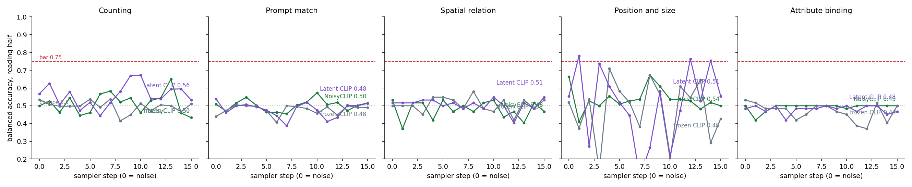
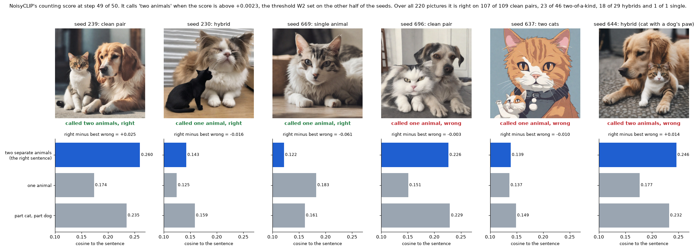

# Can a sentence score read the five properties on a half-drawn picture?   ⚪ null on counting, prompt match and left-right order · ❓ inconclusive on position and size and on binding · read 2026-11-24

**The claim**

At steps 0 to 15 of a 50-step SDXL run, while the picture is still mostly noise, none of three image-and-text models can tell
a right sentence from a wrong one for any of five properties of a cat and dog picture. NoisyCLIP, frozen CLIP and [Latent CLIP](../../../context/methods/05-latent-clip/01-overview.md)
each stay between 0.46 and 0.56 mean balanced accuracy against a bar of 0.75, where 0.5 is chance, and none beats frozen CLIP.
Counting, prompt match and left-right order are null. Position and size, and attribute binding, are inconclusive, because
their labels failed the eye check.

**Why it was asked.** A sentence score was a candidate for steering the sampler toward a clean cat and dog: push the picture
while it is drawn so the right sentence scores higher. A push acts at steps 0 to 15, so the next step, a push on CO3's
renders, was allowed only on steps where the score can read the property at all
([the reading design](../../../artifacts/notes/progress/noise-text-critic/02-can-it-read/design.md), line 3).

A later test of whether this null is fair records the step differently. It is quoted under
[Where the sources disagree](#where-the-sources-disagree) and listed under [Still open](#still-open).

## Table of contents

- [Words this page uses](#words-this-page-uses)
- [What would have counted](#what-would-have-counted)
- [1. No model reads any property at steps 0 to 15](#1-no-model-reads-any-property-at-steps-0-to-15)
- [2. The models do read once the picture is mostly drawn](#2-the-models-do-read-once-the-picture-is-mostly-drawn)
- [3. Counting fails even on the finished picture](#3-counting-fails-even-on-the-finished-picture)
- [4. Why two properties are inconclusive: the labels](#4-why-two-properties-are-inconclusive-the-labels)
- [Where the sources disagree](#where-the-sources-disagree)
- [What this cannot tell you](#what-this-cannot-tell-you)
- [Concepts this uses](#concepts-this-uses)
- [Where this came from](#where-this-came-from)
- [Still open](#still-open)
- [Cross-references](#cross-references)

## Words this page uses

Navigation: 📋 [TOC](#table-of-contents) | [Next](#what-would-have-counted) ➡️

**Step.** One of SDXL's 50 denoising steps. Step 0 is almost pure noise and step 49 is almost the finished picture. A
"half-drawn picture" here is SDXL's latent, the small 4-channel code the picture is drawn in, at steps 0 to 15.

**Sentence score.** How close a picture lands to one sentence: the cosine similarity between the picture's vector and the
sentence's vector, from -1 to 1. The checker score is the right sentence's score minus the highest score among its wrong
sentences, so a positive value means the right sentence won.

**The three models.** NoisyCLIP is CLIP ViT-L/14 with its image side retrained on noisy latents, so it can read a picture
before it is drawn. Frozen CLIP is the same CLIP with its original weights, reading the same input; it is the baseline
NoisyCLIP must beat. Latent CLIP is a smaller CLIP trained on clean SDXL latents, with its own text side.

**Balanced accuracy.** Of the pictures whose right answer is yes, the share the score calls yes; of those whose right answer
is no, the share it calls no; then the mean of the two. 0.5 is chance and 1 is perfect. It is taught on a small table under
[Concepts this uses](#concepts-this-uses).

**Threshold half and reading half.** The seeds are split in two. The cut-off that turns a checker score into a yes or no is
chosen on the threshold half, and balanced accuracy is measured on the reading half, so no number is scored on the pictures
that chose its cut-off.

**The five properties**, each a right sentence against wrong ones
([the reading design](../../../artifacts/notes/progress/noise-text-critic/02-can-it-read/design.md), lines 84 to 90):

| Property | Right sentence | Wrong sentences | Pictures (design, lines 60 to 66) |
|---|---|---|---|
| Counting | a photo of a cat and a dog, two separate animals | a photo of one animal; one animal that is part cat and part dog | 185: two bodies against a hybrid or one animal |
| Prompt match | a photo of a cat and a dog | a photo of two cats; a photo of two dogs; a photo of a horse and a sheep | 155: the asked pair against a wrong pair |
| Left-right order | a cat to the left of a dog | a dog to the left of a cat | 128: 64 pictures and their mirror images |
| Position and size | a large cat on the left and a small dog on the right | the three other size and side arrangements | the same 128, less those with no clear size difference |
| Attribute binding | a red cat and a blue dog | a blue cat and a red dog | 128: two recoloured copies of each of the 64 |

All pictures come from the 220 labelled cat and dog pictures in `2-classifier-guidance/scripts/rung2/eval_set_catdog_v2.json`,
noised back to each step from the finished latent.

## What would have counted

Navigation: ⬅️ [Previous](#words-this-page-uses) | 📋 [TOC](#table-of-contents) | [Next](#1-no-model-reads-any-property-at-steps-0-to-15) ➡️

**The rule was written in [the reading design](../../../artifacts/notes/progress/noise-text-critic/02-can-it-read/design.md#the-run)
before any score existed, and its bars are constants in `2-classifier-guidance/scripts/noise_text_critic/w2_read.py`.**

| Result, per property | What it takes (design, lines 45 to 50) |
|---|---|
| Reads | For NoisyCLIP and for Latent CLIP separately, mean balanced accuracy over steps 0 to 15, on the reading half, is at least 0.75 |
| Beats frozen CLIP | That mean is above frozen CLIP's by more than 1.96 standard errors, from 10,000 bootstrap resamples of the reading half's seeds. For Latent CLIP this is a mixed comparison |
| Null | The label check passes and the property misses the 0.75 bar |
| Inconclusive | The property's label check fails, either half holds fewer than 8 pictures of either label, or a check before scoring fails |

**What would have surprised the design** (line 54): NoisyCLIP passing on left-right order or colour binding at steps 0 to 9,
or Latent CLIP reading above chance at steps 0 to 5, since it never trained on a noisy latent.

W&B run `70g3qw2f` `verified`
(key `wandb_run` in [the reading result file](../../../artifacts/notes/progress/noise-text-critic/02-can-it-read/result.json), opened 2026-11-24).

## 1. No model reads any property at steps 0 to 15

Navigation: ⬅️ [Previous](#what-would-have-counted) | 📋 [TOC](#table-of-contents) | [Next](#2-the-models-do-read-once-the-picture-is-mostly-drawn) ➡️

**Every model sits near chance on every property, step by step, far under the 0.75 bar.**

Five panels, one per property. Up the side is balanced accuracy on the reading half, from 0.2 to 1.0; along the bottom is the
sampler step from 0 (noise) to 15. One line per model: NoisyCLIP green, frozen CLIP grey, Latent CLIP purple, with the dashed
red bar at 0.75 and the dotted chance line at 0.5. Each line ends in its mean over the 16 steps, and those labels match the
table below to two places `verified` (read on the picture). On counting, prompt match, left-right order and binding no line
comes near the bar; the highest point is Latent CLIP's counting score at about 0.67 near steps 9 and 10. On position and size
the lines swing from below 0.2 to past 0.75 at single steps, because each half holds 1 right picture, so a single step's score
turns on whether that one picture is called right `verified` (read on the picture; the count is in the table below).

**The number.** Mean balanced accuracy over steps 0 to 15 on the reading half, with the cut-off chosen on the threshold half
`verified` (each cell read from `mean_steps_0_to_15` in [the reading result file](../../../artifacts/notes/progress/noise-text-critic/02-can-it-read/result.json)
on 2026-11-24; the table is the review's, lines 11 to 17):

| Property | NoisyCLIP | Frozen CLIP | Latent CLIP | Pictures per half (right, wrong) | Verdict |
|---|---|---|---|---|---|
| Counting | 0.515 | 0.496 | 0.560 | 77 and 78, 15 and 15 | null |
| Prompt match | 0.503 | 0.478 | 0.479 | 55 and 54, 23 and 23 | null |
| Left-right order | 0.479 | 0.506 | 0.507 | 33 and 31, 33 and 31 | null |
| Position and size | 0.538 | 0.482 | 0.510 | 1 and 1, 57 and 55 | inconclusive: 1 right picture per half, under the 8 the design needs, and its labels failed the eye check |
| Attribute binding | 0.492 | 0.467 | 0.481 | 33 and 31, 33 and 31 | inconclusive: the recolouring failed the eye check, so the labels cannot be trusted |

**Against frozen CLIP.** No gap passes 1.96 standard errors except NoisyCLIP on position and size (0.056, standard error
0.015), which rests on 2 right pictures and does not count. Latent CLIP's gaps are mixed comparisons, because it differs from
frozen CLIP in both the model and the input `verified` (keys `noisyclip_minus_frozen` and `latent_clip_minus_frozen` in the
reading result file, opened 2026-11-24).

**Steps a push could have used.** The design let the push act only on steps whose threshold-half balanced accuracy was at
least 0.6. Some steps pass that on the threshold half and none reads on the reading half: Latent CLIP's counting passes at 7
steps whose reading-half values average 0.56. With 15 wrong pictures per half one step's balanced accuracy has a standard
error of about 0.07, so 0.6 on one half is within reach of chance `stated` (review, line 36, which marks the 0.07 inferred
from the counts).

## 2. The models do read once the picture is mostly drawn

Navigation: ⬅️ [Previous](#1-no-model-reads-any-property-at-steps-0-to-15) | 📋 [TOC](#table-of-contents) | [Next](#3-counting-fails-even-on-the-finished-picture) ➡️

**NoisyCLIP reads prompt match from about step 20, and reaches 0.78 to 0.86 at steps 30 to 49, so the early failure is about
the early steps.** NoisyCLIP does read prompt match once the picture is mostly drawn, at steps 30 to 49, so
the models and [the input path](../../artifacts/scenes/noisyclip-sentence-score/NOTATION.md#the-input-path) work and the early steps are where reading fails.

> 🖼️ **Figure wanted**: balanced accuracy on the reading half against sampler step 0 to 49 for prompt match and counting, one
> line per model, with steps 0 to 15 shaded as the push's window, so the reader sees where each model starts to read. The
> numbers are in `balanced_accuracy_reading_half` of [the reading result file](../../../artifacts/notes/progress/noise-text-critic/02-can-it-read/result.json).
> Render into `2-classifier-guidance/artifacts/results/can-a-sentence-score-read-the-five-properties/`, write its card entry,
> then embed here.

**The number.** Reading-half balanced accuracy at steps 20, 30, 40 and 49 `verified` (`balanced_accuracy_reading_half` in the
reading result file, opened 2026-11-24):

| Property | NoisyCLIP | Frozen CLIP | Latent CLIP |
|---|---|---|---|
| Prompt match | 0.67, 0.78, 0.86, 0.82 | 0.52, 0.62, 0.80, 0.80 | 0.49, 0.56, 0.61, 0.70 |
| Counting | 0.50, 0.64, 0.68, 0.71 | 0.49, 0.52, 0.56, 0.67 | 0.55, 0.54, 0.55, 0.54 |

NoisyCLIP leads frozen CLIP on prompt match by 0.15 at step 20 and 0.16 at step 30, so its noise training moves reading
earlier, to about step 20 of 50, and not into steps 0 to 15 `stated` (review, line 28).

**The checks before any score was believed** all ran `verified` (read from [the reading result file](../../../artifacts/notes/progress/noise-text-critic/02-can-it-read/result.json),
`published_behaviour` and `input_path`):

| Check | Bar | NoisyCLIP | Latent CLIP | Frozen CLIP |
|---|---|---|---|---|
| Prompt match at step 49, threshold half | above 0.6 | 0.91 | 0.73 | not part of the check |
| Image vectors from this input path against the authors' path, cosine at steps 0 and 15 | at least 0.99 | 0.995 and 0.995, passes | not part of the check | 0.989 and 0.987, just under |

Frozen CLIP's row carries that caveat. It changes no verdict, because every row is null `stated` (review, line 34).

## 3. Counting fails even on the finished picture

Navigation: ⬅️ [Previous](#2-the-models-do-read-once-the-picture-is-mostly-drawn) | 📋 [TOC](#table-of-contents) | [Next](#4-why-two-properties-are-inconclusive-the-labels) ➡️

**At step 49 NoisyCLIP calls two cats "one animal" half the time, because the wrong sentence "part cat and part dog" scores
almost as high as the right one.**

Six finished pictures, each above three bars: NoisyCLIP's cosine at step 49 to the right sentence (blue) and to the two wrong
ones (grey), along a scale from 0.10 to 0.25. A picture is called "two animals" when the right sentence minus the best wrong
one is above +0.0023, the cut-off chosen on the other half of the seeds. The left three are called right: a clean pair at
+0.025, a picture the set labels hybrid at -0.016, and the single animal at -0.061. The right three are called wrong: a clean
pair at -0.003, two cats at -0.010 called one animal, and a picture labelled hybrid (a cat with a dog's paw) at +0.014 called
two animals `verified` (read on the picture; matches the review, line 30). On both clean pairs "part cat and part dog" scores
0.235 and 0.229 against the right sentence's 0.260 and 0.226. The sheet takes the first right call and the first miss of each
kind in SHA-256 order `stated` (review, line 30). At sheet size the picture labelled hybrid at seed 230 looks like a large
long-haired animal beside a small black cat `inferred` (by eye).

**The number.** At step 49 NoisyCLIP's counting call is right on 107 of 109 clean pairs, 23 of 46 two-of-a-kind pictures (two
cats or two dogs), 18 of 29 hybrids and the 1 single animal `verified` (printed on the picture; matches the review, line 30).
The wrong sentence shares both species words with the right one and scores within 0.03 of it on clean pairs, so a
two-of-a-kind picture, which matches neither, falls on the wrong side of the cut-off half the time. The review marks the
reason, that the counting sentences mix the species with the count, as inferred from these cosines.

**A text-only check bounds what any reader with this text side can do** `verified` ([the word check](../../../artifacts/notes/progress/noise-text-critic/02-can-it-read/word-check/word-check.json),
keys `trained` and `random_weights`, opened 2026-11-24). It uses no image.
CLIP ViT-L/14's text side, the one NoisyCLIP keeps frozen, carries colour binding: 0.72 of a red-blue swap survives averaging
both word orders, against 0.13 with random weights. It carries left-right order weakly: 0.28, against 0.08 with random weights,
and swapping the two nouns moves a sentence about a third as far as changing one noun.

## 4. Why two properties are inconclusive: the labels

Navigation: ⬅️ [Previous](#3-counting-fails-even-on-the-finished-picture) | 📋 [TOC](#table-of-contents) | [Next](#where-the-sources-disagree) ➡️

**The word "cat" lands mostly on the cat's head, so the region that labels the cat is often the head alone, and the size and
colour labels built from it fail the eye check.**

> 🖼️ **Figure wanted**: two of the 64 relation pictures with the cat and dog regions drawn on them, one where the cat region
> covers the whole cat and one where it covers only the head, beside the recoloured copy of the second, so the reader sees why
> the size and colour labels fail. The label sheets are from job 94093; the calls are in
> [the eye-check calls](../../../artifacts/notes/progress/noise-text-critic/02-can-it-read/label-check/eye-labels.csv). Check each
> picture against the subject guard, render into
> `2-classifier-guidance/artifacts/results/can-a-sentence-score-read-the-five-properties/`, write its card entry, then embed here.

**The number.** Every label set was checked by eye at sheet size against a 90% bar before any score `verified` (counts from
[the eye-check calls](../../../artifacts/notes/progress/noise-text-critic/02-can-it-read/label-check/eye-labels.csv) and `label-check/eye-colours.csv`, opened 2026-11-24; the 90% bar is
the design's, line 78):

| Label set | Right | Bar | Result |
|---|---|---|---|
| Left-right order, 64 pictures | 62 of 64 (96.9%) | 90% | passes |
| Size, 57 pictures with a size call | 37 of 57 (64.9%) | 90% | fails |
| Recoloured copies, 32 checked | 18 of 32 (56%) | 90% | fails |

The head-only region makes the cat look small in 20 size calls, and leaves the cat's body uncoloured or coloured as the dog in
7 of the 16 checked pictures. The two left-right misses, pictures 43 and 54, show a cat sitting in front of the dog between its
front legs, where neither is to the left. By the design, position and size and attribute binding are held, and the owner
decides how they continue.

## Where the sources disagree

Navigation: ⬅️ [Previous](#4-why-two-properties-are-inconclusive-the-labels) | 📋 [TOC](#table-of-contents) | [Next](#what-this-cannot-tell-you) ➡️

**Three places where two records say different things. This page reports both and resolves none.**

| What | One source | The other source |
|---|---|---|
| The step's verdict | [the reading review](../../../artifacts/notes/progress/noise-text-critic/02-can-it-read/review.md), line 3: "null on counting, prompt match and left-right order, and inconclusive on position and size and on binding" | [the fairness review](../../../artifacts/notes/progress/noise-text-critic/02c-fair-test/review.md), line 3: "W2 is inconclusive by the bars fixed beforehand", because a reader on SDXL's own features, run as a positive control, read the clean pair at 0.637 over steps 0 to 15 against its floor of 0.65 (line 4). [The loop's summary](../../../artifacts/notes/progress/noise-text-critic/00-executive-summary.md), line 38, also calls the step "formally inconclusive" |
| Latent CLIP's counting mean over steps 0 to 15 | [the reading review](../../../artifacts/notes/progress/noise-text-critic/02-can-it-read/review.md), line 13: 0.560 | [the loop verdict](../../../artifacts/notes/progress/noise-text-critic/05-verdict.md), line 13: "0.561, Latent CLIP", the value the fairness review's rerun prints at line 24 |
| Whether position and size, and binding, were scored | [the reading review](../../../artifacts/notes/progress/noise-text-critic/02-can-it-read/review.md), lines 16 and 17: scores for all three models, with the verdict inconclusive | [the loop's summary](../../../artifacts/notes/progress/noise-text-critic/00-executive-summary.md), line 39: "Position and size, and binding, were not scored, because their labels failed the eye check" |

## What this cannot tell you

Navigation: ⬅️ [Previous](#where-the-sources-disagree) | 📋 [TOC](#table-of-contents) | [Next](#concepts-this-uses) ➡️

**Whether the sampler's real states read the same.** These are finished pictures noised back to each step. A latent on the
sampler's own path at step 5 is not the same as a finished picture noised to step 5 `stated` (design, line 134).

**Whether a score that reads would also steer.** A score can separate the classes and still have a gradient that changes
texture and leaves layout alone (design, line 136).

**Why Latent CLIP does or does not read.** Its comparison with the other two is mixed: architecture, text side, training data
and input path all differ, and its 128 by 128 latent is pooled to 64 by 64 as its authors' notebook does. A poor result may
come from the noise, the pooling or the smaller model (design, lines 39 and 140).

**Anything beyond a cat and a dog.** Every picture is one animal pair (design, line 142).

> [!NOTE]
> NoisyCLIP against frozen CLIP is the one clean comparison here: they share an architecture, a text side and an input path,
> and differ only in the image side's weights. Every gap involving Latent CLIP is mixed.

## Concepts this uses

Navigation: ⬅️ [Previous](#what-this-cannot-tell-you) | 📋 [TOC](#table-of-contents) | [Next](#where-this-came-from) ➡️

The toy numbers below are invented unless they say otherwise.

**Balanced accuracy**

A coffee tasting: 10 cups, 8 from a good batch and 2 from a bad one, and the taster calls every cup good. Lay the calls out
with the truth down the side and the taster's call across the top:

| | taster says good | taster says bad |
|---|---|---|
| really good (8) | 8 | 0 |
| really bad (2) | 2 | 0 |

Plain accuracy is the diagonal over all cups, 8 of 10 = 0.8, though the taster tasted nothing. "Balanced" means each row gets
the same say: the good row's share called good is 8 / 8 = 1, the bad row's share called bad is 0 / 2 = 0, and their mean is
0.5, which is chance. Run back on counting: one reading half holds 77 two-animal pictures and 15 one-animal or hybrid
pictures, so a score that calls every picture "two animals" would have plain accuracy 77 / 92, about 0.84, and balanced
accuracy 0.5 (worked here from the review's counts, not a recorded result). On position and size the right row holds 1
picture, so its share is 0 or 1 and a single step can only jump; that is the swing in section 1's fifth panel. The chapter on
[balanced accuracy in the readout guidance textbook](../../../../../goal-setting/learning/deep-learning/diffusion-models/13-classifier-guidance-by-hand/textbook/06-readout-guidance-on-one-small-network.md#balanced-accuracy-the-hit-rate-on-each-class-averaged)
teaches it on a small network.

**The sentence score, a cosine**

A picture's vector is (1, 1), and two sentences have vectors (1, 2) and (2, -1). The cosine is the dot product over the two
lengths: (1 + 2) / (1.414 × 2.236) = 0.949 for the first, and (2 - 1) / (1.414 × 2.236) = 0.316 for the second. The right
sentence minus the wrong one is 0.633, so the first sentence wins. Run back on the clean pair at seed 239 in section 3: the
right sentence scores 0.260 and the best wrong one 0.235, so right minus best wrong is +0.025 `verified` (read on the picture),
and it is called two animals because +0.025 is above the cut-off of +0.0023. Read more in the
[cosine similarity card](../../../../../Obsidian/Mathematics/Linear%20Algebra/Cosine%20Similarity.md#where-to-learn-this),
the [contrastive image-text card](../../../../../Obsidian/Artificial%20Intelligence/Deep%20Learning/Contrastive%20Image-Text%20Training.md#where-to-learn-this)
for how CLIP is trained, and the [CLIP score chapter](../../../../../goal-setting/learning/deep-learning/diffusion-models/12-scoring-and-rival-methods/textbook/01-clip-score.md#how-the-number-is-made).

**A cut-off chosen on one half and read on the other**

Six seeds with checker scores: three yes pictures at 0.04, 0.02 and 0.01, three no pictures at 0.00, -0.01 and 0.03. Put
seeds 1, 3 and 5 in the threshold half and 2, 4 and 6 in the reading half. On the threshold half (0.04 yes, 0.01 yes, -0.01 no)
a cut-off of 0.00 calls all three right. On the reading half (0.02 yes, 0.00 no, 0.03 no) the same cut-off calls the yes right
and one of the two no pictures right, a balanced accuracy of (1 + 0.5) / 2 = 0.75. "Threshold half" because it picks the
threshold, "reading half" because the number is read there, so a cut-off tuned to its own pictures cannot flatter the score.
Here the seeds alternate between halves in SHA-256 order within each label, and all of a seed's pictures stay together
(design, line 111).

**A gap measured in standard errors**

Resample the reading half's seeds with replacement many times, recompute each model's mean each time, and the spread of the
gap between two models is its standard error. A gap of more than 1.96 of those counts as a lead. NoisyCLIP's 0.056 lead on
position and size is 3.7 standard errors of 0.015 (worked here), and it does not count because it rests on 2 right pictures.
The [bootstrap card](../../../../../Obsidian/Mathematics/Statistics/Bootstrap.md#standard-error) and
[the chapter on the bootstrap standard error](../../../../../goal-setting/learning/mathematics/statistics/sampling/textbook/08-the-percentile-bootstrap.md#84-why-with-replacement-and-the-bootstrap-standard-error)
teach it.

## Where this came from

Navigation: ⬅️ [Previous](#concepts-this-uses) | 📋 [TOC](#table-of-contents) | [Next](#still-open) ➡️

**The means, gaps, late steps, picture counts, checks, label calls and word check were read from their files on 2026-11-24; the rest is copied from the review.**

| What | Source | Mark |
|---|---|---|
| Means over steps 0 to 15, pictures per half, the step 49 check, the input path cosines, W&B `70g3qw2f` | [the reading result file](../../../artifacts/notes/progress/noise-text-critic/02-can-it-read/result.json), read 2026-11-24, matching [the reading review](../../../artifacts/notes/progress/noise-text-critic/02-can-it-read/review.md), lines 11 to 17 and 28 to 34 | verified |
| The gaps against frozen CLIP and the late steps | the reading result file, keys `noisyclip_minus_frozen`, `latent_clip_minus_frozen` and `balanced_accuracy_reading_half`, opened 2026-11-24 | verified |
| The verdicts, the step 20 and step 30 leads, the push-step average, the counting calls at step 49 | [the reading review](../../../artifacts/notes/progress/noise-text-critic/02-can-it-read/review.md), lines 3, 16 to 30 and 36 | stated |
| The eye check of the labels and the text-only check | [the eye-check calls](../../../artifacts/notes/progress/noise-text-critic/02-can-it-read/label-check/eye-labels.csv), `label-check/eye-colours.csv` and [the word check](../../../artifacts/notes/progress/noise-text-critic/02-can-it-read/word-check/word-check.json), opened 2026-11-24, matching review lines 51 to 78 | verified |
| The runs | review lines 40 to 49: Slurm jobs 93753 to 94105, full scoring by job 94105 at commit `385dae85` | stated |
| The rule, the sentences and the pictures | [the reading design](../../../artifacts/notes/progress/noise-text-critic/02-can-it-read/design.md), lines 33 to 116 | stated |
| What each picture shows | the two pictures above, opened at full size on 2026-11-24 and passed through `is_showable` in `scripts/shared/disallowed_subjects.py` with their labels | verified |
| The plan that owned the step | step W2 on [the progress board](../../../artifacts/notes/progress/board.json), run under [the Session 9 brief](../../../artifacts/notes/progress/prompts/session-9-turn-abstract-concepts-into-scores.md), described in [the sentence score loop page](../../../artifacts/notes/progress/score-space/02-the-loops/loop-9-turn-concepts-into-scores.md) | |
| Regenerate with | the step's scripts under `2-classifier-guidance/scripts/noise_text_critic/`, launched as in [launching and harvesting a run](../../../runbook/running-things-on-the-cluster/launching-and-harvesting-a-run.md) | |
| The cluster and its cards | [the environment overview](../../../environment/overview.md) | |

## Still open

Navigation: ⬅️ [Previous](#where-this-came-from) | 📋 [TOC](#table-of-contents) | [Next](#cross-references) ➡️

- [ ] The fairness test now records a verdict on this step. [The fairness review](../../../artifacts/notes/progress/noise-text-critic/02c-fair-test/review.md), line 3: "**State: W2 is inconclusive by the bars fixed beforehand, and no sentence score reads in any fair setting.**" Its finding is [the fairness finding](is-the-sentence-score-test-fair.md).
- [ ] Binding has no score: [the binding review](../../../artifacts/notes/progress/noise-text-critic/02d-binding/review.md), line 3, records "no binding score yet".
- [ ] Position and size needs labels that pass the eye check and at least 8 right pictures per half before it can be read.
- [ ] The figure of reading against all 50 steps in section 2.
- [ ] The figure of the head-only cat region in section 4.
- [ ] The three disagreements under [Where the sources disagree](#where-the-sources-disagree).

## Cross-references

Navigation: ⬅️ [Previous](#still-open) | 📋 [TOC](#table-of-contents)

- The mention of **the reading finding** in [the context page on the sentence-score push, one sampler step, section "The names, taken apart"](../../../context/methods/04-the-sentence-score-push/01-overview.md#the-names-taken-apart).
- The mention of **the reading finding, section 2** in [the context page on the sentence-score push, the code behind it, section "Catching the half-drawn latents"](../../../context/methods/04-the-sentence-score-push/04-the-code.md#catching-the-half-drawn-latents).
- The mention of **the reading finding's concepts** in [the context page on the sentence-score push, training our own encoder on digits, section "How it fails and what came out"](../../../context/methods/04-the-sentence-score-push/05-training-our-own-encoder.md#how-it-fails-and-what-came-out).
- The mention of **the reading finding** in [the context page on Latent CLIP, reading a latent with no VAE, section "How it fails and how you know it worked"](../../../context/methods/05-latent-clip/02-reading-a-latent-with-no-vae.md#how-it-fails-and-how-you-know-it-worked).

<!-- built-to: PAGE_LOOK_FORMAT v1 -->
