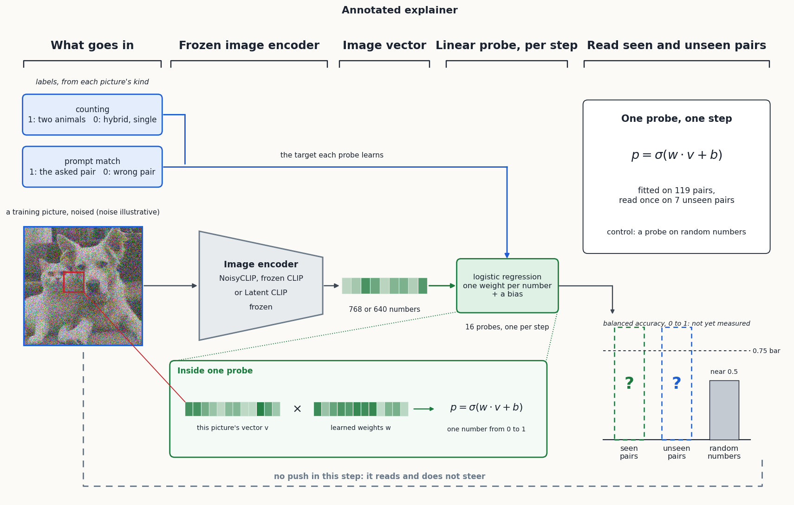

# Does a linear probe on frozen image vectors read unseen pairs?   ⚪ null for all three encoders · verified 2026-11-24

**The claim**

At steps 0 to 15 of a 50-step SDXL run, a single trained layer on top of NoisyCLIP, frozen CLIP or [Latent CLIP](../../../context/methods/05-latent-clip/01-overview.md) reads counting
and prompt match only a little better than chance on pairs it trained on, and less well on the 7 pairs it never saw. The best
is NoisyCLIP: 0.637 and 0.644 mean balanced accuracy on seen pairs, 0.560 and 0.586 on unseen pairs, against a bar of 0.75,
where 0.5 is chance. A probe fitted on random numbers instead of pictures stays at 0.506 and 0.497, so the probe found real but
weak information `verified` (`seen_mean` and `unseen_mean` in [the linear probe result file](../../../artifacts/notes/progress/noise-text-critic/02b-linear-probe/result.json),
opened 2026-11-24). No W&B run id is recorded for this step.

**Why it was asked.** The reading test scored a right sentence against a wrong one and trained nothing; it found no step from 0
to 15 that reads any property ([the reading finding](can-a-sentence-score-read-the-five-properties.md)). On 2026-11-24 the owner
stopped the push that would have used a sentence score and sent the loop on to two trained readers, question 70 on
[the progress board](../../../artifacts/notes/progress/board.json). This is the smaller of the two: the least that can be
trained on top of the same frozen image encoders, one linear layer per step, asked whether it reads pairs outside its training
pictures ([the linear probe design](../../../artifacts/notes/progress/noise-text-critic/02b-linear-probe/design.md), line 3).
The larger one trains a whole encoder and has [its own finding](does-our-own-noise-aware-model-read-unseen-digit-pairs.md).

## Table of contents

- [Words this page uses](#words-this-page-uses)
- [What would have counted](#what-would-have-counted)
- [1. No encoder reads the unseen pairs](#1-no-encoder-reads-the-unseen-pairs)
- [2. The probe finds something, and the random-number control does not](#2-the-probe-finds-something-and-the-random-number-control-does-not)
- [Where the sources disagree](#where-the-sources-disagree)
- [What this cannot tell you](#what-this-cannot-tell-you)
- [Concepts this uses](#concepts-this-uses)
- [Where this came from](#where-this-came-from)
- [Still open](#still-open)
- [Cross-references](#cross-references)

## Words this page uses

Navigation: 📋 [TOC](#table-of-contents) | [Next](#what-would-have-counted) ➡️

**Step, the three models, balanced accuracy.** These mean what they mean on
[the reading finding](can-a-sentence-score-read-the-five-properties.md#words-this-page-uses): one of SDXL's 50 denoising steps,
NoisyCLIP, frozen CLIP and Latent CLIP, and the mean of the share of yes pictures called yes and the share of no pictures called
no, where 0.5 is chance and 1 is perfect.

**Image vector.** What a model's image encoder gives for one noised latent: 768 numbers for NoisyCLIP and frozen CLIP, 640 for
Latent CLIP (design, line 7). The encoder is frozen, so its weights never change here.

**Linear probe.** A single layer of weights that turns one image vector into a probability that the picture is a yes: each of the
768 numbers is multiplied by its own learned weight, the products are added with one bias, and the sum is squashed between 0
and 1. It is a logistic regression (design, line 9). It probes the vector: it learns where in the frozen numbers a property
sits, without changing the encoder. One probe is fitted per model, property and step. It is taught on a toy under
[Concepts this uses](#concepts-this-uses).

**Seen and unseen pairs.** Seen pairs appear in the probe's training pictures; the seen test is 10% of their pictures held back
from fitting. Unseen pairs appear in no training picture, and are read once (design, lines 11 and 25 to 29).

**The two properties and their labels.** Each picture keeps the `kind` an earlier labeller gave it (design, lines 33 to 38):

| Property | Yes | No |
|---|---|---|
| Counting | `positive` (the asked pair, two bodies), `wrong pair` | `hybrid`, `single` |
| Prompt match | `positive` | `wrong pair` |

Left-right order, position and size, and binding have labels only on the reading test's 64 cat and dog pictures, so they have
no unseen pairs and are left out (design, line 40).

**The step's name.** The loop's notes call this step W2b, between the reading test (W2) and training our own model (W4).

## What would have counted

Navigation: ⬅️ [Previous](#words-this-page-uses) | 📋 [TOC](#table-of-contents) | [Next](#1-no-encoder-reads-the-unseen-pairs) ➡️

**The rule was written in [the linear probe design](../../../artifacts/notes/progress/noise-text-critic/02b-linear-probe/design.md#the-bars)
before the run, and its bars are constants in `2-classifier-guidance/scripts/noise_text_critic/w2b_probe.py`, lines 32 to 36.**

| Result, per model and property | What it takes (design, lines 50 to 54) |
|---|---|
| Support | On the unseen pairs, balanced accuracy averaged over steps 0 to 15 is at least 0.75, and within 0.05 of the seen score |
| Null | It misses either condition |
| Inconclusive | Either unseen class has fewer than 30 pictures, or the probe scores below 0.55 on the seen test at every step |
| Control | A probe on 768 random numbers per picture, drawn once and fixed, fitted the same way, must score near 0.5; above 0.6 would mean the labels can be predicted from something other than the picture (line 58) |

**What would have surprised the design** (line 60): a probe on Latent CLIP passing at steps 0 to 5, since Latent CLIP never
trained on a noisy latent.

The design as drawn before the run, read left to right: a noised training picture, the frozen encoder, its image vector, one
logistic regression per step (16 in all, one per step), and the read on seen pairs, unseen pairs and random numbers. The seen and
unseen bars are hollow and marked "?" under the label "not yet measured", and the random-number bar "near 0.5" is drawn from the
design's expectation, so no bar height on it is a result `verified` (read on the picture at full size). The picture is one
training picture, the pilot render of a cat and a dog, with illustrative noise `stated`
([the scene card](../../artifacts/scenes/noisyclip-sentence-score/README.md), line 53).

## 1. No encoder reads the unseen pairs

Navigation: ⬅️ [Previous](#what-would-have-counted) | 📋 [TOC](#table-of-contents) | [Next](#2-the-probe-finds-something-and-the-random-number-control-does-not) ➡️

**Every encoder lands between about 0.53 and 0.59 on the 7 unseen pairs, far under the 0.75 bar, and every one is null.**

> 🖼️ **Figure wanted**: balanced accuracy against sampler step 0 to 15, one panel per property (counting, prompt match), one
> line per reader (NoisyCLIP, frozen CLIP, Latent CLIP, random numbers), seen solid and unseen dashed, with the 0.75 bar and the
> 0.5 chance line, so the reader sees each line stay near chance on the unseen pairs at every step. The numbers are
> `seen_per_step` and `unseen_per_step` under each reader and property in
> [the linear probe result file](../../../artifacts/notes/progress/noise-text-critic/02b-linear-probe/result.json). Render into
> `2-classifier-guidance/artifacts/results/does-a-linear-probe-on-frozen-image-vectors-read-unseen-pairs/`, write its card
> entry, then embed here.

**The number.** Mean balanced accuracy over steps 0 to 15 `verified` (each cell read from `seen_mean`, `unseen_mean` and
`verdict` in [the linear probe result file](../../../artifacts/notes/progress/noise-text-critic/02b-linear-probe/result.json) on
2026-11-24; the table is the review's, lines 17 to 22):

| Encoder | Counting, seen | Counting, unseen | Prompt match, seen | Prompt match, unseen | Verdict |
|---|---|---|---|---|---|
| NoisyCLIP | 0.637 | 0.560 | 0.644 | 0.586 | null |
| frozen CLIP | 0.579 | 0.526 | 0.614 | 0.552 | null |
| Latent CLIP | 0.575 | 0.527 | 0.579 | 0.527 | null |
| random numbers (control) | 0.502 | 0.506 | 0.505 | 0.497 | control passes (at most 0.6) |

The unseen test holds 195 two-animal and 227 one-animal or hybrid pictures for counting, and 109 right-pair and 86 wrong-pair
pictures for prompt match, so each class clears the minimum of 30 `verified` (read from `counts.unseen` in the result file;
matches the review, line 24). The 7 unseen pairs are bison and horse, donkey and duck, guitar and traffic cone, horse and pig,
llama and alpaca, rhino and zebra, and windmill and tractor (design, line 29).

**Against frozen CLIP.** NoisyCLIP's probe leads frozen CLIP's on every cell, and the review reads this as fitting its noise
training (line 26). That is the one clean comparison here, because the two share an architecture and an input path and differ
only in the image side's weights (design, line 19). No standard error is recorded for these gaps, so the lead is not tested.

## 2. The probe finds something, and the random-number control does not

Navigation: ⬅️ [Previous](#1-no-encoder-reads-the-unseen-pairs) | 📋 [TOC](#table-of-contents) | [Next](#where-the-sources-disagree) ➡️

**Each encoder reads above the random-number control on seen pairs, and loses 0.05 to 0.08 of that on unseen pairs, so the
information is real but weak and does not carry well to new pairs.**

> 🖼️ **Figure wanted**: a few pictures from the 7 unseen pairs, at one early step and finished, each with NoisyCLIP's probe
> probability for counting and prompt match and its label, so the reader sees what the probe gets right and wrong; the design
> asked for example pictures beside the numbers (line 67). The pictures are listed in
> `2-classifier-guidance/scripts/rung2/eval_set_v4.json` and the per-step calls come from refitting with `w2b_probe.py`. Check
> each picture at full size against `is_showable` in `scripts/shared/disallowed_subjects.py` and
> [the held pictures list](../../../artifacts/notes/progress/held-pictures.md), render into
> `2-classifier-guidance/artifacts/results/does-a-linear-probe-on-frozen-image-vectors-read-unseen-pairs/`, write its card
> entry, then embed here.

**The number.** The random-number probe sits at 0.502 and 0.505 on seen pairs and 0.506 and 0.497 on unseen pairs, under its
0.6 ceiling `verified` (`random_numbers` and `random_control_passes: true` in the result file). The three encoders' seen scores
run from 0.575 to 0.644, and "all three fall by 0.05 to 0.08 from seen to unseen pairs, and none comes near the bar" `verified`
(`seen_mean` and `unseen_mean` in the result file, falls of 0.048 to 0.077, opened 2026-11-24; the words are the review's, line 26).

**The run.** 4,039 pictures: 3,268 to fit, 349 in the seen test and 422 from the 7 unseen pairs, each noised to steps 0 to 15
with one shared noise draw, with 0 latents missing (review, line 11). The training pictures come from 119 pairs after the
subject guard removed 28 pictures from 4 pairs (design, lines 27 and 31).

> [!NOTE]
> The review compares this with the [readout checker](../../../context/methods/02-the-readout-checker/01-overview.md) in [the fairness finding](is-the-sentence-score-test-fair.md), which reads
> SDXL's own inner features and reaches 0.87 by step 15 on the sampler's real cat and dog states, and concludes that the early
> information sits mostly in the diffusion model's features. It marks that reading inferred and mixed, because the two readers
> differ in their input and in the pictures they read (review, line 26).

## Where the sources disagree

Navigation: ⬅️ [Previous](#2-the-probe-finds-something-and-the-random-number-control-does-not) | 📋 [TOC](#table-of-contents) | [Next](#what-this-cannot-tell-you) ➡️

**Three places where two records say different things. This page reports both and resolves none.**

| What | One source | The other source |
|---|---|---|
| The low end of the unseen scores | [the linear probe review](../../../artifacts/notes/progress/noise-text-critic/02b-linear-probe/review.md), line 3: "On the 7 unseen pairs it reads 0.527 to 0.586" | the same review, line 20, gives frozen CLIP's unseen counting as 0.526, and [the linear probe result file](../../../artifacts/notes/progress/noise-text-critic/02b-linear-probe/result.json) holds `frozen_clip.counting.unseen_mean` 0.5263 |
| The random-number control's counting row | [the linear probe review](../../../artifacts/notes/progress/noise-text-critic/02b-linear-probe/review.md), line 22: "control passes (at most 0.6)" | [the linear probe result file](../../../artifacts/notes/progress/noise-text-critic/02b-linear-probe/result.json): `random_numbers.counting.verdict` is "inconclusive" and `random_numbers.prompt_match.verdict` is "null", while `random_control_passes` is true. The verdict field is set by the per-row rule at `w2b_probe.py` lines 180 to 184 and the pass field by line 200 |
| The size of the smoke test | [the linear probe design](../../../artifacts/notes/progress/noise-text-critic/02b-linear-probe/design.md), line 64: "32 pictures at 2 steps" | [the linear probe review](../../../artifacts/notes/progress/noise-text-critic/02b-linear-probe/review.md), line 10: job 94219, "smoke test, 34 pictures" |

## What this cannot tell you

Navigation: ⬅️ [Previous](#where-the-sources-disagree) | 📋 [TOC](#table-of-contents) | [Next](#concepts-this-uses) ➡️

**Whether a probe that read would also steer.** A probe can read and still have a gradient that does not move the picture
(design, line 71).

**Whether the sampler's real states read the same.** These are finished pictures noised back to each step, as in the reading
test, and a finished picture noised to step 5 is not the sampler's own state at step 5 (design, line 73).

**How sure the labels are.** The `kind` labels came from Claude API calls and hand checks for an earlier checker, and their
error rate on these pictures is not measured (design, line 75).

**How this compares with the reading test.** The pictures, the labels and the reader all differ: many animal and object pairs
with the earlier labeller's kinds here, 220 eye-labelled cat and dog pictures there, and a trained layer against a sentence
score. Any gap between the two pages is mixed. Every gap involving Latent CLIP is mixed too, for the reasons on
[the reading finding](can-a-sentence-score-read-the-five-properties.md#what-this-cannot-tell-you).

## Concepts this uses

Navigation: ⬅️ [Previous](#what-this-cannot-tell-you) | 📋 [TOC](#table-of-contents) | [Next](#where-this-came-from) ➡️

The toy numbers below are invented unless they say otherwise. Balanced accuracy and the cosine are taught on
[the reading finding's concepts](can-a-sentence-score-read-the-five-properties.md#concepts-this-uses).

**A linear probe**

A picture's vector is (0.2, -0.1, 0.5), three numbers instead of 768. A probe has one weight per number, say (1, 2, 2), and a
bias of -0.5. Multiply each number by its weight and add: 0.2 - 0.2 + 1.0 = 1.0, and the bias gives 0.5. The squashing function
turns 0.5 into 1 / (1 + e^-0.5) = 0.62, above the 0.5 threshold, so the probe says yes, two animals.

| Number in the vector | 0.2 | -0.1 | 0.5 | bias |
|---|---|---|---|---|
| Its weight | 1 | 2 | 2 | -0.5 |
| Product | 0.2 | -0.2 | 1.0 | -0.5 |

"Linear" because the score is the sum along the bottom row, a weighted sum with no bend in it. "Probe" because only the weight
row is learned, from labelled pictures, while the vector row comes from a frozen encoder: it asks what the encoder already holds
without changing it. Written out, p = σ(w · v + b), where w is the weight row, v the vector, b the bias and σ the squashing
function. Run back on this test: NoisyCLIP's vector has 768 numbers, so each probe learns 768 weights and a bias, one probe per
step from 0 to 15, with the threshold at 0.5 and the two labels weighted to count equally (design, line 44). The learning tree
has no page on linear probes; the nearest is the
[readout head section of the readout guidance chapter](../../../../../goal-setting/learning/deep-learning/diffusion-models/13-classifier-guidance-by-hand/textbook/06-readout-guidance-on-one-small-network.md#readout-head-the-last-layer-that-reads-the-answer-out),
which builds a last layer that reads an answer out of a network's features with one multiply and one add per cell.

**Seen pairs against unseen pairs**

A student practises on 10 questions and gets 9 right, then sits 10 new questions on the same topic and gets 6 right. The 0.9 on
practice questions says how well the student fits what they saw; the 0.6 on new ones says how much carries over. The bar here
asks for both: at least 0.75 on the new questions, and no more than 0.05 below the practice score. Run back on this test:
NoisyCLIP's counting probe reads 0.637 on held-back pictures of its training pairs and 0.560 on the 7 unseen pairs, so it fails
the first condition by a wide margin. The learning tree has no page on reading held-out classes.

**A control on random numbers**

Fit the same probe on dice rolls instead of the pictures. Dice know nothing about the pictures, so the probe should score 0.5.
If it scored 0.7, the labels would be predictable from something other than the picture (for example, most pictures of one kind
sitting in one part of the file order). Run back on this test: the random-number probe reads 0.506 on counting and 0.497 on
prompt match for the unseen pairs, under the 0.6 ceiling, so the encoders' small lead over 0.5 comes from the pictures.

## Where this came from

Navigation: ⬅️ [Previous](#concepts-this-uses) | 📋 [TOC](#table-of-contents) | [Next](#still-open) ➡️

**The means, the seen-to-unseen fall, counts and verdict fields were read from the result file; the rest is copied from the review and the design.**

| What | Source | Mark |
|---|---|---|
| Seen and unseen means, unseen counts, per-row verdicts, `random_control_passes`, 0 missing latents | [the linear probe result file](../../../artifacts/notes/progress/noise-text-critic/02b-linear-probe/result.json), read 2026-11-24, matching [the linear probe review](../../../artifacts/notes/progress/noise-text-critic/02b-linear-probe/review.md), lines 17 to 24 | verified |
| The seen-to-unseen fall | the linear probe result file, `seen_mean` and `unseen_mean`, opened 2026-11-24 | verified |
| The verdict wording, the reading against the readout checker | [the linear probe review](../../../artifacts/notes/progress/noise-text-critic/02b-linear-probe/review.md), lines 3 and 26 | stated |
| The runs | review lines 7 to 11: smoke test job 94110 failed at the fit stage, smoke test job 94219 and full run job 94220 at commit `8cbdaf49`, 13 minutes | stated |
| The rule, the pictures, the labels, the probe | [the linear probe design](../../../artifacts/notes/progress/noise-text-critic/02b-linear-probe/design.md), lines 17 to 75 | stated |
| The bars in code | `2-classifier-guidance/scripts/noise_text_critic/w2b_probe.py`, lines 32 to 36, read 2026-11-24 | verified |
| What the design picture shows | `ov2-the-linear-probe-on-frozen-vectors.png`, opened at full size on 2026-11-24; its path, its input render's path and every label passed `is_showable` in `scripts/shared/disallowed_subjects.py`; not on [the held pictures list](../../../artifacts/notes/progress/held-pictures.md) | verified |
| The plan that owned the step | step W2b on [the progress board](../../../artifacts/notes/progress/board.json), under [the Session 9 brief](../../../artifacts/notes/progress/prompts/session-9-turn-abstract-concepts-into-scores.md), described in [the sentence score loop page](../../../artifacts/notes/progress/score-space/02-the-loops/loop-9-turn-concepts-into-scores.md) | |
| Regenerate with | `2-classifier-guidance/scripts/noise_text_critic/w2b_probe.py`, launched as in [launching and harvesting a run](../../../runbook/running-things-on-the-cluster/launching-and-harvesting-a-run.md) | |
| The cluster and its cards | [the environment overview](../../../environment/overview.md) | |

## Still open

Navigation: ⬅️ [Previous](#where-this-came-from) | 📋 [TOC](#table-of-contents) | [Next](#cross-references) ➡️

- [ ] No W&B run id is recorded for this step, though the design logs the vectors to W&B project `prime_lab/poe-repair-animals-compose` (line 65); the board's note and [the loop's summary](../../../artifacts/notes/progress/noise-text-critic/00-executive-summary.md), line 41, name none.
- [ ] No standard error is recorded for the gaps between encoders, so NoisyCLIP's lead over frozen CLIP is untested.
- [ ] The figure of balanced accuracy by step in section 1.
- [ ] The example pictures beside the probe's calls in section 2, which the design asked the review to carry (line 67).
- [ ] The three disagreements under [Where the sources disagree](#where-the-sources-disagree).

## Cross-references

Navigation: ⬅️ [Previous](#still-open) | 📋 [TOC](#table-of-contents)

- The mention of **the linear probe finding** in [the context page on the linear probe on frozen vectors](../../../context/methods/05-latent-clip/04-the-linear-probe-on-frozen-vectors.md).

<!-- built-to: PAGE_LOOK_FORMAT v1 -->
