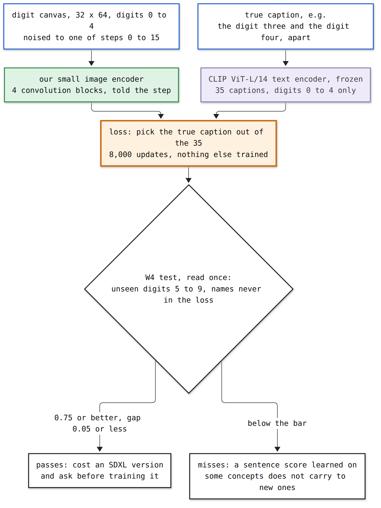
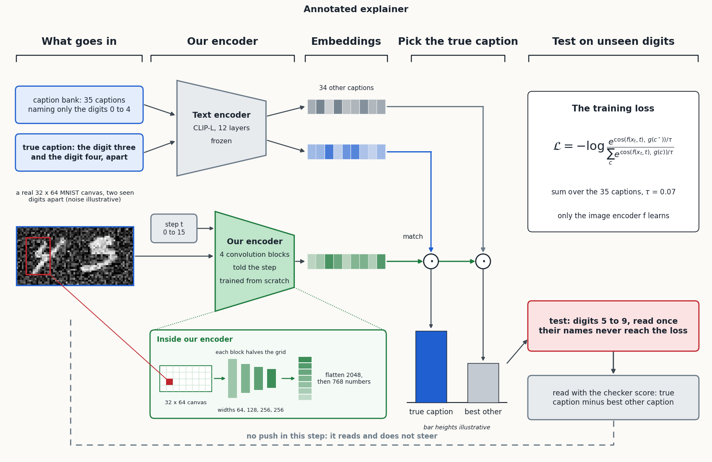

# Does our own noise-aware model read unseen digit pairs?   ⚪ null · read 2026-11-24

**The claim**

A small image encoder trained on noisy digit canvases against CLIP's frozen text encoder learns the digits it was trained on and
does not carry that to new digits. On seen digits 0 to 4 it reads 0.758 balanced accuracy over the digit sampler's steps 14 to
25, the window that keeps as much of the picture as SDXL's steps 0 to 15. On digits 5 to 9, whose names never reached its loss,
it reads 0.590, 0.168 below seen, and on two digits apart against wrong digits it reads 0.502, which is chance. All three of
the design's checks fail. W&B run `en52x031` `stated`
([the own model review](../../../artifacts/notes/progress/noise-text-critic/04-train-our-own/review.md), line 3).

**Why it was asked.** After the reading test found no sentence score that reads steps 0 to 15
([the reading finding](can-a-sentence-score-read-the-five-properties.md)), the owner sent the loop on to two trained readers on
2026-11-24, question 70 on [the progress board](../../../artifacts/notes/progress/board.json). This is the larger one: train
our own image encoder the way NoisyCLIP was trained, and ask whether a sentence score learned on some concepts reads concepts
outside its training set. Digits are the cheapest place to ask that before any SDXL version
([the own model design](../../../artifacts/notes/progress/noise-text-critic/04-train-our-own/design.md), line 3). The smaller
one, a linear layer on frozen encoders, has [its own finding](does-a-linear-probe-on-frozen-image-vectors-read-unseen-pairs.md).

## Table of contents

- [Words this page uses](#words-this-page-uses)
- [What would have counted](#what-would-have-counted)
- [1. Seen digits are read as noise falls, unseen digits barely](#1-seen-digits-are-read-as-noise-falls-unseen-digits-barely)
- [2. Unseen digits apart against wrong digits sit at chance](#2-unseen-digits-apart-against-wrong-digits-sit-at-chance)
- [Where the sources disagree](#where-the-sources-disagree)
- [What this cannot tell you](#what-this-cannot-tell-you)
- [Concepts this uses](#concepts-this-uses)
- [Where this came from](#where-this-came-from)
- [Still open](#still-open)

## Words this page uses

Navigation: 📋 [TOC](#table-of-contents) | [Next](#what-would-have-counted) ➡️

**Canvas.** A 32 by 64 pixel greyscale image of pasted MNIST digits, built by the digit checkers' environment (design, line 20).
Each canvas is one of five kinds: `apart` (two digits, one per half), `overlaid`, `same_half`, `single` and `wrong` (two digits
apart, one of them not the asked digit). `apart` is the yes label and the other four are no (design, line 52).

**Seen and unseen digits.** Seen digits are 0 to 4, the only digits in training. Unseen digits are 5 to 9 (design, line 24).

**Noise-aware.** The image encoder is told which step it is reading and is trained on canvases with that step's noise added,
so it learns to read noisy pictures. This is NoisyCLIP's recipe: tune an image encoder on noisy inputs
against a frozen text encoder (design, line 34). Here the image encoder is new and small, four convolution blocks with a learned
embedding of the step, and only it is trained (design, line 78).

**Caption bank and true caption.** Every training sentence, each embedded once by CLIP ViT-L/14's frozen text encoder, and the
one that describes a canvas, such as "the digit three and the digit seven, apart". The bank names only digits 0 to 4 (design,
lines 26, 60 and 86).

**Checker score.** The right sentence's cosine with the canvas minus the highest cosine among the wrong sentences, so a positive
value means the right sentence won (design, line 28). For an asked pair the wrong sentences are one of the digits alone, the two
overlaid, the two on the same side, and each asked digit apart with any other digit (lines 67 to 72).

**Balanced accuracy.** The mean of the share of yes canvases called yes and the share of no canvases called no, where 0.5 is
chance and 1 is perfect. It is taught on [the reading finding's concepts](can-a-sentence-score-read-the-five-properties.md#concepts-this-uses).

**The judged window.** The digit sampler's steps 14 to 25 of 50. They keep as much of the canvas as SDXL's steps 0 to 15, where a
push acts; the digit sampler's own steps 0 to 15 keep at most 8.7% of the canvas, a harder test than SDXL poses. The owner chose
this window on 2026-11-24, before any run, and steps 0 to 15 are read second (design, line 92).

**Digits apart against wrong digits.** Only the `apart` and `wrong` canvases: two separate digits in both, the asked ones or
not. A rule that sees only the layout scores 0.5 here, so a score above 0.75 means the model reads which digits are present
(design, line 106).

**The step's name.** The loop's notes call this step W4.

## What would have counted

Navigation: ⬅️ [Previous](#words-this-page-uses) | 📋 [TOC](#table-of-contents) | [Next](#1-seen-digits-are-read-as-noise-falls-unseen-digits-barely) ➡️

**The rule was written in [the own model design](../../../artifacts/notes/progress/noise-text-critic/04-train-our-own/design.md#the-bars)
before the run, with the numbers the digit checkers use, and its bars are constants in
`2-classifier-guidance/scripts/noise_text_critic/w4_train.py`, lines 35 to 39.**

| Result | What it takes (design, lines 100 to 104) |
|---|---|
| Support | On the unseen digits over steps 14 to 25, balanced accuracy is at least 0.75, within 0.05 of the seen score, and at least 0.75 on digits apart against wrong digits |
| Null | The overfit test passes and the trained model misses any of those three |
| Inconclusive | The overfit test fails, or the model scores below 0.55 on the seen half at every step |

**What would have surprised the design** (line 108): a pass on digits apart against wrong digits for unseen digits, since the
image encoder never saw a 7 and the loss never named one.

| The test and its two outcomes | The model and its loss |
|---|---|
|  |  |
| The test drawn before the run, top to bottom: a canvas and its true caption go through the two encoders, the loss picks the true caption out of 35 over 8,000 updates, and the unseen digits 5 to 9 are read once. The left branch, 0.75 or better with a gap of 0.05 or less, would have costed an SDXL version; the right branch, below the bar, is the one the run took `verified` (read on the picture; the outcome from the review, line 3). | The same model drawn in detail: the canvas, four convolution blocks of widths 64, 128, 256 and 256 told the step, a 768-number vector, the 35 captions through the frozen text encoder, the loss with τ = 0.07, and the test on digits 5 to 9. Its bar heights are marked "illustrative", so no number on it is a result `verified` (read on the picture at full size). |

Both drawings label the training step range "0 to 15", while the design trains on steps 0 to 25 and judges 14 to 25. That
is quoted under [Where the sources disagree](#where-the-sources-disagree).

## 1. Seen digits are read as noise falls, unseen digits barely

Navigation: ⬅️ [Previous](#what-would-have-counted) | 📋 [TOC](#table-of-contents) | [Next](#2-unseen-digits-apart-against-wrong-digits-sit-at-chance) ➡️

**On seen digits the score climbs from 0.64 at step 14 to 0.89 at step 25; on unseen digits it starts at 0.52, peaks at 0.67
at step 22 and ends at 0.63, so the encoder reads what it trained on and little else.**

> 🖼️ **Figure wanted**: balanced accuracy against the digit sampler's step 0 to 25, one line for seen digits 0 to 4 and one for
> unseen digits 5 to 9, with steps 14 to 25 shaded as the judged window, the 0.75 bar and the 0.5 chance line, so the reader sees
> the two lines part as noise falls. The numbers are `seen.per_step` and `unseen.per_step`, with `timesteps` for a second axis,
> in [the own model result file](../../../artifacts/notes/progress/noise-text-critic/04-train-our-own/final.json). Render into
> `2-classifier-guidance/artifacts/results/does-our-own-noise-aware-model-read-unseen-digit-pairs/`, write its card entry, then
> embed here.

**The number.** Balanced accuracy on reading the true caption against the wrong ones, with each step's threshold chosen on half
of the seen test and applied once to the unseen test `verified` (read from `seen`, `unseen` and `gap` in
[the own model result file](../../../artifacts/notes/progress/noise-text-critic/04-train-our-own/final.json) on 2026-11-24; the
table is the review's, lines 19 to 23):

| Split | Steps 14 to 25, judged | Digits apart against wrong digits | Steps 0 to 15, read second |
|---|---|---|---|
| Seen pairs, digits 0 to 4 (1,000 canvases) | **0.758** | 0.637 | 0.536 |
| Unseen pairs, digits 5 to 9 (2,000 canvases) | **0.590** | 0.502 | 0.504 |
| Bar | at least 0.75 unseen, within 0.05 of seen | at least 0.75 | reported only |

The gap between seen and unseen in the judged window is 0.168, against the 0.05 allowed, and the result file records all three
checks as false `verified`.

**Step by step** in the judged window `verified` (the review's table, lines 25 to 28, matches `per_step` in the result file to two
places):

| Step | 14 | 16 | 18 | 20 | 22 | 24 | 25 |
|---|---|---|---|---|---|---|---|
| Seen | 0.64 | 0.67 | 0.72 | 0.77 | 0.83 | 0.88 | 0.89 |
| Unseen | 0.52 | 0.55 | 0.59 | 0.58 | 0.67 | 0.64 | 0.63 |

**The model learned the task before it was judged.** The overfit test placed 16 of 16 canvases right (15 needed), and the run on
1% of the data read seen canvases at 0.660 in the judged window. The full training, 8,000 updates at batch 256, took 158 seconds
`stated` (review, lines 12 and 13).

## 2. Unseen digits apart against wrong digits sit at chance

Navigation: ⬅️ [Previous](#1-seen-digits-are-read-as-noise-falls-unseen-digits-barely) | 📋 [TOC](#table-of-contents) | [Next](#where-the-sources-disagree) ➡️

**On the one comparison that needs the model to know which digits are present, unseen digits read 0.502, where a rule that
sees only the layout reads 0.5.**

> 🖼️ **Figure wanted**: seen and unseen canvases of the `apart` and `wrong` kinds at three steps of the judged window, each with
> its checker score and the call it gets, beside the balanced accuracy on digits apart against wrong digits by step for both
> splits, so the reader sees that an unseen "7 beside a 9" and a wrong pair get the same call. The per-step numbers are
> `seen.apart_vs_wrong_per_step` and `unseen.apart_vs_wrong_per_step` in
> [the own model result file](../../../artifacts/notes/progress/noise-text-critic/04-train-our-own/final.json); the canvases are in
> `dataset.npz` under `/datasets/mmolefe/poe_repair_min/loop-8/v1/data/` and the trained encoder is at
> `/datasets/mmolefe/poe_repair_min/loop-9/w4/full/encoder.pt`. The design asked for canvases beside each number (line 116).
> Render into `2-classifier-guidance/artifacts/results/does-our-own-noise-aware-model-read-unseen-digit-pairs/`, write its card
> entry, then embed here.

**The number.** Digits apart against wrong digits over steps 14 to 25: 0.637 seen, 0.502 unseen, against a bar of 0.75
`verified` (`seen.apart_vs_wrong` and `unseen.apart_vs_wrong` in the result file). The review reads this as the model never
telling "a 7 beside a 9" from the wrong digits, because its image encoder never saw digits 5 to 9 and nothing in training ties
their shapes to CLIP's words for them. It marks that reason inferred from the two splits (line 30).

**Steps 0 to 15, read second.** Seen 0.536 and unseen 0.504 over those steps, the digit sampler's noisiest, which keep at most
8.7% of the canvas `verified` (`early_balanced_accuracy` in the result file). The review says both splits stay between 0.49 and
0.60 there; the per-step file is quoted beside it under [Where the sources disagree](#where-the-sources-disagree).

## Where the sources disagree

Navigation: ⬅️ [Previous](#2-unseen-digits-apart-against-wrong-digits-sit-at-chance) | 📋 [TOC](#table-of-contents) | [Next](#what-this-cannot-tell-you) ➡️

**Four places where two records say different things. This page reports both and resolves none.**

| What | One source | The other source |
|---|---|---|
| The highest score at steps 0 to 15 | [the own model review](../../../artifacts/notes/progress/noise-text-critic/04-train-our-own/review.md), line 32: "Both splits stay between 0.49 and 0.60 at every one of these steps" | the same review, line 27, gives seen 0.64 at step 14; [the own model result file](../../../artifacts/notes/progress/noise-text-critic/04-train-our-own/final.json) holds `seen.per_step` 0.6350 at step 14 and 0.6265 at step 15 |
| The timesteps of the judged window | [the own model design](../../../artifacts/notes/progress/noise-text-critic/04-train-our-own/design.md), line 92: "steps 14 to 25 (timesteps 712 to 480)" | [the own model result file](../../../artifacts/notes/progress/noise-text-critic/04-train-our-own/final.json): `timesteps` holds 714 at step 14 and 489 at step 25 |
| The steps the model trains on | [the own model design](../../../artifacts/notes/progress/noise-text-critic/04-train-our-own/design.md), line 88: each example draws "one of the 26 timesteps `ddim_timesteps(50)[:26]`, the digit sampler's steps 0 to 25" | [the third way drawing](../../../artifacts/notes/progress/noise-text-critic/way-3-train-our-own.png): "noised to one of steps 0 to 15"; [the digit encoder overview](../../artifacts/scenes/noisyclip-sentence-score/overview/ov3-our-own-encoder-on-digits.png): "step t 0 to 15"; [the scene card](../../artifacts/scenes/noisyclip-sentence-score/README.md), line 59: "noised to one of steps 0 to 15" |
| How the SDXL cost was built | [the own model design](../../../artifacts/notes/progress/noise-text-critic/04-train-our-own/design.md), line 120: from "this step's measured time per update, NoisyCLIP's printed training settings (10 epochs at batch 128) ... and the time to generate its latents on this cluster" | [the own model review](../../../artifacts/notes/progress/noise-text-critic/04-train-our-own/review.md), lines 36 to 39: "These are estimates, from no run", with render time inferred from an RTX 3090 and training time inferred, and the measured 0.128 seconds per update (line 12) not used |

## What this cannot tell you

Navigation: ⬅️ [Previous](#where-the-sources-disagree) | 📋 [TOC](#table-of-contents) | [Next](#concepts-this-uses) ➡️

**Whether an SDXL version would fail the same way.** A 32 by 64 canvas has ten concepts and clean shapes, so a miss here does
not show that an SDXL version would fail to transfer (design, line 124). The review estimates such a version at about 70
GPU-hours against the loop's 8.7, marks those figures inferred, and does not recommend it (lines 36 to 41).

**Whether a model that read would also steer.** No sampler is in this step (design, line 126).

**Position, size and binding.** A canvas can express count, which digits and whether they are apart, and nothing else (design,
line 128).

**How much is the recipe and how much this one run.** One model was trained once with fixed settings, and nothing was varied
after the unseen split was read (design, line 88). The varied axis is only seen against unseen digits, read by the same model
(line 36).

> [!NOTE]
> The loop's verdict reads this result as "CLIP's frozen words do not carry an image encoder to concepts it never trained on"
> ([the loop verdict](../../../artifacts/notes/progress/noise-text-critic/05-verdict.md), line 33). The same bars on a checker
> trained on the digit model's own features are on [the digit checker finding](../abstract-checkers-on-digits/does-a-checker-learn-plurality-on-unseen-digits.md).

## Concepts this uses

Navigation: ⬅️ [Previous](#what-this-cannot-tell-you) | 📋 [TOC](#table-of-contents) | [Next](#where-this-came-from) ➡️

The toy numbers below are invented unless they say otherwise. Balanced accuracy, the cosine and the checker score are taught on
[the reading finding's concepts](can-a-sentence-score-read-the-five-properties.md#concepts-this-uses).

**Picking the true caption out of a bank**

A canvas's vector has cosine 0.3 with its true caption, 0.1 with a second caption and 0.0 with a third. Divide each by a
temperature of 0.1, raise e to each, and share out:

| Caption | Cosine | ÷ 0.1 | e to that | Share |
|---|---|---|---|---|
| true | 0.3 | 3 | 20.09 | 0.84 |
| second | 0.1 | 1 | 2.72 | 0.11 |
| third | 0.0 | 0 | 1.00 | 0.04 |

The loss is minus the log of the true caption's share, -ln 0.84 = 0.17; it falls toward 0 as the true caption's share nears 1.
"Cross-entropy" is that minus-log of the share given to the right answer; the "temperature" sets how sharply small differences
in cosine become big differences in share. Written out, L = -log of exp(cos(f, g*) / τ) over the sum of exp(cos(f, g) / τ) across
the bank. Run back on this test: the bank holds the captions naming digits 0 to 4 (the drawings count 35), τ is 0.07, and only
the image encoder f moves (design, lines 82 to 86). Read more in the
[cross-entropy card](../../../../../Obsidian/Mathematics/Statistics/Information%20Theory/Cross-Entropy.md#where-to-learn-this),
the [softmax card](../../../../../Obsidian/Artificial%20Intelligence/Deep%20Learning/Softmax.md#where-to-learn-this), the
[temperature card](../../../../../Obsidian/Artificial%20Intelligence/Deep%20Learning/Temperature.md#where-to-learn-this) and the
[contrastive image-text card](../../../../../Obsidian/Artificial%20Intelligence/Deep%20Learning/Contrastive%20Image-Text%20Training.md#where-to-learn-this)
for how CLIP itself is trained.

**Why an unseen name gets no pull**

Take the table above for a canvas of a 3 and a 4. Each update pushes the canvas's vector toward "the digit three and the digit
four, apart" and away from the other captions in the bank. A caption naming seven is not in the bank, so no update ever pushes
a 7's vector toward it or away from it. Reading a 7 then depends on whether a 7's vector happens to land nearer the sentence that
names it, which nothing trained. Run back on this test: the unseen digits read 0.590 in the judged window and 0.502 on digits
apart against wrong digits. A model that reads a class it never trained on is called zero-shot; the
[zero-shot card](../../../../../Obsidian/Artificial%20Intelligence/Machine%20Learning/Zero-Shot.md#where-to-learn-this) shows
where CLIP does that, and the learning tree has no page on a trained encoder failing to.

**A noise-aware reader**

Two readers learn to tell a 3 from a 4. One only ever sees clean digits; the other sees each digit with a random amount of noise
added and is told how much. Show both a digit buried in noise: the first has never seen anything like it, the second has. Run
back on this test: the encoder is given a learned embedding of the step that shifts and scales each block's features, and trains
on canvases noised to the digit sampler's steps 0 to 25 (design, lines 78 and 88). NoisyCLIP trained its image side the same way
on SDXL latents, as [the NoisyCLIP reading](../../../artifacts/notes/progress/noise-text-critic/01-reading/noisyclip.md) records.

## Where this came from

Navigation: ⬅️ [Previous](#concepts-this-uses) | 📋 [TOC](#table-of-contents) | [Next](#still-open) ➡️

**The headline numbers, the per-step scores and the checks were read from the result file; the rest is copied from the review
and the design.**

| What | Source | Mark |
|---|---|---|
| Seen and unseen balanced accuracy, digits apart against wrong digits, the steps 0 to 15 means, the gap, the three checks, the per-step scores, 158 seconds, data hash `f70b0fb3…`, W&B `en52x031` | [the own model result file](../../../artifacts/notes/progress/noise-text-critic/04-train-our-own/final.json), read 2026-11-24, matching [the own model review](../../../artifacts/notes/progress/noise-text-critic/04-train-our-own/review.md), lines 3 and 13 to 28 | verified |
| The verdict, the overfit test, the 1% run, the reason for the miss, the SDXL cost | [the own model review](../../../artifacts/notes/progress/noise-text-critic/04-train-our-own/review.md), lines 3, 12, 30 and 36 to 41 | stated |
| The runs | review lines 7 to 13: jobs 94162 and 94163 cancelled before they started, a laptop attempt that wrote nothing, job 94208 for the smoke, overfit and 1% runs, job 94211 for the final training, all at commit `8cbdaf49` | stated |
| The rule, the data, the sentences, the model and the window | [the own model design](../../../artifacts/notes/progress/noise-text-critic/04-train-our-own/design.md), lines 20 to 128 | stated |
| The bars in code | `2-classifier-guidance/scripts/noise_text_critic/w4_train.py`, lines 35 to 39 and 52, read 2026-11-24 | verified |
| What the two drawings show | `way-3-train-our-own.png` and `ov3-our-own-encoder-on-digits.png`, opened at full size on 2026-11-24; their paths and every label passed `is_showable` in `scripts/shared/disallowed_subjects.py`; neither is on [the held pictures list](../../../artifacts/notes/progress/held-pictures.md) | verified |
| The trained encoder | `/datasets/mmolefe/poe_repair_min/loop-9/w4/full/encoder.pt`, handed on as a baseline (review, line 45); not opened here | stated |
| The plan that owned the step | step W4 on [the progress board](../../../artifacts/notes/progress/board.json), under [the Session 9 brief](../../../artifacts/notes/progress/prompts/session-9-turn-abstract-concepts-into-scores.md), described in [the sentence score loop page](../../../artifacts/notes/progress/score-space/02-the-loops/loop-9-turn-concepts-into-scores.md) | |
| Regenerate with | `2-classifier-guidance/scripts/noise_text_critic/w4_train.py` through `w4.sbatch`, launched as in [launching and harvesting a run](../../../runbook/running-things-on-the-cluster/launching-and-harvesting-a-run.md) | |
| The cluster and its cards | [the environment overview](../../../environment/overview.md) | |

## Still open

Navigation: ⬅️ [Previous](#where-this-came-from) | 📋 [TOC](#table-of-contents)

- [ ] The canvases beside each number, which the design asked the review to carry (line 116), and the figure of them in section 2.
- [ ] The figure of seen and unseen balanced accuracy by step in section 1.
- [ ] The cost of an SDXL version rests on inferred figures; the measured time per update was not used in it.
- [ ] The four disagreements under [Where the sources disagree](#where-the-sources-disagree).

## Cross-references

- The mention of **the own-encoder finding** in [the context page on the sentence-score push, one sampler step, section "What is measured where"](../../../context/methods/04-the-sentence-score-push/01-overview.md#what-is-measured-where).
- The mention of **the own-encoder finding** in [the context page on the sentence-score push, training our own encoder on digits](../../../context/methods/04-the-sentence-score-push/05-training-our-own-encoder.md).
- The mention of **its finding** in [the context page on the linear probe on frozen vectors, section "The names, taken apart"](../../../context/methods/05-latent-clip/04-the-linear-probe-on-frozen-vectors.md#the-names-taken-apart).

<!-- built-to: PAGE_LOOK_FORMAT v1 -->
