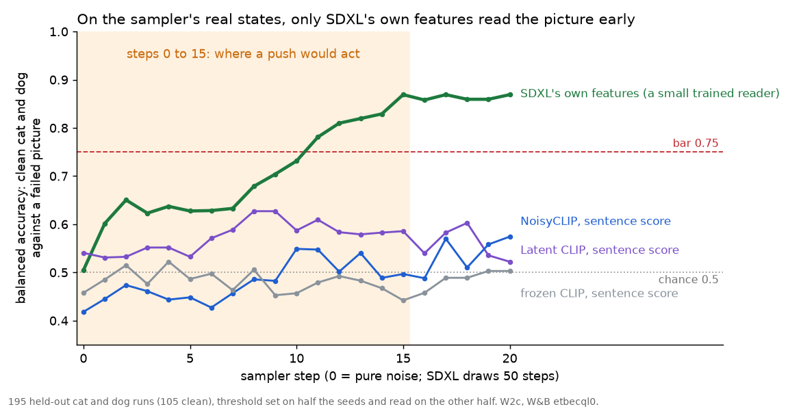

# Is the sentence-score test fair, and can anything read the half-drawn picture at all?   ❓ inconclusive by the bars fixed beforehand, and no sentence score reads in any fair setting · read 2026-11-24

**The claim**

The reading test found no sentence score that reads a cat and dog picture at steps 0 to 15 of a 50-step SDXL run. This test
asked whether that null is fair in two ways. First, a reader known to work, a small network on SDXL's own features, read the
same pictures under the same rules as a positive control. It scored a mean balanced accuracy of 0.637 over steps 0 to 15 on
the clean-pair task, 0.013 under its floor of 0.65, so by the bars fixed beforehand the reading test is inconclusive and not
null. Second, every sentence score got its best fair chance: five wordings averaged, NoisyCLIP's own training steps, the
sampler's real states and sentences that name no species. No sentence row reaches the 0.75 bar over steps 0 to 15 in any of
them; the best is [Latent CLIP](../../../context/methods/05-latent-clip/01-overview.md)'s 0.574 on the real states. W&B run `etbecql0` `stated`
([the fairness review](../../../artifacts/notes/progress/noise-text-critic/02c-fair-test/review.md), lines 3 to 5).

**Why it was asked.** The push test, which would steer CO3's renders with a sentence score, was to be stopped on the reading
test's null. Before stopping it, the owner asked on 2026-11-24 whether anything can read these steps under this protocol, and
whether the sentence scores still fail at their best
([the fairness design](../../../artifacts/notes/progress/noise-text-critic/02c-fair-test/design.md), lines 3 to 7).

The reading test's own review records a different verdict. Both are quoted under
[Where the sources disagree](#where-the-sources-disagree), and the reading test has
[its own finding](can-a-sentence-score-read-the-five-properties.md).

## Table of contents

- [Words this page uses](#words-this-page-uses)
- [What would have counted](#what-would-have-counted)
- [1. On the sampler's real states, only SDXL's own features read early](#1-on-the-samplers-real-states-only-sdxls-own-features-read-early)
- [2. On the reading test's pictures, the control falls just short of its floor](#2-on-the-reading-tests-pictures-the-control-falls-just-short-of-its-floor)
- [3. The fair settings change nothing at steps 0 to 15](#3-the-fair-settings-change-nothing-at-steps-0-to-15)
- [4. Counting with sentences that name no species](#4-counting-with-sentences-that-name-no-species)
- [Where the sources disagree](#where-the-sources-disagree)
- [What this cannot tell you](#what-this-cannot-tell-you)
- [Concepts this uses](#concepts-this-uses)
- [Where this came from](#where-this-came-from)
- [Still open](#still-open)

## Words this page uses

Navigation: 📋 [TOC](#table-of-contents) | [Next](#what-would-have-counted) ➡️

**The reading test.** The earlier test of whether NoisyCLIP, frozen CLIP or Latent CLIP can tell a right sentence from a wrong
one at steps 0 to 15, on 220 labelled cat and dog pictures noised back to each step. The loop's notes call it W2, and its
result is [the reading finding](can-a-sentence-score-read-the-five-properties.md). The three models, the sentence score,
balanced accuracy and the threshold and reading halves are defined on that page under
[Words this page uses](can-a-sentence-score-read-the-five-properties.md#words-this-page-uses), and they mean the same here.

**The fairness test.** This page's test, called W2c in the loop's notes. It keeps the reading test's pictures, noise draws,
halves and scoring code unchanged (design, lines 11 to 13) and adds a control and fairer settings.

**The [readout checker](../../../context/methods/02-the-readout-checker/01-overview.md).** A small network trained to read SDXL's own inner features at a given step and answer "is this
heading for one clean cat beside one clean dog?". The one used here is the kept iteration 4,
`readout-catdog-more3-long/head_step_002000.pt` (design, line 17), described with its training under
[readout checkers on cat and dog](../classifier-guided-poe/can-a-checker-read-a-clean-cat-and-dog.md#readout-checkers-on-cat-and-dog).
Its score is its logit, the raw number before it is turned into a probability.

**The positive control.** A reader already known to work, run on the same pictures under the same rules. If it reads, the
information is there at those steps and a sentence score's failure is its own. If it does not, the protocol itself may hide
what is there. Taught on a toy under [Concepts this uses](#concepts-this-uses).

**The three tasks**, each a right answer against wrong ones (design, line 27; the reading finding's table):

| Task | Right | Wrong | Pictures per half, right and wrong |
|---|---|---|---|
| Clean pair | a clean cat beside a clean dog; sentence "a photo of a cat and a dog" | a wrong pair, a hybrid or a single animal; all five wrong sentences from counting and prompt match | 55 and 38, 54 and 38 |
| Counting | two separate animals | one animal or a hybrid | 77 and 15, 78 and 15 |
| Prompt match | a cat and a dog | another pair | 55 and 23, 54 and 23 |

The picture counts are `verified` (read from `counts_by_half` in
[the fairness result file](../../../artifacts/notes/progress/noise-text-critic/02c-fair-test/result.json) on 2026-11-24).

**The four groups.** Group 1 is the control. Group 2 is the reading test's noised pictures, four noise draws per step. Group 3
is the sampler's real states: 195 held-out cat and dog joint runs, 105 of them clean, read once per step with no noise
added. Group 4 rescores counting with sentences that name no species (design, lines 17 to 29 and 44 to 57).

## What would have counted

Navigation: ⬅️ [Previous](#words-this-page-uses) | 📋 [TOC](#table-of-contents) | [Next](#1-on-the-samplers-real-states-only-sdxls-own-features-read-early) ➡️

**The bars were fixed in [the fairness design](../../../artifacts/notes/progress/noise-text-critic/02c-fair-test/design.md#the-bars-fixed-before-any-w2c-score)
after the reading test's scores were seen and before any score of this test existed** (design, line 7). Each addition is a
standard practice from outside this data, none tuned on it.

| Result | What it takes (design, lines 35 to 40) |
|---|---|
| Control holds | The readout checker's mean balanced accuracy over steps 0 to 15, on the clean-pair task of the reading test's pictures, is at least 0.65, and above frozen CLIP's plain sentence score by more than 1.96 standard errors |
| A sentence score reads | Any sentence row, plain or with five wordings averaged, of any of the three models, reaches a mean of at least 0.75 over steps 0 to 15 on any task in group 2 or group 3 |
| The reading test stands | The control holds and no sentence row reads |
| The reading test is inconclusive | The control does not hold: this protocol cannot show reading at these steps even for a reader known to work |
| Finished-picture check | At step 49, where almost no noise is left, each sentence row should read counting and the clean pair at 0.75 or more; a row that fails is reported beside its early numbers |
| In-window reading | NoisyCLIP's mean over steps 20 to 29 on prompt match, reported as context only, since the push acts at 0 to 15 |

There are 24 sentence rows: 6 readers (3 models, plain and averaged) on 3 tasks in group 2 and 1 task in group 3. The design
expects standard errors of about 0.02 to 0.04 on each mean, so a pass by chance is unlikely, which it marks inferred (line 42).

## 1. On the sampler's real states, only SDXL's own features read early

Navigation: ⬅️ [Previous](#what-would-have-counted) | 📋 [TOC](#table-of-contents) | [Next](#2-on-the-reading-tests-pictures-the-control-falls-just-short-of-its-floor) ➡️

**The readout checker climbs from chance at step 0 to 0.87 by step 15 on the sampler's own states, while every sentence score
stays between about 0.42 and 0.63.**

Up the side is balanced accuracy on the reading half for the clean-pair task, a clean cat and dog against a failed picture,
from 0.35 to 1.0; along the bottom is the sampler step from 0 (pure noise) to 20 of SDXL's 50. Steps 0 to 15, where a push
would act, are shaded. One line per reader, each point one step: the readout checker green, Latent CLIP purple, NoisyCLIP blue
and frozen CLIP grey, all sentence scores with a single wording. The dashed red line is the 0.75 bar and the dotted line is
chance at 0.5. The green line starts at 0.50 at step 0, crosses the bar between step 10 (0.73) and step 11 (0.78), and holds
near 0.87 from step 15 to 20; the three sentence lines never reach 0.64 `verified` (read on the picture, matching
`group_b` in [the fairness result file](../../../artifacts/notes/progress/noise-text-critic/02c-fair-test/result.json)). The
picture was drawn from that file by `2-classifier-guidance/scripts/noise_text_critic/w5_who_reads_early.py` `verified` (the
script read on 2026-11-24).

**The number.** Group 3, the clean-pair task on 195 real runs (105 clean), balanced accuracy on the reading half `stated`
([the fairness review](../../../artifacts/notes/progress/noise-text-critic/02c-fair-test/review.md), lines 32 to 41):

| Reader | Mean, steps 0 to 15 | Step 0 | Step 5 | Step 10 | Step 15 | Step 20 |
|---|---|---|---|---|---|---|
| Readout checker | 0.696 | 0.50 | 0.63 | 0.73 | 0.87 | 0.87 |
| NoisyCLIP, plain / averaged | 0.479 / 0.473 | 0.42 | 0.45 | 0.55 | 0.50 | 0.57 |
| Frozen CLIP | 0.480 | 0.46 | 0.49 | 0.46 | 0.44 | 0.50 |
| Latent CLIP, plain / averaged | 0.574 / 0.540 | 0.54 | 0.53 | 0.59 | 0.59 | 0.52 |

The single-step columns are the plain rows. The readout checker beats frozen CLIP by 0.215 over steps 0 to 15, with a standard
error of 0.042. No sentence row reaches 0.64 at any single step from 0 to 20; the highest is Latent CLIP's 0.63 at step 8
(review, line 41). The result file holds 0.627 at both step 8 and step 9 `verified`.

> [!NOTE]
> These runs' labels come from a model's call on the finished picture, not an eye call, so group 3's labels are less sure than
> the reading test's 220 pictures (design, line 29). The control's floor is judged on group 2, not here.

## 2. On the reading test's pictures, the control falls just short of its floor

Navigation: ⬅️ [Previous](#1-on-the-samplers-real-states-only-sdxls-own-features-read-early) | 📋 [TOC](#table-of-contents) | [Next](#3-the-fair-settings-change-nothing-at-steps-0-to-15) ➡️

**On the noised pictures the control reads the clean pair at 0.637 over steps 0 to 15, under its 0.65 floor, so the rule calls
the reading test inconclusive; it still beats frozen CLIP by 0.150.**

> 🖼️ **Figure wanted**: balanced accuracy on the reading half against sampler step (0 to 15, 20 to 29, 30, 40 and 49) for the
> clean-pair task on the reading test's noised pictures, one line per reader (readout checker, NoisyCLIP, frozen CLIP, Latent
> CLIP, plain), with the 0.65 control floor and the 0.75 bar drawn, so the reader sees how close the control comes. The numbers
> are in `group_a.clean_pair.<reader>.balanced_accuracy_reading_half` of
> [the fairness result file](../../../artifacts/notes/progress/noise-text-critic/02c-fair-test/result.json). Render into
> `2-classifier-guidance/artifacts/results/is-the-sentence-score-test-fair/`, write its card entry, then embed here.

**The number.** Group 2, mean balanced accuracy on the reading half, with the cut-off chosen on the threshold half `stated`
([the fairness review](../../../artifacts/notes/progress/noise-text-critic/02c-fair-test/review.md), lines 13 to 28). "Plain /
averaged" is one wording against five wordings averaged.

| Task | Reader | Steps 0 to 15 | Steps 20 to 29 | Step 49 |
|---|---|---|---|---|
| Clean pair | readout checker (the control) | **0.637** | 0.801 | 0.74 |
| | NoisyCLIP, plain / averaged | 0.506 / 0.503 | 0.687 / 0.711 | 0.86 / 0.89 |
| | frozen CLIP, plain / averaged | 0.488 / 0.486 | 0.513 / 0.523 | 0.92 / 0.91 |
| | Latent CLIP, plain / averaged | 0.556 / 0.535 | 0.528 / 0.546 | 0.62 / 0.60 |
| Counting | readout checker | 0.646 | 0.704 | 0.65 |
| | NoisyCLIP, plain / averaged | 0.514 / 0.521 | 0.540 / 0.516 | 0.71 / 0.65 |
| | frozen CLIP | 0.496 | 0.474 | 0.67 |
| | Latent CLIP, plain / averaged | 0.561 / 0.522 | 0.499 / 0.514 | 0.54 / 0.53 |
| Prompt match | readout checker | 0.600 | 0.792 | 0.73 |
| | NoisyCLIP, plain / averaged | 0.508 / 0.526 | 0.711 / 0.734 | 0.82 / 0.82 |
| | frozen CLIP | 0.487 | 0.492 | 0.80 |
| | Latent CLIP, plain / averaged | 0.478 / 0.502 | 0.572 / 0.498 | 0.70 / 0.68 |

The steps 0 to 15 column was checked against `mean_steps_0_to_15` in the result file and agrees to three places `verified`.

**Against frozen CLIP.** The readout checker beats frozen CLIP's plain score by more than 1.96 standard errors on every task:
0.150 on the clean pair (standard error 0.035), 0.150 on counting and 0.114 on prompt match. These are mixed comparisons,
because the reader and its input both change `stated` (review, lines 4 and 30). The result file also marks Latent CLIP above frozen
CLIP on the clean pair: plain and averaged on these pictures (0.069 with standard error 0.027, and 0.047 with 0.023), and
plain on the real states (0.094 with 0.038). These are mixed comparisons the review does not mention, and no bar uses them
`verified` (read from `latent_clip_minus_frozen` and `latent_clip_ens_minus_frozen` under `group_a` and `group_b`).

> [!WARNING]
> The 220 pictures were used to choose which readout checker iteration to keep, so the control's row is slightly optimistic
> (design, line 17).

## 3. The fair settings change nothing at steps 0 to 15

Navigation: ⬅️ [Previous](#2-on-the-reading-tests-pictures-the-control-falls-just-short-of-its-floor) | 📋 [TOC](#table-of-contents) | [Next](#4-counting-with-sentences-that-name-no-species) ➡️

**Each fairer setting either leaves the early steps where they were or helps only where no push acts** `stated` (review, lines
43 to 47):

| Setting | Why it is fair (design, lines 21 to 25 and 39) | What it changed |
|---|---|---|
| Five wordings averaged per sentence | CLIP's own recommended practice for zero-shot scoring (CLIP paper, section 3.1.4) | No sentence row moved by more than 0.04 over steps 0 to 15 |
| Steps 20 to 29 read as well | NoisyCLIP trained on latents 20 to 29 of a 50-step run ([the NoisyCLIP reading](../../../artifacts/notes/progress/noise-text-critic/01-reading/noisyclip.md), p. 6) | NoisyCLIP reads prompt match at 0.711 (0.734 averaged) and the clean pair at 0.687 (0.711), so even in its own window it stays under 0.75 |
| The sampler's real states | NoisyCLIP trained on real trajectory states, and the push acts on them | They read no better than noise added to finished pictures (section 1) |
| Step 49, the finished-picture check | A row that cannot read a finished picture cannot be expected to read a noisy one | "Every sentence model passes the clean pair, and NoisyCLIP and frozen CLIP pass prompt match", though section 2's table gives Latent CLIP 0.62 and 0.60 on the clean pair at step 49 (see [Where the sources disagree](#where-the-sources-disagree)). Counting fails for all three (0.71, 0.67 and 0.54), as the reading test found |

> 🖼️ **Figure wanted**: for each of the six sentence rows, the plain and averaged means over steps 0 to 15 side by side as
> paired dots, one panel per task, with the 0.75 bar, so the reader sees that averaging the wordings moves no row by more than
> 0.04. The numbers are `mean_steps_0_to_15` for `<model>` and `<model>_ens` under `group_a` and `group_b` of
> [the fairness result file](../../../artifacts/notes/progress/noise-text-critic/02c-fair-test/result.json). Render into
> `2-classifier-guidance/artifacts/results/is-the-sentence-score-test-fair/`, write its card entry, then embed here.

**The number.** No sentence row's mean over steps 0 to 15 reaches 0.6 in any setting. The highest single step on the reading
half is 0.67, Latent CLIP's counting score at step 10 on the reading test's pictures `stated` (review, line 59).

## 4. Counting with sentences that name no species

Navigation: ⬅️ [Previous](#3-the-fair-settings-change-nothing-at-steps-0-to-15) | 📋 [TOC](#table-of-contents) | [Next](#where-the-sources-disagree) ➡️

**Taking the species words out of the counting sentences fixes neither the early steps nor the finished picture, so the
counting failure sits in the models' image side as much as in the wording.**

The reading test's wrong counting sentence, "one animal that is part cat and part dog", shares both species words with the
right one. Two cats or two dogs match neither, and NoisyCLIP called them one animal on 23 of 46 finished pictures (design,
line 46), shown on six pictures in
[the reading finding's section 3](can-a-sentence-score-read-the-five-properties.md#3-counting-fails-even-on-the-finished-picture).
Here the right sentence is "a photo of two animals", against "a photo of one animal" and "a photo of one animal with mixed
features". It is scored on the reading test's saved image vectors, so only the text changes (review, line 49).

**The number.** Mean balanced accuracy on the reading half for counting, Slurm job 94210 `stated` (review, lines 51 to 57;
its numbers are in `loop-9/w2c/species-free/result.json` on the cluster's data disk, not in the notes folder):

| Reader | Steps 0 to 15 | Step 49 | The reading test's sentences at step 49 |
|---|---|---|---|
| NoisyCLIP, plain / averaged | 0.553 / 0.522 | 0.517 / 0.729 | 0.71 / 0.65 |
| Frozen CLIP, plain / averaged | 0.477 / 0.498 | 0.704 / **0.750** | 0.67 / not read |
| Latent CLIP, plain / averaged | 0.503 / 0.499 | 0.538 / 0.538 | 0.54 / 0.53 |

No row reads over steps 0 to 15. On the finished picture only frozen CLIP with the five wordings averaged reaches 0.75, exactly
at the bar, and plain NoisyCLIP falls from 0.71 to 0.517. "Two cats" still loses to "one animal" half the time `stated`
(review, line 57).

> 🖼️ **Figure wanted**: counting balanced accuracy at step 49 for each sentence row, the reading test's sentences beside the
> species-free ones, with the 0.75 bar, so the reader sees that dropping the species words lifts one row to the bar and lowers
> another. The numbers are in `loop-9/w2c/species-free/result.json` under `/datasets/mmolefe/poe_repair_min/`; pull it first.
> Render into `2-classifier-guidance/artifacts/results/is-the-sentence-score-test-fair/`, write its card entry, then embed here.

## Where the sources disagree

Navigation: ⬅️ [Previous](#4-counting-with-sentences-that-name-no-species) | 📋 [TOC](#table-of-contents) | [Next](#what-this-cannot-tell-you) ➡️

**Five places where two records say different things. This page reports both and resolves none; the first is open as
question 79 on [the progress board](../../../artifacts/notes/progress/board.json).**

| What | One source | The other source |
|---|---|---|
| The reading test's verdict | [the reading review](../../../artifacts/notes/progress/noise-text-critic/02-can-it-read/review.md), line 3: "null on counting, prompt match and left-right order, and inconclusive on position and size and on binding" | [the fairness review](../../../artifacts/notes/progress/noise-text-critic/02c-fair-test/review.md), line 3: "W2 is inconclusive by the bars fixed beforehand", because the control read 0.637 against its 0.65 floor (line 4). [The loop's summary](../../../artifacts/notes/progress/noise-text-critic/00-executive-summary.md), line 38, also calls it "formally inconclusive" |
| The loop verdict's per-property calls | [the loop verdict](../../../artifacts/notes/progress/noise-text-critic/05-verdict.md), lines 13 to 15: counting, prompt match and left-right order each "null", with this test among the evidence for the first two | the same page, line 23: the control's 0.637 under its floor makes the reading test's verdict "formally inconclusive", as the fairness review says at line 3 |
| Latent CLIP's counting mean over steps 0 to 15 | [the reading review](../../../artifacts/notes/progress/noise-text-critic/02-can-it-read/review.md), line 13: 0.560 | [the fairness review](../../../artifacts/notes/progress/noise-text-critic/02c-fair-test/review.md), line 24: 0.561, the value [the loop verdict](../../../artifacts/notes/progress/noise-text-critic/05-verdict.md) quotes at line 13 |
| How many of the reading test's pictures this test scores | [the fairness review](../../../artifacts/notes/progress/noise-text-critic/02c-fair-test/review.md), line 13, and [the fairness design](../../../artifacts/notes/progress/noise-text-critic/02c-fair-test/design.md), line 11: "220 pictures" | [the fairness result file](../../../artifacts/notes/progress/noise-text-critic/02c-fair-test/result.json): `group_a.pictures` is 185 |
| Whether every sentence model passes the clean pair at step 49 | [the fairness review](../../../artifacts/notes/progress/noise-text-critic/02c-fair-test/review.md), line 47: "Every sentence model passes the clean pair" | the same review, line 20: Latent CLIP at step 49 on the clean pair reads 0.62 plain and 0.60 averaged, under the 0.75 bar of [the fairness design](../../../artifacts/notes/progress/noise-text-critic/02c-fair-test/design.md), line 39 |

## What this cannot tell you

Navigation: ⬅️ [Previous](#where-the-sources-disagree) | 📋 [TOC](#table-of-contents) | [Next](#concepts-this-uses) ➡️

**Why the readout checker reads and the sentence scores do not.** Every comparison between them is mixed: the reader, its
training and its input (SDXL's inner features against the latent the CLIP models see) all differ (review, line 30). The one
clean comparison is NoisyCLIP against frozen CLIP, marked `clean` in the result file.

**Whether a fresh control would pass.** The control was chosen on these pictures, which flatters it (design, line 17), and it
missed its floor by 0.013. A control trained without these pictures could land on either side.

**Whether the readout checker generalises.** It is one reader on one pair, cat and dog
([the loop's summary](../../../artifacts/notes/progress/noise-text-critic/00-executive-summary.md), line 40).

**Whether a score that reads would also steer.** No push was run; [the push test's review](../../../artifacts/notes/progress/noise-text-critic/03-does-it-steer/review.md),
line 3, records it "not run, because no step was readable".

## Concepts this uses

Navigation: ⬅️ [Previous](#what-this-cannot-tell-you) | 📋 [TOC](#table-of-contents) | [Next](#where-this-came-from) ➡️

The toy numbers below are invented unless they say otherwise. Balanced accuracy, the cut-off chosen on one half and read on the
other, and a gap measured in standard errors are taught on
[the reading finding's concepts](can-a-sentence-score-read-the-five-properties.md#concepts-this-uses).

**A positive control**

A new smoke detector is hung in 10 rooms, 5 with smoke and 5 without, and it calls 5 of 10 right, which is chance. Either the
detector is blind or the rooms hide their smoke (a fan blowing it away). So hang a detector known to work in the same rooms:

| Detector | Smoky rooms called smoky | Clear rooms called clear | Balanced accuracy |
|---|---|---|---|
| new detector | 3 of 5 | 2 of 5 | (0.6 + 0.4) / 2 = 0.5 |
| known-good detector | 5 of 5 | 4 of 5 | (1.0 + 0.8) / 2 = 0.9 |

"Positive" because the known-good detector should say yes where there is smoke; "control" because it tests the rooms, not the
new detector. If it reads 0.9, the smoke is there and the new detector is blind. If it also reads 0.5, the rooms hide the
smoke and the new detector's 0.5 says nothing. Run back on this test: the readout checker is the known-good detector, the
noised pictures are the rooms, and the floor written beforehand was 0.65. It read 0.637, between the two cases, so the rule
says the rooms are not shown to be readable and the reading test's null cannot stand as a null. On the real states it reads
0.696 over steps 0 to 15 and 0.87 at step 15 (section 1), which the rule does not count because the floor names the noised
pictures. Read more in the
[readout head section of the readout guidance chapter](../../../../../goal-setting/learning/deep-learning/diffusion-models/13-classifier-guidance-by-hand/textbook/06-readout-guidance-on-one-small-network.md#readout-head-the-last-layer-that-reads-the-answer-out),
which builds a readout on a small network. The learning tree has no page on positive controls.

**Averaging the wordings of a sentence**

A picture's vector is (1, 0). One wording of a sentence gives the text vector (0.6, 0.8) and another gives (0.8, 0.6), both of
length 1. Their cosines with the picture are 0.6 and 0.8, so the score depends on which wording was picked. Averaging the two
gives (0.7, 0.7), with cosine 0.7 / 0.99 = 0.707 (a cosine ignores length, so the average need not be rescaled). "Prompt"
is the sentence fed to the text side, and "ensembling" is averaging several of its wordings, so one unlucky wording cannot sink
the score. Run back on this test: each sentence was written five ways, from "a photo of {}." to "{}.", and its text vector is
the mean of the five (design, line 23). It moved no sentence row by more than 0.04 over steps 0 to 15 (section 3). Read more
in the [zero-shot card](../../../../../Obsidian/Artificial%20Intelligence/Machine%20Learning/Zero-Shot.md#where-to-learn-this),
which links the CLIP paper's zero-shot results.

**A mixed comparison**

Two tasters score the same coffee, one tasting it hot and one tasting it cold, and the first calls more cups right. The gap
could come from the taster or from the temperature, because both changed. A comparison is clean when exactly one thing
differs. Run back on this test: the readout checker reads SDXL's inner features and frozen CLIP reads the latent through its
image side, so its 0.150 lead mixes the reader with the input. NoisyCLIP against frozen CLIP shares the architecture, text side
and input and differs only in the image side's weights, so that gap (0.019 on the clean pair, under 1.96 standard errors of
0.025, read from `noisyclip_minus_frozen` in the result file `verified`) is the clean one.

## Where this came from

Navigation: ⬅️ [Previous](#concepts-this-uses) | 📋 [TOC](#table-of-contents) | [Next](#still-open) ➡️

**The verdict, the tables and the runs are copied from the review; picture counts, the steps 0 to 15 means and the gaps not
in the review were read from the result file.**

| What | Source | Mark |
|---|---|---|
| The verdict, every table of means, the gaps against frozen CLIP, W&B `etbecql0` | [the fairness review](../../../artifacts/notes/progress/noise-text-critic/02c-fair-test/review.md), lines 3 to 59 | stated |
| Pictures per half, the group 2 and group 3 means over steps 0 to 15, Latent CLIP's gaps, the step 8 and 9 tie, the verdict block `"state": "W2 is inconclusive"` | [the fairness result file](../../../artifacts/notes/progress/noise-text-critic/02c-fair-test/result.json), read 2026-11-24 | verified |
| The bars, the groups, the wordings, the control's caveat | [the fairness design](../../../artifacts/notes/progress/noise-text-critic/02c-fair-test/design.md), lines 3 to 64, fixed before any score of this test | stated |
| The species-free counting rescore | review lines 49 to 57, from `loop-9/w2c/species-free/result.json` on the cluster's data disk, not opened here | stated |
| The runs | review lines 63 to 67: smoke test job 94113 and full run job 94114 at commit `be6a9e0f`, the species-free rescore as job 94210 (line 49) | stated |
| What the picture shows | `who-reads-early.png`, opened at full size on 2026-11-24, and its path and every label passed through `is_showable` in `scripts/shared/disallowed_subjects.py`; not on [the held pictures list](../../../artifacts/notes/progress/held-pictures.md) | verified |
| The plan that owned the step | step W2c on [the progress board](../../../artifacts/notes/progress/board.json), under [the Session 9 brief](../../../artifacts/notes/progress/prompts/session-9-turn-abstract-concepts-into-scores.md), described in [the sentence score loop page](../../../artifacts/notes/progress/score-space/02-the-loops/loop-9-turn-concepts-into-scores.md) | |
| Regenerate with | `2-classifier-guidance/scripts/noise_text_critic/w2c_fair.py` and `w2c_species_free.py`, as stages of `w2.sbatch`, launched as in [launching and harvesting a run](../../../runbook/running-things-on-the-cluster/launching-and-harvesting-a-run.md) | |
| The cluster and its cards | [the environment overview](../../../environment/overview.md) | |

## Still open

Navigation: ⬅️ [Previous](#where-this-came-from) | 📋 [TOC](#table-of-contents)

- [ ] Which verdict the reading test's title line carries: question 79 on [the progress board](../../../artifacts/notes/progress/board.json), open. Each page keeps its own review's verdict until the owner answers.
- [ ] A control that was not chosen on these pictures, so the floor can be read without the optimism the design names (line 17).
- [ ] The runs table (review, lines 63 to 67) lists the species-free rescore as job 94131, cancelled, while the group 4 numbers come from job 94210 (line 49), which the table does not list.
- [ ] The species-free result file is on the cluster's data disk only.
- [ ] The figure of the control against step in section 2.
- [ ] The figure of plain against averaged wordings in section 3.
- [ ] The figure of species-free counting at step 49 in section 4.
- [ ] The five disagreements under [Where the sources disagree](#where-the-sources-disagree).

## Cross-references

- The mention of **the fairness finding** in [the context page on the sentence-score push, one sampler step, section "What is measured where"](../../../context/methods/04-the-sentence-score-push/01-overview.md#what-is-measured-where).

<!-- built-to: PAGE_LOOK_FORMAT v1 -->
