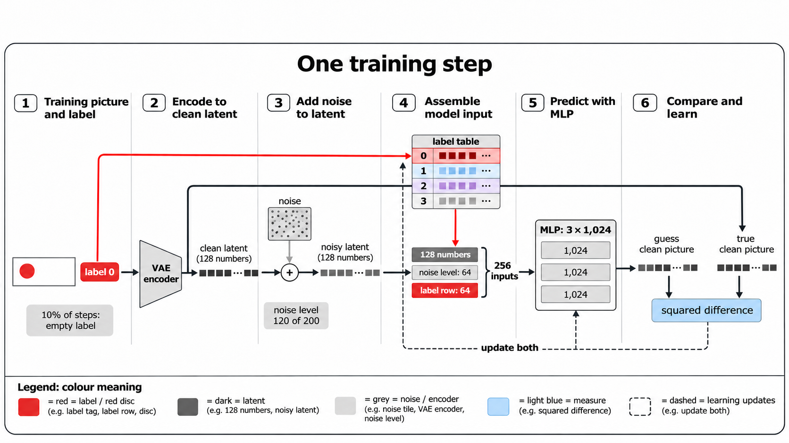
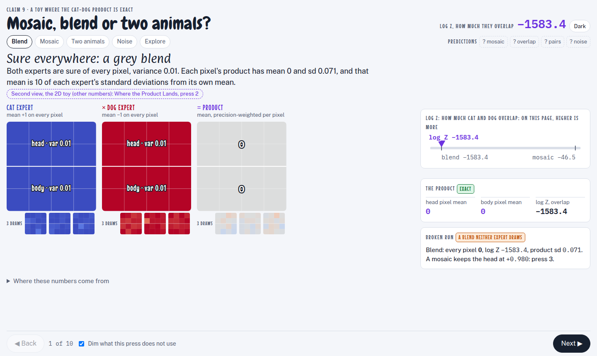
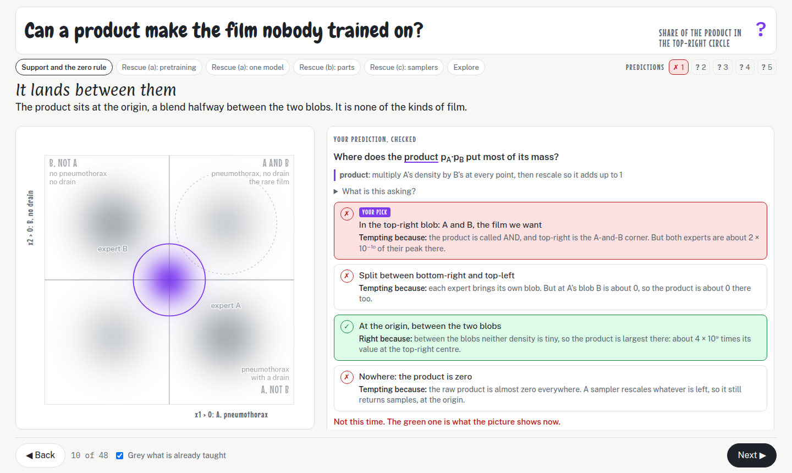
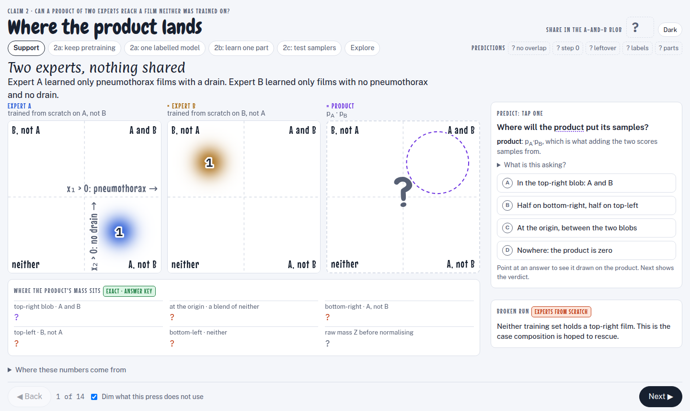

# Scenes: Understanding compositionality

<!-- index: written by scripts/regroup/artifacts_index.py; edit the items, not this file -->

| Scene | What it is | Picture | Last change |
|---|---|---|---|
| [How does the caption model work?](how-the-caption-model-works/README.md) | Pictures of model 3, the small caption-conditioned latent diffusion model that the co-occurrence |  | 2026-11-13 |
| [The parts world](parts-world/README.md) | One interactive scene for claim 9 of the overlap-dial idea map: a toy where every image is 16 pixels drawn as a 4 × 4 tile and every expert is a Gauss |  | 2026-11-13 |
| [Three ways a product reaches A-and-B](three-ways-a-product-reaches-a-and-b/README.md) | An interactive page on the four-quadrant toy for the drip-idea walk "When a product of two diffusion experts reaches A-and-B", claim 2 and its childre |  | 2026-11-13 |
| [The composition notebook, cell by cell](what-an-expert-learns-cell-by-cell/README.md) | as a scene by hld-diagram's notebook level: an outline of its six sections (cut at its own `##` |  | 2026-11-13 |
| [Where the product lands](when-a-product-reaches-a-and-b/README.md) | One interactive scene for claim 2 of the walk in the idea map for when a product reaches A and B: the three ways a product of two diffusion experts ca |  | 2026-11-13 |
