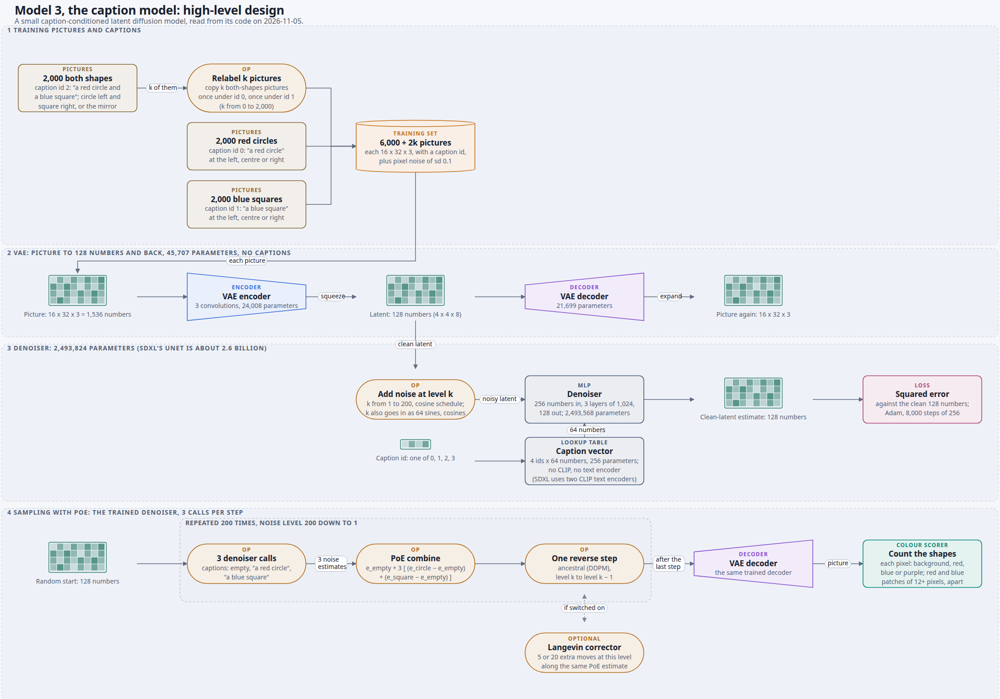
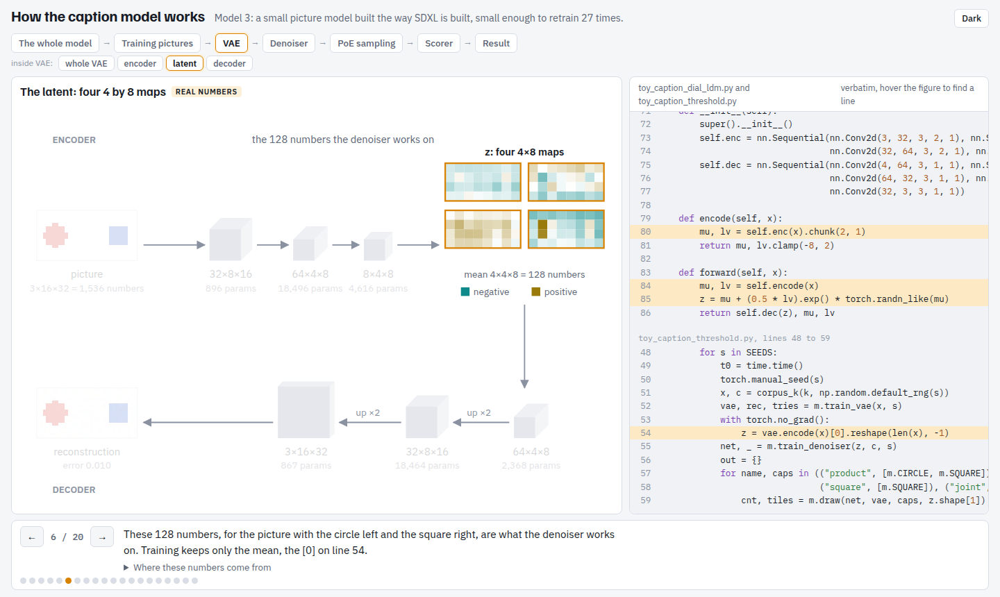

# How does the caption model work?

Pictures of model 3, the small caption-conditioned latent diffusion model that the co-occurrence
write-up trains, so its parts can be explained to someone who has not read the code.

## What is in here

One high-level design of the model with its spec and dated copy; other entries may follow.

## The diagram: the-caption-model-high-level-design-explainer

**What it shows**

Model 3, the caption model, in four lanes read top to bottom. Lane 1 is the training data: 2,000
red circles (caption id 0), 2,000 blue squares (id 1) and 2,000 both-shapes pictures (id 2), with
the relabelling step that copies k of the both-shapes pictures under id 0 and again under id 1.
Lane 2 is the VAE, 45,707 parameters, which turns a 16 x 32 x 3 picture into 128 numbers and back
and never sees a caption. Lane 3 is the denoiser, a 2,493,824-parameter MLP with three hidden
layers of 1,024: it takes 128 noisy latent numbers, the noise level and a caption id looked up as a
64-number vector, and returns its estimate of the clean latent. There is no CLIP and no text
encoder; SDXL's UNet is about 2.6 billion parameters and reads its prompt through two CLIP text
encoders. Lane 4 is sampling with PoE: three denoiser calls per step (empty, "a red circle", "a
blue square") combined as e_empty + 3 [(e_circle − e_empty) + (e_square − e_empty)], 200 reverse
steps, the optional Langevin corrector, the VAE decoder and the colour scorer.

**How we got it**

Read from `artifacts/notes/what-poe-loses-when-it-composes/`: `toy_caption_dial_ldm.py` (VAE,
Denoiser, training, `draw`), `toy_caption_threshold.py` (exact-count relabelling),
`toy_caption_corrector.py` (the corrector), `toy_sampler_hybrids.py` (pictures, noise schedule) and
`toy_blob_scorer.py` (the colour scorer). Both parameter counts were recomputed from the layer
shapes. The spec is `the-caption-model-high-level-design-explainer.json`, drawn by the hld-diagram
skill's `draw_hld.py` in its deep-learning look, and published as a private page at
https://claude.ai/artifact/4AJAhtvrZyut1uvvbKb2nq. The page's closed disclosure gives the file and
line for every box.

**What it lets you say**

What the model is, what goes in and what comes out at each stage, and how big each part is, with
the comparison to SDXL beside the two parts that differ most: the denoiser's size and the caption
lookup in place of a text encoder.

**What it cannot say**

Any result. The compose counts live in the
[plain-words write-up](../../results/how-much-co-occurrence-the-product-needs/plain-figures/README.md).
No sample pictures sit on the boxes in this version. The one-caption sampler, the older
random-share relabelling and the template-library scorer are described in the disclosure and not
drawn.

### Versions

- `the-caption-model-high-level-design-explainer__2026-11-05.svg`: version 1, 23 parts and 21
  arrows in four lanes.

**Held since 2026-11-05.** The referrer line is owed: the write-up's README should link this
diagram where it introduces model 3, and this run was told not to edit the write-up.

## The walk-through: how-the-caption-model-works

**What it shows**

Model 3 in 11 screens, one job each, published as a private page at
https://claude.ai/artifact/GUr6NB6iSGAmTzgSbMCaAn. It runs from a training picture and its caption id, through the VAE
(16 x 32 x 3 to 128 numbers and back), the denoiser's three inputs and its clean-latent guess, the caption as a row of a
learned 4 x 64 table beside SDXL's tokens and two text encoders, one training step, 200-step sampling for one caption and
for PoE, and what relabelling adds to the training set. It ends on the saved PoE samples for every relabelling count and
run, and the Langevin corrector on 8 models. The anchors (`#caption-is-a-label` and ten others) are listed in `SPEC.md`.

**How we got it**

`build_scene_data.py` traces every shape with one hooked forward pass, retrains one model on CPU with the repo's own code
(2,000 relabelled, seed 20261022, VAE error 0.0100), records its latent, denoiser inputs and outputs, caption table and two
trajectories, and packs the saved npz samples into `page-images/`. `build_page.py` joins `page-src.html`, those numbers, the
pictures and the source lines read verbatim into `how-the-caption-model-works.html`. It passed
`check_scene.mjs` with nothing to fix on all 11 screens.

**What it lets you say**

What each part takes in and gives out and how big it is, that a caption is a label id and never words, how one picture
and one PoE picture are made, and what the saved samples look like at each relabelling count, with and without the
corrector.

**What it cannot say**

The retrained model's pictures are not the saved runs' pictures. Results beyond what the saved samples and counts show
belong to the [plain-words write-up](../../results/how-much-co-occurrence-the-product-needs/plain-figures/README.md).

### Versions

- `how-the-caption-model-works.html`, 2026-11-05: version 1, 11 screens.

**Held since 2026-11-05.** The referrer line is owed here too: the write-up's README should link this page where it
introduces model 3, and this run was told not to edit the write-up.

## The cascade: the-caption-model-cascade

**What it shows**

Model 3 as one map that cascades into its parts, in 20 presses, published as a private page at
https://claude.ai/artifact/FKqaXfcQha6hE4AAeMNAfU. A strip at the top always shows where you are:
the whole model, then training pictures, VAE, denoiser, PoE sampling, scorer and result, with a
second row for the parts inside the one that is lit. Each screen puts one picture beside the
verbatim source lines it depicts, lit for that screen; hovering a part of the picture lights its
line. Inside the denoiser it shows the noise level as 64 sine and cosine features (drag the level),
the caption as the 4 by 64 learned lookup table with no CLIP or text encoder, the cosine between
the four rows, and where the 2,493,824 parameters sit beside an area-true square for SDXL's UNet
of about 2.6 billion. It ends on the write-up's figures 06 and 08, unchanged, and a closing screen
saying that only the captions on the both-shapes pictures differ across the 27 models.

**How we got it**

`the-caption-model-cascade-export.py` imports the repo's own code unchanged, retrains one model
on the laptop GPU (0 relabelled pictures, seed 20261022, VAE error 0.0101, 38 seconds), and writes
`the-caption-model-cascade-export.json`: per-layer parameter counts (they sum to 45,707 and
2,493,824), one picture's 128-number latent and reconstruction, the trained caption table,
decoded clean-latent guesses along 200-step runs for the joint caption, "a red circle" and PoE,
and 8 final samples per caption with the Python scorer's labels. The page draws the training
pictures from a line-for-line port of `draw()` in `toy_sampler_hybrids.py` and runs a port of the
colour scorer's `read()` on the exported samples; it agreed with the Python labels on all 24. The
page passed `check_scene.mjs` with nothing to fix on all 20 presses.

**What it lets you say**

What model 3 is, how big each part is, what goes in and comes out at each stage, that a caption
is a row number rather than words, and what the relabelling experiment changes, with the code
line for each claim.

**What it cannot say**

The retrained model is not one of the 27 reported models: its 8 PoE samples are faint smears the
scorer calls nothing readable, where the reported 0-relabelled models mostly draw a purple blob.
The noise mixed into the latent on the denoiser screen and the corrector schematic are
illustrative and marked so. Every count comes from the
[plain-words write-up](../../results/how-much-co-occurrence-the-product-needs/plain-figures/README.md)
and its saved figures.

### Versions

- `the-caption-model-cascade.html`, 2026-11-05: version 1, 20 presses.

**Held since 2026-11-05.** The referrer line is owed: the write-up's README should link this page
where it introduces model 3, and this run was told not to edit the write-up.
