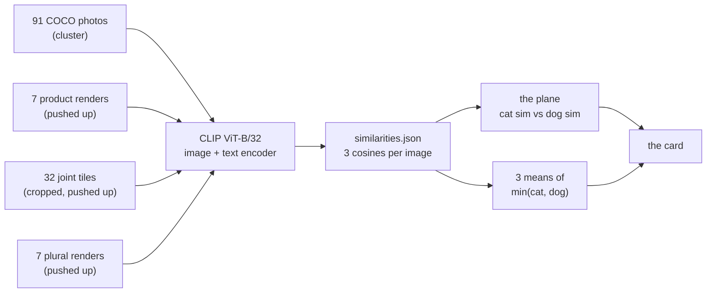

# 📊 Does the hybrid fit both captions better than a real photograph does?

## Recommended prompt (after this plan completes)

```
/sync-plan-tree @plans/10-what-poe-loses-when-it-composes/does-the-hybrid-fit-both-captions.md — <one line on what actually happened>
```

## Position in the plan tree

| Step | Plan | What it does |
|------|------|-------------|
| previous | [What PoE loses when it composes](what-poe-loses-when-it-composes.md) | States why the product lands on a chimera rather than on two animals |
| **current** | **Does the hybrid fit both captions better than a real photograph does?** | **Measures the chimera claim in CLIP's shared image-and-text space, on images already on disk** |
| next | [Can a toy reproduce the hybrid?](route-structural-can-a-toy-reproduce-the-hybrid.md) | Rebuilds the same failure at a scale where the maximum can be computed |

## Table of contents

- [Position in the plan tree](#position-in-the-plan-tree)
- [Quick context: where you are](#quick-context-where-you-are)
- [Considerations](#considerations)
- [The claim](#the-claim)
- [Why this plan exists](#why-this-plan-exists)
- [What happens (visual)](#what-happens-visual)
- [Description: what to build](#description-what-to-build)
- [Purpose and goal](#purpose-and-goal)
- [Tasks](#tasks) — things for Claude to execute
- [Instructions](#instructions) — things for you to do manually
- [What has to pass before this runs](#what-has-to-pass-before-this-runs)
- [Figure Catalog](#figure-catalog)
- [Orchestration](#orchestration-keeping-catalogs-and-plan-files-in-sync)
- [Code references](#code-references)
- [Next step](#next-step)
- [Error Matrix](#error-matrix)

## Quick context: where you are

Navigation: ⬅️ [Previous](#position-in-the-plan-tree) | 📋 [TOC](#table-of-contents) | [Next](#considerations) ➡️

**The measurement.** Ask CLIP how well each of three kinds of picture matches the phrase "a photo
of a cat" and the phrase "a photo of a dog", and compare them on the weaker of the two.

**The claim being tested.** This scope argues the product of two experts returns one fused animal
because a product of two caption probabilities is maximised by a picture that is ambiguously both,
rather than by a picture holding two separate animals. If that is right, a fused render should
satisfy both single-animal captions at once better than a real photograph of a cat beside a dog
does. If true, the plane in the figure puts the product renders up and to the right of the
photographs. If false, the photographs sit at least as high on the weaker caption, and the
chimera-as-argmax story needs the joint distribution rather than CLIP to carry it.

**The three sets.**

| Set | n | Where it lives |
|---|---|---|
| real both-animal photographs | 91 | COCO train2017 on the cluster, named by `manifest.json`, with 40 of 131 struck off by [the by-eye audit](../../../4-inclusive-captions/artifacts/results/how-many-photos-the-inclusive-captions-pilot-can-train-on/audit-verdicts.json) |
| plain product renders, cat × dog | 7 | `3-understanding-compositionality/artifacts/results/what-sdxl-already-knows/poe-against-the-joint/does-poe-of-cats-and-dogs-match-the-joint/tiles/cat__x__dog/seed01..07/poe.png`, 1024 px, gitignored |
| joint prompt renders, cat × dog | 32 | cropped from [where the joint prompt succeeds](../../../supervisor-meeting/1-inference-only/0-reference-where-the-joint-prompt-succeeds.png), an 8 × 4 grid at 320 px a tile |
| plural product renders, cats × dogs | 7 | `.../tiles/cats__x__dogs/seed01..07/poe.png`, carried as a fourth point on the plane; seed08 holds only a joint render |

Seven seeds are covered by both render sets, so the paired read is over seven.

**This plan's job.** Produce the plane, the three means and the card, and say whether the product
renders beat the photographs on the weaker caption and by how much. Nothing is trained and nothing
is rendered.

**For the full picture:** [what PoE loses when it composes](what-poe-loses-when-it-composes.md),
and [the compose rate](../../../context/world/compose-rate.md) for what this project's usual
instrument counts, which is not what is counted here.

## Considerations

Navigation: ⬅️ [Previous](#quick-context-where-you-are) | 📋 [TOC](#table-of-contents) | [Next](#the-claim) ➡️

**Expected runtime.** Minutes. 138 images through CLIP ViT-B/32 on one GPU node.

**Prerequisites.** Cluster reachable at `mscluster84`; the render tiles pushed there, since
`artifacts/results/` is gitignored and git will not carry them.

**Environment facts this plan depends on.**

- COCO train2017 is at `/datasets/mmolefe/coco2017`, and the pool manifest at
  `/datasets/mmolefe/poe_repair_min/outputs/inclusive_captions_pool/manifest.json`. Neither exists
  on the laptop, which has no `/datasets` mount at all.
- The `co3` env at `/home-mscluster/mmolefe/miniforge3/envs/co3/bin/python` holds torch 2.5.1 and
  transformers 4.44.1. No torch exists on the laptop, in any env.
- `openai/clip-vit-base-patch32` is already in the cluster's Hugging Face cache, so the run needs
  no network.
- Large outputs go to `/datasets`, never to `/home-mscluster`, per
  [storage](../../../environment/storage.md).

**Known issues.** See the [Error Matrix](#error-matrix).

## The claim

Navigation: ⬅️ [Previous](#considerations) | 📋 [TOC](#table-of-contents) | [Next](#why-this-plan-exists) ➡️

**The product renders' weaker single-animal CLIP similarity is higher than the real photographs',
because a fused animal reads as a partial match to both captions where a photograph spends half
its frame on each animal.**

**Why this matters right now:** the chimera-as-argmax argument is currently stated and drawn but
never measured against real photographs of the thing it says the product should have produced.
This is the cheapest measurement that can embarrass it.

## Why this plan exists

Navigation: ⬅️ [Previous](#the-claim) | 📋 [TOC](#table-of-contents) | [Next](#what-happens-visual) ➡️

- **The gap.** The scope asserts that the product's maximum sits on an ambiguously-both image. The
  evidence for it is renders that look fused and a diagram of a product of two densities. Nothing
  has compared a fused render against a real two-animal photograph in a space where both can be
  scored by the same ruler.

- **The approach.** CLIP puts images and captions in one space, so the same two captions can be
  scored against a render and against a photograph. The quantity the argument predicts is the
  weaker of an image's two single-animal similarities: an image that is unambiguously one animal
  has a low one, and an image that is ambiguously both has two middling ones.

- **Key insights.**
  1. A product is maximised where both factors are large at once, which is the weaker-of-two
     reading, not the sum.
  2. The photographs are the control the argument needs: they are what a picture holding two
     animals actually looks like.
  3. The joint prompt renders are the third set because the project already treats them as the
     thing the product fails to be.

## What happens (visual)

Navigation: ⬅️ [Previous](#why-this-plan-exists) | 📋 [TOC](#table-of-contents) | [Next](#description-what-to-build) ➡️



What one point on the plane is, worked on the toy, seed 3 of cat × dog:

```
                        sim("a photo of a cat")   sim("a photo of a dog")   min
  product render            0.___                     0.___                 0.___   ← the claim
  joint render              0.___                     0.___                 0.___     says this
  a COCO photograph         0.___                     0.___                 0.___     column is
                                                                                      biggest on
                                                                                      row 1
```

## Description: what to build

Navigation: ⬅️ [Previous](#what-happens-visual) | 📋 [TOC](#table-of-contents) | [Next](#purpose-and-goal) ➡️

1. **A gather step.** Resolve the 91 accepted COCO paths from `manifest.json` and
   `audit-verdicts.json`; crop the 32 joint tiles out of the contact sheet; collect the 7 product
   and 7 plural render paths. Write one `sets.json` naming every image with its set and seed, and
   prove every path opens.
2. **An embed step**, running on the cluster. CLIP ViT-B/32 over every image, and over the three
   phrases. Writes `similarities.json`: one record per image with its set, its path, its three
   cosine similarities and the smaller of the two single-animal ones.
3. **A summary step.** Mean and standard deviation of the smaller single-animal similarity per set,
   with n, plus the per-seed paired difference between product and joint on the seven matched
   seeds.
4. **The figure.** The plane, three colours, six thumbnails pinned beside their own points.
5. **The card**, naming the axes, the data behind each point, the three means, and what the result
   cannot tell you.

## Purpose and goal

Navigation: ⬅️ [Previous](#description-what-to-build) | 📋 [TOC](#table-of-contents) | [Next](#tasks) ➡️

- **Purpose.** Put a number on the scope's central argument using images that already exist, before
  any of the more expensive reads it implies.
- **Goals.**
  1. One record per image with its three cosine similarities, on disk and rebuildable.
  2. One figure whose axes a reader can name without a legend.
  3. A card stating whether the product renders beat the photographs on the weaker caption, by how
     much, and what the measurement cannot say.

## Tasks

Navigation: ⬅️ [Previous](#purpose-and-goal) | 📋 [TOC](#table-of-contents) | [Next](#instructions) ➡️

**For Claude to execute.** Ask Claude to do these.

### 0. 🧭 Check this plan before working from it

- [ ] **0.1** Check this plan conforms and its instructions are concrete, before acting on it.
  - Paste: `/verify-plan @plans/10-what-poe-loses-when-it-composes/does-the-hybrid-fit-both-captions.md`
  - Done when: the report comes back clean, or its proposals have been applied.
- [ ] **0.2** Cross-reference this plan's terms against `context/`, `environment/`, `runbook/`,
  `report/` and any learning journey naming this project.
  - Paste: `/xref-pillar @plans/10-what-poe-loses-when-it-composes/does-the-hybrid-fit-both-captions.md`
  - Done when: the scan comes back with no candidates, or its proposed links have been applied.

▶ **Next: task 1.1**, the first real work.

### 1. 🔧 Gather the four sets and prove every path opens

◀ **Needs: [task 0.1](#0--check-this-plan-before-working-from-it)**, so the plan is known good
before anything runs off it.

- [x] ✅ **1.1 Crop the 32 joint-prompt tiles out of the contact sheet.** ✓ verified 2026-11-04: 32 tiles written, row 1 montage matches the sheet's first row with no label strip

    ```bash
    cd /home/molef/PhD/poe_repair_min-dog-and-rain && \
      python3 3-understanding-compositionality/scripts/hybrid_caption_fit/crop_joint_sheet.py
    ```

  - Produces: `3-understanding-compositionality/artifacts/results/what-sdxl-already-knows/what-the-captions-say/does-the-hybrid-fit-both-captions/joint-tiles/seed01.png` to
    `seed32.png`, 320 × 320 each, label strip removed.
  - **Done when:** 32 files exist and a montage of the first row matches rows 1 to 8 of the sheet
    by eye.

- [x] ✅ **1.2 Write `sets.json` naming every image in all four sets.** ✓ verified 2026-11-04: 91 photo, 7 product, 32 joint, 7 plural; 0 photographs missing on the cluster; matched seeds 1 to 7

    ```bash
    cd /home/molef/PhD/poe_repair_min-dog-and-rain && \
      python3 3-understanding-compositionality/scripts/hybrid_caption_fit/build_sets.py
    ```

  - Reads the pool manifest and the audit verdicts for the photograph set (cluster-side paths), and
    local paths for the three render sets.
  - Produces: `3-understanding-compositionality/artifacts/results/what-sdxl-already-knows/what-the-captions-say/does-the-hybrid-fit-both-captions/sets.json`, with `set`, `seed`
    or `coco_id`, and `path` per image.
  - **Done when:** the file lists 91 photographs, 7 product, 32 joint and 7 plural, and every local
    path opens with PIL.

▶ **Next: task 2.1**, which needs the images to be where the cluster can read them.

### 2. 🚀 Embed on the cluster

◀ **Needs: [task 1.2](#1--gather-the-four-sets-and-prove-every-path-opens)**, which names what to
copy.

- [ ] **2.1 Push the 46 render images to the cluster.**

    ```bash
    cd /home/molef/PhD/poe_repair_min-dog-and-rain && \
      python3 3-understanding-compositionality/scripts/hybrid_caption_fit/push_renders.py
    ```

  - Copies the product, joint and plural tiles to
    `/datasets/mmolefe/poe_repair_min/outputs/hybrid_caption_fit/images/`, because
    `artifacts/results/` is gitignored and `cluster.sh run` cannot carry them.
  - **Done when:** `scripts/cluster.sh sh "ls .../images | wc -l"` prints 46.

- [ ] **2.2 Run CLIP over every image and the three phrases.**

    ```bash
    cd /home/molef/PhD/poe_repair_min-dog-and-rain && \
      scripts/cluster.sh run "/home-mscluster/mmolefe/miniforge3/envs/co3/bin/python \
        3-understanding-compositionality/scripts/hybrid_caption_fit/embed_clip.py"
    ```

  - Model `openai/clip-vit-base-patch32`, read from the cluster's Hugging Face cache, no network.
  - Produces: `/datasets/mmolefe/poe_repair_min/outputs/hybrid_caption_fit/similarities.json`.
  - **Done when:** the file holds 137 records, each with `sim_cat`, `sim_dog`, `sim_both` and
    `sim_min`, and the log's last line prints the per-set count.

- [ ] **2.3 Pull the results and the six thumbnail photographs back.**

    ```bash
    cd /home/molef/PhD/poe_repair_min-dog-and-rain && \
      python3 3-understanding-compositionality/scripts/hybrid_caption_fit/pull_results.py
    ```

  - **Done when:** `similarities.json` is in the artifact folder locally and the chosen photograph
    thumbnails open.

▶ **Next: task 3.1**.

### 3. 📊 Summarise and draw

◀ **Needs: [task 2.3](#2--embed-on-the-cluster)**, whose numbers it reads.

- [ ] **3.1 Compute the three means and the paired read.**

    ```bash
    cd /home/molef/PhD/poe_repair_min-dog-and-rain && \
      python3 3-understanding-compositionality/scripts/hybrid_caption_fit/summarise.py
    ```

  - Produces: `summary.json`, holding per set the mean, standard deviation and n of `sim_min`, and
    the per-seed product-minus-joint difference on the seven matched seeds.
  - **Done when:** the file names all four sets and the seven paired seeds.

- [ ] **3.2 Draw the plane.**

    ```bash
    cd /home/molef/PhD/poe_repair_min-dog-and-rain && \
      python3 3-understanding-compositionality/scripts/hybrid_caption_fit/plot_plane.py
    ```

  - x is cosine similarity to "a photo of a cat", y is the same to "a photo of a dog", one point
    per image, the sets in separate colours, six example images pinned as thumbnails beside their
    own points.
  - Produces: `3-understanding-compositionality/artifacts/results/what-sdxl-already-knows/what-the-captions-say/does-the-hybrid-fit-both-captions/cat-dog-similarity-plane.png`.
  - **Done when:** the figure exists, both axes carry their phrase in full, and the six thumbnails
    sit beside the points they belong to.

▶ **Next: [instruction 5.1](#5--check-the-figure-before-the-card-is-written)**.

### 4. 📝 Write the card

◀ **Needs: [instruction 5.1](#5--check-the-figure-before-the-card-is-written)**, your yes on the
axes and the six thumbnails.

- [ ] **4.1 Write the artifact card.**
  - `3-understanding-compositionality/artifacts/results/what-sdxl-already-knows/what-the-captions-say/does-the-hybrid-fit-both-captions/README.md`, naming the axes, the data
    behind each point, the three means with their standard deviations and n, the paired read, and
    what the measurement cannot tell you. Cosine similarity runs from −1 to 1, and the card says
    what a difference of the size found actually looks like.
  - **Done when:** the card states whether the product renders beat the photographs on the weaker
    caption and by how much.

▶ **Next: the close out**.

### Close out. 🔄 Record what this plan taught

◀ **Needs:** every group above attempted, including the ones that went red.

- [ ] **Capture the failures this plan hit**, while they are still fresh.
  - Paste: `/ingest-error-pattern --from-run-log @plans/10-what-poe-loses-when-it-composes/does-the-hybrid-fit-both-captions.md`
  - Done when: each failure has a catalog entry, or there were none to record.
- [ ] **Bring the tree current** with what actually happened.
  - Paste: `/sync-plan-tree @plans/10-what-poe-loses-when-it-composes/does-the-hybrid-fit-both-captions.md — <one line on what you did>`
  - Done when: statuses, the running order and the Error Matrix match reality.

▶ **Next: what has to pass before this runs.**

## Instructions

Navigation: ⬅️ [Previous](#tasks) | 📋 [TOC](#table-of-contents) | [Next](#what-has-to-pass-before-this-runs) ➡️

**For you to follow manually.** Do these yourself.

### 5. 👁️ Check the figure before the card is written

◀ **Needs: [task 3.2](#3--summarise-and-draw)** done, so there is a figure to look at.

5.1 **Read the plane and say whether it is readable.**
   - Open `3-understanding-compositionality/artifacts/results/what-sdxl-already-knows/what-the-captions-say/does-the-hybrid-fit-both-captions/cat-dog-similarity-plane.png`.
   - Check the x axis reads "cosine similarity to: a photo of a cat" and the y axis the same for
     dog, both spelled out rather than abbreviated.
   - Check each of the six thumbnails sits beside the point it belongs to, and that you can tell
     from the thumbnail alone which set it came from.
   - Expected result: three clouds you can separate by eye, or an honest overlap.
   - ✅ If the axes read correctly and the thumbnails land on their points, say so and the card
     gets written.
   - ❌ If a thumbnail covers its own point or a cloud is unreadable, say which and it is redrawn.

▶ **Next: [task 4.1](#4--write-the-card)**, which needs your yes.

### 6. 👁️ Look at the two extremes at full resolution

◀ **Needs: [task 3.1](#3--summarise-and-draw)**, whose summary names them.

6.1 **Open the highest-scoring product render and the highest-scoring photograph at 1:1.**
   - Contact-sheet scale has already made a clear cat and dog read as a hybrid in this project, so
     judge these from the full-resolution file, not from the plane's thumbnail.
   - Record in one line what each actually shows.
   - ✅ If the top product render is visibly fused, the number and the picture agree.
   - ❌ If it holds two separate animals, say so: the measurement is then picking up something
     other than fusion, and the card must say that.

## What has to pass before this runs

Navigation: ⬅️ [Previous](#instructions) | 📋 [TOC](#table-of-contents) | [Next](#figure-catalog) ➡️

> **Why this checkpoint matters:** every number below is a cosine from one model. If the sets are
> wrong, the plane is a picture of the wrong thing.

- **Pass criteria:**
  - All 91 accepted photographs resolve to files that open on the cluster.
  - The 32 cropped joint tiles carry no label strip and no neighbouring tile's pixels.
  - The 7 product seeds and the 32 joint seeds overlap on exactly the seeds the paired read uses.

- **Fail criteria (STOP):**
  - Fewer than 60 photographs resolve: the control set is too small to compare against and the
    question goes back to the user.
  - The contact sheet's seed labels do not correspond to the product tiles' seed numbers: the
    paired read is then unfounded and only the unpaired means may be reported.

- **Partial pass guidance:** if the photographs cannot be reached at all, the two render sets are
  still worth comparing, and the card says the photograph set is pending and why.

## Figure Catalog

Navigation: ⬅️ [Previous](#what-has-to-pass-before-this-runs) | 📋 [TOC](#table-of-contents) | [Next](#orchestration-keeping-catalogs-and-plan-files-in-sync) ➡️

#### Generated during execution

| Item | Lane | Description | Generated by | Status | Details |
|------|------|-------------|--------------|--------|---------|
| The cat-dog similarity plane | — | One point per image; x is cosine similarity to "a photo of a cat", y to "a photo of a dog"; four sets in four colours; six thumbnails pinned beside their own points | `3-understanding-compositionality/scripts/hybrid_caption_fit/plot_plane.py`, task 3.2 | ⏳ | Saves to `3-understanding-compositionality/artifacts/results/what-sdxl-already-knows/what-the-captions-say/does-the-hybrid-fit-both-captions/cat-dog-similarity-plane.png` |

## Orchestration: keeping catalogs and plan files in sync

Navigation: ⬅️ [Previous](#figure-catalog) | 📋 [TOC](#table-of-contents) | [Next](#code-references) ➡️

| Step | Command | Triggered by | Outcome |
|------|---------|--------------|---------|
| Check the plan | `/verify-plan @plans/10-what-poe-loses-when-it-composes/does-the-hybrid-fit-both-captions.md` | task 0.1 | Conformance and thin instructions reported |
| Cross-reference the plan | `/xref-pillar @plans/10-what-poe-loses-when-it-composes/does-the-hybrid-fit-both-captions.md` | task 0.2 | Terms already documented elsewhere linked |
| Capture patterns | `/ingest-error-pattern --from-run-log @plans/10-what-poe-loses-when-it-composes/does-the-hybrid-fit-both-captions.md` | the close out, after any red run | Errors added to catalogs |
| Bring the tree current | `/sync-plan-tree @plans/10-what-poe-loses-when-it-composes/does-the-hybrid-fit-both-captions.md` | the close out | Statuses and the Error Matrix match reality |

## Code references

Navigation: ⬅️ [Previous](#orchestration-keeping-catalogs-and-plan-files-in-sync) | 📋 [TOC](#table-of-contents) | [Next](#next-step) ➡️

**File:** [the pool script](../../scripts/census/inclusive_captions_pool.py)
**Relevant section:** `COCO_ROOT`, `_images_dir()` and `EXCLUDED_BOTH`. They are where the
photograph paths and the 40 struck-off indices come from.

**File:** [the cluster driver](../../../scripts/cluster.sh)
**Relevant section:** `sh`, `run` and `pull`. Every cluster action in this plan goes through it.

## Next step

Navigation: ⬅️ [Previous](#code-references) | 📋 [TOC](#table-of-contents)

[Can a toy reproduce the hybrid?](route-structural-can-a-toy-reproduce-the-hybrid.md), which asks
the same question where the maximum of the product can be computed rather than sampled.

## Error Matrix

Navigation: ⬅️ [Previous](#code-references) | 📋 [TOC](#table-of-contents)

<details>
<summary>No failures catalogued yet</summary>

**Purpose**: Known issues and solutions. Regenerated by `/sync-plan-tree` after
`/ingest-error-pattern` adds entries.

#### From global catalog

#### From project catalog

</details>
