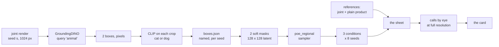

# 🧪 Is the layout the missing piece?

## Recommended prompt (after this plan completes)

```
/sync-plan-tree @plans/10-what-poe-loses-when-it-composes/is-the-layout-the-missing-piece.md — <one line on what actually happened>
```

## Position in the plan tree

| Step | Plan | What it does |
|------|------|-------------|
| previous | [Does the hybrid fit both captions?](does-the-hybrid-fit-both-captions.md) | Measures the chimera-as-argmax claim in CLIP's shared image-and-text space |
| **current** | **Is the layout the missing piece?** | **Hands the product a layout taken from the joint prompt's own render and asks whether that alone produces two clear animals** |
| next | [Can a toy reproduce the hybrid?](route-structural-can-a-toy-reproduce-the-hybrid.md) | Rebuilds the same failure where the maximum of the product can be computed |

## Table of contents

- [Position in the plan tree](#position-in-the-plan-tree)
- [Quick context: where you are](#quick-context-where-you-are)
- [Considerations](#considerations)
- [The claim](#the-claim)
- [Why this plan exists](#why-this-plan-exists)
- [What happens (visual)](#what-happens-visual)
- [Description: what to build](#description-what-to-build)
- [Purpose and goal](#purpose-and-goal)
- [Tasks](#tasks) — things for Claude to execute
- [Instructions](#instructions) — things for you to do manually
- [What has to pass before this runs](#what-has-to-pass-before-this-runs)
- [Figure Catalog](#figure-catalog)
- [Orchestration](#orchestration-keeping-catalogs-and-plan-files-in-sync)
- [Code references](#code-references)
- [Next step](#next-step)
- [Error Matrix](#error-matrix)

## Quick context: where you are

Navigation: ⬅️ [Previous](#position-in-the-plan-tree) | 📋 [TOC](#table-of-contents) | [Next](#considerations) ➡️

**What is being changed.** Plain product multiplies two experts over every pixel, so both experts
constrain every cell and the only image satisfying both is one animal that reads as either. This
plan gives each expert its own region of the latent grid, so the product runs over disjoint
coordinates instead of the same ones. The regions come from the joint prompt's own successful
render, which is why they are called an oracle layout: no deployed method would have them.

**The sampler change, in one line.** Plain product predicts
`eps_uncond + 7.5 × (d_A + d_B)` at every cell, where `d_A` and `d_B` are each expert's difference
from the unconditional prediction. This plan predicts `eps_uncond + 7.5 × (m_A ⊙ d_A + m_B ⊙ d_B)`,
where `m_A` and `m_B` are soft masks on the 128 × 128 latent grid that sum to 1 at every cell.

**What the six columns are.** One row per seed, every column from the same starting noise, rendered
in one loop so no precision difference can enter.

| Column | What it is | What it is for |
|---|---|---|
| joint prompt | one CFG branch on "a cat and a dog" | the ceiling, and the source of the layout |
| plain product | the existing PoE sampler | the floor; 0 clear pairs on held-out seeds |
| oracle layout | the two detected boxes, each prompt in its own | the experiment |
| random boxes | two boxes of the same areas, randomly placed | separates "a layout" from "the right layout" |
| swapped prompts | the oracle boxes with the two prompts exchanged | separates "two regions" from "the right region for each animal" |
| same prompt both | the oracle boxes with "a cat" in both | separates "regional masking makes two objects" from "it makes the two named objects" |

**The bar, fixed before anything runs.** 4 clear pairs out of the 8 judgeable seeds for the oracle
layout. This is the mark the scope already uses for a third-expert sheet and it is not changed after
the answer.

**For the full picture:** [what PoE loses when it composes](what-poe-loses-when-it-composes.md),
and [the compose rate](../../context/world/compose-rate.md) for the instrument this plan deliberately
does not use for the species calls.

## Considerations

Navigation: ⬅️ [Previous](#quick-context-where-you-are) | 📋 [TOC](#table-of-contents) | [Next](#the-claim) ➡️

**Expected runtime.** About an hour of GPU. 48 SDXL renders at 1024 px, 50 DDIM steps, plus 4
preview renders, on one RTX 3090. Nothing is trained.

**Prerequisites.** The cluster checkout fast-forwardable from this branch, and a free device on the
session node.

**Environment facts this plan depends on.**

- The laptop has no `/datasets` mount and an 8 GB GPU, so every render runs on the cluster through
  [the cluster driver](../../scripts/cluster.sh).
- Python is `/home-mscluster/mmolefe/miniforge3/envs/co3/bin/python`, never a bare `python`.
- Large outputs go to `/datasets/mmolefe/poe_repair_min/`, never `/home-mscluster`, and the disk
  guard checks the filesystem actually written to, per [storage](../../environment/storage.md).
- Never run a broad `find` on the cluster filesystem: the mounts hang it.

**Why the reference columns render first, in their own process.** A windowed sampler in this repo
once left an adapter attached while rendering what were meant to be plain references, which cost a
re-render. The joint and plain-product columns are produced by a separate invocation that never
imports the new composer.

**Known issues.** See the [Error Matrix](#error-matrix).

## The claim

Navigation: ⬅️ [Previous](#considerations) | 📋 [TOC](#table-of-contents) | [Next](#why-this-plan-exists) ➡️

**Given the joint prompt's own layout, the product of two experts over disjoint regions renders two
clear animals on at least 4 of the 8 judgeable seeds, where the same product over shared pixels
renders 0.**

**Why this matters right now:** every attempt so far has tried to supply the missing information as
a third expert in text space, and all of them failed. This asks whether the missing information was
never a vector at all, but a partition of the pixels.

## Why this plan exists

Navigation: ⬅️ [Previous](#the-claim) | 📋 [TOC](#table-of-contents) | [Next](#what-happens-visual) ➡️

**The gap.** Projective Composition (arXiv 2502.04549) gives the condition under which adding scores
is exact: the conditionals factorise over a disjoint coordinate partition. This project has measured
the failure at length and never manufactured the condition to see what happens when it holds.

**The approach.** Take the partition from the one render that already succeeds, so the layout is
correct by construction and the only thing being tested is whether a correct layout is sufficient.

**What makes it worth running.** Three outcomes are all informative. If the oracle layout composes
and the random boxes do not, the missing information is the layout and the open question becomes
where a layout comes from. If both compose equally, the layout content is irrelevant and regional
masking alone breaks the fusion, which is a weaker and more surprising result. If neither composes,
the partition was never the obstacle and the correction has to carry something else.

## What happens (visual)

Navigation: ⬅️ [Previous](#why-this-plan-exists) | 📋 [TOC](#table-of-contents) | [Next](#description-what-to-build) ➡️



One seed's arithmetic, worked, with the numbers filled in by task 1.3:

```
  detector box, cat      [ x0 , y0 , x1 , y1 ] pixels on a 1024 x 1024 render
  divided by 8           [ __ , __ , __ , __ ] cells on the 128 x 128 latent grid
  m_cat before blur      1 inside those cells, 0 outside
  after a 4-cell blur    edge ramps from 1 to 0 over about 4 cells
  after normalising      m_cat + m_dog = 1 at every one of the 16,384 cells
```

## Description: what to build

Navigation: ⬅️ [Previous](#what-happens-visual) | 📋 [TOC](#table-of-contents) | [Next](#purpose-and-goal) ➡️

1. **A layout script.** For each candidate seed, crop its tile out of the reference sheet, detect
   animal boxes with the same detector and filters the compose scorer uses, name each box with the
   crop classifier, and write one record per seed. A seed that does not yield exactly one cat box
   and one dog box is not judgeable and is replaced by the next seed that is.
2. **A mask builder.** Boxes to two soft masks on the 128 × 128 latent grid, in both overlap
   readings, with an overlay figure drawn on the joint render so a misplaced mask is visible before
   anything renders.
3. **The composer**, `poe_repair/composers/poe_regional.py`, beside `poe.py` and never modifying it.
4. **The sweep.** Reference columns in their own process, then the four regional conditions, all
   into one sheet.
5. **The calls and the card.** Every tile judged at full resolution into two clear animals, one
   hybrid, or one single animal, with the counts for every condition out of the same seeds.

## Purpose and goal

Navigation: ⬅️ [Previous](#description-what-to-build) | 📋 [TOC](#table-of-contents) | [Next](#tasks) ➡️

- **Purpose.** Test whether the information the product is missing is a partition of the pixels.
- **Goals.**
  1. A layout per judgeable seed, named by a validated instrument, with its own annotated figure.
  2. A composer that can be reused for any later regional experiment.
  3. A card stating the oracle layout's count and all three controls' counts out of the same seeds.

## Tasks

Navigation: ⬅️ [Previous](#purpose-and-goal) | 📋 [TOC](#table-of-contents) | [Next](#instructions) ➡️

**For Claude to execute.** Ask Claude to do these.

### 0. 🧭 Check this plan before working from it

- [ ] **0.1** Check this plan conforms and its instructions are concrete, before acting on it.
  - Paste: `/verify-plan @plans/10-what-poe-loses-when-it-composes/is-the-layout-the-missing-piece.md`
  - Done when: the report comes back clean, or its proposals have been applied.
- [ ] **0.2** Cross-reference this plan's terms against `context/`, `environment/`, `runbook/`,
  `report/` and any learning journey naming this project.
  - Paste: `/xref-pillar @plans/10-what-poe-loses-when-it-composes/is-the-layout-the-missing-piece.md`
  - Done when: the scan comes back with no candidates, or its proposed links have been applied.

▶ **Next: task 1.1**, the first real work.

### 1. 🔬 Find the layout in the joint renders

◀ **Needs: [task 0.1](#0--check-this-plan-before-working-from-it)**, so the plan is known good
before anything runs off it.

- [x] ✅ **1.1 Write `scripts/layout_from_joint_render.py`.** ✓ verified 2026-11-04: runs with --help and imports with no side effects
  - Crops a seed's tile out of the reference sheet (8 × 4 grid, 320 px tiles, 28 px label strip),
    detects animal boxes with GroundingDINO using the compose scorer's own filters, crops each box
    with the classifier's 0.08 pad, and classifies it cat against dog with CLIP ViT-B/32 over the
    same four templates.
  - Carries a disk guard that checks the filesystem it writes to.
  - **Done when:** the file imports with no side effects and `--help` prints.

- [x] ✅ **1.2 Run it on seeds 9 to 32 and pick the eight judgeable seeds.** ✓ verified 2026-11-04: seeds 9, 12, 16, 19, 20, 22, 25, 27 selected of 24 candidates, every rejection carrying which of the three gates stopped it
  - Every candidate is read, never stopping at the first eight, so the crop sheet covers the
    rejected seeds too.
  - A seed passes three gates in order, and a rejected seed says which one stopped it.
    1. The detector keeps exactly two animal boxes.
    2. The pair is usable as a partition: neither box covers more than 70% of the frame, and
       neither swallows more than half of the other. A box that is the whole picture hands its
       expert every cell, and two boxes one inside the other are not two regions.
    3. The two boxes are named one cat and one dog.
  - The species comes from the crop classifier, and from the eye where the crop sheet shows the
    classifier wrong. Its own call is kept beside the hand-given one in `boxes.json`, so the two
    can be counted against each other.
  - Held-out seeds 9 to 16 come first; the shortfall is filled from 17 upward in order.
  - Produces: `artifacts/results/is-the-layout-the-missing-piece/boxes.json`, one record per
    candidate seed with its boxes, both names per box, the margins, the geometry, and why a
    rejected seed was rejected; and `candidate-crops.png`, every candidate box cropped exactly as
    the classifier received it.
  - **Done when:** eight seeds are selected, every rejected seed carries its reason, and the crop
    sheet covers all 24 candidates.

- [x] ✅ **1.3 Draw the layouts on the renders.** ✓ confirmed by eye 2026-11-04, on the user's delegation: all 8 panels have the blue box on a cat and the red box on a dog
  - Produces: `artifacts/results/is-the-layout-the-missing-piece/detected-layouts.png`, one panel
    per selected seed: the joint render with both boxes drawn, each labelled with its call and
    margin, and its pixel box and its latent-cell box printed on the panel.
  - **Done when:** the figure exists and every panel carries both labels.

▶ **Next: [instruction 6.1](#6--check-the-layouts-before-any-mask-is-built)**, your read of the layouts.

### 2. 🔧 Turn each layout into two masks

◀ **Needs: [instruction 6.1](#6--check-the-layouts-before-any-mask-is-built)**, your yes on the boxes.

- [x] ✅ **2.1 Build both overlap readings.** ✓ verified 2026-11-04: max |m_cat + m_dog - 1| is exactly 0 over 8 seeds and both readings
  - Each box becomes a 128 × 128 indicator, blurred with a Gaussian whose edge ramp spans about 4
    cells, then the pair is normalised to sum to 1 at every cell. Reading A splits the overlap
    evenly; reading B gives the overlap to the expert whose box is smaller.
  - **Done when:** both readings satisfy `abs(m_A + m_B - 1) < 1e-5` at every one of the 16,384
    cells, printed as the maximum deviation.

- [x] ✅ **2.2 Draw the overlays.** ✓ verified 2026-11-04: 8 seeds x 2 readings drawn over their own renders, each mask on its own animal
  - Produces: `artifacts/results/is-the-layout-the-missing-piece/mask-overlays.png`, both readings
    for every selected seed, each drawn over the joint render it came from, upsampled 8× to pixel
    space, with the cat mask and the dog mask in two colours and the overlap region marked.
  - **Done when:** the figure exists and covers every selected seed in both readings.

▶ **Next: [instruction 7.1](#7--check-the-masks-sit-where-the-animals-are)**, your read of the overlays.

### 3. 🔧 The regional composer

◀ **Needs: [instruction 7.1](#7--check-the-masks-sit-where-the-animals-are)**, your yes on the masks.

- [ ] **3.1 Write `poe_repair/composers/poe_regional.py`.**
  - Predicts `eps_uncond + w × (m_A ⊙ (eps_A − eps_uncond) + m_B ⊙ (eps_B − eps_uncond))`, with the
    same three-branch UNet batch, the same scheduler calls and the same DDIM step as
    [the plain product composer](../../poe_repair/composers/poe.py), which is not modified.
  - Takes the two masks and the condition name, and writes its summary JSON naming the condition,
    the overlap reading and the mask provenance.
  - Carries a bootstrapping switch, default off, after MultiDiffusion (arXiv 2302.08113): for the
    first `n` steps each region is denoised against a constant-colour background so an object forms
    inside a small box rather than the box filling with background. The switch exists because
    fusing per-region predictions is MultiDiffusion's own operator and this is the one part of it
    the plain fusion leaves out.
  - **Done when:** masks of 0.5 everywhere reproduce the average of the two experts' differences,
    checked against a hand-computed tensor, to within fp16 noise, and the switch off reproduces
    the run with no bootstrapping byte for byte.

- [ ] **3.2 Render both overlap readings on two seeds.**
  - Produces: `artifacts/results/is-the-layout-the-missing-piece/overlap-readings.png`, two seeds ×
    two readings, with the joint render beside them.
  - **Done when:** four renders exist and sit in one figure.

▶ **Next: [instruction 8.1](#8--pick-the-overlap-reading)**, which is your choice to make.

### 4. 🚀 Render the sheet

◀ **Needs: [instruction 8.1](#8--pick-the-overlap-reading)**, which fixes one reading for the sweep.

- [ ] **4.1 Render the two reference columns, in their own process.**
  - The joint prompt and plain product on the eight selected seeds, from the shared starting noise,
    launched by an invocation that never imports `poe_regional`.
  - **Done when:** 16 renders exist on `/datasets` and the log shows no LoRA or adapter load.

- [ ] **4.2 Render the four regional conditions.**
  - Oracle layout, random boxes of the same areas, swapped prompts, and the same prompt in both
    boxes, on the same eight seeds from the same starting noise. The random boxes are drawn from
    one seeded generator whose seed is recorded.
  - **Done when:** 32 renders exist and every summary JSON names its condition.

- [ ] **4.3 Build the sheet.**
  - Produces: `artifacts/results/is-the-layout-the-missing-piece/three-conditions-sheet.png`, one
    row per seed, six image columns in the order of the table in
    [Quick context](#quick-context-where-you-are), plus a narrow strip beside the oracle column
    showing that seed's two masks.
  - **Done when:** the sheet has eight rows and every column is titled with what it is.

▶ **Next: task 5.1**, the calls.

### 5. 📊 Call every tile and write the card

◀ **Needs: [task 4.3](#4--render-the-sheet)**, so every tile exists at full resolution.

- [ ] **5.1 Call every tile at full resolution.**
  - Each of the 48 tiles is opened at 1024 px and called two clear animals, one hybrid, or one
    single animal. The compose scorer is not used for the species calls: it counts instances and
    cannot name a species.
  - Produces: `artifacts/results/is-the-layout-the-missing-piece/calls.json`, one record per tile
    with its seed, condition, call and a one-line reason.
  - **Done when:** 48 records exist and the per-condition counts are printed.

- [ ] **5.2 Write the card.**
  - Produces: `artifacts/results/is-the-layout-the-missing-piece/README.md`, stating the clear-pair
    count out of the judgeable seeds for all four regional conditions beside the two references,
    PASS or MISS against 4 of 8 for the oracle layout, what each control rules out, which overlap
    reading was used and why, and what the result cannot say about pairs whose joint prompt fails.
  - **Done when:** the card carries every count and names the seeds it is counted over.

▶ **Next: [instruction 9.1](#9--judge-the-sheet)**, your verdict.

### Close out. 🔄 Record what this plan taught

- [ ] **C.1** Capture any new failure pattern.
  - Paste: `/ingest-error-pattern --from-run-log @plans/10-what-poe-loses-when-it-composes/is-the-layout-the-missing-piece.md`
- [ ] **C.2** Bring the tree current.
  - Paste: `/sync-plan-tree @plans/10-what-poe-loses-when-it-composes/is-the-layout-the-missing-piece.md`

## Instructions

Navigation: ⬅️ [Previous](#tasks) | 📋 [TOC](#table-of-contents) | [Next](#what-has-to-pass-before-this-runs) ➡️

**For you to follow manually.** Do these yourself.

### 6. 👁️ Check the layouts before any mask is built

◀ **Needs: [task 1.3](#1--find-the-layout-in-the-joint-renders)** done, so there is a figure.

6.1 **Read `candidate-crops.png` first, then `detected-layouts.png`, both under
`artifacts/results/is-the-layout-the-missing-piece/`.**
   - The crop sheet is what the classifier was handed. A wrong name there is a classifier failure;
     a crop holding both animals is a box failure, and the two have different fixes.
   - For each of the eight panels in the layout figure, check the box labelled cat is on the cat
     and the box labelled dog is on the dog.
   - Check no box covers both animals, and no animal is missing a box.
   - ✅ If every panel's two boxes are on the right animals, say so and the masks get built.
   - ❌ If a box is on the wrong animal, say which seed: that seed is dropped and replaced by the
     next judgeable one, and the card records the drop.

▶ **Next: [task 2.1](#2--turn-each-layout-into-two-masks)**, which needs your yes.

### 7. 👁️ Check the masks sit where the animals are

◀ **Needs: [task 2.2](#2--turn-each-layout-into-two-masks)** done.

7.1 **Read `artifacts/results/is-the-layout-the-missing-piece/mask-overlays.png`.**
   - A mask in the wrong place makes every count afterwards meaningless, which is why this is a
     stop rather than a glance.
   - Check each coloured region covers its own animal and the blurred edge is a ramp a few cells
     wide, not a hard line and not a wash over the whole frame.
   - ✅ If both readings sit on their animals, say so.
   - ❌ If a mask is offset or inverted, say which seed and which reading.

▶ **Next: [task 3.1](#3--the-regional-composer)**, which needs your yes.

### 8. 👁️ Pick the overlap reading

◀ **Needs: [task 3.2](#3--the-regional-composer)** done, so both readings have been rendered.

8.1 **Read `artifacts/results/is-the-layout-the-missing-piece/overlap-readings.png` at full size.**
   - Two seeds, two readings each, with the joint render beside them for reference.
   - Decide which reading to run the sweep on, and say why in one line. That line goes in the card.
   - ✅ Either reading is a valid choice; the card records which and why.
   - ❌ If both readings produce the same picture, say so: the overlap is then not load-bearing and
     the card says the choice did not matter.

▶ **Next: [task 4.1](#4--render-the-sheet)**, which needs one reading fixed.

### 9. 👁️ Judge the sheet

◀ **Needs: [task 5.2](#5--call-every-tile-and-write-the-card)** done.

9.1 **Read `artifacts/results/is-the-layout-the-missing-piece/three-conditions-sheet.png`, then any
tile you want to check at 1024 px.**
   - Two renders that read as a clear cat and a clear dog at sheet scale have read as hybrids at
     full resolution in this project, so a call you doubt is checked on the tile, not on the sheet.
   - ✅ If you agree with the calls, the counts stand and the card is final.
   - ❌ If you disagree with any call, say which tile and what you see: `calls.json` and the card
     are rewritten to your call.

## What has to pass before this runs

Navigation: ⬅️ [Previous](#instructions) | 📋 [TOC](#table-of-contents) | [Next](#figure-catalog) ➡️

> **Why this checkpoint matters:** the layout is the whole independent variable. A box on the wrong
> animal produces a sheet that looks like an answer and is not one.

- **Pass criteria:**
  - Eight judgeable seeds found, each with exactly one cat box and one dog box above the 0.20
    margin floor.
  - Both masks sum to 1 at every cell, maximum deviation under 1e-5.
  - The reference columns rendered by a process that never imported the new composer.
  - Every render in the sheet from the same starting noise and the same precision.

- **Fail criteria (STOP):**
  - Fewer than eight judgeable seeds exist in 9 to 32: the sweep runs on however many there are and
    the bar is restated out of that number in the card, before the calls are made.
  - A reference column disagrees with the existing reference sheet by eye: something in the render
    path has changed and nothing is judged until it is found.

- **The verdict, written before the run.**
  - **Support:** the oracle layout reaches 4 or more clear pairs of 8, and the random-box control
    reaches fewer.
  - **Null:** the oracle layout reaches 1 or 0. A null is not reported until MultiDiffusion's own
    implementation has been reproduced and run on the same eight layouts, because a null from a
    composer written for this plan cannot separate "a partition is not enough" from "the composer
    is wrong". The route is
    `/drip-execute-plan --reproduce 2302.11552`-shaped, pointed at arXiv 2302.08113, and the
    bootstrapping switch is turned on first since it is the cheaper of the two checks.
  - **Inconclusive:** the oracle layout reaches 2 or 3.
  - **Layout content irrelevant:** the oracle layout reaches 4 or more and the random-box control
    reaches within 1 of it. The masking breaks the fusion; the layout does not.
  - **Regions without names:** the swapped-prompt or same-prompt control reaches within 1 of the
    oracle layout. Two regions produce two objects, and which expert governs which region does not
    decide what is drawn.

## Figure Catalog

Navigation: ⬅️ [Previous](#what-has-to-pass-before-this-runs) | 📋 [TOC](#table-of-contents) | [Next](#orchestration-keeping-catalogs-and-plan-files-in-sync) ➡️

#### Generated during execution

| Item | Lane | Description | Generated by | Status | Details |
|------|------|-------------|--------------|--------|---------|
| The candidate crops | — | Every candidate box over all 24 seeds, cropped exactly as the classifier received it, labelled with CLIP's call, its margin and the box's share of the frame; this is what separates a bad box from a bad call | `scripts/layout_from_joint_render.py`, task 1.2 | ✅ | `artifacts/results/is-the-layout-the-missing-piece/candidate-crops.png` |
| The detected layouts | — | One panel per selected seed: the joint render with both boxes drawn, each labelled with its species call, its CLIP margin, its pixel box and its latent-cell box | `scripts/layout_from_joint_render.py`, task 1.3 | ⏳ | `artifacts/results/is-the-layout-the-missing-piece/detected-layouts.png` |
| The mask overlays | — | Both overlap readings for every selected seed, each drawn over the joint render it came from, cat mask and dog mask in two colours, overlap marked | task 2.2 | ⏳ | `artifacts/results/is-the-layout-the-missing-piece/mask-overlays.png` |
| The two overlap readings | — | Two seeds × two readings, with the joint render beside them, at full resolution | task 3.2 | ⏳ | `artifacts/results/is-the-layout-the-missing-piece/overlap-readings.png` |
| The six-condition sheet | — | One row per seed; columns joint prompt, plain product, oracle layout, random boxes, swapped prompts, same prompt both; a mask strip beside the oracle column | task 4.3 | ⏳ | `artifacts/results/is-the-layout-the-missing-piece/three-conditions-sheet.png` |

## Orchestration: keeping catalogs and plan files in sync

Navigation: ⬅️ [Previous](#figure-catalog) | 📋 [TOC](#table-of-contents) | [Next](#code-references) ➡️

| Step | Command | Triggered by | Outcome |
|------|---------|--------------|---------|
| Check the plan | `/verify-plan @plans/10-what-poe-loses-when-it-composes/is-the-layout-the-missing-piece.md` | task 0.1 | Conformance and thin instructions reported |
| Cross-reference the plan | `/xref-pillar @plans/10-what-poe-loses-when-it-composes/is-the-layout-the-missing-piece.md` | task 0.2 | Terms already documented elsewhere linked |
| Capture patterns | `/ingest-error-pattern --from-run-log @plans/10-what-poe-loses-when-it-composes/is-the-layout-the-missing-piece.md` | the close out, after any red run | Errors added to catalogs |
| Bring the tree current | `/sync-plan-tree @plans/10-what-poe-loses-when-it-composes/is-the-layout-the-missing-piece.md` | the close out | Statuses and the Error Matrix match reality |

## Code references

Navigation: ⬅️ [Previous](#orchestration-keeping-catalogs-and-plan-files-in-sync) | 📋 [TOC](#table-of-contents) | [Next](#next-step) ➡️

**File:** [the plain product composer](../../poe_repair/composers/poe.py)
**Relevant section:** the whole file. The new composer copies its shape and this one is not modified.

**File:** [the corrector composer](../../poe_repair/composers/poe_langevin.py)
**Relevant section:** `run`, for how a composer takes extra per-step arguments and writes its own
summary JSON.

**File:** [the sampling primitives](../../poe_repair/methods/_sampling.py)
**Relevant section:** `run_cfg_poe`, lines 133 to 185. The three-branch UNet batch, the guided
difference, and the DDIM step the new sampler keeps unchanged.

**File:** [the crop classifier](../../scripts/census/crop_classifier_cat_vs_dog.py)
**Relevant section:** `ZeroShot`, `BOX_PAD` and `MIN_MARGIN`. How a detected box gets a species
name, and why the detector cannot do it.

**File:** [the frog and toad box reader](../../scripts/frog_toad_late_window_boxes.py)
**Relevant section:** the `detect_boxes` call with `CONF`, `MIN_BOX_FRACTION` and the NMS loop. The
detection call is copied from here rather than written fresh.

## Next step

Navigation: ⬅️ [Previous](#code-references) | 📋 [TOC](#table-of-contents)

[Can a toy reproduce the hybrid?](route-structural-can-a-toy-reproduce-the-hybrid.md), which asks
whether the same partition argument holds where the product's maximum can be computed rather than
sampled.

## Error Matrix

Navigation: ⬅️ [Previous](#code-references) | 📋 [TOC](#table-of-contents)

<details>
<summary>No failures catalogued yet</summary>

**Purpose**: Known issues and solutions. Regenerated by `/sync-plan-tree` after
`/ingest-error-pattern` adds entries.

#### From global catalog

#### From project catalog

</details>

## Cross-references

- The mention of **the regional composer** in [the plan for regrouping the core repo into project folders](../split-into-idea-repos.md#before-the-next-move).
