# 📒 Report: how much co-occurrence the product of two experts needs

**The exact product prefers the two-shape picture from the smallest overlap tested (a pair weight of 0.001), and its two samplers draw the pair half the time only at a weight between 0.3 and 0.5.** The toy multiplies a circle expert and a square expert, each an exact mixture of Gaussians over 16 by 32 colour pictures, so every draw can be checked against the distribution it was aiming at. A crisp pair is a draw whose nearest known picture is the red circle beside the blue square. Every count is out of 300 draws. What this means for a trained model is on [the page about what training must supply](what-poe-needs-from-training-to-draw-two-things-at-once.md), and the [index of exact-toy results](../../artifacts/results/the-exact-toy/how-much-co-occurrence-the-product-needs/../README.md) lists the rest.

> [!NOTE]
> No verdict is recorded. [The plan's step](../../plans/10-what-poe-loses-when-it-composes/today-how-much-co-occurrence-the-product-needs.md#steps) for the owner to read the figure against its written table is unticked, so this page reports the card's reading.

## Table of contents

- [Where the product and its samplers find the pair](#where-the-product-and-its-samplers-find-the-pair)
- [Why adding noised scores loses the pair](#why-adding-noised-scores-loses-the-pair)
- [How much the experts may disagree](#how-much-the-experts-may-disagree)
- [When captions set the overlap](#when-captions-set-the-overlap)
- [Whether it can draw a layout nobody trained on](#whether-it-can-draw-a-layout-nobody-trained-on)
- [Where the sources disagree](#where-the-sources-disagree)
- [What this cannot tell you](#what-this-cannot-tell-you)
- [Concepts this uses](#concepts-this-uses)
- [Where this came from](#where-this-came-from)
- [Still open](#still-open)

## Where the product and its samplers find the pair

Navigation: 📋 [TOC](#table-of-contents) | [Next](#why-adding-noised-scores-loses-the-pair) ➡️

| The first 0.5 of the dial | The whole dial | The draws behind the counts |
|---|---|---|
| <a href="../../artifacts/results/the-exact-toy/how-much-co-occurrence-the-product-needs/weight-sweep.png">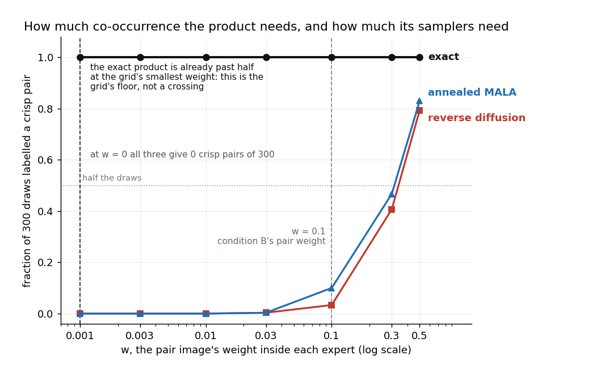</a> | <a href="../../artifacts/results/the-exact-toy/how-much-co-occurrence-the-product-needs/how-far-the-dial-has-to-go.png">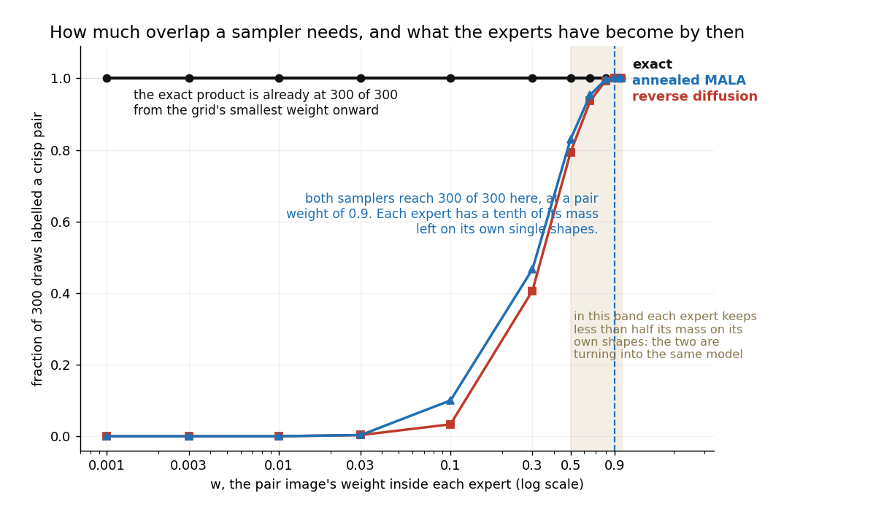</a> | <a href="../../artifacts/results/the-exact-toy/how-much-co-occurrence-the-product-needs/draws-across-weights.png">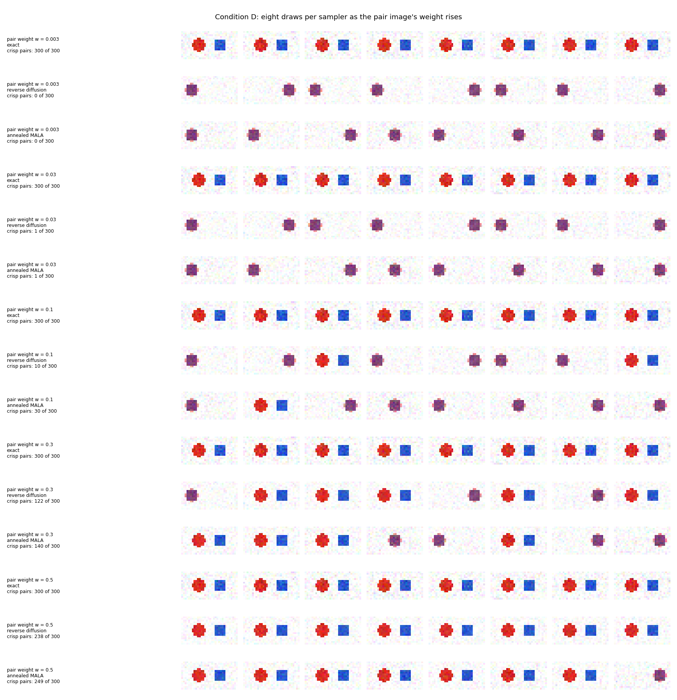</a> |
| x: the pair picture's weight inside each expert, log scale. y: fraction of 300 draws called crisp. One point is one sampler at one weight `verified` ([sweep counts](../../artifacts/notes/what-poe-loses-when-it-composes/toy-sampler-cooccurrence-sweep.json)) | Same axes, 0.001 to 0.99. In the shaded band each expert keeps under half its mass on its own shapes `verified` ([high-weight counts](../../artifacts/results/the-exact-toy/how-much-co-occurrence-the-product-needs/toy-high-overlap-sweep.json)) | Eight of the 300 draws per row, so the counts can be checked by eye `verified` |

**The exact product jumps from 0 to 300 crisp pairs at a pair weight of 0.001, the smallest non-zero weight on the grid.** A closed-form curve over 400 weights is already above half at its own lowest point, 0.00001, so 0.001 is the grid's floor and no crossing was located `stated` (the card).

| Pair weight | Exact product | Reverse diffusion | Annealed MALA |
|---|---|---|---|
| 0 | 0 | 0 | 0 |
| 0.001 | 300 | 0 | 0 |
| 0.1 | 300 | 10 | 30 |
| 0.3 | 300 | 122 | 140 |
| 0.5 | 300 | 238 | 249 |
| 0.9 | 300 | 300 | 300 |

## Why adding noised scores loses the pair

Navigation: ⬅️ [Previous](#where-the-product-and-its-samplers-find-the-pair) | 📋 [TOC](#table-of-contents) | [Next](#how-much-the-experts-may-disagree) ➡️

<a href="../../artifacts/results/the-exact-toy/how-much-co-occurrence-the-product-needs/summed-scores-against-the-true-noised-product.png">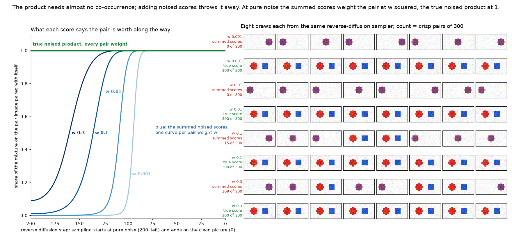</a>

**The loss happens where the two experts' noised scores are added.** The same reverse-diffusion sampler draws 300 of 300 crisp pairs when it is given the true score of the noised product. On the left, x is the reverse step (200 is pure noise, 0 the clean picture), y is the share of the mixture on the pair picture paired with itself, and one curve is one pair weight `verified` ([noised product file](../../artifacts/results/the-exact-toy/how-much-co-occurrence-the-product-needs/toy-noised-product.json)).

| Pair weight | Summed noised scores | True noised-product score |
|---|---|---|
| 0.001 | 0 | 300 |
| 0.01 | 0 | 300 |
| 0.1 | 15 | 300 |
| 0.3 | 109 | 300 |

## How much the experts may disagree

Navigation: ⬅️ [Previous](#why-adding-noised-scores-loses-the-pair) | 📋 [TOC](#table-of-contents) | [Next](#when-captions-set-the-overlap) ➡️

<a href="../../artifacts/results/the-exact-toy/how-much-co-occurrence-the-product-needs/the-leak-dial.png">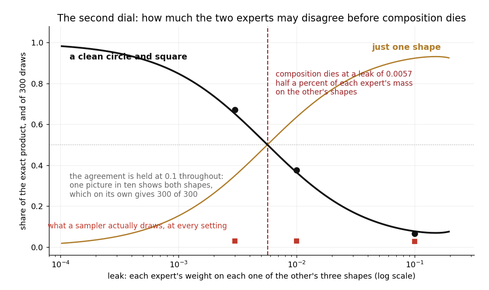</a>

**A leak of 0.00567 undoes a pair weight of 0.1.** The leak is each expert's weight on each one of the other expert's three shapes. x: leak, log scale. y: share of the exact product. Curves are closed form, black dots are exact draws and red squares are reverse-diffusion draws `verified` ([leak file](../../artifacts/results/the-exact-toy/how-much-co-occurrence-the-product-needs/toy-leak-sweep.json)).

| Leak | Exact: crisp | Exact: one shape | Reverse diffusion: crisp |
|---|---|---|---|
| 0 | 300 | 0 | 10 |
| 0.003 | 201 | 99 | 9 |
| 0.01 | 113 | 187 | 9 |
| 0.1 | 20 | 280 | 8 |

## When captions set the overlap

Navigation: ⬅️ [Previous](#how-much-the-experts-may-disagree) | 📋 [TOC](#table-of-contents) | [Next](#whether-it-can-draw-a-layout-nobody-trained-on) ➡️

| Competing captions | Exact product and one sampler | Four samplers |
|---|---|---|
| <a href="../../artifacts/results/the-exact-toy/how-much-co-occurrence-the-product-needs/competing-captions.png">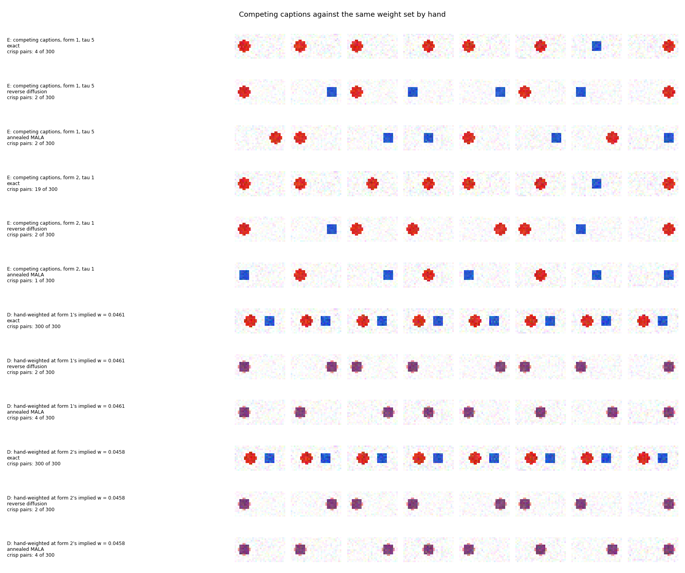</a> | <a href="../../artifacts/results/the-exact-toy/how-much-co-occurrence-the-product-needs/what-changes-as-overlap-rises.png">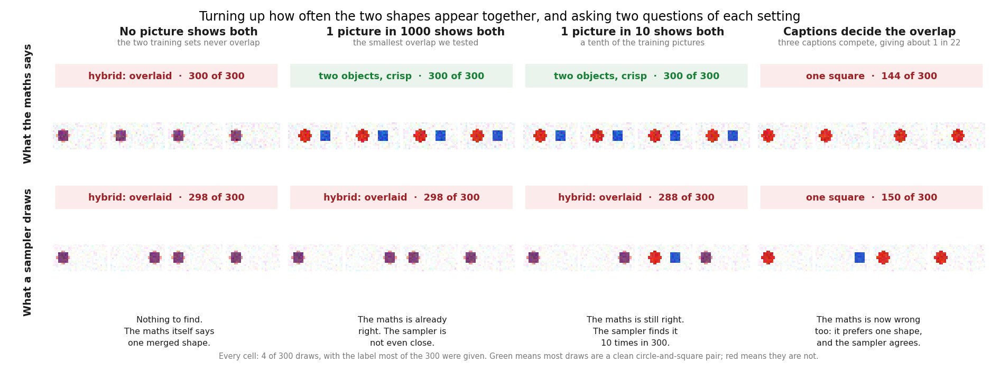</a> | <a href="../../artifacts/results/the-exact-toy/how-much-co-occurrence-the-product-needs/four-samplers-across-the-overlap-dial.png">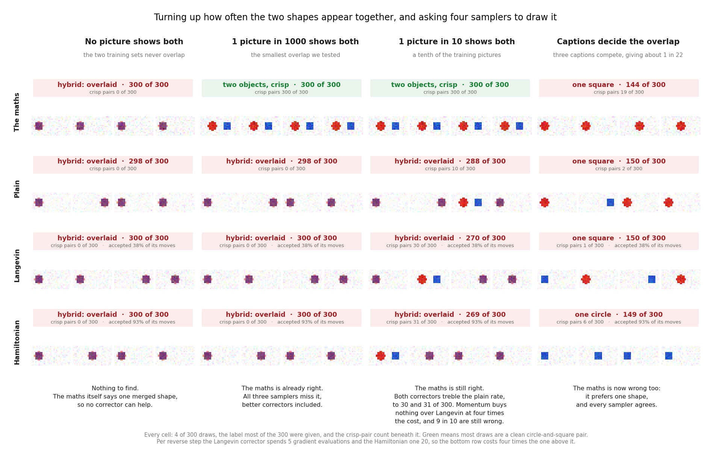</a> |
| Each row is one condition and one sampler, eight of 300 draws `verified` ([caption counts](../../artifacts/results/the-exact-toy/how-much-co-occurrence-the-product-needs/toy-caption-competition.json)) | Columns: no overlap, 1 picture in 1,000, 1 in 10, and the weight three competing captions imply `verified` | At a pair weight of 0.1: plain 10, Langevin 30, Hamiltonian 31 of 300, with 38% and 93% of corrector moves accepted `verified` |

**When three captions compete, the exact product itself stops drawing the pair.** The two scoring forms imply a pair weight of 0.0461 and 0.0458. At those weights the hand-set product draws 300 of 300 crisp pairs and the competing-caption product draws 4 and 19, with 296 and 281 single shapes. The card's account is that each expert now gives the other's lone shapes more weight than the pair `stated`.

## Whether it can draw a layout nobody trained on

Navigation: ⬅️ [Previous](#when-captions-set-the-overlap) | 📋 [TOC](#table-of-contents) | [Next](#where-the-sources-disagree) ➡️

| Two trained layouts, two unseen | Circle times square, divided by background |
|---|---|
| <a href="../../artifacts/results/the-exact-toy/how-much-co-occurrence-the-product-needs/can-it-make-a-third-arrangement.png">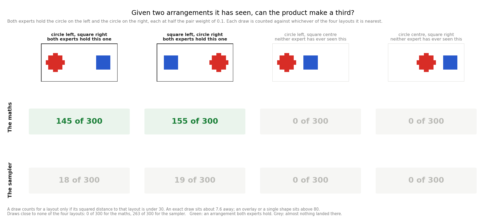</a> | <a href="../../artifacts/results/the-exact-toy/how-much-co-occurrence-the-product-needs/can-the-product-draw-a-layout-nobody-trained-on.png">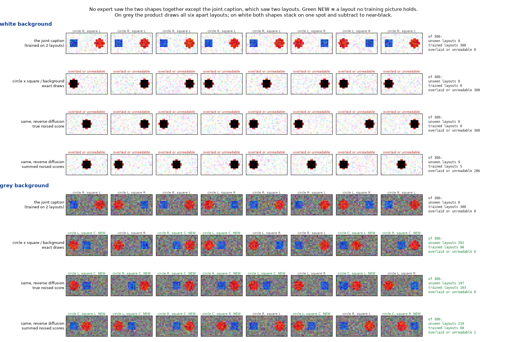</a> |
| Rows: exact product, reverse diffusion. A draw counts for a layout only within squared distance 30 of it `verified` ([layout file](../../artifacts/results/the-exact-toy/how-much-co-occurrence-the-product-needs/toy-layout-generalisation.json)) | Rows: joint caption, then the composition drawn three ways `verified` ([background file](../../artifacts/results/the-exact-toy/how-much-co-occurrence-the-product-needs/toy-factorized.json)) |

**The plain product returns only layouts its experts hold, and dividing by the background reaches new ones on grey.** On grey, the composition lands on the four unseen layouts in 202 of 300 exact draws, 197 with the true noised score and 210 with summed scores, against 0 for a joint caption. The recorded verdict for that test is support. On white the same counts are 0, 0 and 9 `verified`.

<a href="../../artifacts/results/the-exact-toy/how-much-co-occurrence-the-product-needs/the-chain-of-results.png">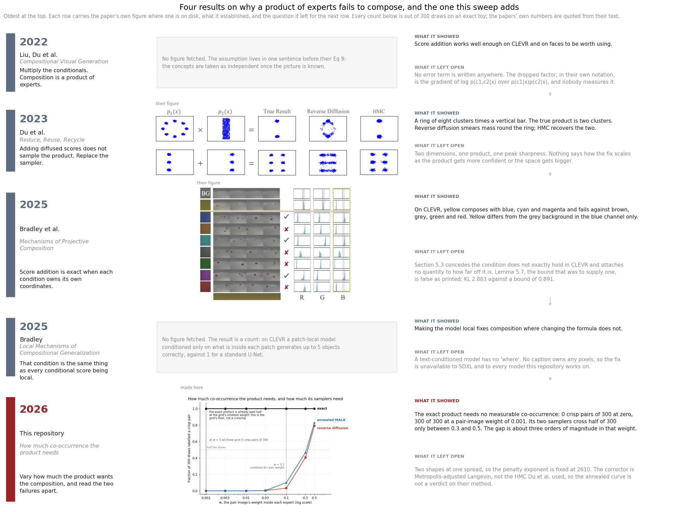</a>

The [chain of results](../../artifacts/results/the-exact-toy/how-much-co-occurrence-the-product-needs/the-chain-of-results.png) places this sweep after four earlier papers. Two of the four have no figure on disk, so their panels state the result in words `verified`.

## Where the sources disagree

Navigation: ⬅️ [Previous](#whether-it-can-draw-a-layout-nobody-trained-on) | 📋 [TOC](#table-of-contents) | [Next](#what-this-cannot-tell-you) ➡️

**Four recorded statements conflict with the saved numbers, and each is shown here unresolved.**

| What | One source | The other source |
|---|---|---|
| when the summed score's pair share reaches 1.000 | the card: only after step 95 to 160, depending on the weight | [the noised product file](../../artifacts/results/the-exact-toy/how-much-co-occurrence-the-product-needs/toy-noised-product.json): the share first reaches 0.5 at steps 94, 109, 135 and 160 and 0.999 at steps 80, 89, 101 and 111, for weights 0.001, 0.01, 0.1 and 0.3 (each is the highest step whose share is at or above that level) |
| single shapes from the exact competing-caption product | the card's prose: about 296 for both forms | the card's own table: 146 + 150 = 296 for form 1 and 137 + 144 = 281 for form 2 |
| the gap between what the product and its samplers need | the card: about three orders of magnitude | log10(0.3 / 0.001) = 2.48 and log10(0.5 / 0.001) = 2.70 from the grid's floor. From the closed form's lowest weight, log10(0.3 / 0.00001) = 4.48 and log10(0.5 / 0.00001) = 4.70 |
| reverse diffusion's crisp count at one density | the sweep: 10 at weight 0.1, 122 at 0.3, 238 at 0.5 | other runs of the same density: 14 (the card's earlier condition), 15 and [18](../../artifacts/results/the-exact-toy/can-a-classifier-push-fix-the-product/inclusive-captions-comparison.json) at 0.1; 109 and 115 at 0.3; 246 at 0.5 |

## What this cannot tell you

Navigation: ⬅️ [Previous](#where-the-sources-disagree) | 📋 [TOC](#table-of-contents) | [Next](#concepts-this-uses) ➡️

**Every crisp pair is the one picture both experts were given.** Of 300 exact draws, all sit nearer that layout than its mirror image (median squared distance 7.63 against 97.21), so the sweep measures when the product prefers a two-object picture it already holds `stated`.

**One spread fixes the numbers.** The spread σ = 0.1 sets the penalty exponent at 2,610. Another spread would move every count here, and the toy cannot say where a real model sits `stated`.

**The caption model's support is a choice.** Limiting each expert to pictures its caption describes would remove the leak and return the competing-caption condition to the hand-weighted one `stated`.

## Concepts this uses

Navigation: ⬅️ [Previous](#what-this-cannot-tell-you) | 📋 [TOC](#table-of-contents) | [Next](#where-this-came-from) ➡️

The toy numbers below are invented. The project numbers are from the files named above.

**A pairing weight**

Two friends each rate places. Ana gives her cafe 0.99 and a shared bar 0.01, and Ben gives his diner 0.99 and the same bar 0.01. Cafe with diner earns 0.99 × 0.99, then pays a distance penalty of 0.00001, leaving 0.0000098. Bar with bar pays nothing and keeps 0.01 × 0.01 = 0.0001, so it wins. The weight of a pairing is the first weight times the second times exp(-distance² / 4σ²). Here distance² is 104.4 and σ is 0.1, so a circle paired with a square pays exp(-2610). Read more on the [product of experts](../../../../../Obsidian/Artificial%20Intelligence/Generative%20Modeling/Product%20Of%20Experts.md#where-to-learn-this).

**The product of noised experts**

Noise shrinks that penalty. With ᾱ as the share of the clean picture left, the exponent becomes distance² / 4 × ᾱ / (ᾱσ² + 1 - ᾱ). At ᾱ = 1 this is 104.4 / 4 / 0.01 = 2,610. At ᾱ = 0 it is 0, so every pairing counts and the pair picture keeps only w² of the mixture, which is 0.0001 at w = 0.01. The [reverse step](../../../../../goal-setting/learning/deep-learning/diffusion-models/01-poe-derivation-foundations/plans/10-schedule-and-reverse-step.md) walks through ᾱ.

**The leak's break-even point**

If a pair is worth 4 and six rivals are worth 1 each, the rivals hold 6 of 10. Here the pair is worth 0.1² = 0.01. Each of six single shapes is worth leak × own weight, where own weight is (1 - 0.1 - 3 × leak) / 3. At leak 0.00567 that is 6 × 0.00567 × 0.2943 = 0.0100, level with the pair.

## Where this came from

Navigation: ⬅️ [Previous](#concepts-this-uses) | 📋 [TOC](#table-of-contents) | [Next](#still-open) ➡️

| What | Source | Mark |
|---|---|---|
| counts, formulas and how each run was made | [the co-occurrence card](../../artifacts/results/the-exact-toy/how-much-co-occurrence-the-product-needs/README.md), read 2026-11-21 | `stated` |
| weights to 0.5 and the closed form | [sweep file](../../artifacts/notes/what-poe-loses-when-it-composes/toy-sampler-cooccurrence-sweep.json) | `verified` |
| the written test | [the plan](../../plans/10-what-poe-loses-when-it-composes/today-how-much-co-occurrence-the-product-needs.md#the-test-written-before-any-run) | `stated` |
| the toy | [toy script](../../artifacts/notes/what-poe-loses-when-it-composes/toy_sampler_hybrids.py) | `stated` |

## Still open

Navigation: ⬅️ [Previous](#where-this-came-from) | 📋 [TOC](#table-of-contents)

- [ ] Read the sweep figure against the plan's table. The plan holds this step for the owner.
- [ ] Record a reading of the competing-caption rule. The implied weights (0.0461, 0.0458) sit above the 0.001 grid value and the exact counts (4, 19) sit at or below 150, and no reading is written down.
- [ ] Measure whether a real "a cat" expert's weight on dog pictures is above or below the toy's 0.00567 leak. The card names this as the test for a real model.
- [ ] Explain the one `divide by zero in log` warning in the competing-caption run. The card records it as unexplained.

<!-- built-to: PAGE_LOOK_FORMAT v1 -->
