# 📒 Report: what product of experts needs from training to draw two things at once

**In a small model built like SDXL, product of experts draws two separate shapes only after some both-shapes pictures also carry each single caption.** SDXL is too large to retrain freely, so these experiments use small models where every training picture and caption is controlled. A separate pair is a sample with a red patch and a blue patch of at least 12 pixels each, apart from each other. Every count is out of 300 samples.

| Experiment | Recorded verdict | The number | Source |
|---|---|---|---|
| two separately trained networks | null | 0 of 300 separate at every shared fraction from 0 to 0.5 | [trained experts file](../../artifacts/results/the-exact-toy/how-much-co-occurrence-the-product-needs/toy-trained-experts.json) |
| caption model, random share of pictures relabelled | inconclusive | best setting that keeps both single captions intact: 118 of 300 | [caption dial file](../../artifacts/results/the-exact-toy/how-much-co-occurrence-the-product-needs/toy-caption-dial-ldm.json) |
| caption model, exact number relabelled | no threshold found; "one picture is enough" contradicted | no number from 0 to 2,000 draws the pair in all three trainings | [up to 200](../../artifacts/results/the-exact-toy/how-much-co-occurrence-the-product-needs/toy-caption-threshold.json), [600 to 2,000](../../artifacts/results/the-exact-toy/how-much-co-occurrence-the-product-needs/toy-caption-threshold-600-1200-2000.json) |
| Langevin corrector, models with the single captions | support | median 260.5 of 300 plain, 300 with 5 corrector steps | [corrector file](../../artifacts/results/the-exact-toy/how-much-co-occurrence-the-product-needs/toy-caption-corrector.json) |
| the same corrector, models without them | null | 0 of 300 plain and corrected | [no single captions file](../../artifacts/results/the-exact-toy/how-much-co-occurrence-the-product-needs/toy-caption-corrector-no-single-captions.json) |
| circle times square, divided by background | support | 202 of 300 exact draws in unseen layouts on grey | [background file](../../artifacts/results/the-exact-toy/how-much-co-occurrence-the-product-needs/toy-factorized.json) |

## Table of contents

- [The failure on SDXL and the pilot](#the-failure-on-sdxl-and-the-pilot)
- [Experts written as formulas](#experts-written-as-formulas)
- [Two separately trained networks](#two-separately-trained-networks)
- [What the caption model trains on](#what-the-caption-model-trains-on)
- [What the caption model draws](#what-the-caption-model-draws)
- [What a corrector adds](#what-a-corrector-adds)
- [Composing with no both-shapes picture](#composing-with-no-both-shapes-picture)
- [Where the sources disagree](#where-the-sources-disagree)
- [What this cannot tell you](#what-this-cannot-tell-you)
- [Concepts this uses](#concepts-this-uses)
- [Where this came from](#where-this-came-from)
- [Still open](#still-open)

## The failure on SDXL and the pilot

Navigation: 📋 [TOC](#table-of-contents) | [Next](#experts-written-as-formulas) ➡️

| The failure | A pilot of the fix on SDXL |
|---|---|
| <a href="../../artifacts/results/the-exact-toy/how-much-co-occurrence-the-product-needs/plain-figures/01-the-problem-on-sdxl.png">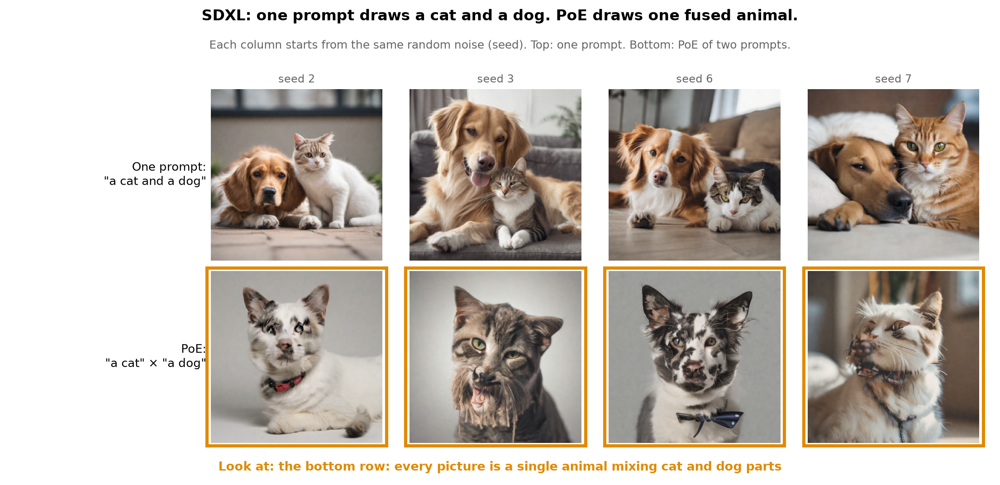</a> | <a href="../../artifacts/results/the-exact-toy/how-much-co-occurrence-the-product-needs/plain-figures/10-sdxl-inclusive-captions-pilot.png">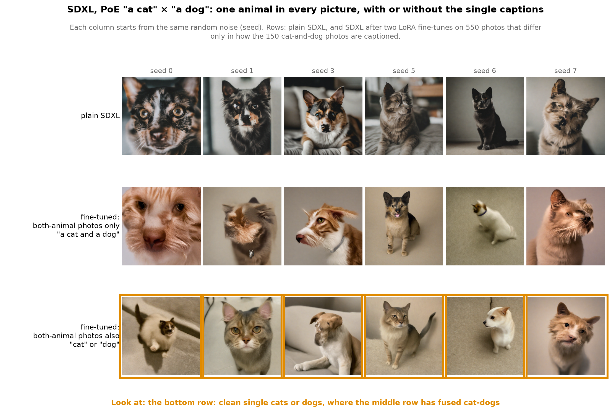</a> |
| Columns are seeds 2, 3, 6 and 7. One prompt draws both animals and the product draws one fused animal `verified` | On these six seeds the product still draws one animal in both fine-tunes. With the single captions, most are a clean cat or dog `stated`. The planned 128-seed test has not run |

## Experts written as formulas

Navigation: ⬅️ [Previous](#the-failure-on-sdxl-and-the-pilot) | 📋 [TOC](#table-of-contents) | [Next](#two-separately-trained-networks) ➡️

| What the product wants | When experts like the other shape | Where the sampler loses it |
|---|---|---|
| <a href="../../artifacts/results/the-exact-toy/how-much-co-occurrence-the-product-needs/plain-figures/02-formula-experts-what-poe-wants.png">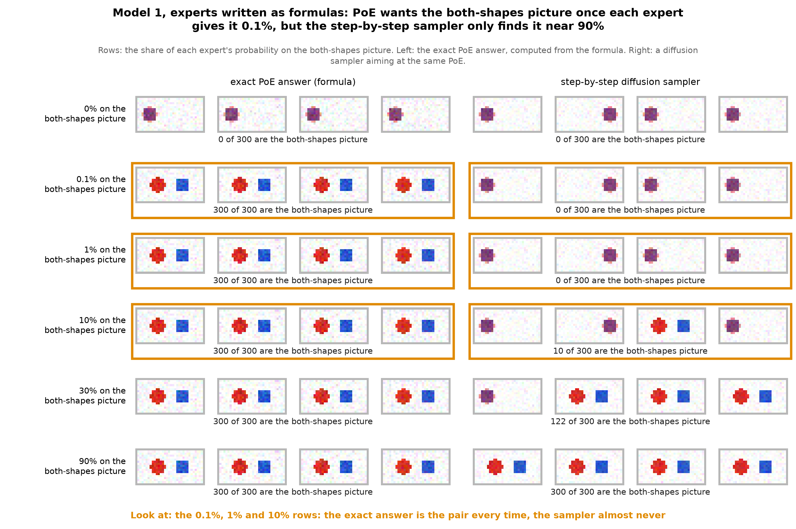</a> | <a href="../../artifacts/results/the-exact-toy/how-much-co-occurrence-the-product-needs/plain-figures/03-formula-experts-that-like-the-other-shape.png">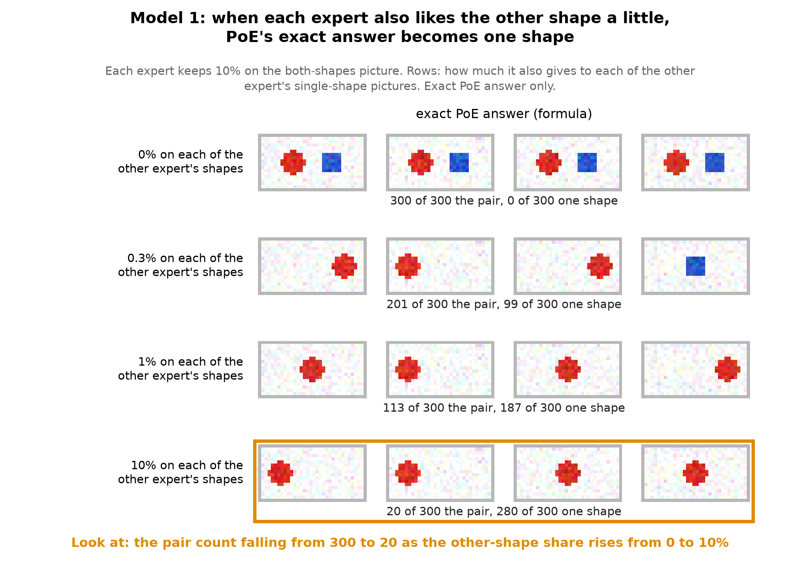</a> | <a href="../../artifacts/results/the-exact-toy/how-much-co-occurrence-the-product-needs/plain-figures/04-where-the-sampler-loses-the-pair.png">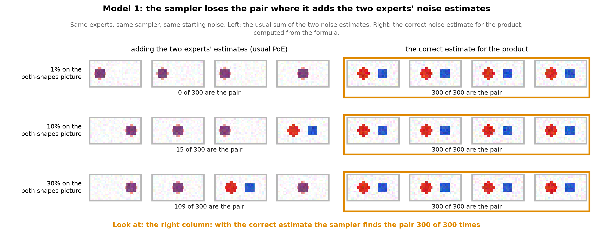</a> |
| Rows: each expert's share on the both-shapes picture. Columns: exact answer, diffusion sampler `verified` | Each expert keeps 10% on the pair. Rows: its share on each of the other's shapes `verified` | Left: added noise estimates. Right: the correct estimate for the product `verified` |

**The formula model separates what the product wants from what a sampler finds.** The full sweep is on [the co-occurrence page](how-much-co-occurrence-the-product-needs.md).

## Two separately trained networks

Navigation: ⬅️ [Previous](#experts-written-as-formulas) | 📋 [TOC](#table-of-contents) | [Next](#what-the-caption-model-trains-on) ➡️

<a href="../../artifacts/results/the-exact-toy/how-much-co-occurrence-the-product-needs/can-one-expert-learn-its-own-pictures.png">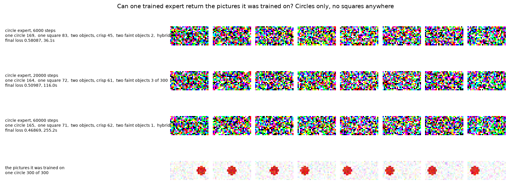</a>

**Two trained networks drew 0 of 300 separate pairs at every shared fraction, while this check on one expert draws only noise.** Rows are training budgets and each row shows eight of 300 draws. The check's draws are noise, yet the nearest-picture labeller still names them, 169 "one circle" at 6,000 steps `verified` ([check file](../../artifacts/results/the-exact-toy/how-much-co-occurrence-the-product-needs/toy-trained-preflight.json)). The picture has no card entry. The two runs are compared under [Where the sources disagree](#where-the-sources-disagree).

## What the caption model trains on

Navigation: ⬅️ [Previous](#two-separately-trained-networks) | 📋 [TOC](#table-of-contents) | [Next](#what-the-caption-model-draws) ➡️

| The one thing changed | Each caption's pool | How few pictures there are |
|---|---|---|
| <a href="../../artifacts/results/the-exact-toy/how-much-co-occurrence-the-product-needs/plain-figures/05-the-training-pictures.png">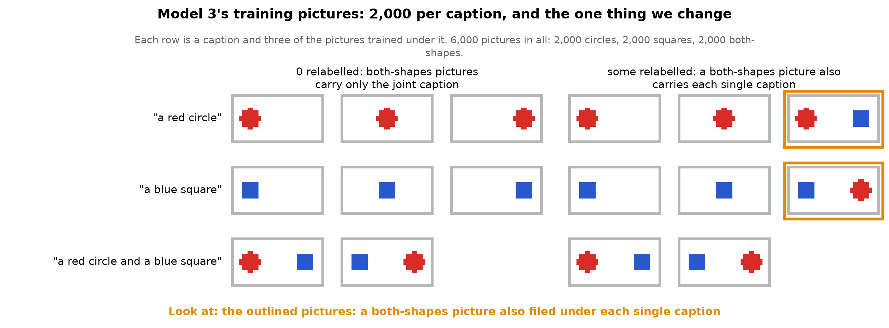</a> | <a href="../../artifacts/results/the-exact-toy/how-much-co-occurrence-the-product-needs/plain-figures/05b-the-training-set-with-and-without-relabelling.png">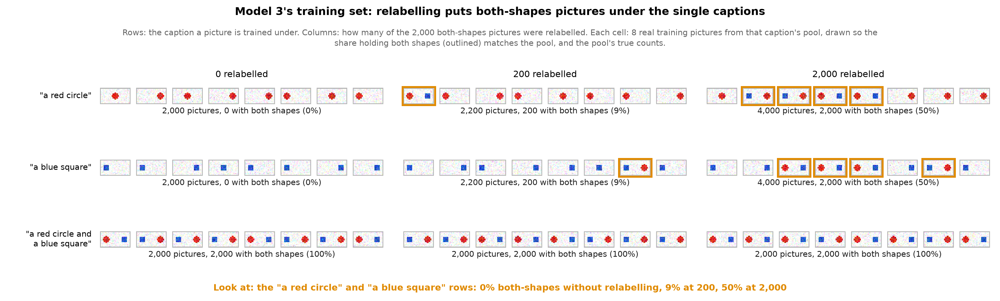</a> | <a href="../../artifacts/results/the-exact-toy/how-much-co-occurrence-the-product-needs/plain-figures/05c-what-each-caption-holds.png">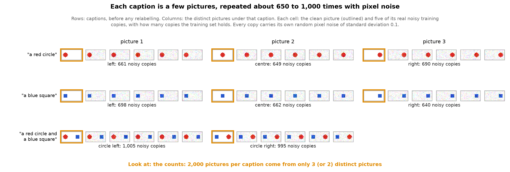</a> |
| Relabelled means a both-shapes picture is also trained under each single caption `verified` | Pool share holding both shapes: 0% at 0 relabelled, 9% at 200, 50% at 2,000 `verified` | 2,000 pictures per caption come from 3 distinct pictures, or 2 for the joint caption `verified` |

| The caption table | Why a hybrid is purple |
|---|---|
| <a href="../../artifacts/results/the-exact-toy/how-much-co-occurrence-the-product-needs/plain-figures/05d-the-caption-table.png">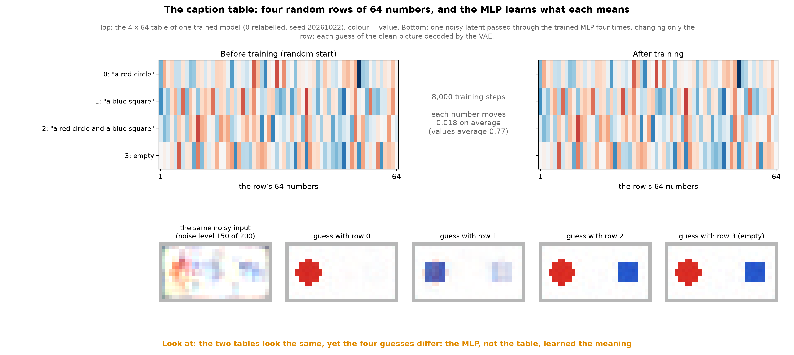</a> | <a href="../../artifacts/results/the-exact-toy/how-much-co-occurrence-the-product-needs/plain-figures/05e-why-the-hybrid-is-purple.png">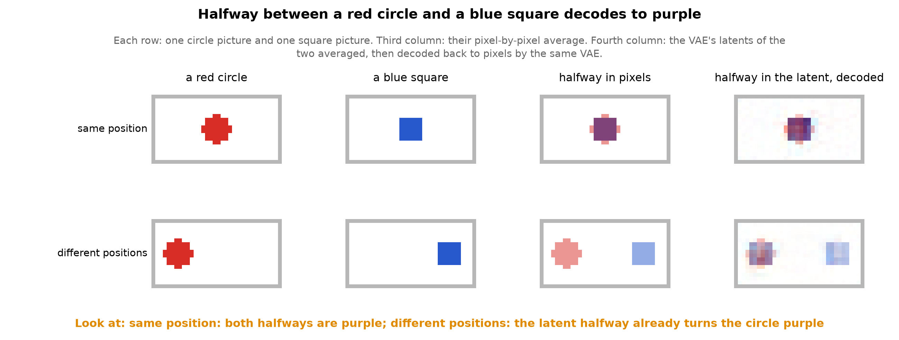</a> |
| Each number moves 0.018 on average over 8,000 training steps, against a typical size of 0.77 `verified` ([table example](../../artifacts/results/the-exact-toy/how-much-co-occurrence-the-product-needs/toy-caption-table-example.json)) | Halfway between the two shapes decodes to purple when they share a position `verified` |

## What the caption model draws

Navigation: ⬅️ [Previous](#what-the-caption-model-trains-on) | 📋 [TOC](#table-of-contents) | [Next](#what-a-corrector-adds) ➡️

| Nine relabelling counts, three trainings | Every caption side by side | The dial in full |
|---|---|---|
| <a href="../../artifacts/results/the-exact-toy/how-much-co-occurrence-the-product-needs/plain-figures/06-what-poe-draws-in-the-caption-model.png">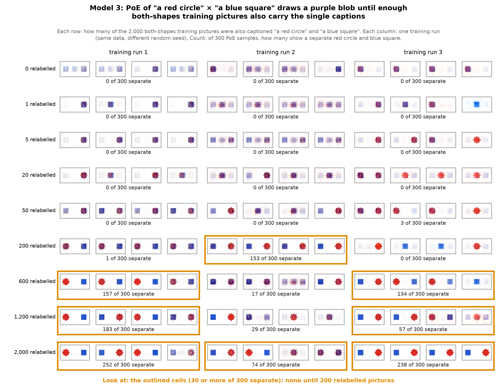</a> | <a href="../../artifacts/results/the-exact-toy/how-much-co-occurrence-the-product-needs/plain-figures/07-every-caption-side-by-side.png">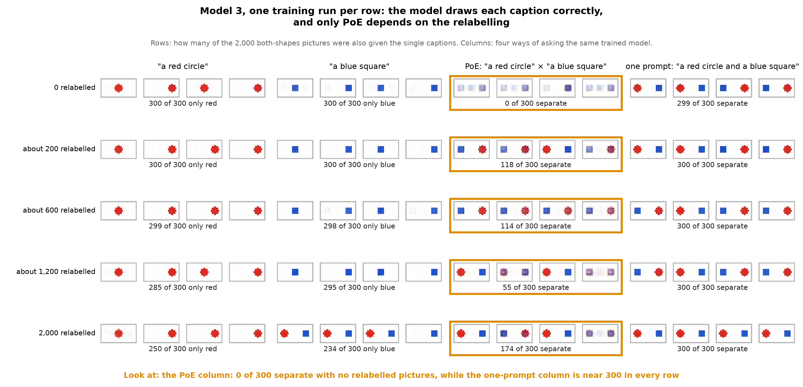</a> | <a href="../../artifacts/results/the-exact-toy/how-much-co-occurrence-the-product-needs/what-the-caption-model-draws.png">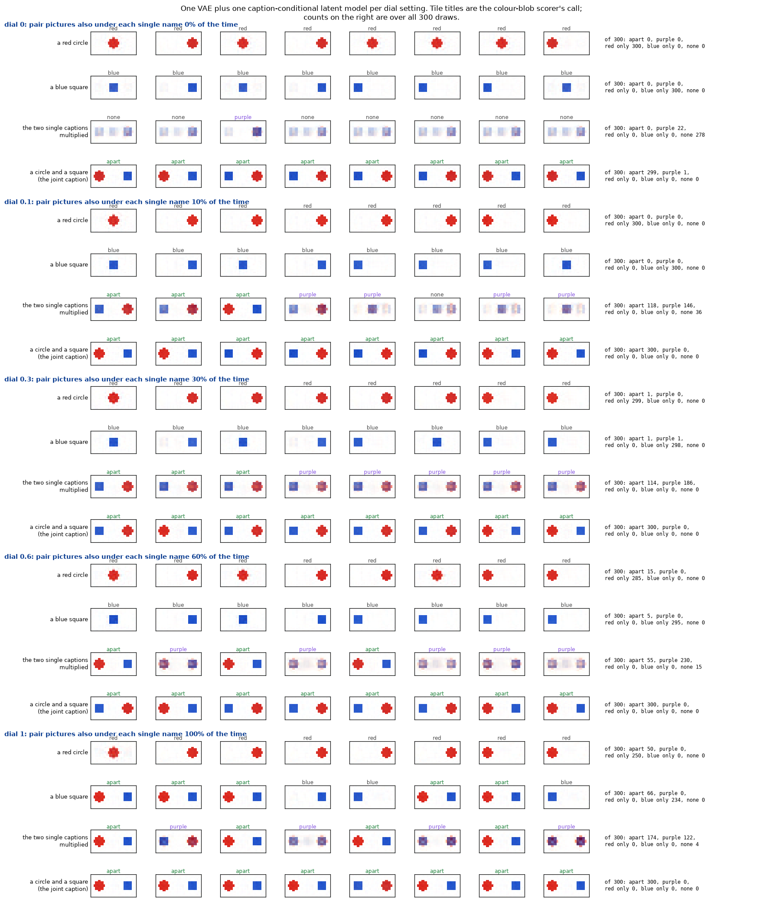</a> |
| One cell is one trained model: four samples and its count of 300 `verified` | One model per row, so each row's counts can move between trainings `stated` | Counts from the colour-blob scorer over all 300 draws `verified` |

**With 0 to 50 relabelled pictures, at most 3 of 300 samples across 15 models are separate. From 200 the count rises unevenly.** The joint caption draws the pair in at least 267 of 300 in all 27 models, so the model can draw both shapes `verified`.

| Relabelled | Training 1 | Training 2 | Training 3 |
|---|---|---|---|
| 0, 1, 5, 20 | 0 | 0 | 0 |
| 50 | 0 | 0 | 3 |
| 200 | 1 | 153 | 0 |
| 600 | 157 | 17 | 134 |
| 1,200 | 183 | 29 | 57 |
| 2,000 | 252 | 74 | 238 |

> [!IMPORTANT]
> The dial experiment's written outcomes do not cover its result. The script recorded "inconclusive" and the owner has not chosen a reading.

| Written outcome | What it needs | What was measured | Met |
|---|---|---|---|
| support | at least 150 separate with both single captions at 240 or more | best such setting: 118 | no |
| null | under 30 wherever both captions pass | 118, 114 and 55 at dials 0.1, 0.3 and 0.6 | no |
| inconclusive, as written | a rise only where single-caption purity has already fallen | the rise happens where purity holds | no |
| inconclusive, as the script prints it | anything between support and null | 118 lies between 30 and 150 | yes, recorded |

<a href="../../artifacts/results/the-exact-toy/how-much-co-occurrence-the-product-needs/caption-model-across-guidance.png">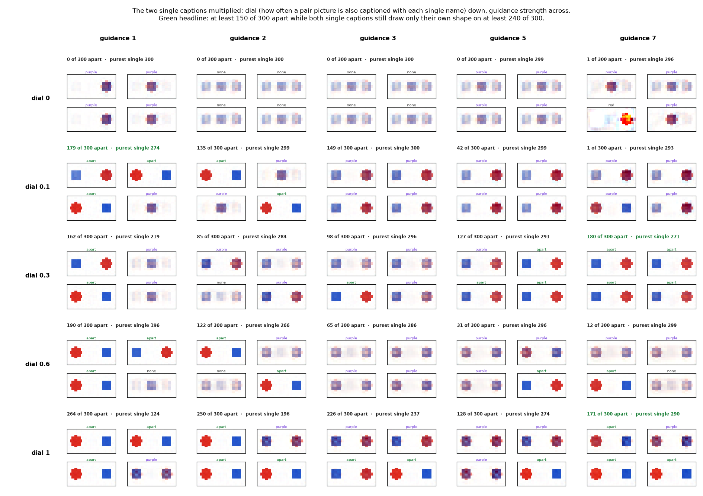</a>

**Guidance does not rescue the model trained with no relabelling.** Rows are the dial, columns are guidance 1, 2, 3, 5 and 7, and one cell is one setting. At dial 0 no cell passes 1 of 300, and at other dials cells range from 1 to 264 with no strength best across dials `verified` ([guidance file](../../artifacts/results/the-exact-toy/how-much-co-occurrence-the-product-needs/toy-caption-dial-ldm-guidance.json)).

## What a corrector adds

Navigation: ⬅️ [Previous](#what-the-caption-model-draws) | 📋 [TOC](#table-of-contents) | [Next](#composing-with-no-both-shapes-picture) ➡️

| Five dial settings with the corrector | Four models with and four without |
|---|---|
| <a href="../../artifacts/results/the-exact-toy/how-much-co-occurrence-the-product-needs/plain-figures/07-every-caption-side-by-side_b.png">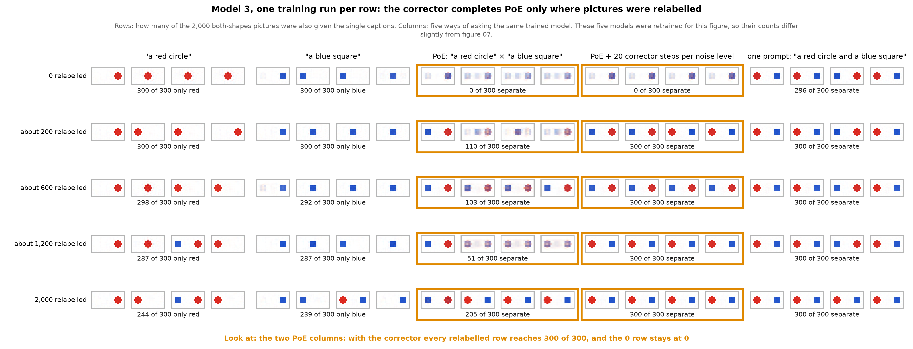</a> | <a href="../../artifacts/results/the-exact-toy/how-much-co-occurrence-the-product-needs/plain-figures/08-the-corrector.png">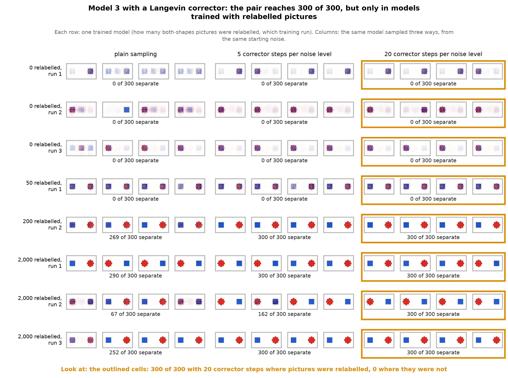</a> |
| Plain product 0, 110, 103, 51 and 205 of 300. With 20 corrector steps 0, 300, 300, 300 and 300 `verified` ([dial corrector file](../../artifacts/results/the-exact-toy/how-much-co-occurrence-the-product-needs/toy-caption-dial-corrector.json)) | One row is one retrained model, and all columns start from the same noise `verified` |

**The single captions let the product find the pair, and a corrector then raises how often it does.** The written rule is judged at 5 steps, where the median of four models rises from 260.5 to 300. One 2,000-picture model reaches only 162 at 5 steps and 300 at 20. Without the single captions all four models stay at 0 `verified`.

## Composing with no both-shapes picture

Navigation: ⬅️ [Previous](#what-a-corrector-adds) | 📋 [TOC](#table-of-contents) | [Next](#where-the-sources-disagree) ➡️

<a href="../../artifacts/results/the-exact-toy/how-much-co-occurrence-the-product-needs/plain-figures/09-composing-with-no-both-shapes-pictures.png">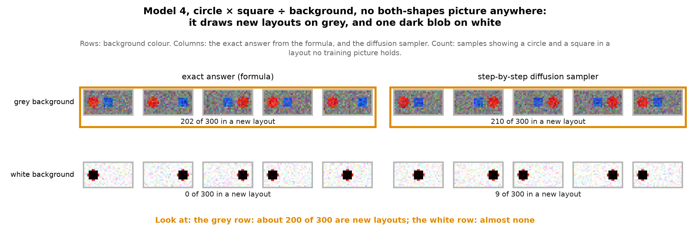</a>

**Dividing by a background expert composes with no both-shapes picture on grey and fails on white.** This model is written by hand, so it says nothing about how a captioned model learns `stated`. The detail is on [the co-occurrence page](how-much-co-occurrence-the-product-needs.md#whether-it-can-draw-a-layout-nobody-trained-on).

## Where the sources disagree

Navigation: ⬅️ [Previous](#composing-with-no-both-shapes-picture) | 📋 [TOC](#table-of-contents) | [Next](#what-this-cannot-tell-you) ➡️

**Five recorded statements conflict, and each is shown here unresolved.**

| What | One source | The other source |
|---|---|---|
| whether a trained expert returns its own pictures at 6,000 steps | [the check](../../artifacts/results/the-exact-toy/how-much-co-occurrence-the-product-needs/toy-trained-preflight.json): noise, final loss 0.58087. [Its script](../../artifacts/notes/what-poe-loses-when-it-composes/toy_trained_preflight.py) passes the network's output to the sampler as a noise prediction `verified` | [the trained experts file](../../artifacts/results/the-exact-toy/how-much-co-occurrence-the-product-needs/toy-trained-experts.json), also 6,000 steps: 300 of 300 own shape, final loss 0.01287. [Its script](../../artifacts/notes/what-poe-loses-when-it-composes/toy_trained_experts.py) trains the network to predict the picture (lines 73 to 74) and converts that to a noise prediction before sampling `verified`. The check probably ran on an earlier version that predicted noise, so the two losses would measure different targets `inferred`. Both scripts arrived in one commit (`734a074e`), so no record shows the order. The null for two trained networks rests on this second run |
| how many guidance cells meet the rule | the card: two (dial 0.1 at guidance 1, dial 0.3 at guidance 7) | [the guidance file](../../artifacts/results/the-exact-toy/how-much-co-occurrence-the-product-needs/toy-caption-dial-ldm-guidance.json) and the picture: three, adding dial 1 at guidance 7 with 171 separate and purity 293 and 290 |
| how far one setting moves between trainings | the card: about 30 of 300 | three trainings at guidance 3 give 118, 149, 110 at dial 0.1; 114, 98, 103 at 0.3; 55, 65, 51 at 0.6; 174, 226, 205 at 1. Largest minus smallest is 39, 16, 14 and 52 |
| which models the guidance sweep used | the card: "the same models" | its guidance 3 counts (149, 98, 65, 226) differ from the first dial table (118, 114, 55, 174), and the file records one training per dial for that sweep |
| how many cells draw the pair | the picture of nine counts outlines 8 cells at 30 or more | the written rule counts 7, because the 238 at 2,000 relabelled has a single caption at 223, under 240 |

## What this cannot tell you

Navigation: ⬅️ [Previous](#where-the-sources-disagree) | 📋 [TOC](#table-of-contents) | [Next](#concepts-this-uses) ➡️

**Three trainings per number is few.** The largest minus smallest count at one number reaches 178 of 300 (252 against 74 at 2,000 relabelled), where the card says 150, so the order of neighbouring numbers is unreliable `verified`.

**Relabelling also enlarges the training set.** At 2,000 relabelled each picture is seen about 200 times against about 340 at 0, and the comparison does not separate that from the caption change `stated`.

**A toy caption varies far less than a real one.** Each "a red circle" picture is one of three pictures plus pixel noise, so the toy cannot say what share of both-animal photos SDXL needs `stated`.

## Concepts this uses

Navigation: ⬅️ [Previous](#what-this-cannot-tell-you) | 📋 [TOC](#table-of-contents) | [Next](#where-this-came-from) ➡️

The toy numbers below are invented. The project numbers are from the files named above.

**A caption's share of both-thing pictures**

A shelf labelled "tea" holds 9 tea tins and 1 tin of tea and coffee, so 1 in 10 items under "tea" also holds coffee. Share is both-thing items under the label divided by all items under the label. Here 200 relabelled pictures join 2,000 under "a red circle", so the share is 200 / 2,200 = 9%.

**The product in noise estimates**

Suppose the empty prompt predicts 1.0, "cat" 1.2 and "dog" 0.9. Each prompt's push is its prediction minus the empty one: +0.2 and -0.1. At guidance 3 the product predicts 1.0 + 3 × (0.2 - 0.1) = 1.3. On the card's worked step the empty row gives 1.197, the circle 1.196 and the square 1.261, and the card prints 1.385. The rounded inputs shown there give 1.197 + 3 × ((1.196 - 1.197) + (1.261 - 1.197)) = 1.386. Read more on [classifier-free guidance](../../../../../Obsidian/Artificial%20Intelligence/Generative%20Modeling/Diffusion%20Models/Classifier-Free%20Guidance.md#where-to-learn-this).

**A Langevin corrector step**

A walker at height 2 is told uphill is +1, takes a step of size 0.1 and gets a random nudge of +0.05, ending at 2 + 0.1 × 1 + 0.05 = 2.15. The step is: new sample = sample + η × score + √(2η) × fresh noise. Here η is 0.05 of the noise variance, repeated 5 or 20 times at every noise level. Read more on [Langevin dynamics](../../../../../Obsidian/Mathematics/Statistics/Markov%20Chain%20Monte%20Carlo/Langevin%20Dynamics.md#where-to-learn-this).

## Where this came from

Navigation: ⬅️ [Previous](#concepts-this-uses) | 📋 [TOC](#table-of-contents) | [Next](#still-open) ➡️

| What | Source | Mark |
|---|---|---|
| the write-up and its ten figures | [the plain-figures card](../../artifacts/results/the-exact-toy/how-much-co-occurrence-the-product-needs/plain-figures/README.md), read 2026-11-21 | `stated` |
| the counts and recorded verdicts | the JSON files linked above, read 2026-11-21 | `verified` |
| how the figures were drawn | [the figure script](../../artifacts/notes/what-poe-loses-when-it-composes/plain_figures.py) | `stated` |
| the SDXL pilot's record | [the inclusive-captions walk](../../../4-inclusive-captions/artifacts/drips/inclusive-captions-pilot/EXECUTE_WALK.md) | `stated` |

## Still open

Navigation: ⬅️ [Previous](#where-this-came-from) | 📋 [TOC](#table-of-contents)

- [ ] Choose how to read the dial experiment, whose result falls outside its three written outcomes.
- [ ] Establish why the single-expert check draws noise while the trained experts file reports clean shapes at the same step count. The null for two trained networks depends on it.
- [ ] Run the SDXL pilot's planned test of 128 seeds per training.
- [ ] Write a card entry for `can-one-expert-learn-its-own-pictures.png`, which no card lists.

<!-- built-to: PAGE_LOOK_FORMAT v1 -->
