# Inclusive captions: talk-through for the supervisor meeting

Twelve slides, one point each, in the order they are shown. Each section has the slide, what to say,
what moved off the slide onto [the detailed versions](detailed/) (with its numbers and source files),
and short answers to the questions likely to come up. Every count is at guidance 3.

**The question to open with**

If each single caption has seen both things together in some of its training pictures, does the
product of the two captions draw both? We test it in two small worlds where we control exactly what
each caption saw: a toy of red circles and blue squares, and MNIST digits.

**Colours on every slide**

A green outline is a picture that shows both things (a training picture, or a sample that is a
clean pair). Red is the product, blue a single caption or label asked alone, and orange the one
"Look at" sentence.

**Words this uses**

**Share**: of the training pictures under one single caption (or label), the number that show both
things, out of all of them. **The product**: the two single captions combined at sampling time by the
product-of-experts rule. **A clean pair**: a finished picture that shows both things, apart (slide 04
defines it beside the three other outcomes: fused, one thing only, other).

---

## 00. What relabelling means

<a href="00-what-relabelling-means.png">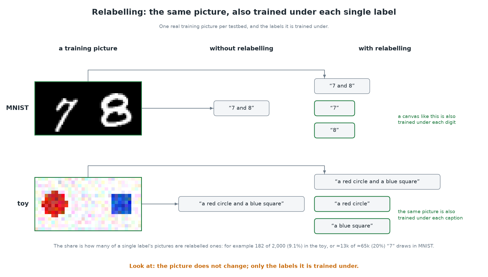</a>

**What to say**

A picture holding a 7 and an 8 is labelled "7 and 8". Relabelling means a picture like that is also
trained under "7" and under "8". The picture does not change; only the labels it is trained under.
The share is how many of a single label's pictures are relabelled ones: 182 of 2,000 (9.1%) in one toy
setting, or ≈13k of ≈65k "7" draws (20%) in one MNIST setting.

**On the detailed version**

Nothing moved; this slide is new. The MNIST canvas is the first canvas labelled "7 and 8" that
`ShareCanvasMaker` (share 0.2, seed 0, in `poe_repair/experiments/inclusive_captions/mnist/canvases.py`)
draws. The toy picture is the first picture filed under "a red circle and a blue square" by
`corpus_replace(182, seed 20261022)` in `4-inclusive-captions/scripts/toy_caption_replace.py`, with its
pixel noise.

**Questions they may ask**

*Is it literally the same picture on MNIST?* In the toy, yes: the same both-shapes pictures are filed
under "a red circle" and under "a blue square", each copy with its own pixel noise. On MNIST every
canvas is built fresh at each training step, so it is the same kind of canvas: every "7 and 8" draw
keeps its label, and a share of the "7" and "8" draws show a 7 beside an 8. The slide's note under
the MNIST chips says "a canvas like this" for that reason.

---

## 01a. The toy training set

<a href="01a-the-toy-training-set.png">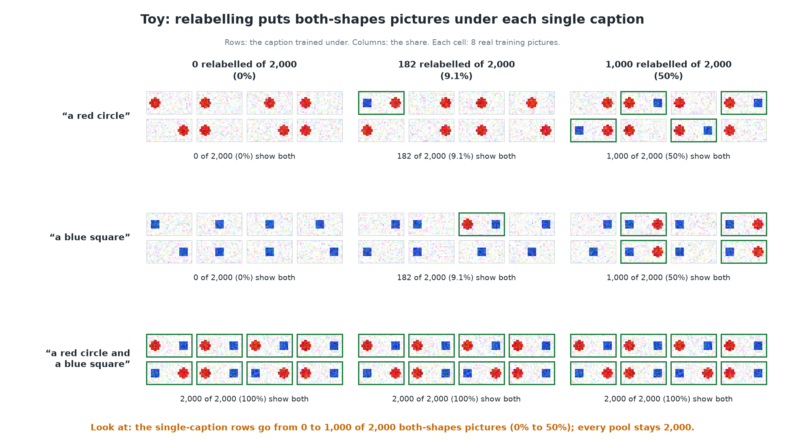</a>

**What to say**

Each row is the caption a picture is trained under, and each column a setting. Under "a red circle",
0 of 2,000 pictures show both shapes at first, then 182 of 2,000 (9.1%), then 1,000 of 2,000 (50%).
The joint caption always has 2,000 of 2,000 both-shapes pictures. Every pool stays at 2,000, so only
the share moves.

**On the detailed version**

The full sweep tested 0, 1, 5, 20, 49, 182, 462, 750 and 1,000 relabelled of 2,000 (0% to 50%), three
trainings each; the toy is 6,000 pictures per model at every share (`toy_relabelling_numbers.json`,
"replacing design (main)"). Each training picture is one of 8 distinct pictures plus pixel noise of sd
0.1. The 8 tiles per cell come from the real pool built by `corpus_replace` (seed 20261022), drawn so
the number outlined is the pool's share of 8, rounded.

**Questions they may ask**

*Why replacing and not adding?* Adding k both-shapes copies grows the training set from 6,000 to as
many as 10,000 pictures, so each picture is seen fewer times and a result could come from either
change. Replacing swaps k lone shapes for k both-shapes pictures, so only the share moves. The adding
design was run first and gives the same answer at every share; it is kept as the check.

*What is the canvas?* In the toy, a 16 × 32 colour picture on white with a circle, a square, or both
at fixed positions.

---

## 01b. The MNIST training set

<a href="01b-the-mnist-training-set.png">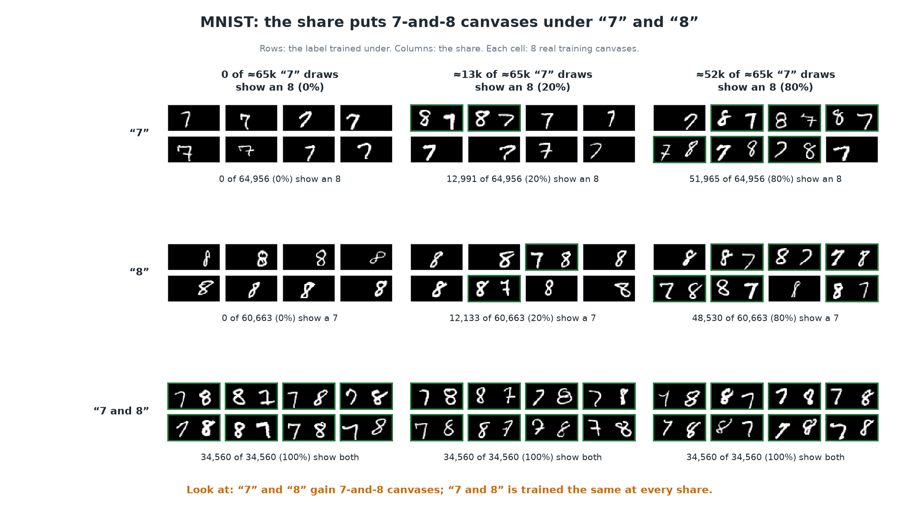</a>

**What to say**

Each row is the label a canvas is trained under. At 0%, none of the ≈65k "7" draws per model show
an 8; at 20%, ≈13k of ≈65k do; at 80%, ≈52k of ≈65k. "8" gains a 7 the same way. "7 and 8" gets
≈35k of ≈35k two-digit draws at every share, so it is trained the same throughout.

**On the detailed version**

The counts are expected draws per model, from the rule in `canvases.py` and MNIST's digit
frequencies, not counted draws: ≈768k canvases per model (6,000 steps of 128); single digits ≈622k
(81%), "7" ≈65k, "8" ≈61k; joint labels ≈69k (9%), of which "7 and 8" ≈35k; blank ≈77k (10%).
"8" at 20% is ≈12k of ≈61k and at 80% ≈49k of ≈61k. The shares tested are 0, 10, 20, 40 and 80%,
three trainings each; 0% is plan 02's dial-0 models, the same training mix. Five pairs never share a
canvas: 0 & 3, 1 & 9, 3 & 4, 3 & 6, 4 & 7. Tiles are real canvases from `ShareCanvasMaker` (seed 0),
drawn so the number outlined is the share of 8, rounded.

**Questions they may ask**

*What is the canvas?* A 32 × 64 pixel picture, two MNIST digit boxes wide, holding one real MNIST digit
anywhere or two digits, one per half.

*What does a "7" draw at 20% show?* With probability 20%, the 7 beside an 8; otherwise the 7 alone.
For other digits the second digit is any seen partner.

---

## 02. The toy model

<a href="02-the-toy-setup.png">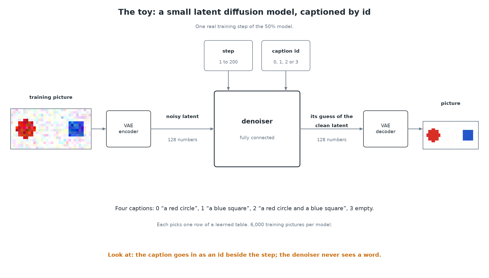</a>

**What to say**

The VAE turns each 16 × 32 colour picture into 128 numbers and back. The denoiser reads the noisy
128 numbers, the step and the caption id, and outputs its guess of the clean 128 numbers. A caption is
an id from 0 to 3 that picks a row of a learned table, so the network never sees a word.

**On the detailed version**

Denoiser: fully connected, 256 numbers in (128 latent, 64 for the step, 64 for the caption row), three
hidden layers of 1,024, 128 out, 2,493,824 weights. VAE: 45,707 weights, latent 4 × 4 × 8 = 128 numbers,
trained first on the pictures alone, never sees a caption. Denoiser 8,000 steps of 256 pictures; VAE
4,000 steps of 256. The empty caption replaces the caption on 10% of draws. The example is from the 50%
model, seed 20261022, caption id 0, step 100 of 200, loss 0.00648 on that example. Sources:
`../../scenes/how-the-toy-relabelling-experiment-works/toy_relabelling_numbers.json` and the arrays in
`4-inclusive-captions/data/toy-relabelling-ladder/rig_replace1000.npz`.

**Questions they may ask**

*Why ids and not CLIP?* The experiment needs to control exactly what each caption has seen. A
pretrained text encoder brings in what "circle" meant across millions of outside images, which the
share cannot control. With an id, the pictures filed under a caption are the only thing that defines it.

*Is the joint caption built from the single ones?* No. "a red circle and a blue square" is its own
row, id 2.

---

## 03. The MNIST model

<a href="03-the-mnist-setup.png">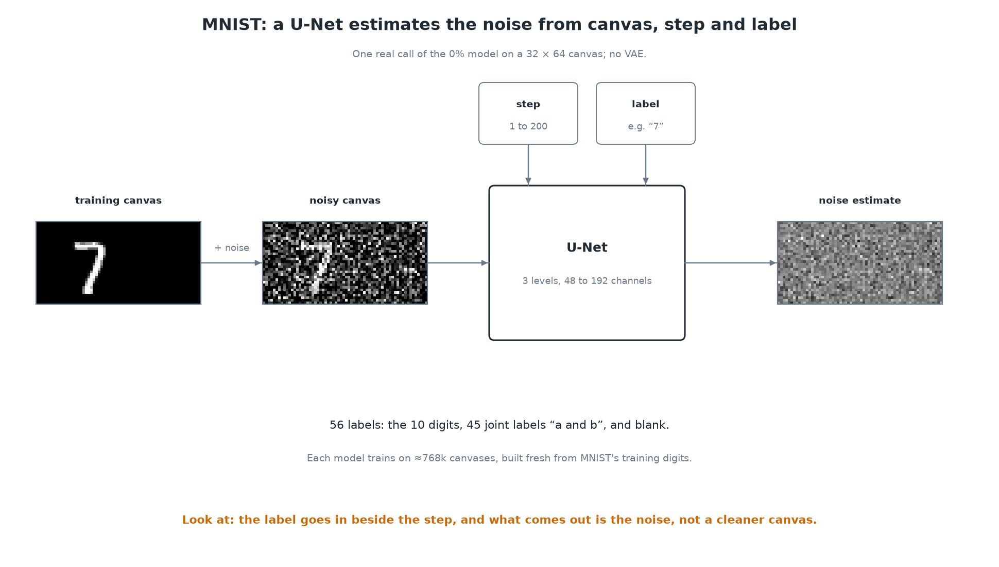</a>

**What to say**

There is no VAE here: the U-Net works on the 32 × 64 pixels directly. It reads the noisy canvas, the
step and the label, and outputs its estimate of the noise that was added. There are 56 labels: the 10
digits, 45 joint labels "a and b", and blank.

**On the detailed version**

U-Net: 6,462,913 weights, 14 residual blocks, three levels of 48, 96 and 192 channels; the label picks a
row of a learned 56 × 192 table, added to the step embedding inside every residual block
(`mnist_stage_numbers.json`, "network"). The picture is one real call computed on CPU with the 0% model,
training 1 (`data/mnist/checkpoints/dial-0-seed-1.pt`), on a "7" canvas noised to step 100 with seed 0;
the estimate's mean squared error against the added noise is 0.011.

**Questions they may ask**

*Why pixels rather than a VAE like the toy?* 32 × 64 grey pixels are small enough to denoise directly,
and it removes the VAE as one more place the result could come from.

---

## 04. Making and counting one picture

<a href="04-making-and-counting-one-picture.png">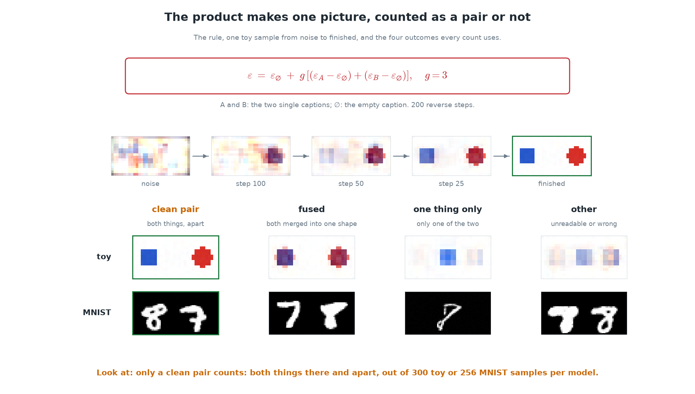</a>

**What to say**

At every reverse step the same network runs three times: empty, then each single caption. The product
takes the empty estimate and adds three times each caption's difference from it. Sampling takes 200
reverse steps from pure noise. Every finished picture lands in exactly one of four outcomes, and only
a clean pair counts. Each count is how many of a model's 300 (toy) or 256 (MNIST) samples are clean
pairs.

**The four outcomes, the same words on every slide**

**Clean pair**: both things, apart. Toy scorer call "red and blue apart"; MNIST judge call "two
separate right digits".

**Fused**: both merged into one shape. Toy "purple or overlaid"; MNIST "fused".

**One thing only**: only one of the two. Toy "red only" or "blue only"; MNIST "one digit".

**Other**: unreadable or wrong. Toy "nothing readable"; MNIST "two digits with a wrong identity" or
"damaged".

For a single label asked alone, the MNIST cells say instead how many show the 7 alone, a 7 with a
second digit, or other ("wrong digit" or "damaged"); the toy's "a red circle" cells say clean pair, the
circle alone, or other. The example tiles on the slide are the first product sample with each call in
training 1, searching the shares from the largest down.

**On the detailed version**

Toy scorer: each pixel takes the nearest of white, red, blue and purple; "red and blue apart" needs at
least 12 red and 12 blue pixels, centres at least 6 pixels apart, and fewer than 12 purple
(`toy_relabelling_numbers.json`, "scorer"). Other toy calls: red only, blue only, purple or overlaid,
nothing readable. MNIST judge: a CNN with 870,891 weights, sha256 `b0fb317e…cb7a`, reading each
digit-sized blob; its ladder is damaged, one digit, fused, two digits with a wrong identity, two
separate right digits; for a single label, right digit alone or with a second. The optional corrector
adds Langevin steps at each level, z ← z + η s + √(2η) ξ with η = 0.05 (1 − ᾱ): 5 or 20 per level in the
toy, 20 on MNIST. The toy strip is one product sample of the 50% model (`rig_replace1000.npz`); the
outcome examples are the first training-1 product sample with each call, searching the shares from
the largest down (toy: the sweep and 0% sample files, called by the scorer; MNIST: `scores.csv`).

**Questions they may ask**

*What does N of 300 count?* In the toy, each model draws 300 samples, each from its own fresh starting
noise, and N is how many are a clean pair (the scorer's "red and blue apart").

*What does N of 256 count?* On MNIST, each model draws 256 seeds, and the same 256 starting noises are
used for every model. N is how many reach "two separate right digits" (for "7" alone, "right digit
with a second").

*Why guidance 3?* Both testbeds use 3 throughout. Du et al. (2023) use the same composition rule at 4.

---

## 05. Toy result

<a href="05-toy-result.png">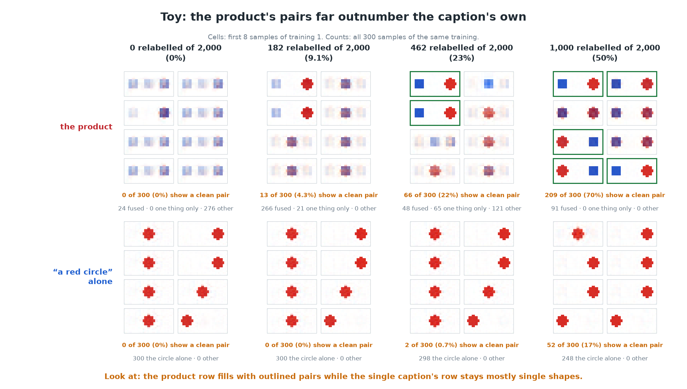</a>

**What to say**

Each cell shows training 1's first 8 samples, and its counts cover all 300 samples of that training.
At 0% none of the product's samples is a clean pair; at 9.1% 13 of 300 (4.3%) are, at 23% 66 of 300
(22%), and at 50% 209 of 300 (70%). Asked alone, "a red circle" draws a clean pair far less often: 52
of 300 (17%) at 50%, with the other 248 a circle alone. So the product's pairs are not copies of what
the caption draws by itself.

**Every cell on the slide (training 1, seed 20261022, of 300)**

| Share | Product: clean pair · fused · one thing only · other | "a red circle" alone: clean pair · the circle alone · other |
|---|---|---|
| 0 of 2,000 (0%) | 0 (0%) · 24 · 0 · 276 | 0 (0%) · 300 · 0 |
| 182 of 2,000 (9.1%) | 13 (4.3%) · 266 · 21 · 0 | 0 (0%) · 300 · 0 |
| 462 of 2,000 (23%) | 66 (22%) · 48 · 65 · 121 | 2 (0.7%) · 298 · 0 |
| 1,000 of 2,000 (50%) | 209 (70%) · 91 · 0 · 0 | 52 (17%) · 248 · 0 |

Each row adds up to 300 (checked by the script). At 0% most product samples are faint blobs too weak
to read ("other"); at 9.1% most are fused purple shapes.

**On the detailed version**

Clean pairs of 300, three trainings (seeds 20261022, 20261023, 20261024), median in brackets:

| Share | Product | "a red circle" alone | "a blue square" alone |
|---|---|---|---|
| 0 of 2,000 (0%) | 0, 0, 0 (0) | 0, 0, 0 (0) | 0, 0, 0 (0) |
| 1 to 20 of 2,000 (0.05% to 1%) | 0 in every training | 0 | 0 |
| 49 of 2,000 (2.45%) | 0, 0, 2 (0) | 0, 0, 0 (0) | 0, 0, 0 (0) |
| 182 of 2,000 (9.1%) | 13, 5, 72 (13) | 0, 0, 0 (0) | 0, 0, 0 (0) |
| 462 of 2,000 (23%) | 66, 64, 146 (66) | 2, 8, 5 (5) | 0, 0, 2 (0) |
| 750 of 2,000 (37.5%) | 239, 129, 75 (129) | 13, 34, 22 (22) | 6, 9, 16 (9) |
| 1,000 of 2,000 (50%) | 209, 150, 84 (150) | 52, 53, 39 (52) | 30, 21, 39 (30) |

Shares 0.05% to 50% are from `toy-caption-replace-sweep.json`; the 0% row is the k = 0 trainings in
`toy-caption-threshold.json` (the same design with nothing relabelled), both in
`4-inclusive-captions/artifacts/results/does-relabelling-both-shapes-pictures-help-the-toy-product-compose/`.
The joint caption drew the pair on at least 298 of 300 at every share. The slide shows the first 8
samples of training 1 per cell (0%: `toy-caption-threshold-samples.npz` in subproject 3's results
folder; other shares: `toy-caption-replace-sweep-samples.npz`), outlined where the scorer calls them
"red and blue apart".

**Questions they may ask**

*Is the product just copying the single captions' own pairs?* No: from 9.1% the product's median is
above both single captions' medians at every share, about 3 to 1 at 50% (medians 150 of 300 against 52
of 300).
At 9.1% the single captions draw no pairs at all while the product draws 13, 5 and 72.

*Why is the spread so wide?* Three trainings per share is few; at 37.5% they give 239, 129 and 75. The
jump from at most 2 below 9% to 64 and above from 23% is reliable; the order between 37.5% and 50% is not.

*Was the corrector run here?* Not on this sweep. A separate replacing-design run with the corrector, at 0
to 1,000 of 2,000 and three trainings each, is slide 05b.

---

## 05b. The toy corrector

<a href="05b-the-toy-corrector.png">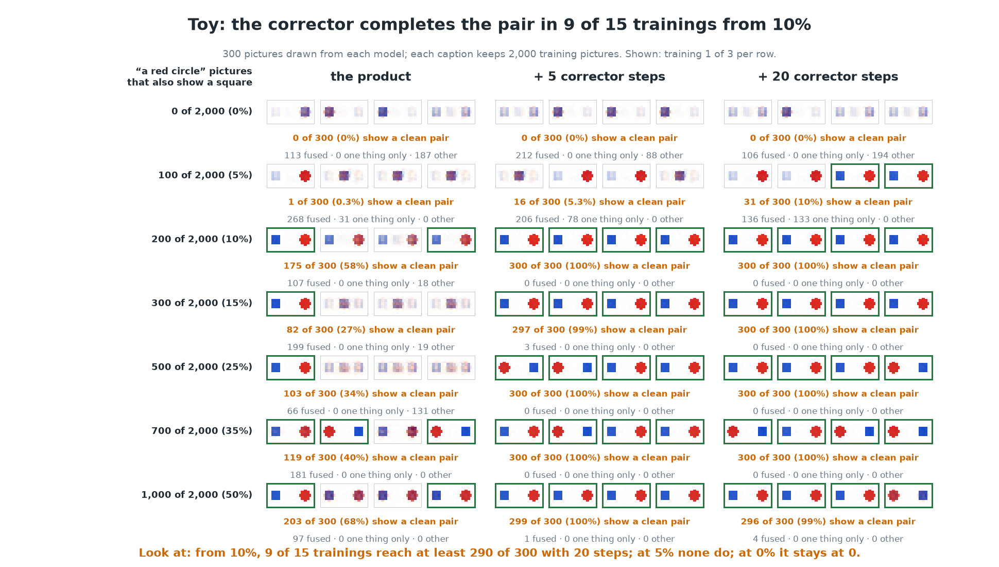</a>

**What to say**

Each row is one model, trained with that many of the 2,000 "a red circle" pictures also showing a
square, and each count is out of the 300 pictures drawn from it. The corrector adds Langevin steps at
each noise level that pull the sample toward what the product rates likely. With none of the pictures
shared it stays at 0 of 300. From 10%, training 1 reaches 296 to 300 of 300 with 20 steps, but the
right-hand column shows the other trainings often lag: counting all three trainings from 10%, 9 of 15
reach at least 290 of 300. At 5% none do.

**Every count (clean pairs of 300; trainings with seeds 20261022, 20261023, 20261024)**

| "a red circle" pictures also showing a square | The product | + 5 corrector steps | + 20 corrector steps |
|---|---|---|---|
| 0 of 2,000 (0%) | 0, 0, 0 | 0, 0, 0 | 0, 0, 0 |
| 100 of 2,000 (5%) | 1, 0, 35 | 16, 0, 60 | 31, 0, 185 |
| 200 of 2,000 (10%) | 175, 0, 37 | 300, 4, 96 | 300, 253, 195 |
| 300 of 2,000 (15%) | 82, 73, 132 | 297, 300, 293 | 300, 300, 300 |
| 500 of 2,000 (25%) | 103, 42, 95 | 300, 38, 135 | 300, 36, 198 |
| 700 of 2,000 (35%) | 119, 17, 243 | 300, 276, 300 | 300, 299, 300 |
| 1,000 of 2,000 (50%) | 203, 136, 84 | 299, 193, 96 | 296, 262, 132 |

The slide's cells are training 1, with its full split (clean pair · fused · one thing only · other), each
adding up to 300: for example 0% plain is 0 · 113 · 0 · 187, and 5% with 20 steps is 31 · 136 · 133 · 0.
Sources: `toy-replace-corrector-k<k>.json` and `toy-replace-corrector-k<k>-samples.npz` for k = 0, 100,
200, 300, 500, 700 and 1,000, in
`4-inclusive-captions/artifacts/results/does-relabelling-both-shapes-pictures-help-the-toy-product-compose/`
(copied from the cluster checkout for this deck). Tiles are the first 4 of training 1's saved samples per
setting, outlined where the scorer calls them a clean pair.

**The expectation written before the run holds only at 15% and 35%.** The JSON's "bar" says: with
relabelled pictures (k of 100 or more), 20 corrector steps give at least 290 of 300 in all three
trainings; with none (k = 0), at most 3 of 300. The k = 0 part holds (0, 0, 0). The k ≥ 100 part holds
at 15% (300, 300, 300) and 35% (300, 299, 300), and fails at 5% (31, 0, 185), 10% (300, 253, 195), 25%
(300, 36, 198) and 50% (296, 262, 132).

**On the detailed version**

The earlier corrector test used the adding design (pictures added, not replaced), on models retrained
for that test ([the adding-design slide](detailed/05b-the-toy-corrector-adding-design.png)). With 20
corrector steps the models with 0 and 50 added stayed at 0 of 300 (all three 0-added models: 300, 299
and 300 fused), and the models with 200 added (run 2 only) and 2,000 added (all three runs) reached 300
of 300; their plain counts were 269 for 200 added and 290, 67 and 252 for 2,000 added
(`toy-caption-corrector.json` and `toy-caption-corrector-no-single-captions.json` in
`3-understanding-compositionality/artifacts/results/the-exact-toy/how-much-co-occurrence-the-product-needs/`).
That test had one or three models per row; the replacing run here has three at every share, and it is
the three-training spread that shows the lag.

**Questions they may ask**

*Is the corrector doing the composing?* No. With no shared pictures it stays at 0 of 300 in every
training. With shared pictures it completes the pair in most trainings, not all: one or two of the
three trainings lag at 10%, 25% and 50%, down to 36 of 300.

*Why do some trainings lag?* Not established. The lagging trainings are not the ones with the lowest
plain counts in every case: at 10%, the training that starts at 0 of 300 ends at 253, while the one that
starts at 37 ends at 195.

---

## 06. MNIST result

<a href="06-mnist-result.png">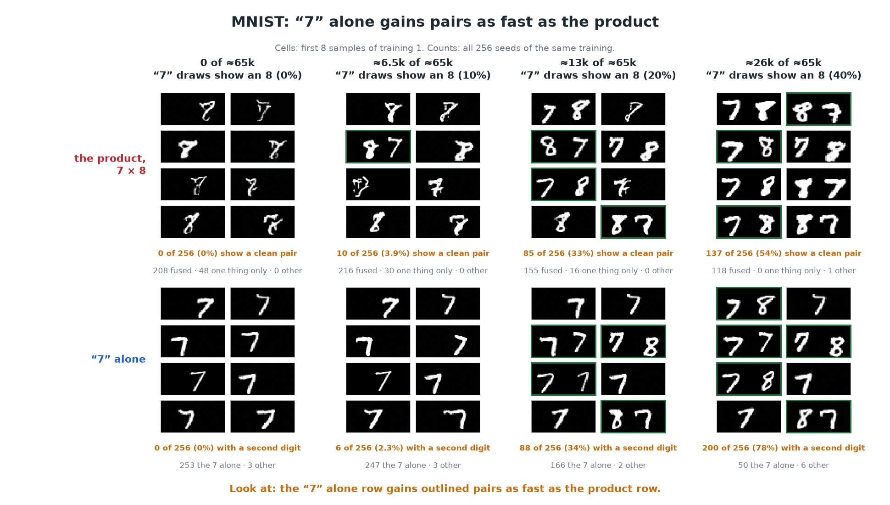</a>

**What to say**

Each cell shows training 1's first 8 samples, and its counts cover all 256 seeds of that training. At
0% the product draws no clean pair: 208 of 256 are fused and 48 show one digit. As the share rises the
product draws more clean pairs, 137 of 256 (54%) at 40%. But "7" alone, with no "8" asked for, already
draws a 7 with a second digit on 200 of 256 (78%) at 40%. So the product's pairs rise with the pairs
the single label draws by itself and cannot be credited to the product.

**Every cell on the slide (training 1, of 256)**

| Share | Product: clean pair · fused · one thing only · other | "7" alone: with a second digit · the 7 alone · other |
|---|---|---|
| 0% | 0 (0%) · 208 · 48 · 0 | 0 (0%) · 253 · 3 |
| 10% | 10 (3.9%) · 216 · 30 · 0 | 6 (2.3%) · 247 · 3 |
| 20% | 85 (33%) · 155 · 16 · 0 | 88 (34%) · 166 · 2 |
| 40% | 137 (54%) · 118 · 0 · 1 | 200 (78%) · 50 · 6 |
| 80% (off the slide) | 114 (45%) · 141 · 0 · 1 | 250 (98%) · 1 · 5 |

Each row adds up to 256 (checked by the script), from `counts.json`.

**On the detailed version**

Seeds of 256, three trainings, median in brackets (`counts.json` in
`4-inclusive-captions/artifacts/results/does-the-share-of-two-digit-pictures-help-the-product-compose-on-mnist/`):

| Share | Product, plain | Product, corrected | "7" alone with a second | "8" alone with a second |
|---|---|---|---|---|
| 0% | 0, 0, 0 (0) | 0, 0, 0 (0) | 0, 0, 1 (0) | 0, 0, 0 (0) |
| 10% | 10, 22, 15 (15) | 17, 28, 24 (24) | 6, 12, 13 (12) | 9, 11, 14 (11) |
| 20% | 85, 70, 86 (85) | 52, 56, 35 (52) | 88, 48, 59 (59) | 70, 59, 68 (68) |
| 40% | 137, 147, 142 (142) | 40, 80, 27 (40) | 200, 213, 212 (212) | 212, 200, 211 (211) |
| 80% | 114, 139, 91 (114) | 72, 81, 22 (72) | 250, 254, 255 (254) | 255, 253, 255 (255) |

The 80% column is off the slide because the 40% column already makes the point. At 10% and 20% the
product is at most 1.25 times the larger single label (15 against 12, 85 against 68). The slide shows
seeds 0 to 7 of training 1 per cell (`data/mnist/samples/dial-0-seed-1.npz` for 0%,
`data/mnist/share-samples/share-<s>-seed-1.npz` otherwise), outlined where the judge's call in
`scores.csv` is "two separate right digits" (product) or "right digit with a second" ("7" alone). "With
a second" is not checked to be an 8: the judge counts a 7 beside any second digit.

**Questions they may ask**

*Why is the MNIST verdict NULL?* The rule was written in `share_bar.py` before any share model trained.
A share counts only if "7" alone and "8" alone keep their lone digit on at least 95% of what training
implies (219 of 256 at 10%, 195 at 20%, 146 at 40%, 49 at 80%) in all three trainings. Only 10% passes;
at 20%, "7" alone keeps its lone digit on 166, 207 and 197. NULL means no counting share's corrected
product averages 39 of 256; at 10% it averages 23 of 256 (9.0%).

*Why does the corrector help the toy and not MNIST?* On MNIST at guidance 3 the corrector raises the
pairs at 10% (median 15 to 24) and lowers them from 20%, and the lost pairs become fused pictures:
summed over the three trainings at 40%, plain sampling gives 426 clean pairs and 338 fused of 768, the
corrector 147 clean pairs and 562 fused (`counts.json`). At guidance 1 (slide 06b, training 1) it raises
them at 10 to 70%, so the harm goes with guidance 3. Why guidance 3 does this is not established.

*Why does "7" alone draw so many pairs?* Unknown, and it is the open question on slide 07. The toy's
single captions under-draw their trained share (52 of 300 at 50%, where the share alone would give 150);
MNIST's "7" over-draws it (median 212 of 256 at 40%, against 102). Both are at guidance 3.

---

## 06b. MNIST: the product across shares, at guidance 3 and guidance 1

<a href="06b-the-mnist-product-across-shares.png">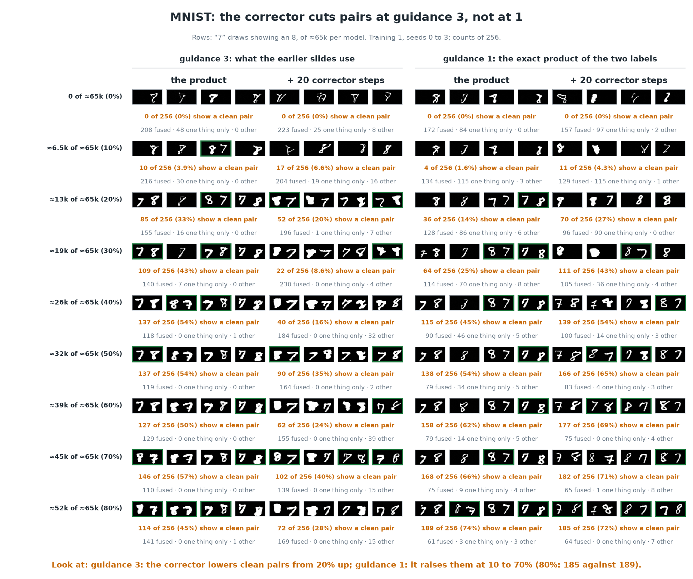</a>

**What to say**

Guidance 3 multiplies each label's difference from the blank estimate by 3; guidance 1 is the exact
product of the two labels. At guidance 3 the corrector lowers the clean pairs at every share from 20%
up: at 30% from 109 to 22 of 256, at 80% from 114 to 72. At guidance 1 it raises them at every share
from 10 to 70% (at 30% from 64 to 111, at 50% from 138 to 166) and leaves 80% about the same (189 to
185). So the corrector's harm on MNIST goes with guidance 3.

**Every cell on the slide (training 1, of 256: clean pair · fused · one thing only · other)**

| Share of "7" draws showing an 8 | Guidance 3 | Guidance 3 + corrector | Guidance 1 | Guidance 1 + corrector |
|---|---|---|---|---|
| 0 of ≈65k (0%) | 0 · 208 · 48 · 0 | 0 · 223 · 25 · 8 | 0 · 172 · 84 · 0 | 0 · 157 · 97 · 2 |
| ≈6.5k of ≈65k (10%) | 10 · 216 · 30 · 0 | 17 · 204 · 19 · 16 | 4 · 134 · 115 · 3 | 11 · 129 · 115 · 1 |
| ≈13k of ≈65k (20%) | 85 · 155 · 16 · 0 | 52 · 196 · 1 · 7 | 36 · 128 · 86 · 6 | 70 · 96 · 90 · 0 |
| ≈19k of ≈65k (30%) | 109 · 140 · 7 · 0 | 22 · 230 · 0 · 4 | 64 · 114 · 70 · 8 | 111 · 105 · 36 · 4 |
| ≈26k of ≈65k (40%) | 137 · 118 · 0 · 1 | 40 · 184 · 0 · 32 | 115 · 90 · 46 · 5 | 139 · 100 · 14 · 3 |
| ≈32k of ≈65k (50%) | 137 · 119 · 0 · 0 | 90 · 164 · 0 · 2 | 138 · 79 · 34 · 5 | 166 · 83 · 4 · 3 |
| ≈39k of ≈65k (60%) | 127 · 129 · 0 · 0 | 62 · 155 · 0 · 39 | 158 · 79 · 14 · 5 | 177 · 75 · 0 · 4 |
| ≈45k of ≈65k (70%) | 146 · 110 · 0 · 0 | 102 · 139 · 0 · 15 | 168 · 75 · 9 · 4 | 182 · 65 · 1 · 8 |
| ≈52k of ≈65k (80%) | 114 · 141 · 0 · 1 | 72 · 169 · 0 · 15 | 189 · 61 · 3 · 3 | 185 · 64 · 0 · 7 |

Each cell adds up to 256 (checked by the script). Guidance-3 counts are from `scores.csv`, with tiles
from `data/mnist/share-samples/` and `data/mnist/samples/dial-0-seed-1.npz`. Guidance-1 tiles are
`data/mnist/share-samples-g1/share-<s>-seed-1.npz`; their calls were made for this deck with the
pinned judge (`judge_checks.pinned_judge` and `pair_call`, weights sha256 `b0fb317e…`) and are cached in
`guidance-1-training-1-calls.json` in this folder. Tiles are seeds 0 to 3. The shares 30, 50, 60 and
70% were added after the rule in `share_bar.py` was written, so they are shown and not judged.

**On the detailed version**

The guidance-1 rule written before any guidance-1 picture (`share_bar.py`) is read in `counts-g1.json`,
over all three trainings. "The pairs came from guidance" holds: "7" alone draws its digit with a second
digit on at most 13, 35, 90 and 192 of 256 at 10, 20, 40 and 80%, under the limits of 38, 64, 115 and
218. "The product composes beyond its labels" holds at no judged share: the plain product's clean pairs
never reach twice what "7" alone or "8" alone draw with a second digit. For training 1, "7" alone with a
second digit at the nine shares is 0, 11, 35, 45, 82, 104, 132, 158 and 183 of 256.

**Questions they may ask**

*Why does the corrector help the toy and not MNIST?* At guidance 3 it lowers MNIST's clean pairs from 20%
up, and the lost pairs become fused pictures. At guidance 1 it raises them at 10 to 70%. So the harm
goes with guidance 3, the setting where the single labels also over-draw pairs. Why guidance 3 does
this is not established.

---

## 06c. MNIST: a pair seen together against a pair never together

<a href="06c-seen-together-against-never-together.png">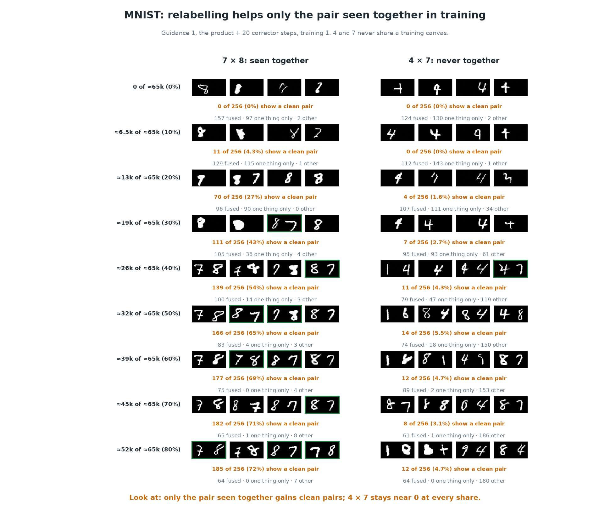</a>

**What to say**

Five digit pairs never share a training canvas, at any share: 0 & 3, 1 & 9, 3 & 4, 3 & 6 and 4 & 7.
The 7 and 8 do appear together under "7" and "8" at the share. At guidance 1 with the corrector, 7 × 8
rises to 185 of 256 (72%) clean pairs at 80%, while 4 × 7 stays at 14 of 256 (5.5%) or fewer.
Relabelling helps only the pair it showed together.

**Every cell on the slide (training 1, guidance 1, + 20 corrector steps, of 256)**

| Share | 7 × 8: clean pair · fused · one thing only · other | 4 × 7: clean pair · fused · one thing only · other |
|---|---|---|
| 0% | 0 · 157 · 97 · 2 | 0 · 124 · 130 · 2 |
| 10% | 11 · 129 · 115 · 1 | 0 · 112 · 143 · 1 |
| 20% | 70 · 96 · 90 · 0 | 4 · 107 · 111 · 34 |
| 30% | 111 · 105 · 36 · 4 | 7 · 95 · 93 · 61 |
| 40% | 139 · 100 · 14 · 3 | 11 · 79 · 47 · 119 |
| 50% | 166 · 83 · 4 · 3 | 14 · 74 · 18 · 150 |
| 60% | 177 · 75 · 0 · 4 | 12 · 89 · 2 · 153 |
| 70% | 182 · 65 · 1 · 8 | 8 · 61 · 1 · 186 |
| 80% | 185 · 64 · 0 · 7 | 12 · 64 · 0 · 180 |

Calls by the pinned judge (`pair_call` with (7, 8) and (4, 7)), cached in
`guidance-1-training-1-calls.json`. Most of 4 × 7's "other" from 40% up is two digits with a wrong
identity: 115, 147, 148, 183 and 176 of 256 at 40 to 80%.

**On the detailed version**

Over all three trainings, 4 × 7 with the corrector draws at most 15 of 256 clean pairs at guidance 1
(70%, training 3) and at most 19 of 256 at guidance 3 (30%, training 1), from `counts-g1.json` and
`scores.csv`. At guidance 3 the three trainings give 0, 0, 0 at 0%; 1, 0, 0 at 10%; 2, 5, 0 at 20%;
19, 5, 16 at 30%; 8, 0, 4 at 40%; 5, 4, 4 at 50%; 5, 3, 5 at 60%; 6, 1, 2 at 70%; 2, 8, 0 at 80%.
Held-out pairs come from `HELD_OUT` in `poe_repair/experiments/inclusive_captions/mnist/canvases.py`.

**Questions they may ask**

*Does it reach pairs never seen together?* No. The 4 × 7 product stays at 15 of 256 or fewer at
guidance 1 and 19 of 256 or fewer at guidance 3, at every share, in every training, even though "4"
alone, asked for one digit, draws a second digit on 156 of 256 (61%) at 80%; at 0, 10, 20 and 40% it
is 2, 18, 30 and 64 of 256. So "4" can draw two digits; the product still does not make a 4 beside a 7.

---

## 07. What it means

<a href="07-what-it-means.png">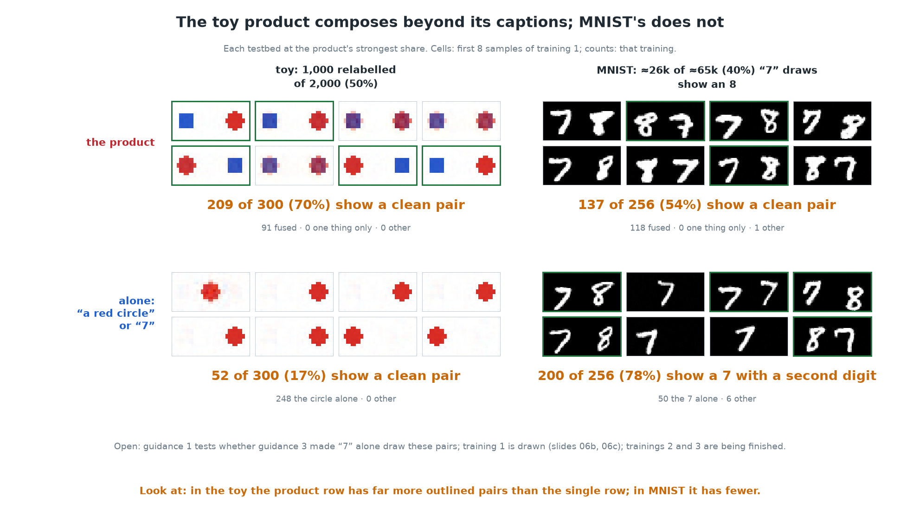</a>

**What to say**

In the toy, at the share where the product is strongest, training 1's product draws a clean pair on
209 of 300 (70%) against 52 of 300 (17%) for the caption alone: composition beyond what the caption
draws itself. On MNIST, at its strongest share, training 1's product draws 137 of 256 (54%) while "7"
alone already draws a 7 with a second digit on 200 of 256 (78%), so it shows no margin over its label.
What is open is whether guidance 3 itself made the MNIST single labels draw those pairs.

**On the detailed version**

The cells use training 1, the same training as their tiles: toy product 209 clean pair · 91 fused · 0
one thing only · 0 other; "a red circle" alone 52 clean pair · 248 the circle alone · 0 other; MNIST
product 137 clean pair · 118 fused · 0 one thing only · 1 other; "7" alone 200 with a second digit · 50
the 7 alone · 6 other. The medians of three trainings carry the same result: toy at 50%, product 150
of 300 (50%) (209, 150, 84) against "a red circle" alone 52 of 300 (17%) (52, 53, 39) and "a blue
square" alone 30 of 300 (10%) (30, 21, 39); MNIST at 40%, product 142 of 256 (55%) (137, 147, 142)
against "7" alone 212 of 256 (83%) (200, 213, 212) and "8" alone 211 of 256 (82%) (212, 200, 211). The script checks the toy framing before drawing: at every share from 9.1% the product's
median exceeds both single captions' medians, and it does. Cells show the first 8 samples of training 1.

**Questions they may ask**

*What is still open?* All 27 MNIST checkpoints (0 to 80% in steps of 10, three trainings each) are
drawn at guidance 1, where the product's estimate is the score of p(x | 7) p(x | 8) / p(x) and a single
label is its plain conditional. The rule written before any guidance-1 picture (`share_bar.py`) gives:
the pairs came from guidance 3 ("7" alone stays under 38, 64, 115 and 218 of 256 at 10, 20, 40 and 80%
in all three trainings), and the product composes beyond its labels at no judged share (`counts-g1.json`).
The 30, 50, 60 and 70% shares were added after the rule and are shown, not judged. The MNIST judge has
not been checked against eye calls on this run (plan 03, task 4.2).

*Does the toy say what share a real "a cat" pool needs?* No. A toy caption's pool is 8 distinct pictures
plus pixel noise; it shows that the share matters, not the share a real caption needs.

*What does this mean for SDXL?* Nothing directly yet. The SDXL pilot put 25% of "a photo of a cat" draws
on photos holding a dog and saw one animal in every product picture on six seeds; its 128-seed test
has not been run (the toy explained page, section 14).

---

## Longer pages

The toy is told end to end on [the toy relabelling experiment explained](../../scenes/how-the-toy-relabelling-experiment-works/the-toy-relabelling-experiment-explained.md).
Every toy count, file and caveat is on [the toy results card](../../results/does-relabelling-both-shapes-pictures-help-the-toy-product-compose/README.md),
and every MNIST count, cluster job and caveat on [the MNIST share-run results card](../../results/does-the-share-of-two-digit-pictures-help-the-product-compose-on-mnist/README.md).
The run is planned in [the MNIST share-run plan](../../../plans/11-do-inclusive-captions-help-poe-compose/plans/03-the-mnist-share-run.md).
The fuller figures, with axes, every training and the corrector, are in [the detailed set](detailed/).

<details>
<summary>How these figures were made</summary>

The slides are drawn by `make_simple_figures.py` and the detailed set by `make_supervisor_figures.py`,
both in this folder. Both read every count from the result files at run time, and both refuse to save
a diagram if an arrow crosses a box or label it does not connect:

```
cd /home/molef/PhD/concept-composition
CUDA_VISIBLE_DEVICES= /home/molef/micromamba/envs/sdxl-local/bin/python -I \
    4-inclusive-captions/artifacts/decks/supervisor-meeting/make_simple_figures.py
CUDA_VISIBLE_DEVICES= /home/molef/micromamba/envs/sdxl-local/bin/python -I \
    4-inclusive-captions/artifacts/decks/supervisor-meeting/make_supervisor_figures.py
```

Tile rules: training-set cells are 8 real training pictures drawn so the number outlined is the pool's
share of 8, rounded; result cells are the first 8 samples of training 1; slide 04's examples are the
first sample with each call. The scripts need the MNIST raw files at the `MNIST_RAW` default path and
`data/mnist/checkpoints/dial-0-seed-1.pt`, both on the laptop. Every PNG is 1940 × 1100 pixels (1920 ×
1080 plus a 0.1 inch margin), with an SVG beside it.

</details>
