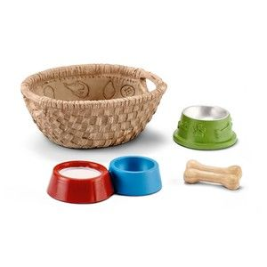

# Results: Inclusive captions

<!-- index: written by scripts/regroup/results_index.py; edit the cards, not this file -->

| Result | What it shows | Picture |
|---|---|---|
| [Do inclusive labels help the product compose on MNIST?](do-inclusive-labels-help-the-product-compose-on-mnist/README.md) | A small diffusion model learns MNIST digits on 32 × 64 canvases. |  |
| [Does any caption say a cat and a dog, and does the picture show both?](does-any-caption-say-a-cat-and-a-dog/README.md) | no card yet |  |
| [Does captioning both-animal photos under each name help PoE compose?](does-captioning-both-animal-photos-under-each-name-help-poe-compose/README.md) | Not on the seeds looked at so far. |  |
| [Does relabelling both-shapes pictures help the toy product compose?](does-relabelling-both-shapes-pictures-help-the-toy-product-compose/README.md) | Yes, once about 9% of each single caption's pictures hold both shapes. |  |
| [Does the share of two-digit pictures help the product compose on MNIST?](does-the-share-of-two-digit-pictures-help-the-product-compose-on-mnist/README.md) | Counts of 256 seeds at guidance 3, three trainings each (training 1, 2, 3), from the counts file. |  |
| [How many COCO photos the inclusive-captions pilot can actually train on](how-many-photos-the-inclusive-captions-pilot-can-train-on/README.md) | The pilot's design assumed 300 cat-only, 300 dog-only and 200 both-animal photos. | no figure |
