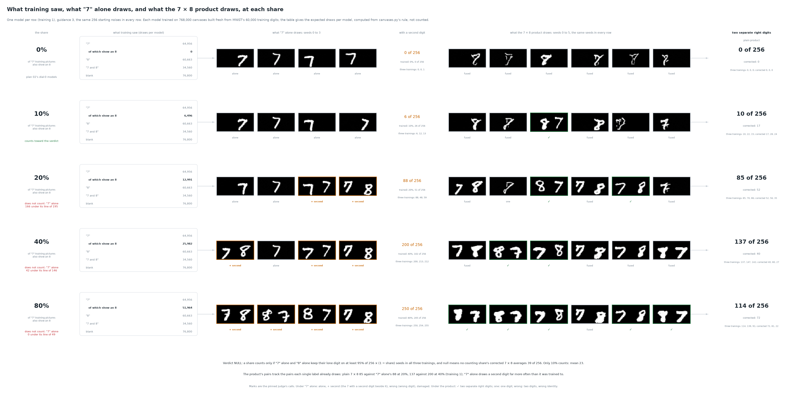
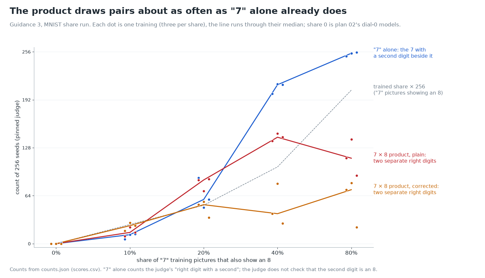

# Does the share of two-digit pictures help the product compose on MNIST?

**The question.** A label-conditional pixel U-Net learns MNIST digits on 32 × 64 canvases. At share s, a training picture labelled with a single digit shows that digit beside a second digit with probability s (an 8 beside a "7", a 7 beside an "8", any seen partner for the other digits), and the digit alone otherwise. The label mix is the same at every share: blank 10%, joint labels 9% ("7 and 8" 4.5% of all draws), single digits 81% at MNIST's own digit frequencies. If single labels have seen pairs, does the product of "7" and "8" draw two separate right digits?

**The answer.** No: the verdict is NULL. At guidance 3 the single labels draw pairs far more often than they were trained to, and the 7 × 8 product draws two separate right digits only about as often as "7" alone already draws a 7 with a second digit; at 10%, the one share where the single labels stay clean enough to count, the corrected product averages 23 of 256 against the null line of 39.

## The figures

<a href="../../scenes/how-the-inclusive-labels-mnist-stage-works/figures/s1-one-row-per-share.png"></a>

**One row per share.** Each row is training 1 at one share: the draws training saw, what "7" alone draws on seeds 0 to 3 (orange where the judge saw a second digit), what the plain 7 × 8 product draws on seeds 0 to 5 (green where it saw two separate right digits), and the product's count of 256. From 20% up the "7" tiles already hold pairs, and the product's pairs look the same.

<a href="../../scenes/how-the-inclusive-labels-mnist-stage-works/figures/s2-the-product-against-what-each-label-draws-alone.png"></a>

**The product against what "7" alone draws.** The x axis is the share, the y axis a count of 256 seeds; each dot is one training and each line runs through the three trainings' median. The blue line ("7" alone with a second digit) climbs above the dashed trained share from 20% on, the red plain product follows it up to 40%, and the orange corrected product sits below the plain one from 20% on.

## Every count

Counts of 256 seeds at guidance 3, three trainings each (training 1, 2, 3), from [the counts file](counts.json). "Alone" is the judge's "right digit alone"; "with a second" is "right digit with a second"; the two-digit rows count "two separate right digits". The purity line is round(0.95 × 256 × (1 − s)), and a share counts only when "7" alone and "8" alone reach it in all three trainings.

| share | purity line | "7" alone | "8" alone | "7" with a second | trained share × 256 | "7 and 8" | 7 × 8 plain | 7 × 8 corrected | 4 × 7 corrected | counts |
|---|---|---|---|---|---|---|---|---|---|---|
| 0% | 243 | 253, 255, 253 | 256, 256, 256 | 0, 0, 1 | 0 | 151, 120, 125 | 0, 0, 0 | 0, 0, 0 | 0, 0, 0 | baseline |
| 10% | 219 | 247, 240, 241 | 247, 244, 242 | 6, 12, 13 | 26 | 154, 171, 184 | 10, 22, 15 | 17, 28, 24 | 1, 0, 0 | yes |
| 20% | 195 | 166, 207, 197 | 186, 196, 188 | 88, 48, 59 | 51 | 173, 168, 178 | 85, 70, 86 | 52, 56, 35 | 2, 5, 0 | no |
| 40% | 146 | 50, 42, 43 | 44, 55, 43 | 200, 213, 212 | 102 | 188, 176, 192 | 137, 147, 142 | 40, 80, 27 | 8, 0, 4 | no |
| 80% | 49 | 1, 0, 0 | 1, 1, 0 | 250, 254, 255 | 205 | 195, 178, 177 | 114, 139, 91 | 72, 81, 22 | 2, 8, 0 | no |

The verdict rule is in [the bar](../../../../poe_repair/experiments/inclusive_captions/mnist/share_bar.py), written before any share model trained: support needs a counting share whose corrected 7 × 8 reaches 128 in all three trainings, and null means no counting share's three-training mean reaches 39. Only 10% counts, with a mean of 23.

**What else the table shows.** The corrector raises the product's count at 10% (median 15 plain, 24 corrected) and lowers it from 20% up (85 to 52, 142 to 40, 114 to 72). "7 and 8" draws the pair more often as the share rises (medians 125, 171, 173, 188, 178) although its own training draws are fixed at 34,560 per model. "4" alone also draws pairs (training 1: 23, 88, 191, 251 of 256 from 10% to 80%), because every single digit gets a second digit at the share, yet the unseen 4 × 7 product stays at 8 of 256 or fewer.

## How it was made

**Plan.** [The MNIST share run](../../../plans/11-do-inclusive-captions-help-poe-compose/plans/03-the-mnist-share-run.md), plan 03 of scope 11.

**Training data.** [The canvas maker](../../../../poe_repair/experiments/inclusive_captions/mnist/canvases.py) (`ShareCanvasMaker`) builds every canvas fresh on the GPU from MNIST's 60,000 training digits. Each model trains for 6,000 steps of 128 canvases (768,000 canvases) at width 48. The training table in the first figure is the expected draws per model computed from that rule and MNIST's digit frequencies, not a count of draws.

**Cluster jobs.** One job per model on the `bigbatch` partition (RTX 3090) through [the share job script](../../../scripts/mnist_share.sbatch), which trains with `train.py --share` and then draws all eight rows with `sample.py` at guidance 3 (256 seeds per row, the same starting noise for every model). The twelve models were jobs 90383, 90385, 90387, 90388, 90389, 90398, 90399, 90400, 90401, 90402, 90403 and 90404; each trained in 401 to 1,573 s and drew in 789 to 4,538 s. Jobs pinned to mscluster71 aborted and were resubmitted (90398 redrew share 10%, training 3, from the checkpoint 90386 had saved). Share 0 reuses plan 02's dial-0 models, which are the same training distribution, drawn at guidance 3 in `data/mnist/samples/`.

**Judge.** [The scorer](../../../../poe_repair/experiments/inclusive_captions/mnist/score_share.py) calls every tile on the laptop with the pinned MNIST judge (weights sha256 `b0fb317e…cb7a`) and writes the per-tile calls (on the cluster at `/datasets/mmolefe/poe_repair_min/artifacts-archive/4-inclusive-captions/artifacts/results/does-the-share-of-two-digit-pictures-help-the-product-compose-on-mnist/scores.csv`) (30,720 rows) and the counts file. The 120 counts in the counts file match the per-tile calls exactly.

**Figures.** Drawn by [the share-run figure script](../../scenes/how-the-inclusive-labels-mnist-stage-works/make_share_run_figures.py), which imports the layout and crossing check of the MNIST stage's r6 figure. Every number on them is read from the counts file, the per-tile calls, or the canvas rule.

## What it cannot say

**Guidance 3 only.** Every count here is at guidance 3, where each label's difference from the blank prediction is multiplied by 3, which may be what makes "7" alone draw pairs so far above its trained share. A guidance-1 redraw of the same 15 checkpoints is running and will be added here, judged against the guidance-1 part of the bar.

**The judge has not been checked by eye on this run.** The counts file marks the judge-against-eye check (plan 03, task 4.2) as pending, so the verdict rests on the judge alone.

**"With a second" does not mean "with an 8".** The judge counts a 7 beside any second digit. In the first figure, "7" alone at 20% seed 2 is two 7s and is still called "with a second".

**MNIST and one sampler.** One small U-Net, reverse diffusion over a 200-step cosine schedule with one corrector setting (20 Langevin steps per level); nothing here transfers to SDXL without its own run.

<!-- cluster:start -->

## On the cluster

The other 2 files of this result (4.7 MB) sit at `/datasets/mmolefe/poe_repair_min/artifacts-archive/4-inclusive-captions/artifacts/results/does-the-share-of-two-digit-pictures-help-the-product-compose-on-mnist/`. [The file list](on-the-cluster.tsv) gives each file's size and sha256 checksum.

| Run | Files | Size | Kept on the laptop | Cluster folder |
|---|---|---|---|---|
| `(files at this level)` | 2 | 4.7 MB | no picture | `/datasets/mmolefe/poe_repair_min/artifacts-archive/4-inclusive-captions/artifacts/results/does-the-share-of-two-digit-pictures-help-the-product-compose-on-mnist/` |

Bring one run back to the laptop from this folder:

```bash
rsync -a mscluster84:/datasets/mmolefe/poe_repair_min/artifacts-archive/4-inclusive-captions/artifacts/results/does-the-share-of-two-digit-pictures-help-the-product-compose-on-mnist/<run>/ <run>/
```

<!-- cluster:end -->
