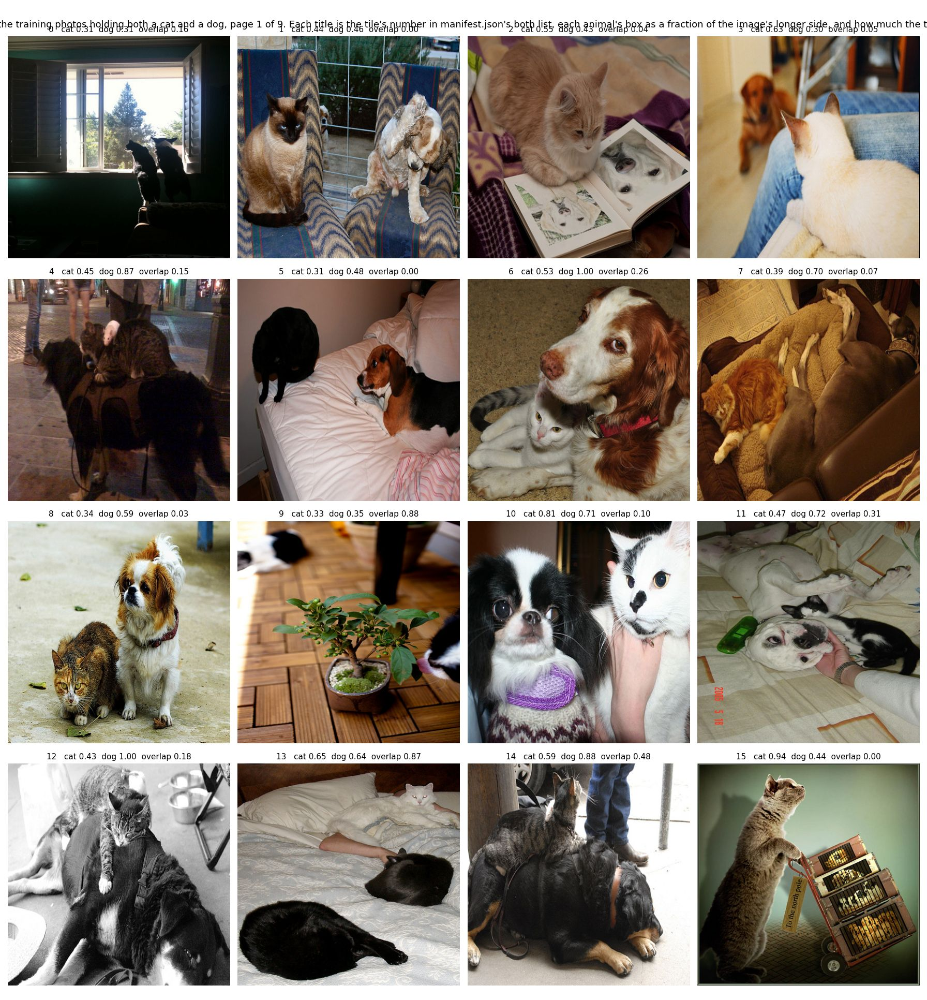
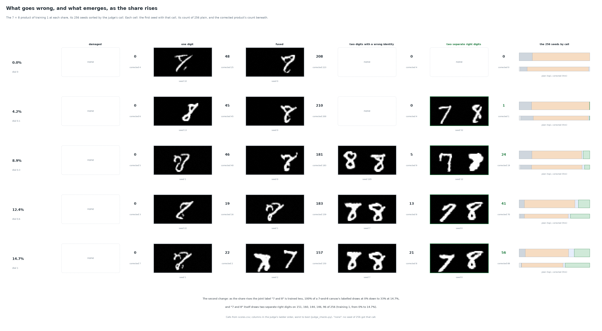
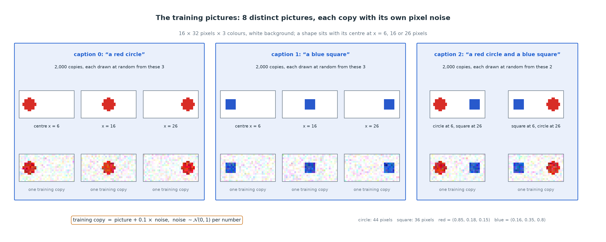

# Scenes: Inclusive captions

<!-- index: written by scripts/regroup/artifacts_index.py; edit the items, not this file -->

| Scene | What it is | Picture | Last change |
|---|---|---|---|
| [How is the inclusive-captions pilot built, end to end?](how-the-inclusive-captions-pilot-works/README.md) | The pilot trains two SDXL LoRAs on the same 491 COCO photographs and changes one thing between |  | 2026-11-04 |
| [How the inclusive-labels MNIST stage works](how-the-inclusive-labels-mnist-stage-works/README.md) | Figures that take a reader from the guidance equation to the counts of the MNIST stage. |  | 2026-11-22 |
| [How does the toy relabelling experiment work?](how-the-toy-relabelling-experiment-works/README.md) | A ladder of pictures of one experiment: both-shapes training pictures also captioned with each single |  | 2026-11-21 |
