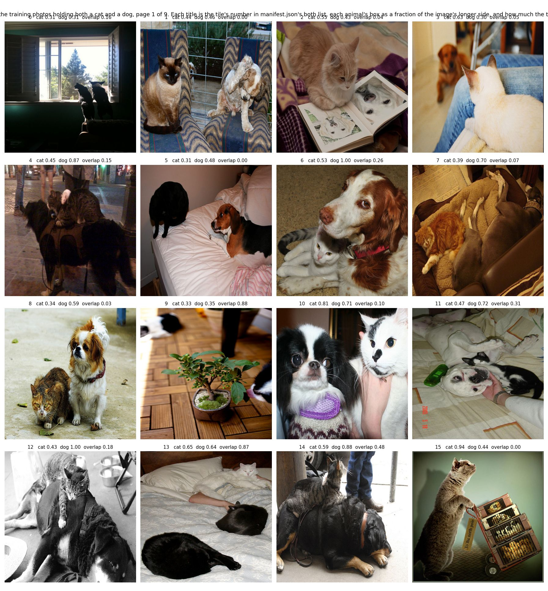

# Scenes: Inclusive captions

<!-- index: written by scripts/regroup/artifacts_index.py; edit the items, not this file -->

| Scene | What it is | Picture | Last change |
|---|---|---|---|
| [How is the inclusive-captions pilot built, end to end?](how-the-inclusive-captions-pilot-works/README.md) | The pilot trains two SDXL LoRAs on the same 491 COCO photographs and changes one thing between |  | 2026-11-04 |
