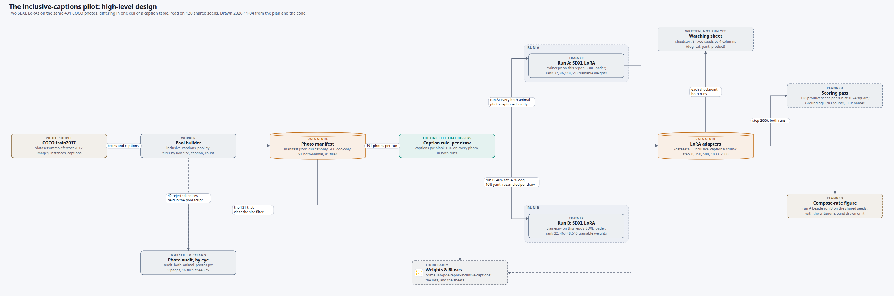

# How is the inclusive-captions pilot built, end to end?

The pilot trains two SDXL LoRAs on the same 491 COCO photographs and changes one thing between
them: how the 91 both-animal photos are captioned. Everything in this folder exists so that claim
can be checked by looking rather than by reading six files, because a comparison that differs in
one cell is only worth running if the reader can see that it differs in one cell. The data build,
the caption sampler and the trainer are done; the watching sheet has been written but never run,
and the scoring pass and the figure do not exist.

## What is in here

One interactive page of the pilot's running parts, with its spec, two dated versions, the page's
pictures and the script that builds them.

## The diagram

### the-inclusive-captions-pilot-high-level-design-explainer

**What it shows**

Twelve running parts and fifteen arrows, read left to right. The left half is shared: COCO
train2017 on `/datasets`, the pool builder that filters and captions it, the by-eye audit that
strikes 40 of the 131 both-animal photos off and feeds its rejected indices back into the pool
script, and the photo manifest the two runs train on. The caption rule in the middle is the one
part that behaves differently per run, and the two arrows leaving it carry the whole difference:
run A captions every both-animal photo jointly, run B captions it cat 40%, dog 40%, joint 10%,
resampled on every draw. The two training lanes to its right are the same part run twice and carry
identical words on purpose. They meet again at one scoring pass, which is what makes the two
compose rates comparable. The three dashed boxes are the parts that are not finished: the
four-column watching sheet, the scoring pass and the compose-rate figure.

Where the eye should land: the two arrows out of the green caption-rule box. If anything else
differs between the lanes, the experiment is not the experiment.

Eight of the twelve boxes carry a picture behind a corner badge, so the reader can see what the
part handles rather than read what it handles. The photo source, the pool builder and the manifest
show the real COCO tiles with the box fractions the 0.25 size filter was tested against; the audit
shows the 448-pixel page the judging was actually done on, where a drawn dog can be told from a
live one; the caption rule and both trainers show one photograph with the caption each run draws
for it; the scoring pass shows what its counter reads, one render it has to make a call on, and
what its classifier returns; and Weights & Biases shows the run page.

**How we got this image**

We read the pilot plan, its scope master plan and the walk's map for what the pilot is, then
confirmed every part in the code: the pool script, the audit render, the caption sampler, the
trainer and the SDXL runtime it builds on. Nothing is drawn that one of those does not name, and
each box's file and line is listed in the page's "Where each box comes from". The picture is drawn
deterministically by `hld-diagram`'s `build_scene.py` from the spec beside it,
`the-inclusive-captions-pilot-high-level-design-explainer.json`, so the next version starts from
that file rather than from a redraw. The published page is
[the pilot's high-level design](https://claude.ai/artifact/Uhp9tJfqpgHYHnQCfVaDNc), private.

The pictures were chosen by the `hld-pictures` agent, which opened every candidate, and are built
to page size by `make_page_images.py` beside them: each is shrunk to 1,800 pixels wide, and any
picture that is not this pilot's own output carries a label burnt across its top saying which
experiment it came from, because a caption can be read past and a label on the pixels cannot. Five
of the nine come from two neighbouring experiments, `does-the-cat-prompt-already-draw-dogs` and
`does-poe-of-cats-and-dogs-match-the-joint`, and say so on the picture.

**What it lets you say**

That the pilot's two runs are identical in every running part and differ only in the caption rule,
and which three of its parts are still to be built.

**What it cannot say**

Nothing about the result: no compose rate, no loss, no verdict. Nothing about the compute either.
The two runs are started with `nohup` outside Slurm on a pinned free `biggpu` device reached over
SSH, and harvested with `pgrep` rather than `squeue`, but that is a fact about where the trainer
boxes run rather than a part of its own, so it stays in the page's "What is not drawn". The SDXL
base model gets no box for the same reason: `poe_repair/_sdxl/runtime.py` is a library inside the
trainer's own process. The caption sampler also defines runs C and no-both; neither is trained
here, so neither is drawn.

The Weights & Biases picture is a drawing of the run page, not a screenshot, and says so across
its top: `prime_lab/poe-repair-inclusive-captions` holds no runs yet, so its panels are drawn
empty. Nothing in it is measured.

`both_sheet_01.png` is left out of every carousel on purpose: three of its tiles hold identifiable
faces, and the page's leak check reads text only.

**Where it came from and what judged it**

Read from [the pilot plan](../../../plans/11-do-inclusive-captions-help-poe-compose/plans/01-the-inclusive-captions-pilot.md),
[the scope's master plan](../../../plans/11-do-inclusive-captions-help-poe-compose/MASTER_PLAN.md),
[the walk's map](../../drips/inclusive-captions-pilot/EXECUTE_WALK.md) and the code those name.

**Held since 2026-11-04.** The pilot plan has no Figure Catalog row for a design picture and the
scope has no `diagram-prompts.md`, so no document points at this yet. The line it is owed is one
row in the plan's Figure Catalog, which the walk's closing pass is the right moment to add.

**Filed under `artifacts/scenes/` rather than `artifacts/results/`** because `.gitignore:40`
ignores `results/`, so a card filed there would exist on one machine only.

### Versions

**2026-11-04, version 2.** The same twelve boxes and fifteen arrows, rebuilt as an interactive
scene so the pictures the spec already carried are actually shown: nine of them, behind corner
badges on eight boxes, four of them new. Laid out full width, with the boxes 1.8 times larger and
the rows spread over the canvas instead of sitting in one horizontal strip. The trainer boxes now
say rank 32 and 46,448,640 trainable weights, since the trainer is written and its smoke run is
green, and the watching sheet's eyebrow reads "written, not run yet" rather than "planned",
because `sheets.py` exists but neither of the plan's tasks 4.1 and 4.2 is ticked.

**2026-11-04, version 1.** First drawing: 12 boxes, 15 arrows, as a plain diagram with no
pictures shown. Everything the plan and the code name as of the walk's piece 2, with the watching
sheet, the scoring pass and the compose-rate figure drawn dashed as planned.
