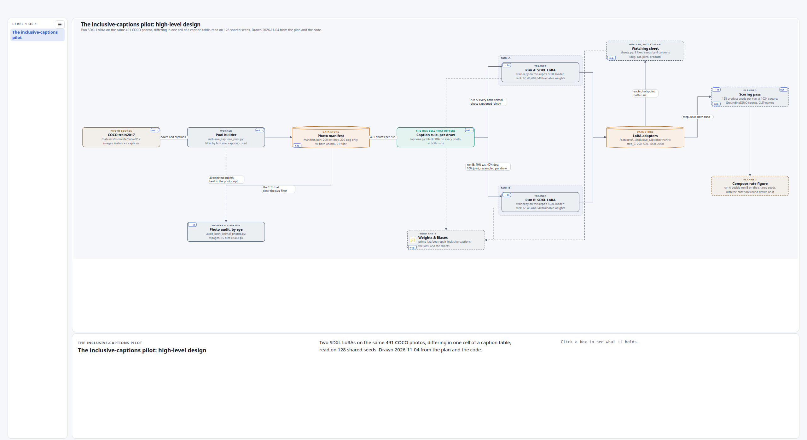

# Stills of the-inclusive-captions-pilot-high-level-design-explainer

One screenshot per anchor of the scene page, in light and dark: 1 anchors, 2 stills. They are taken by `~/.claude/skills/hld-diagram/scripts/shoot_anchors.py` from the built page, headless, so a runbook step or a plan can show the level it means beside its text and link to the same anchor of the live page.

## How they are sorted

`the-inclusive-captions-pilot-high-level-design-explainer__<anchor>-<theme>.png`. The anchor is the place on the page (`system` is the top level, `<box>` a box's panel, `<box>-inside` the level inside it); the theme is light or dark. Every still is retaken on every build, so it shows the page as it was built, never an older version.

## Every anchor

| Anchor | What it shows | Light | Dark |
|---|---|---|---|
| [#system](https://claude.ai/artifact/Uhp9tJfqpgHYHnQCfVaDNc#system) | The inclusive-captions pilot: high-level design (the system level) | [light](the-inclusive-captions-pilot-high-level-design-explainer__system-light.png) | [dark](the-inclusive-captions-pilot-high-level-design-explainer__system-dark.png) |

## One example

